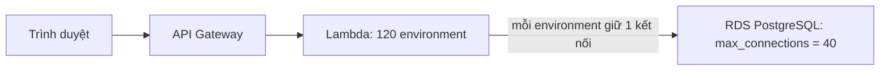

# L01: Một request đi qua những dịch vụ nào, và vì sao tăng Lambda làm nghẽn RDS

> **Trạng thái:** bản viết lại đủ bảy bước, nằm ngoài `src/`. Chưa nối vào app, chưa đo với người đọc thứ hai.
> **Số liệu:** mọi con số trong bài là giả định của kịch bản, được ghi "Giả sử" ở chỗ dùng. Không phải số đo từ hệ thống thật, không phải mặc định của AWS hay PostgreSQL.

**Tiên quyết:** biết HTTP ở mức request và response; biết một API trả về JSON; biết PostgreSQL có giới hạn số kết nối.

## Bước 1. Đoán trước

Giả sử endpoint đăng ký upload nhận 200 request mỗi giây. Mỗi lần gọi Lambda mất 0,6 giây. Giả sử mỗi environment của Lambda giữ một kết nối tới RDS, và RDS chỉ nhận tối đa 40 kết nối.

Trước khi đọc tiếp, trả lời hai câu:

1. Có bao nhiêu lần gọi chạy cùng lúc?
2. Có bao nhiêu lần gọi không có kết nối?

Viết đáp án ra giấy. Đáp án nằm ở cuối bước 3.

## Bước 2. Điều bạn đã biết

Bạn đã từng chạy một API trên một máy. API đó mở vài kết nối tới PostgreSQL, và các request dùng chung một pool. Khi số kết nối vượt `max_connections`, PostgreSQL trả về `FATAL: sorry, too many clients already`.

Bài này giữ nguyên chuỗi đó và thay từng khớp bằng một dịch vụ AWS:

- API Gateway nhận HTTPS và gọi Lambda.
- Lambda chạy code của bạn.
- RDS PostgreSQL giữ dữ liệu.

Khác biệt cần nhớ: trên một máy, nhiều request dùng chung một tiến trình và một pool. Trên Lambda, mỗi lần gọi đang chạy có một execution environment riêng.

## Bước 3. Một ví dụ có số

Giả sử endpoint nhận 200 request mỗi giây, mỗi lần gọi Lambda mất 0,6 giây.

Mỗi giây có 200 request mới. Mỗi request chiếm một environment trong 0,6 giây. Số lần gọi chạy cùng lúc là 200 × 0,6 = 120. Lambda gọi phép tính này là concurrency: số request mỗi giây nhân thời gian của một request.

Giả sử code mở kết nối ngoài handler, và mỗi environment giữ lại kết nối đó cho các lần gọi sau. Khi đó 120 environment cần 120 kết nối.

Giả sử RDS đặt `max_connections = 40`. RDS chỉ cấp 40 kết nối, nên 120 − 40 = 80 lần gọi không có kết nối. Chúng phải chờ hoặc nhận lỗi.

**Đáp án bước 1:** 120 lần gọi chạy cùng lúc; 80 lần gọi không có kết nối.

## Bước 4. Cơ chế, từng bước một



1. **Mỗi request đồng thời có một environment.** API Gateway chuyển request sang Lambda. Khi các environment có sẵn đều đang bận, Lambda tạo thêm. Một environment chỉ xử lý một request tại một thời điểm.
2. **Environment được tái dùng, nên kết nối mở ngoài handler sống tiếp.** Code ngoài handler chạy một lần khi environment khởi tạo. Environment được giữ lại (gọi là warm) cho các lần gọi sau, và kết nối mở ở đó vẫn còn. API Gateway không mở kết nối tới RDS, nên khớp này không đụng trần.
3. **Trần của RDS cố định ở cuối chuỗi.** 120 environment đòi 120 kết nối, trần là 40. Số kết nối không tự nới theo lưu lượng; nó đổi khi bạn đổi tham số hoặc kích cỡ instance. [INFERENCE: chưa đọc trang tham số RDS trong phiên này.]
4. **Chờ làm concurrency tăng.** Lần gọi phải chờ kết nối thì chạy lâu hơn. Concurrency bằng số request mỗi giây nhân thời gian mỗi lần gọi, nên thời gian tăng kéo theo số environment cần tăng. Thêm environment lại đòi thêm kết nối, nên chờ tiếp. Đây là vòng tự đẩy.
5. **Có hai cách đặt trần, và cả hai đều có cái giá.**
   - Reserved concurrency đặt số environment tối đa cho hàm. Request vượt trần bị throttle ở Lambda thay vì đè lên RDS. Cái giá: phần concurrency đã dành không dùng được cho hàm khác, kể cả khi hàm không dùng hết.
   - RDS Proxy giữ một bể kết nối thật và xếp hàng hoặc từ chối phần vượt. Cái giá: một khớp phải cấu hình và theo dõi, có phí theo kích cỡ instance [INFERENCE: chưa đọc trang giá RDS Proxy]. Proxy không tăng năng lực truy vấn của instance [INFERENCE: tài liệu không nói rõ].

**Multi-AZ là chuyện khác.** Multi-AZ không giải bài toán trần kết nối. Multi-AZ DB instance có một standby đồng bộ ở AZ khác, và standby không phục vụ đọc. Khi failover, RDS đổi bản ghi DNS sang standby. Thời gian thường 60–120 giây, và kết nối đang mở phải mở lại. Proxy không tạo standby. Standby do Multi-AZ tạo; proxy có thể giữ kết nối phía ứng dụng và nối lại tới standby.

## Bước 5. Thí nghiệm nhỏ

Chạy trong thư mục `lessons/01-aws/l01/`. Script chỉ dùng thư viện chuẩn của Python 3. Nếu lệnh `python` không có trong PATH, gọi bằng đường dẫn tới Python 3 trên máy bạn.

```
python little_law.py --rps 200 --wall 0.6 --max-conn 40
```

Kết quả đã chạy trên máy này:

```
Giả định: 200 request/s, mỗi lần gọi 0.6 s, RDS max_connections = 40
Environment cần (rps x W):              120
Kết nối cần (mỗi environment ấm giữ 1): 120
Lần gọi không có kết nối:              80
Vượt trần: mỗi environment ấm giữ một kết nối, nên tăng Lambda là tăng kết nối; lần gọi dư phải chờ hoặc lỗi.
```

Đổi thời gian mỗi lần gọi thành 0,2 giây:

```
python little_law.py --rps 200 --wall 0.2 --max-conn 40
```

```
Giả định: 200 request/s, mỗi lần gọi 0.2 s, RDS max_connections = 40
Environment cần (rps x W):              40
Kết nối cần (mỗi environment ấm giữ 1): 40
Lần gọi không có kết nối:              0
Vừa khít trần: không còn chỗ cho kết nối vận hành hay lưu lượng tăng thêm.
```

Số environment đúng bằng trần, nên không còn chỗ dự phòng.

**Tự thử:** giữ `--wall 0.2`, đổi `--rps` thành 210. Có bao nhiêu environment, và bao nhiêu lần gọi không có kết nối?

## Bước 6. Bốn câu luyện tập

Trả lời trước khi mở đáp án.

**Câu 1.** Vì sao mỗi environment Lambda có thể giữ một kết nối riêng, còn trên một máy chủ nhiều request dùng chung một pool?

<details>
<summary>Đáp án</summary>

Kết luận: environment là một môi trường cô lập được tái dùng, không phải một request. Kết nối mở ngoài handler sống qua các lần gọi trên cùng environment, và không dùng chung với environment khác. Trên một máy chủ, một tiến trình phục vụ nhiều request nên một pool là đủ.

Điều kiện để đúng: kết nối mở ngoài handler. Nếu mở trong handler, mỗi lần gọi mở một kết nối mới.

Cách kiểm: in id của kết nối vào log. Nếu id giữ nguyên giữa hai lần gọi liên tiếp trên cùng environment, kết nối đang được tái dùng.

</details>

**Câu 2.** Cho một cách đặt trần để việc tăng Lambda không đè bẹp RDS.

<details>
<summary>Đáp án</summary>

Kết luận: đặt trần ở phía Lambda, hoặc đặt một khớp gom kết nối. Cả hai phải cho ra số kết nối nhỏ hơn số kết nối RDS còn chỗ.

Cách một: reserved concurrency đặt thấp hơn số kết nối còn chỗ, để Lambda throttle trước khi RDS phải từ chối. Cách hai: RDS Proxy giữ bể kết nối thật và xếp hàng phần vượt.

Điều kiện để đúng: bạn phải biết `max_connections` và số kết nối các thành phần khác đang giữ.

Cách kiểm: khi lưu lượng vượt trần, lỗi chuyển từ "too many clients" của RDS sang throttle của Lambda hoặc độ trễ xếp hàng ở proxy, còn số kết nối RDS phẳng.

</details>

**Câu 3.** Giả sử AZ chứa primary mất điện đúng lúc 120 environment đang giữ kết nối. Client thấy gì?

<details>
<summary>Đáp án</summary>

Kết luận: Multi-AZ chuyển sang standby, RDS đổi bản ghi DNS, và các kết nối đang mở phải mở lại.

Failover thường mất 60–120 giây, lâu hơn nếu có transaction lớn hoặc quá trình phục hồi dài. Trong khoảng đó client nhận lỗi kết nối. Sau đó client phải phân giải lại tên miền. Tiến trình giữ cache DNS lâu, ví dụ JVM có TTL dài, sẽ còn gọi địa chỉ cũ.

Nếu không có proxy, 120 environment cùng mở lại kết nối có thể đụng trần lần nữa [INFERENCE]. Nếu có proxy, kết nối từ ứng dụng tới proxy có thể được giữ, và proxy nối lại tới standby.

Điều kiện để đúng: RDS phải là Multi-AZ. Single-AZ không có standby để chuyển.

Cách kiểm: RDS event log có sự kiện failover kèm lý do. Log ứng dụng có một cụm lỗi kết nối rồi hết.

</details>

**Câu 4.** Đặt RDS Proxy rồi, còn trường hợp nào vẫn nghẽn?

<details>
<summary>Đáp án</summary>

Kết luận: còn. Proxy giải bài toán số kết nối. Theo tài liệu, nó tránh chi phí bộ nhớ và CPU khi mở kết nối mới. Tài liệu không nói proxy làm truy vấn nhanh hơn. [INFERENCE: proxy chỉ xếp hàng hoặc từ chối phần vượt, không chạy truy vấn thay instance.]

Nếu nút thắt là truy vấn thiếu index hoặc ổ đĩa chậm, proxy chỉ làm hàng đợi dài hơn và p99 vẫn cao. Proxy cũng từ chối kết nối khi vượt hạn mức, nên ứng dụng vẫn phải xử lý lỗi đó. Proxy không tạo standby: nếu RDS là Single-AZ, mất AZ đó vẫn là mất.

Điều kiện để đúng: số kết nối đúng là nút thắt.

Cách kiểm: sau khi đặt proxy, số kết nối RDS phẳng nhưng CPU hoặc độ trễ truy vấn vẫn cao. Lúc đó nút thắt đã chuyển sang chỗ khác.

</details>

## Bước 7. Câu neo

> Lambda co giãn theo số request đồng thời. RDS đổi số kết nối khi bạn đổi cấu hình. Thêm Lambda khi trần kết nối đã chạm chỉ làm hàng đợi dài hơn.

## Ghi chú nguồn

<details>
<summary>Ghi chú nguồn, đọc ngày 2026-10-29</summary>

- Concurrency và công thức: https://docs.aws.amazon.com/lambda/latest/dg/lambda-concurrency.html
- Reserved concurrency, throttle, không tính phí: https://docs.aws.amazon.com/lambda/latest/dg/configuration-concurrency.html
- Vòng đời environment, khởi tạo ngoài handler, tái dùng: https://docs.aws.amazon.com/lambda/latest/dg/lambda-runtime-environment.html
- Lambda với RDS, khuyến nghị dùng proxy: https://docs.aws.amazon.com/lambda/latest/dg/services-rds.html
- RDS Proxy, hàng đợi, từ chối kết nối, giữ kết nối khi chuyển standby: https://docs.aws.amazon.com/AmazonRDS/latest/UserGuide/rds-proxy.html
- Multi-AZ DB instance, standby không phục vụ đọc: https://docs.aws.amazon.com/AmazonRDS/latest/UserGuide/Concepts.MultiAZSingleStandby.html
- Failover, 60–120 giây, đổi DNS: https://docs.aws.amazon.com/AmazonRDS/latest/UserGuide/Concepts.MultiAZ.Failover.html

Chưa kiểm trong bài này: `max_connections` mặc định của RDS; trang tham số RDS; chi tiết hành vi của API Gateway. Số liệu trong bài là kịch bản.

</details>
