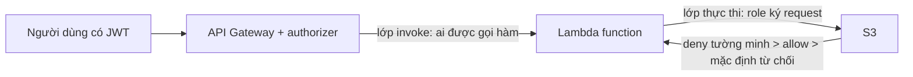

# L02: Ai được gọi Lambda, và Lambda được phép làm gì

> **Trạng thái:** bản đủ bảy bước, nằm ngoài `src/`. Chưa nối vào `Lesson.vue`, chưa qua Goldfish, chưa đo với người đọc thứ hai.
> **Số liệu:** mọi con số trong bài là giả định của kịch bản, được ghi "Giả sử" ở chỗ dùng. Không phải số đo từ hệ thống thật, không phải mặc định của AWS.

**Tiên quyết:** biết HTTP ở mức request và response; biết một API trả JSON; biết trên một máy, tiến trình chạy dưới một user và user đó quyết định nó ghi được file nào.

## Bước 1. Đoán trước

Giả sử execution role của một hàm Lambda hiện chỉ có `s3:PutObject` trên `arn:aws:s3:::uploads-staging/*`. Hàm đang chạy tốt. Bạn thêm một nhánh ghi vào bucket `uploads-prod` bằng đúng client boto3 đó.

Trả lời bốn câu trước khi đọc tiếp:

1. Lần ghi vào `uploads-prod` trả gì, và principal trong lỗi là ai?
2. Nếu thay vì sửa `Resource` bạn cấp `s3:*` trên `*` thì được gì và mất gì?
3. Nếu bạn cấp thêm quyền S3 cho **người dùng đang gọi API** thì lỗi có hết không?
4. Nếu hàm này được **một hàm khác** gọi, phải sửa chính sách nào?

Viết đáp án ra giấy. Đáp án nằm ở cuối bước 3.

## Bước 2. Điều bạn đã biết

Bạn đã từng chạy một API trên một máy. Tiến trình chạy dưới một user của hệ điều hành. User đó ghi được file vì quyền của file cho phép, không phải vì người gọi HTTP đã đăng nhập.

Bài này giữ nguyên chuỗi đó và thay từng khớp bằng một khớp của AWS:

- Tiến trình trên máy → **execution environment** của Lambda (môi trường cô lập chạy code của bạn).
- User của hệ điều hành → **execution role** (role mà Lambda đảm nhận khi chạy hàm).
- Quyền trên file → **policy** gắn trên role.
- Người gọi HTTP đã đăng nhập → người dùng cuối, chỉ đứng ở cửa vào.

Khác biệt cần nhớ: trên một máy, user của tiến trình là thứ duy nhất quyết định quyền file. Trên Lambda có **hai** lần kiểm tra ở hai thời điểm khác nhau, và một lần cho qua không kéo theo lần kia cho qua.

## Bước 3. Một ví dụ có số

Giả sử một endpoint `POST /files` chạy sau API Gateway có JWT authorizer (bộ kiểm token ở cửa vào). Người dùng đã đăng nhập, token còn hạn. Hàm nhận event rồi gọi S3 `PutObject` ghi một file nhỏ vào `uploads-staging`.

Giả sử ba ngày trước mọi thứ chạy bình thường. Sáng nay **100 phần trăm** request nhận 500. Log của hàm có đúng một dòng:

```
User: arn:aws:sts::111122223333:assumed-role/upload-api-role/upload-api-role
is not authorized to perform: s3:PutObject on resource:
"arn:aws:s3:::uploads-staging/file-001.txt"
because no identity-based policy allows the s3:PutObject action
```

Đọc dòng đó theo ba trường:

| Trường | Giá trị trong ví dụ | Nói lên điều gì |
|---|---|---|
| principal | `assumed-role/upload-api-role` | bên ký request là **role**, không phải người dùng |
| action | `s3:PutObject` | hành động bị từ chối |
| resource | `arn:aws:s3:::uploads-staging/file-001.txt` | tài nguyên mà policy không phủ tới |

Giả sử cùng lúc đó một script nội bộ gọi thẳng hàm bằng SDK nhận 403 **ngay ở bước invoke**, trước khi hàm chạy và trước khi có bất kỳ dòng log nào của hàm. Hai lỗi cùng là 403, nhưng rơi vào hai chỗ khác nhau của chuỗi. Đó là toàn bộ bài này.

Giả sử đội xử lý theo phản xạ: gắn `AdministratorAccess` cho role. Lỗi biến mất trong vài giây. Cái giá: role đó giờ đọc được mọi bucket, xoá được bảng, và vì không còn dòng `AccessDenied` nào, nhóm mất luôn tín hiệu duy nhất từng cho biết code gọi ra ngoài phạm vi dự kiến.

**Đáp án bước 1:**

1. S3 từ chối; principal là `assumed-role/...`, action `s3:PutObject`, resource là ARN của bucket prod. Người dùng không xuất hiện vì họ không ký request này.
2. Được: lỗi biến mất ngay. Mất: role ghi và xoá được mọi bucket của tài khoản, và log mất khả năng cho biết hành động nào là hành động dự kiến.
3. Không hết. Quyền của người dùng chỉ ảnh hưởng bước gọi API và bước invoke; khi hàm chạy, boto3 ký bằng credential tạm của role.
4. Phải sửa **lớp invoke**: resource-based policy trên hàm đích, hoặc một quyền tương ứng trên role của hàm gọi.

## Bước 4. Cơ chế, từng bước một



1. **Lớp invoke — ai được gọi hàm.** Trước khi có tiến trình nào, AWS kiểm tra bên gọi có quyền `lambda:InvokeFunction` trên hàm này hay không. Quyền đó đến từ hai nơi: identity policy của bên gọi, hoặc resource policy gắn trên chính hàm. Với một dịch vụ AWS gọi hàm, tài liệu Lambda nói Lambda chỉ xét resource-based policy. Authorizer chỉ chứng minh người dùng là ai; nó không cấp quyền gọi hàm và không cấp quyền cho hàm.
2. **Lớp thực thi — hàm được chạm vào gì.** Khi hàm chạy, Lambda đảm nhận execution role và cấp credential tạm cho tiến trình. Mọi SDK trong code ký request bằng credential đó, nên principal trong mọi lỗi quyền là role. Đây là lý do câu 3 ở bước 1 trả lời "không".
3. **IAM quyết định theo thứ tự cố định.** Mặc định mọi request bị từ chối. Bộ đánh giá tìm `Deny` tường minh trước; gặp một cái là kết luận `Deny`, không xét tiếp. Không có `Deny` thì phải có `Allow` ở đâu đó mới được phép; không có `Allow` nào thì rơi về từ chối mặc định (implicit deny). Trong cùng một tài khoản, quyền hiệu lực là **hợp** của identity policy và resource policy.
4. **Trust policy khác permission policy.** Một role có hai tài liệu. Trust policy trả lời "ai được đảm nhận role này" — nó là resource-based policy gắn trên role. Permission policy trả lời "đã đảm nhận rồi thì làm được gì". Lambda cần trust policy cho service principal của Lambda để đảm nhận role; nếu thiếu, hàm không chạy được dù permission policy đầy đủ.
5. **Đọc lỗi theo ba trường, sửa đúng một chỗ.** Principal lạ → xem role. Action lạ → code gọi ra ngoài phạm vi. Resource lạ → ARN trong policy không khớp ARN thật (đổi tên bucket, sai tiền tố, sai vùng). Lệch ở đâu sửa ở đó.
6. **Role tối thiểu: một action, một ARN.** Chọn `s3:PutObject` thay vì `s3:*`; chọn `arn:aws:s3:::uploads-staging/*` thay vì `*`. Cái giá là mỗi lần thêm tài nguyên bạn phải sửa policy cùng lúc với code — và chính việc phải sửa đó là dấu hiệu tốt.
7. **Ranh giới IAM không làm hộ.** IAM không biết bản ghi nào thuộc người dùng nào. Quyền của role chỉ nói hàm chạm được bảng; việc chỉ trả dữ liệu của đúng người gọi vẫn là một câu `WHERE` trong code.

Hai lớp này không thay thế nhau vì chúng chạy ở hai thời điểm: lớp invoke chạy khi chưa có tiến trình, lớp role chạy sau khi code đã bắt đầu. Vì vậy một lỗi 403 không kèm log của hàm **không thể** là lỗi role.

## Bước 5. Thí nghiệm nhỏ

Máy này không có quyền gọi AWS, nên thí nghiệm là một **mô hình** bộ đánh giá policy viết bằng thư viện chuẩn của Python 3. Nó chỉ cài đúng ba luật: deny tường minh thắng, không có deny thì cần allow, không có allow thì từ chối. Nó **không phải** bộ đánh giá thật của IAM: bộ thật còn xét SCP, permissions boundary, session policy, điều kiện, và chủ sở hữu chéo tài khoản.

Chạy trong thư mục `lessons/01-aws/l02/`. Nếu máy không có `python` trong PATH thì gọi bằng đường dẫn đầy đủ tới Python 3.

```
python iam_eval.py
```

Kết quả đã chạy trên máy này:

```
Principal trong mọi request dưới đây: arn:aws:iam::111122223333:role/upload-api-role
(Lambda đã đảm nhận role, nên boto3 ký bằng credential tạm của role.)

Execution role tối thiểu dùng cho tổ hợp 1 và 2:
{
  "Statement": [
    {
      "Effect": "Allow",
      "Action": [
        "s3:PutObject"
      ],
      "Resource": [
        "arn:aws:s3:::uploads-staging/*"
      ]
    }
  ]
}

--------------------------------------------------------------------------
1. identity allow, không có deny ở đâu
  s3:PutObject     arn:aws:s3:::uploads-staging/bao-cao.csv
                   -> Allow: có Allow ở identity policy hoặc resource policy
  s3:DeleteObject  arn:aws:s3:::uploads-staging/bao-cao.csv
                   -> Deny: không policy nào allow, nên mặc định từ chối
--------------------------------------------------------------------------
2. identity allow, nhưng có explicit deny
  s3:PutObject     arn:aws:s3:::uploads-staging/bao-cao.csv
                   -> Deny: có explicit deny, thắng mọi allow
--------------------------------------------------------------------------
3. identity không allow, resource policy allow
  s3:PutObject     arn:aws:s3:::uploads-staging/bao-cao.csv
                   -> Allow: có Allow ở identity policy hoặc resource policy
--------------------------------------------------------------------------
4. không allow ở đâu cả
  s3:PutObject     arn:aws:s3:::uploads-prod/bao-cao.csv
                   -> Deny: không policy nào allow, nên mặc định từ chối
--------------------------------------------------------------------------

Tổ hợp 1 có hai request: cái đầu được phép, cái sau bị từ chối.
Đó là dấu hiệu role chỉ mở đúng một action, không mở cả họ s3:*.
```

Bốn tổ hợp tương ứng bốn câu trả lời khác nhau, và chúng khớp với thứ tự IAM dùng:

- Tổ hợp 1: có allow, không có deny → cho qua. Request thứ hai trong cùng tổ hợp (`s3:DeleteObject`) bị từ chối **dù cùng bucket**, vì policy chỉ liệt kê `s3:PutObject`. Đây là bằng chứng role tối thiểu hoạt động.
- Tổ hợp 2: allow và deny cùng tồn tại → deny thắng. Trong IAM thật, kết quả này không phụ thuộc policy nào được viết trước.
- Tổ hợp 3: identity policy rỗng, chỉ có bucket policy allow → cho qua. Trong cùng tài khoản, quyền hiệu lực là hợp của hai loại policy.
- Tổ hợp 4: không có allow ở đâu → từ chối, và lý do là "mặc định", không phải "bị cấm".

**Tự thử:** sửa `MINIMAL_ROLE_POLICY` thành `"Action": ["s3:*"]` rồi chạy lại. Tổ hợp 1 sẽ cho qua cả `s3:DeleteObject`. Đó chính là cái mất ở câu 2 bước 1, nhìn thấy được bằng mắt.

## Bước 6. Bốn câu luyện tập

Trả lời trước khi mở đáp án.

**Câu 1.** Hai lớp quyền kiểm tra hai hành động nào, và vì sao một lớp cho qua không kéo theo lớp kia cho qua?

<details>
<summary>Đáp án</summary>

Kết luận: lớp invoke trả lời ai được gọi hàm, lớp execution role trả lời hàm được gọi cái gì. Lớp invoke chạy trước khi có tiến trình, nên bị chặn ở đó thì không có log của hàm; lớp role chỉ có hiệu lực sau khi code đã chạy.

Điều kiện để đúng: bạn phân biệt được lỗi có kèm log của hàm hay không. Có log hàm mà vẫn `AccessDenied` là lỗi role; 403 mà không có dòng log nào là lỗi lớp invoke.

Cách kiểm: gọi hàm trực tiếp bằng SDK và xem có log của hàm hay không; sau đó đối chiếu principal trong lỗi — `assumed-role` nghĩa là role đã ký, nên lỗi nằm ở lớp thực thi.

</details>

**Câu 2.** Viết một execution role chỉ mở đúng một thao tác ghi S3, và nói cách chứng minh nó đúng là tối thiểu.

<details>
<summary>Đáp án</summary>

Kết luận: một `Allow` với `Action: ["s3:PutObject"]` và `Resource: ["arn:aws:s3:::uploads-staging/*"]`, cộng quyền ghi log nếu hàm cần log.

Điều kiện để đúng: bạn biết chính xác bucket và tiền tố mà code dựng ra. Nếu code dựng đường dẫn động thì ARN phải phủ đúng tập tiền tố đó, không rộng hơn.

Cách kiểm: gọi một thao tác ngoài phạm vi, ví dụ `s3:DeleteObject` trên cùng bucket, và phải nhận `AccessDenied` với đúng action đó. Trong bài này, tổ hợp 1 của thí nghiệm in ra đúng cặp kết quả đó.

</details>

**Câu 3.** Người dùng đã đăng nhập và token còn hạn. Vì sao vẫn không đủ để hàm ghi được S3?

<details>
<summary>Đáp án</summary>

Kết luận: vì người dùng không phải bên ký request tới S3. Khi hàm chạy, boto3 ký bằng credential tạm của execution role, nên quyền được xét là quyền của role.

Điều kiện để đúng: code dùng credential do môi trường cấp (không nhúng access key của người dùng vào biến môi trường). Nếu bạn nhúng key của người dùng thì kết luận này không còn đúng — và đó là một lỗi bảo mật khác.

Cách kiểm: đọc principal trong dòng `AccessDenied`. Nếu là `assumed-role/<tên-role>` thì người dùng không tham gia vào lời gọi đó.

</details>

**Câu 4.** Có trường hợp nào role đúng mà vẫn không ghi được S3?

<details>
<summary>Đáp án</summary>

Kết luận: có. Khi bucket thuộc tài khoản khác, bucket policy cũng phải cho phép, nên role đúng vẫn nhận `AccessDenied`. Một `Deny` tường minh trong bucket policy cũng chặn được dù identity policy có `Allow`: ví dụ điều kiện `aws:SecureTransport` bằng `false`, hoặc điều kiện VPC endpoint. Và nếu code dựng ARN sai — sai tên bucket, sai vùng — thì policy đúng vẫn không khớp tài nguyên.

Chặn truy cập công khai (Block Public Access) không nằm trong danh sách này: nó chặn truy cập công khai, không chặn principal đã xác thực trong cùng tài khoản, nên role có `Allow` vẫn ghi được dù bucket bật nó. Điều kiện TLS cũng chỉ chặn khi client gửi bằng `http`; endpoint S3 mặc định là HTTPS nên trường hợp đó hiếm.

Điều kiện để đúng: principal trong lỗi đúng là role của hàm, action đúng là action bạn định gọi, và resource đúng là tài nguyên bạn định chạm.

Cách kiểm: đối chiếu ba trường đó với nội dung policy trước khi sửa bất cứ dòng nào; nếu resource trong lỗi khác ARN trong policy thì sửa ARN, không sửa action.

</details>

## Bước 7. Câu neo

> Qua cửa xác thực chỉ chứng minh người dùng là ai; quyền ghi S3 do execution role quyết định, và role đó chỉ nên mở đúng một action trên đúng một ARN.

## Ghi chú nguồn

<details>
<summary>Ghi chú nguồn, đọc ngày 2026-10-29</summary>

- https://docs.aws.amazon.com/IAM/latest/UserGuide/reference_policies_evaluation-logic_policy-eval-denyallow.html — mặc định mọi request bị từ chối; `Deny` tường minh thắng `Allow`; phải có `Allow` mới được phép; thứ tự xét: deny → RCP → SCP → resource-based → identity-based → permissions boundary → session policy.
- https://docs.aws.amazon.com/IAM/latest/UserGuide/reference_policies_evaluation-logic.html — trong cùng tài khoản, quyền hiệu lực là hợp của identity-based và resource-based policy; deny tường minh ở một trong hai thắng.
- https://docs.aws.amazon.com/lambda/latest/dg/lambda-permissions.html — execution role là nơi khai báo quyền của hàm; resource-based policy dùng để cấp quyền cho tài khoản và dịch vụ khác; khi một dịch vụ như S3 gọi hàm, Lambda chỉ xét resource-based policy.
- https://docs.aws.amazon.com/lambda/latest/dg/permissions-granting-access.html — hai đường cấp quyền gọi hàm: identity-based policy của bên gọi, hoặc resource-based policy trên hàm.
- https://docs.aws.amazon.com/IAM/latest/UserGuide/id_roles.html#id_roles_terms-and-concepts — role không có credential dài hạn mà cấp credential tạm; trust policy quy định ai được đảm nhận role; permissions policy quy định role làm được gì.
- https://docs.aws.amazon.com/AmazonS3/latest/userguide/troubleshoot-403-errors.html — 403 là explicit deny hoặc implicit deny; định dạng `User {arn} is not authorized to perform {action} on "{resource}" because {context}`, và câu `because no identity-based policy allows the {action} action` cho trường hợp thiếu allow.
- https://docs.aws.amazon.com/lambda/latest/dg/lambda-runtime-environment.html — code ngoài handler chạy trong pha Init, client SDK đặt ở đó để tái dùng giữa các lần gọi.

Chưa kiểm trong bài này: mã và nội dung lỗi 403 do API Gateway trả về; hành vi cụ thể của JWT authorizer khi token sai; hành vi của IAM Access Analyzer; giới hạn kích thước policy. Các con số trong sự cố (ba ngày, 100 phần trăm request, một dòng AccessDenied) là giả định của kịch bản.

</details>
