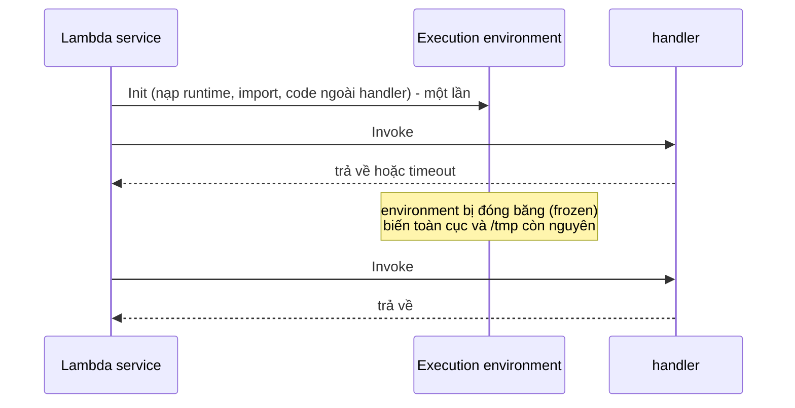

# L03: Một lần gọi Lambda đi qua Init, handler và retry như thế nào

> **Trạng thái:** bản đủ bảy bước, nằm ngoài `src/`. Chưa nối vào `Lesson.vue`, chưa qua Goldfish, chưa đo với người đọc thứ hai.
> **Số liệu:** mọi con số trong bài là giả định của kịch bản, được ghi "Giả sử" ở chỗ dùng. Không phải số đo từ hệ thống thật, không phải giá trị mặc định của AWS.

**Tiên quyết:** biết một hàm Python nhận tham số và trả về giá trị; biết một chương trình chạy trên một máy có phần "nạp thư viện" ở đầu và phần "xử lý từng mục" ở sau; biết gửi email là một tác dụng phụ không rút lại được.

## Bước 1. Đoán trước

Giả sử một hàm có timeout 3 giây, mỗi lần chạy thật mất 5 giây, và email xác nhận được gửi ở giây thứ hai. Hàm được gọi **bất đồng bộ** từ sự kiện upload của S3.

Trả lời bốn câu trước khi đọc tiếp:

1. Với một sự kiện, hàm được thử bao nhiêu lần?
2. Khách nhận bao nhiêu email cho một ảnh?
3. Nếu đổi sang gọi **đồng bộ** qua API Gateway thì ai thử lại, và client thấy gì?
4. Nếu đổi sang **event source mapping** đọc từ SQS thì điều gì quyết định số lần thử?

Viết đáp án ra giấy. Đáp án nằm ở cuối bước 3.

## Bước 2. Điều bạn đã biết

Bạn đã từng viết một script xử lý hàng loạt: nạp thư viện và mở kết nối ở đầu file, rồi lặp qua từng message ở dưới. Chạy một lần, xử lý một nghìn message, kết nối mở đúng một lần.

Bài này giữ nguyên hình dạng đó và thay từng khớp:

- "Chạy một lần, lặp qua nhiều message" → mỗi lần gọi là một tiến trình riêng, nhưng **môi trường** thì được tái dùng.
- "Phần đầu file" → **pha Init**.
- "Phần thân vòng lặp" → **pha Invoke**, tức thân handler.
- "Tắt máy giữa chừng" → **timeout**: dừng tiến trình, nhưng không hoàn tác những gì đã ghi ra ngoài.

Khác biệt cần nhớ: script của bạn chạy một lần cho cả lô. Lambda chạy **một lần cho mỗi sự kiện**, và môi trường chạy có thể đã có sẵn từ lần gọi trước.

## Bước 3. Một ví dụ có số

Giả sử một hàm xử lý ảnh được gọi bất đồng bộ từ sự kiện upload của S3. Hàm cấu hình timeout 3 giây. Với ảnh 4 MB, phần tải ảnh, tạo ba kích thước và ghi lại mất khoảng 5 giây, nên lần chạy nào cũng bị dừng ở giây thứ ba.

Giả sử trong hai giờ có 900 ảnh được tải lên. Log cho thấy **mỗi ảnh có ba lần chạy**, mỗi lần dừng đúng ở 3 giây với thông báo hết thời gian. Bảng thống kê đếm số ảnh đã xử lý cao gấp ba lần số ảnh thật, và khách nhận ba email cho mỗi ảnh.

Không ai bấm thử lại: phía tải ảnh chỉ gửi một sự kiện cho mỗi file. Ba lần chạy đến từ phía Lambda, không đến từ phía gửi. Và khi đội thử bằng cách gọi hàm qua API Gateway, họ chỉ thấy **một** lỗi trả về, không thấy ba lần chạy — vì gọi đồng bộ không có retry tự động.

Phép tính cần nhớ: một sự kiện × ba lần thử = ba tác dụng phụ, nếu tác dụng phụ nằm **trước** điểm timeout. Nếu email được gửi ở giây thứ tư, không lần nào gửi được và khách nhận **không** email nào. Cùng một lỗi, hai kết quả trái ngược, tuỳ vị trí lời gọi trong thân hàm.

**Đáp án bước 1:**

1. Ba lần: một lần đầu và hai lần thử lại. Lambda thử lại một lời gọi bất đồng bộ thất bại tối đa hai lần; hết lượt thì sự kiện bị bỏ hoặc vào dead-letter queue nếu đã cấu hình.
2. Ba email, vì email ở giây thứ hai nằm trước điểm dừng ở giây thứ ba, nên mỗi lần thử đều gửi được một cái.
3. Không ai thử lại tự động. API Gateway chuyển lỗi về cho client, và client quyết định có gửi lại hay không.
4. Với hàng đợi: `visibility timeout` quyết định khoảng cách giữa hai lần thử, `redrive policy` với số lần nhận tối đa quyết định khi nào message sang dead-letter queue.

## Bước 4. Cơ chế, từng bước một



1. **Init — chạy một lần cho mỗi environment.** Lambda tạo môi trường, nạp runtime, import module và chạy phần code nằm ngoài handler. Mọi thứ khởi tạo ở đây được giữ lại cho các lần gọi sau, nên client SDK và kết nối nên đặt ở đây. Pha Init có giới hạn thời gian riêng: tài liệu ghi 10 giây cho hàm chạy theo nhu cầu, và nếu quá hạn thì Lambda thử lại Init ở lần gọi đầu tiên với timeout của hàm.
2. **Invoke — chạy mỗi lần gọi.** Handler nhận `event` và `context`, chạy tới khi trả về hoặc tới khi chạm timeout. Mỗi request đồng thời cần một environment riêng, nên concurrency bằng số request mỗi giây nhân thời gian một lần gọi.
3. **Environment bị đóng băng giữa hai lần gọi.** Khi runtime báo xong, Lambda đóng băng môi trường: tiến trình dừng, không chạy nền, nhưng bộ nhớ và đĩa còn nguyên. Lần gọi sau trên cùng môi trường bỏ qua toàn bộ Init — đó là "warm start". Lambda vẫn thu hồi môi trường sau một khoảng không hoạt động — tài liệu runtime-environment không nêu con số cụ thể, chỉ nói thu hồi sau một khoảng không hoạt động [INFERENCE: vài giờ] — nên không được giả định nó sống mãi.
4. **`/tmp` dùng lại được, và đó là cache tạm.** Mỗi environment có `/tmp` riêng (512 MB đến 10.240 MB, đặt riêng bằng cấu hình ephemeral storage, không đi theo bộ nhớ), và nội dung còn nguyên khi môi trường bị đóng băng. Nó là cache, không phải kho dữ liệu: môi trường mới có `/tmp` rỗng.
5. **Timeout là cắt, không phải hoàn tác.** Hết thời gian thì lần chạy bị dừng, nhưng email đã gửi vẫn đã gửi, bản ghi đã tạo vẫn còn. Không có rollback. Tài liệu cũng nói khi invoke lỗi, Lambda đặt lại môi trường và **không** xoá `/tmp` trước lần Init kế tiếp.
6. **Ai thử lại — ba câu trả lời khác nhau.**
   - Gọi trực tiếp (đồng bộ): Lambda **không** tự thử lại. Lỗi trả về cho bên gọi, và bên gọi chọn cách xử lý. Với API Gateway, lỗi được chuyển nguyên về client.
   - Gọi bất đồng bộ: Lambda thử lại, mặc định **tối đa hai lần** sau lần đầu. Hết lượt thì sự kiện bị bỏ, hoặc vào dead-letter queue / on-failure destination nếu đã cấu hình.
   - Event source mapping: bộ poll đọc nguồn rồi gọi hàm theo lô. Với **stream**, Lambda thử lại **cả lô** và lỗi lặp lại sẽ **chặn shard** cho tới khi hết lỗi hoặc dữ liệu hết hạn. Với **hàng đợi**, `visibility timeout` và `redrive policy` của hàng đợi quyết định khoảng cách giữa hai lần thử và khi nào message sang dead-letter queue.
7. **Idempotency — hệ quả bắt buộc, không phải tuỳ chọn.** Mọi đường retry ở trên đều có thể giao **cùng một sự kiện** nhiều lần. Vì vậy code phải kiểm tra "đã xử lý chưa" trước khi làm tác dụng phụ, bằng một khoá ghi có điều kiện. Số lần chạy là thông tin của nền tảng; khoá là thông tin của nghiệp vụ.

Điểm cần phân biệt: retry chỉ có ích khi lỗi là **tạm thời**. Lỗi do dữ liệu đầu vào sai sẽ lặp lại y hệt ở mọi lần thử, nên ba lần chạy không lần nào thành công mà tác dụng phụ thì nhân ba.

## Bước 5. Thí nghiệm nhỏ

Máy này không có quyền gọi AWS, nên thí nghiệm là một **mô phỏng** bằng thư viện chuẩn của Python 3: giao cùng một message ba lần cho một handler có tác dụng phụ ở giây thứ hai, trong khi timeout ở giây thứ ba; đếm số dòng bị ghi trùng; rồi thêm khoá idempotency và đếm lại. Đây là mô phỏng cơ chế retry, không phải Lambda thật.

Chạy trong thư mục `lessons/01-aws/l03/`. Nếu máy không có `python` trong PATH thì gọi bằng đường dẫn đầy đủ tới Python 3.

```
python retry_idempotency.py
```

Kết quả đã chạy trên máy này:

```
Giả định: một message 'anh-001.jpg', 3 lần giao, timeout 3s, việc thật 5s,
tác dụng phụ (gửi email) xảy ra ở giây thứ 2.

  Lần 1: dừng ở timeout 3.0s, việc thật cần 5.0s
  Lần 2: dừng ở timeout 3.0s, việc thật cần 5.0s
  Lần 3: dừng ở timeout 3.0s, việc thật cần 5.0s

Không có khoá idempotency:
  Số lần handler được gọi:      3
  Số dòng đã ghi:               3
  Số dòng trùng (cùng message): 2
  Số message duy nhất:          1

  Lần 1: dừng ở timeout 3.0s sau khi đã giữ khoá
  Lần 2: bỏ qua: khoá đã tồn tại
  Lần 3: bỏ qua: khoá đã tồn tại

Có khoá idempotency (ghi khoá trước tác dụng phụ):
  Số lần handler được gọi:      3
  Số dòng đã ghi:               1
  Số dòng trùng (cùng message): 0
  Số message duy nhất:          1

Đọc ra: số lần handler chạy không đổi (vẫn 3), chỉ số tác dụng phụ đổi từ 3 xuống 1.
```

Đọc kết quả theo hai dòng cuối của mỗi khối: **số lần handler chạy không đổi**. Khoá idempotency không làm Lambda thôi thử lại — nó chỉ làm lần thử thứ hai, thứ ba không để lại tác dụng phụ. Đó là toàn bộ ý của chữ "idempotent": chạy một lần hay ba lần, trạng thái cuối cùng như nhau.

**Tự thử:** đổi `SIDE_EFFECT_AT` thành `4.0` rồi chạy lại. Số dòng đã ghi thành 0 ở cả hai khối. Cùng một lỗi timeout, nhưng khách nhận không email nào — đó là trường hợp ở bước 3.

## Bước 6. Bốn câu luyện tập

Trả lời trước khi mở đáp án.

**Câu 1.** Init và handler khác nhau ở đâu, và vì sao đặt sai chỗ một dòng code lại làm chậm cả hàm?

<details>
<summary>Đáp án</summary>

Kết luận: Init chạy một lần cho mỗi environment, handler chạy mỗi lần gọi. Code trong Init trả giá một lần; code trong handler trả giá mỗi request.

Điều kiện để đúng: environment phải được tái dùng. Nếu lưu lượng tăng làm Lambda mở thêm environment, mỗi environment mới trả giá Init thêm một lần; và môi trường vẫn bị thu hồi sau vài giờ.

Cách kiểm: so độ trễ lần gọi đầu tiên sau deploy với các lần sau, hoặc chuyển một lời gọi mạng từ thân handler ra ngoài và đo lại.

</details>

**Câu 2.** Với ba kiểu gọi, ai thử lại và thử bao nhiêu lần?

<details>
<summary>Đáp án</summary>

Kết luận: gọi trực tiếp thì bên gọi; bất đồng bộ thì Lambda thử thêm tối đa hai lần; event source mapping thì cấu hình của nguồn quyết định.

Điều kiện để đúng: biết kiểu gọi của mình. Cùng một hàm có thể có cả ba kiểu gọi, và mỗi kiểu cho ra một con số khác nhau cho cùng một lỗi.

Cách kiểm: đếm số lần chạy cho cùng một mã sự kiện trong log. Nhiều lần với cùng một mã là retry, không phải nhiều sự kiện.

</details>

**Câu 3.** Vì sao retry buộc code phải idempotent, và làm sao biết một lần chạy là lần đầu hay lần thử lại?

<details>
<summary>Đáp án</summary>

Kết luận: vì retry giao lại đúng sự kiện đó, và tác dụng phụ đã xảy ra trước điểm lỗi thì không rút lại được. Cách biết không dựa vào việc đếm số lần gọi, mà dựa vào một khoá do chính code ghi: ghi khoá trước, làm việc sau, khoá đã tồn tại thì thoát.

Điều kiện để đúng: khoá phải gắn với danh tính nghiệp vụ của message, và việc ghi khoá phải là ghi có điều kiện để hai lần chạy song song không cùng thắng.

Cách kiểm: như thí nghiệm ở bước 5 — đếm số dòng trùng trước và sau khi thêm khoá.

</details>

**Câu 4.** Retry có cứu được lỗi do dữ liệu đầu vào sai không? Và nếu hàm chậm dần vì dữ liệu lớn lên thì nên tăng timeout hay đổi kiến trúc?

<details>
<summary>Đáp án</summary>

Kết luận: không cứu được, và tệ hơn là biến một lỗi thành ba. Với hàm chậm dần, tăng timeout chỉ mua thời gian: nó làm mỗi request giữ environment lâu hơn, chi phí tăng theo thời gian chạy, và khi vượt trần cấu hình thì sự cố quay lại đúng hình dạng cũ.

Điều kiện để đúng: retry chỉ có ích khi lỗi là tạm thời; tăng timeout chỉ hợp lý khi thời gian xử lý có trần rõ ràng và trần đó thấp hơn giới hạn của hàm.

Cách kiểm: nếu ba lần chạy cho cùng một sự kiện đều dừng ở cùng một dòng với cùng thông báo, đó là lỗi dữ liệu. Nếu vẽ thời gian chạy theo kích thước đầu vào thấy một đường dốc đều, đó là vấn đề thiết kế.

</details>

## Bước 7. Câu neo

> Init chạy một lần cho mỗi environment còn handler chạy mỗi lần gọi, nên ai thử lại và thử bao nhiêu lần là câu hỏi về kiểu gọi, không phải về code.

## Ghi chú nguồn

<details>
<summary>Ghi chú nguồn, đọc ngày 2026-10-29</summary>

- https://docs.aws.amazon.com/lambda/latest/dg/lambda-runtime-environment.html — ba pha Init, Invoke, Shutdown; Lambda đóng băng environment khi runtime báo xong; Init giới hạn 10 giây và được thử lại ở lần gọi đầu nếu quá hạn; code ngoài handler chỉ chạy khi environment mới; `/tmp` còn nguyên khi environment bị đóng băng; khi invoke lỗi thì Lambda reset nhưng **không** xoá `/tmp`; environment bị thu hồi sau vài giờ.
- https://docs.aws.amazon.com/lambda/latest/dg/invocation-retries.html — gọi trực tiếp thì Lambda không tự thử lại và bên gọi quyết định; gọi bất đồng bộ thì Lambda thử lại tối đa hai lần; event source mapping đọc stream thì thử lại cả lô và chặn shard tới khi hết lỗi hoặc dữ liệu hết hạn; đọc hàng đợi thì visibility timeout và redrive policy quyết định; API Gateway luôn chuyển lỗi về cho bên gọi.
- https://docs.aws.amazon.com/lambda/latest/dg/invocation-async-retain-records.html — dead-letter queue và on-failure destination nhận sự kiện khi hết lượt thử; ví dụ invocation record có `approximateInvokeCount: 3` và `condition: RetriesExhausted`.
- https://docs.aws.amazon.com/lambda/latest/dg/invocation-eventsourcemapping.html — bộ poll đọc nguồn và gọi hàm theo lô (được dẫn từ trang retry ở trên).

Chưa kiểm trong bài này: thời gian cold start cụ thể cho từng runtime; hành vi của provisioned concurrency khi environment bị đặt lại; giới hạn số lần nhận mặc định của từng loại hàng đợi; nội dung chi tiết trang event source mapping (chỉ đọc qua phần được dẫn). Các con số trong sự cố (timeout 3 giây, xử lý 5 giây, 900 ảnh, ba email) là giả định của kịch bản.

</details>
