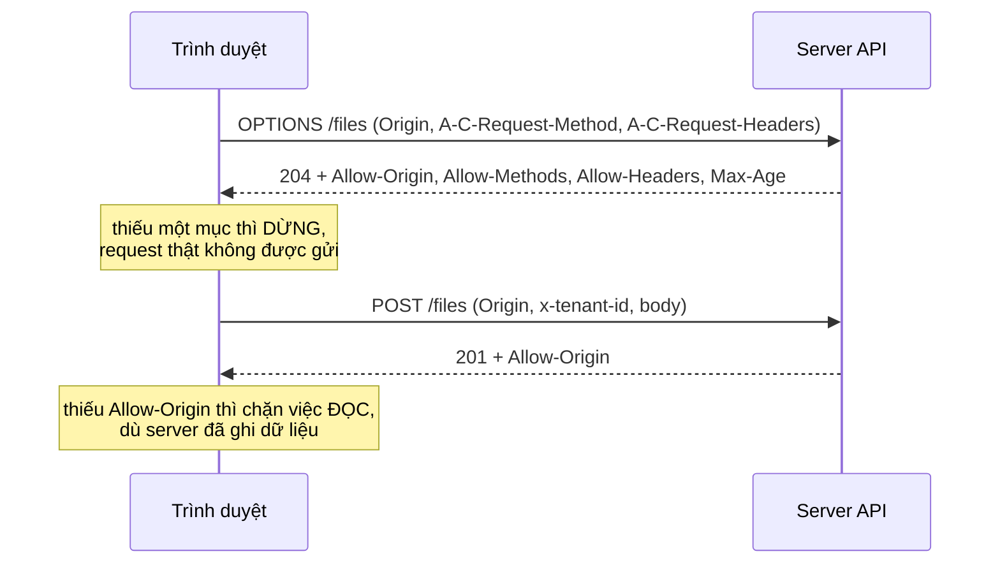

# L04: Vì sao curl trả 200 mà trình duyệt vẫn chặn request

> **Trạng thái:** bản đủ bảy bước, nằm ngoài `src/`. Chưa nối vào `Lesson.vue`, chưa qua Goldfish, chưa đo với người đọc thứ hai.
> **Số liệu:** mọi con số trong bài là giả định của kịch bản, được ghi "Giả sử" ở chỗ dùng. Không phải số đo từ hệ thống thật, không phải mặc định của trình duyệt hay của API Gateway.

**Tiên quyết:** biết một trang HTML gọi API bằng `fetch`; biết HTTP có method và header; biết chạy `curl` trên dòng lệnh.

## Bước 1. Đoán trước

Giả sử trang chạy ở `http://localhost:5173`, API ở `http://localhost:8000`. Trang gọi `fetch` với method `GET` và header `Authorization: Bearer ...`.

Trả lời bốn câu trước khi đọc tiếp:

1. Một lần gọi như vậy sinh ra bao nhiêu request HTTP tới server?
2. Header `Authorization` đi trên request nào — request hỏi trước, request thật, hay cả hai?
3. Nếu server trả 200 kèm body nhưng thiếu `Access-Control-Allow-Origin`, code phía giao diện nhận gì?
4. Nếu request mang cookie thì có dùng được `Access-Control-Allow-Origin: *` không?

Viết đáp án ra giấy. Đáp án nằm ở cuối bước 3.

## Bước 2. Điều bạn đã biết

Bạn đã từng mở một trang HTML và gọi API bằng `curl` trong terminal. Cả hai đều nói HTTP, cả hai đều nhận JSON. Vậy mà một bên chạy, một bên báo lỗi.

Khác biệt không nằm ở server. Nó nằm ở **bên gọi**: `curl` không có origin, không có cookie của trang, và không thi hành luật nào cả. Trình duyệt thì có, vì nó đang bảo vệ người dùng đang đăng nhập trên trang khác.

Bài này giữ nguyên chuỗi "trang gọi API" và thay từng khớp:

- `curl` gọi API → **trang** gọi API bằng `fetch`.
- Server trả JSON → vẫn thế, server không đổi.
- Không có gì chặn → **trình duyệt** chặn ở bước đọc response.

Khác biệt cần nhớ: CORS (Cross-Origin Resource Sharing, cơ chế server khai báo origin nào được đọc response) là luật **do trình duyệt thi hành**, không phải do server. Server chỉ nói; trình duyệt mới là bên chặn.

## Bước 3. Một ví dụ có số

Giả sử giao diện chạy ở `app.example.com`, API ở `api.example.com`. Khi thử bằng curl, lệnh `POST /files` kèm header `x-tenant-id` trả về **201** với đúng JSON mong đợi — giả sử trong ba ngày liền, 100 phần trăm số lần thử.

Trong trình duyệt, cùng request đó **không bao giờ tới được handler**. Console hiện:

```
blocked by CORS policy: Request header field x-tenant-id
is not allowed in preflight response.
```

Mở tab Network thì thấy một request `OPTIONS` trả 200, và request `POST` thật **không được gửi đi**.

Sau khi thêm tên header đó vào cấu hình, lỗi đổi thành:

```
No 'Access-Control-Allow-Origin' header is present on the requested resource.
```

Lần này `POST` **đã tới server**, server trả 201, và console vẫn báo lỗi. Hai thông báo lỗi, hai chỗ sửa khác nhau: cái đầu là response của lượt hỏi trước, cái sau là response thật.

Đây là lý do phải mở tab Network trước khi đọc code. Thấy `OPTIONS` đỏ và không có request thật → sửa lượt hỏi trước. Thấy request thật với 200 mà giao diện vẫn trống → sửa header của response thật.

**Đáp án bước 1:**

1. Hai: một `OPTIONS` hỏi trước, rồi một `GET` thật. `Authorization` không thuộc nhóm header được miễn hỏi trước.
2. Chỉ trên request `GET` thật. Request `OPTIONS` chỉ mang `Origin`, `Access-Control-Request-Method`, `Access-Control-Request-Headers`.
3. Trình duyệt nhận 200 và có body, nhưng không cho code đọc body: `fetch` bị reject, không có status, không có body. Log server ghi 200, code giao diện thấy lỗi mạng.
4. Không. Với credentials, `Access-Control-Allow-Origin` phải là đúng origin của trang, kèm `Access-Control-Allow-Credentials: true`.

## Bước 4. Cơ chế, từng bước một



1. **Xác định origin.** Origin là bộ ba **scheme, host, port**. Khác một trong ba là cross-origin — kể cả cùng tên miền mà khác cổng. `app.example.com` gọi `api.example.com` là cross-origin; `localhost:5173` gọi `localhost:8000` cũng vậy.
2. **Phân loại request.** Request **đơn giản** chỉ dùng `GET`, `HEAD`, `POST`, chỉ đặt các header trong danh sách được miễn hỏi trước (`Accept`, `Accept-Language`, `Content-Language`, `Content-Type` với ba giá trị `application/x-www-form-urlencoded`, `multipart/form-data`, `text/plain`, `Range`), và không dùng `ReadableStream`. Loại này đi thẳng. Thêm `Authorization` hay `x-tenant-id` là thành **không đơn giản**, và trình duyệt phải hỏi trước.
3. **Lượt hỏi trước (preflight).** Trình duyệt gửi `OPTIONS` kèm `Origin`, `Access-Control-Request-Method`, `Access-Control-Request-Headers`. Server phải trả:
   - `Access-Control-Allow-Origin` khớp origin,
   - `Access-Control-Allow-Methods` chứa phương thức sẽ dùng,
   - `Access-Control-Allow-Headers` chứa **đúng các tên header** được hỏi.

   Thiếu một mục là dừng: request thật không bao giờ được gửi. Đây là lỗi đầu tiên trong sự cố ở bước 3.
4. **Lượt thật và lần kiểm tra thứ hai.** Request thật vẫn được gửi, và **response của nó** phải mang `Access-Control-Allow-Origin` một lần nữa. Thiếu thì trình duyệt chặn việc **đọc** response: server đã chạy xong, đã ghi dữ liệu, mà code phía giao diện nhận lỗi. Response 4xx hay 5xx cũng cần header này, nếu không lập trình viên không đọc được nội dung lỗi — sự cố thật bị che bởi sự cố cấu hình.
5. **Credentials là trường hợp riêng.** Khi request mang cookie hoặc chứng chỉ, wildcard bị từ chối. Phải trả đúng origin, kèm `Access-Control-Allow-Credentials: true`, và thêm `Vary: Origin` để cache không trả nhầm header của origin khác. Wildcard tiết kiệm công cấu hình nhưng mất hai thứ: dùng được credentials, và việc giới hạn ai được đọc response.
6. **Hai header ít người biết.**
   - `Access-Control-Max-Age` cho biết trình duyệt được cache kết quả hỏi trước bao nhiêu giây. Tài liệu MDN ghi giá trị mặc định là 5 giây, và mỗi trình duyệt có trần nội bộ riêng. Max-age dài giảm số lượt `OPTIONS`, nhưng làm bạn chậm thấy kết quả khi vừa thêm một header mới.
   - `Access-Control-Expose-Headers` liệt kê header **của response** mà code được đọc. Mặc định chỉ vài header an toàn là đọc được; muốn đọc `X-Request-Id` hay `Content-Encoding` thì phải khai báo. Ở đây `*` cũng chỉ là wildcard khi request không mang credentials.
7. **Sửa ở đâu.** Với API Gateway, header CORS phải có trên **cả** response preflight do gateway tạo **và** response thật do integration trả về. Đó chính là lý do sự cố ở bước 3 phải sửa hai lần: lần đầu mới sửa phần preflight. Nếu hàm tự trả response thì hàm phải tự thêm header cho mọi nhánh, kể cả nhánh lỗi.

Điểm cần phân biệt: CORS **không** phải xác thực. Nó không bảo vệ API khỏi người gọi không phải trình duyệt — `curl` gọi được bất cứ lúc nào. Nó bảo vệ **người dùng** khỏi việc một trang lạ đọc dữ liệu của họ từ một API mà trình duyệt đang giữ cookie. Vì vậy CORS không thay được việc server kiểm tra quyền.

## Bước 5. Thí nghiệm nhỏ

Hai server `http.server` cục bộ: một cái không gửi header CORS, một cái có. Script khởi động cả hai, rồi tự gọi `curl -i` và in nguyên văn phần server trả về. Chạy trong thư mục `lessons/01-aws/l04/`. Nếu máy không có `python` trong PATH thì gọi bằng đường dẫn đầy đủ tới Python 3.

```
python cors_demo.py
```

Kết quả đã chạy trên máy này:

```
========================================================================
Server 1: không gửi header CORS (port 8801)
$ curl -i -X OPTIONS -H 'Origin: http://localhost:5173' -H 'Access-Control-Request-Method: POST' -H 'Access-Control-Request-Headers: x-tenant-id' http://127.0.0.1:8801/files
------------------------------------------------------------------------
HTTP/1.0 204 No Content
Server: BaseHTTP/0.6 Python/3.14.3
Date: Thu, 29 Oct 2026 06:43:09 GMT

========================================================================
Server 2: có gửi header CORS (port 8802)
$ curl -i -X OPTIONS -H 'Origin: http://localhost:5173' -H 'Access-Control-Request-Method: POST' -H 'Access-Control-Request-Headers: x-tenant-id' http://127.0.0.1:8802/files
------------------------------------------------------------------------
HTTP/1.0 204 No Content
Server: BaseHTTP/0.6 Python/3.14.3
Date: Thu, 29 Oct 2026 06:43:09 GMT
Access-Control-Allow-Origin: http://localhost:5173
Access-Control-Allow-Methods: GET, POST, OPTIONS
Access-Control-Allow-Headers: x-tenant-id, content-type
Access-Control-Max-Age: 600
Vary: Origin

========================================================================
Request thật (POST) tới server 2: server chạy xong, trả 201
$ curl -i -X POST -H 'Origin: http://localhost:5173' -H 'x-tenant-id: t-1' -H 'Content-Type: application/json' -d '{"name":"a"}' http://127.0.0.1:8802/files
------------------------------------------------------------------------
HTTP/1.0 201 Created
Server: BaseHTTP/0.6 Python/3.14.3
Date: Thu, 29 Oct 2026 06:43:09 GMT
Content-Type: application/json
Content-Length: 11
Access-Control-Allow-Origin: http://localhost:5173
Access-Control-Allow-Methods: GET, POST, OPTIONS
Access-Control-Allow-Headers: x-tenant-id, content-type
Access-Control-Max-Age: 600
Vary: Origin

{"ok":true}

Ghi chú: cả bốn khối trên đều do curl in ra. curl không có origin,
không hỏi trước và không thi hành CORS, nên nó không bao giờ thấy lỗi chặn.
```

Đọc hai khối đầu: cả hai đều trả **204**. Khác biệt duy nhất là bốn header. Trình duyệt nhận 204 từ server 1 sẽ dừng và không gửi `POST`; nhận 204 từ server 2 thì gửi tiếp. Với `curl`, hai response này chỉ là hai chuỗi byte, và **không có gì bị chặn**.

**Giới hạn của thí nghiệm, phải nói rõ:** `curl` chứng minh **server gửi gì**. Việc trình duyệt chặn việc đọc response là hành vi của trình duyệt, và `curl` không thấy được nó. Muốn thấy, phải mở trang thật trong trình duyệt và đọc console cùng tab Network.

**Tự thử:** bỏ dòng `Access-Control-Allow-Headers` trong `_cors_headers` rồi chạy lại. Header vẫn còn nguyên trên dây, `curl` vẫn thấy 204 — nhưng trình duyệt sẽ báo đúng lỗi đầu tiên ở bước 3. Đây là bằng chứng rõ nhất rằng `curl` không kiểm tra hộ trình duyệt.

## Bước 6. Bốn câu luyện tập

Trả lời trước khi mở đáp án.

**Câu 1.** Vì sao `curl` trả 201 mà trình duyệt vẫn báo lỗi CORS?

<details>
<summary>Đáp án</summary>

Kết luận: CORS do trình duyệt thi hành, không do server. `curl` không có origin, không hỏi trước, và không có gì để chặn; trình duyệt thì kiểm tra header trước khi cho code đọc response.

Điều kiện để đúng: bạn đang so cùng một request trên cùng một server. Nếu khác header hoặc khác method thì hai lần gọi không còn so sánh được.

Cách kiểm: mở tab Network của trình duyệt. Thấy request thật trả 200 mà console vẫn lỗi, và response thiếu `Access-Control-Allow-Origin` — đó là bằng chứng.

</details>

**Câu 2.** Request nào phải qua hỏi trước, và lượt hỏi trước cần server trả những header nào?

<details>
<summary>Đáp án</summary>

Kết luận: request không đơn giản phải hỏi trước — tức dùng method ngoài `GET`/`HEAD`/`POST`, hoặc đặt header ngoài danh sách được miễn, hoặc `Content-Type` ngoài ba giá trị cho phép. Lượt hỏi trước cần `Access-Control-Allow-Origin` khớp origin, `Access-Control-Allow-Methods` chứa method, và `Access-Control-Allow-Headers` chứa đúng các tên header được hỏi.

Điều kiện để đúng: thiếu một mục là dừng; thừa tên header không sao, thiếu một tên là hỏng.

Cách kiểm: đọc request `OPTIONS` trong tab Network, so danh sách `Access-Control-Request-Headers` với `Access-Control-Allow-Headers` trong response.

</details>

**Câu 3.** Server đã ghi dữ liệu thành công nhưng giao diện vẫn báo lỗi. Chuyện gì đã xảy ra, và sửa ở đâu?

<details>
<summary>Đáp án</summary>

Kết luận: response thật thiếu `Access-Control-Allow-Origin`, nên trình duyệt chặn bước **đọc** response. Server đã chạy xong, dữ liệu đã ghi; chỉ phần đọc bị chặn.

Điều kiện để đúng: header phải có trên **mọi** response, kể cả 4xx và 5xx, nếu không lập trình viên không đọc được nội dung lỗi.

Cách kiểm: `curl -i` tới đúng endpoint và xem response thật có header đó hay không. Nếu chỉ response preflight có mà response thật không, đó là cấu hình thiếu ở tầng integration — với API Gateway, phải thêm ở cả hai chỗ.

</details>

**Câu 4.** Vì sao `Access-Control-Allow-Origin: *` không đi với credentials, và thay bằng gì?

<details>
<summary>Đáp án</summary>

Kết luận: wildcard nghĩa là "mọi origin được đọc", còn credentials nghĩa là "request này mang cookie của người dùng". Đi cùng nhau thì bất kỳ trang nào cũng đọc được dữ liệu của người dùng đang đăng nhập, nên đặc tả không cho phép.

Điều kiện để đúng: trả đúng origin của trang, kèm `Access-Control-Allow-Credentials: true`, và thêm `Vary: Origin` để cache không trộn header giữa các origin. Nếu server trả danh sách nhiều origin, nó phải chọn đúng một giá trị khớp `Origin` của request.

Cách kiểm: gọi từ hai origin khác nhau và so header trả về; nếu giống nhau và là `*` trong khi request có cookie, trình duyệt sẽ chặn.

</details>

## Bước 7. Câu neo

> CORS không làm server từ chối request; nó làm trình duyệt từ chối cho code đọc response, nên server trả 200 vẫn không cứu được một response thiếu `Access-Control-Allow-Origin`.

## Ghi chú nguồn

<details>
<summary>Ghi chú nguồn, đọc ngày 2026-10-29</summary>

- https://developer.mozilla.org/en-US/docs/Web/HTTP/Guides/CORS — origin là bộ ba scheme/host/port; định nghĩa request đơn giản (method, danh sách header được miễn, ba giá trị `Content-Type`); preflight `OPTIONS` với `Access-Control-Request-Method` và `Access-Control-Request-Headers`; response thật phải mang `Access-Control-Allow-Origin` lần nữa; request mang credentials thì server phải nêu đúng origin thay vì `*`; lỗi CORS không cho JavaScript biết chi tiết, chỉ console biết.
- https://developer.mozilla.org/en-US/docs/Web/HTTP/Reference/Headers/Access-Control-Expose-Headers — mặc định chỉ các header an toàn là đọc được; `*` chỉ là wildcard khi request không có credentials.
- https://developer.mozilla.org/en-US/docs/Web/HTTP/Guides/CORS (phần `Access-Control-Max-Age`) — giá trị tính bằng giây, mặc định 5 giây, mỗi trình duyệt có trần nội bộ riêng.
- https://developer.mozilla.org/en-US/docs/Web/HTTP/Guides/CORS (phần requests with credentials) — response thiếu `Access-Control-Allow-Credentials: true` sẽ bị bỏ qua dù request đã gửi cookie.

Chưa kiểm trong bài này: cấu hình CORS mặc định của từng loại integration trong API Gateway; thời gian cache preflight thực tế của từng trình duyệt; hành vi của CloudFront khi gộp hai origin về một tên miền; mã lỗi cụ thể mà `fetch` trả về khi bị chặn. Các con số trong sự cố (ba ngày, 100 phần trăm số lần thử) là giả định của kịch bản; header và status trong thí nghiệm là output thật của `curl` trên máy này.

</details>
