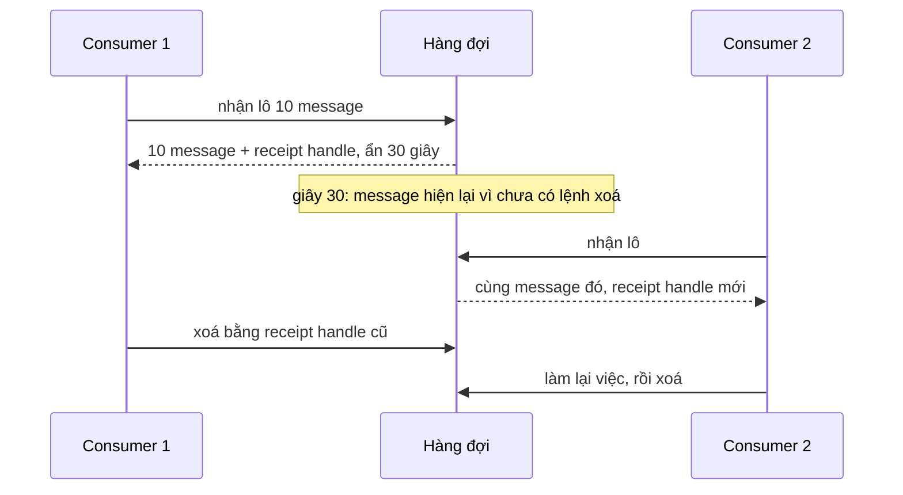

# L06: Vì sao thêm consumer không làm hàng đợi nhanh hơn

> **Trạng thái:** bản viết lại đủ bảy bước, nằm ngoài `src/`. Chưa nối vào app, chưa đo với người đọc thứ hai.
> **Số liệu:** mọi con số kịch bản là giả định, ghi "Giả sử" ở chỗ dùng. Không phải số đo của SQS thật, không phải mặc định của AWS. Thí nghiệm ở Bước 5 là **mô phỏng cơ chế** bằng thư viện chuẩn của Python, không gọi dịch vụ nào.

**Tiên quyết:** biết một vòng lặp worker nhận việc rồi xử lý; biết việc xử lý có thể thất bại giữa chừng; biết một tác dụng phụ như gửi email là việc không nên làm hai lần.

## Bước 1. Đoán trước

Giả sử sau một đợt nhập dữ liệu, hàng đợi còn 12 000 message tồn. Giả sử có 6 consumer, mỗi lần nhận tối đa 10 message và xử lý lần lượt từng message, mỗi message mất khoảng 40 giây. Giả sử visibility timeout (khoảng thời gian message bị ẩn sau khi một consumer nhận) đặt 30 giây.

Trước khi đọc tiếp, trả lời bốn câu:

1. Cả cụm xử lý được bao nhiêu message mỗi giây?
2. Mất bao lâu để hết 12 000 message?
3. Có message nào bị xử lý hai lần không?
4. Nếu nâng visibility timeout lên 600 giây thì đổi lại cái gì?

Viết đáp án ra giấy. Đáp án nằm ở cuối bước 3.

## Bước 2. Điều bạn đã biết

Bạn đã từng viết một worker đọc việc từ một danh sách trong Redis hoặc một bảng trong cơ sở dữ liệu: lấy một dòng, đánh dấu "đang làm", làm xong thì xoá dòng đó. Nếu tiến trình chết giữa chừng, dòng vẫn còn đó và một worker khác nhặt lên.

Bài này giữ nguyên vòng lặp đó và thay từng khớp bằng hàng đợi:

- Danh sách việc thành **hàng đợi** (queue), consumer hỏi hàng đợi theo lô thay vì tự quét bảng.
- Cột "đang làm" thành **visibility timeout**: message không bị đánh dấu, nó bị ẩn tạm.
- Dòng bị xoá thành lời gọi xoá có **receipt handle** (mã nhận, cấp riêng cho mỗi lần giao).
- "Worker chết thì dòng còn đó" thành một mô hình có tên: **giao ít nhất một lần**.

Khác biệt cần nhớ: ở danh sách của bạn, "đang làm" là một trạng thái bạn tự quản. Ở hàng đợi, hàng đợi không biết consumer còn sống hay đã chết — nó chỉ biết đã nhận được lệnh xoá hay chưa.

## Bước 3. Một ví dụ có số

Giả sử mỗi consumer xử lý lần lượt từng message, mỗi message 40 giây. Một consumer làm được 1 ÷ 40 = 0,025 message mỗi giây. Sáu consumer cho 6 ÷ 40 = 0,15 message mỗi giây.

Giả sử lô 10 message không đổi con số đó. Lô chỉ quyết định bao nhiêu message bị ẩn cùng lúc, không quyết định mỗi message mất bao lâu. Công thức viết theo lô cũng ra cùng kết quả: consumer × lô ÷ thời gian cả lô = 6 × 10 ÷ (10 × 40) = 0,15.

Với 12 000 message và 0,15 message mỗi giây, thời gian là 12 000 ÷ 0,15 = 80 000 giây, khoảng 22 giờ.

Bây giờ đến phần trùng lặp. Giả sử visibility timeout 30 giây, ngắn hơn 40 giây cần để xử lý. Message thứ nhất trong lô được nhận ở giây 0, bị ẩn tới giây 30, nhưng consumer còn bận tới giây 40. Từ giây 30 tới 40, message đó đã hiện lại và chưa bị xoá: một consumer khác rảnh trong khoảng đó sẽ nhận nó và làm lại từ đầu.

Điều ít ai để ý: với lô 10, message cuối trong lô chỉ được xử lý xong ở giây 400, nhưng nó đã hết hạn ẩn từ giây 30. Vì vậy visibility timeout phải phủ **cả lô**, không phải một message. Giả sử đặt 600 giây thì cả lô nằm gọn trong khoảng ẩn.

**Đáp án bước 1:** (1) 0,15 message mỗi giây; (2) khoảng 80 000 giây, hơn 22 giờ; (3) có, vì 30 giây ngắn hơn 40 giây và ngắn hơn nhiều so với 400 giây của cả lô; (4) hết trùng nhưng message của một consumer chết bị treo lâu hơn trước khi được giao lại.

## Bước 4. Cơ chế, từng bước một



1. **Consumer hỏi, hàng đợi không đẩy.** Consumer gọi API nhận message theo lô. Đây là mô hình kéo: số việc song song bằng số consumer nhân số message đang được xử lý cùng lúc, không phải bằng số message trong hàng đợi.
2. **Message bị ẩn, không bị xoá.** Ngay khi trả về, message vẫn nằm trong hàng đợi nhưng không consumer nào khác nhận được trong khoảng visibility timeout. Nó không biến mất; nó chỉ tạm vô hình.
3. **Xoá chỉ sau khi xong việc, bằng receipt handle.** Mỗi lần giao cấp một receipt handle khác nhau. Xoá phải dùng handle của lần giao hiện tại. Nếu consumer không xoá trước khi hết khoảng ẩn, message hiện lại và có thể được giao cho consumer khác — kể cả khi consumer đầu vẫn đang chạy.
4. **Hàng đợi không biết consumer đã chết.** Nó chỉ biết chưa nhận được lệnh xoá. Vì vậy message của một consumer chết quay lại sau đúng khoảng visibility timeout, không phải ngay lúc chết. Đây là lý do phải chọn giữa hai cái giá: khoảng ẩn ngắn thì phục hồi nhanh nhưng dễ trùng, khoảng ẩn dài thì hết trùng nhưng chậm phục hồi.
5. **Long polling giảm số lời gọi rỗng.** Thay vì hỏi liên tục và nhận về rỗng, consumer đặt thời gian chờ để hàng đợi giữ request lại cho tới khi có message hoặc hết thời gian chờ. Cách này không làm message nhanh hơn; nó chỉ bỏ bớt các lời gọi vô ích.
6. **Đếm số lần nhận, rồi chuyển sang dead-letter queue.** Redrive policy đặt `maxReceiveCount`: số lần một message được giao tối đa trước khi bị chuyển sang dead-letter queue (hàng đợi dành cho message hỏng). Không có bước này, một message luôn lỗi sẽ quay vòng mãi và không ai thấy nó.
7. **Giao ít nhất một lần, nên tác dụng phụ phải chịu lặp.** Có hai nguồn trùng độc lập: visibility timeout ngắn hơn thời gian xử lý, và consumer chết sau khi đã làm xong việc nhưng trước khi kịp xoá. Cả hai đều nằm ngoài tầm kiểm soát của code. Vì vậy mọi tác dụng phụ phải có khoá chống lặp theo nội dung hoặc mã message, và khoá đó phải được ghi **trước** khi gọi dịch vụ ngoài.

**Vì sao thêm consumer không làm hàng đợi nhanh hơn.** Thông lượng xấp xỉ số consumer chia thời gian một message. Công thức đó chỉ đúng khi tài nguyên phía sau còn dư. Nếu mỗi message phải gọi một dịch vụ chỉ nhận được 6 việc song song, thì thông lượng bị chặn ở 6 ÷ 40 = 0,15 message mỗi giây, dù bạn có 6 hay 60 consumer. Thêm consumer khi đó không tăng số việc xong; nó chỉ tăng số consumer đang rảnh, và mỗi consumer rảnh là một cơ hội nhận lại message vừa hiện ra — tức là tăng giao trùng.

## Bước 5. Thí nghiệm nhỏ

Script mô phỏng bằng thư viện chuẩn, chạy trong `lessons/01-aws/l06/`. Đồng hồ chạy theo từng giây rời rạc; mỗi consumer giữ một lô và xử lý lần lượt. Đây là mô phỏng cơ chế, **không phải SQS thật**: không có mạng, không có độ trễ API, không có hàng đợi FIFO.

```
python visibility.py
```

Kết quả đã chạy trên máy này (12 000 message, lô 10, 40 giây mỗi message):

```
Kịch bản: 12 000 message, lô 10, mỗi message 40 giây xử lý.

   consumer   vis  trần sau   lần giao  giao trùng  xử lý lại     giây   msg/giây
          2    30         -      12018          18          0   240001      0.050
          6    30         -      12054          54          0    80001      0.150
          6   600         -      12000           0          0    80001      0.150
         12    30         -      12108         108          0    40001      0.300
         12    30         6      12114         114          0    80001      0.150

2 → 6 consumer: thông lượng 0.050 → 0.150 msg/giây (gấp 3.0).
6 → 12 consumer: thông lượng 0.150 → 0.300 msg/giây (gấp 2.0), giao trùng 54 → 108.
12 consumer nhưng tài nguyên sau chỉ 6 suất: 0.150 msg/giây, giao trùng 114.
vis 30 → 600 giây, vẫn 6 consumer: giao trùng 54 → 0.

Công thức: consumer × lô ÷ thời gian một lô = consumer ÷ thời gian một message.
   2 consumer ÷ 40 giây = 0.050 msg/giây
   6 consumer ÷ 40 giây = 0.150 msg/giây
  12 consumer ÷ 40 giây = 0.300 msg/giây
  trần phía sau 6 suất ÷ 40 giây = 0.150 msg/giây
```

Bốn điều đọc được từ bảng:

- **Thông lượng đi theo số consumer, tuyến tính.** 2 → 6 → 12 consumer cho 0,050 → 0,150 → 0,300 message mỗi giây. Con số này chỉ phụ thuộc thời gian một message.
- **Giao trùng xuất hiện đúng khi khoảng ẩn ngắn hơn thời gian xử lý.** 54 lần ở cấu hình 6 consumer với 30 giây; nâng lên 600 giây thì về 0. Cùng code, cùng dữ liệu, khác một tham số.
- **Thêm consumer làm trùng tăng.** 6 → 12 consumer: giao trùng 54 → 108, đúng gấp đôi. Mỗi consumer thêm vào là một chỗ nữa có thể nhặt lại message đang bay.
- **Có trần phía sau thì thêm consumer không tăng thông lượng.** 12 consumer nhưng chỉ 6 suất xử lý song song: vẫn 0,150 message mỗi giây, bằng đúng 6 consumer, còn giao trùng tăng lên 114.

**Tự thử:** giữ 6 consumer và visibility timeout 30 giây, đổi thời gian xử lý một message xuống 10 giây. Giao trùng còn bao nhiêu, và vì sao?

## Bước 6. Bốn câu luyện tập

Trả lời trước khi mở đáp án.

**Câu 1.** Một consumer đang xử lý message thì message đó nằm ở đâu, và vì sao không ai khác nhận được?

<details>
<summary>Đáp án</summary>

Kết luận: message vẫn nằm trong hàng đợi nhưng bị ẩn trong khoảng visibility timeout. Hàng đợi không chuyển quyền sở hữu, nó chỉ tạm không trả message đó cho lần nhận khác. Hết khoảng ẩn mà chưa có lệnh xoá thì message hiện lại.

Điều kiện để đúng: khoảng ẩn phải còn hiệu lực. Nếu thời gian xử lý dài hơn khoảng ẩn, message hiện lại giữa chừng và consumer khác nhận được, dù consumer đầu vẫn đang làm.

Cách kiểm: trong lúc một consumer đang giữ message, gọi API nhận từ một consumer khác và thấy lô rỗng. Chờ qua mốc hết khoảng ẩn rồi gọi lại, thấy message xuất hiện với receipt handle mới.

</details>

**Câu 2.** Vì sao visibility timeout ngắn hơn thời gian xử lý lại gây xử lý trùng, và vì sao lô làm chuyện này nặng hơn?

<details>
<summary>Đáp án</summary>

Kết luận: vì message hiện lại trước khi lần xử lý đầu kết thúc, nên một consumer khác nhận được nó và làm lại từ đầu. Với lô, khoảng ẩn tính từ lúc nhận cho từng message, nhưng message cuối trong lô chỉ được xử lý xong sau `lô × thời gian một message`, nên khoảng ẩn phải phủ cả lô chứ không phải một message.

Điều kiện để đúng: phải có consumer khác rảnh trong khoảng message đã hiện lại mà chưa bị xoá. Nếu mọi consumer đều bận suốt khoảng đó thì trùng không xảy ra, nhưng đó là may mắn về thời điểm, không phải thiết kế.

Cách kiểm: so thời gian xử lý trung bình của một lô với giá trị visibility timeout đang cấu hình. Trong thí nghiệm ở Bước 5, 6 consumer với 30 giây cho 54 lần giao trùng; nâng lên 600 giây cho 0.

</details>

**Câu 3.** Backlog không giảm. Làm sao biết nên thêm consumer hay nên giảm thời gian mỗi message?

<details>
<summary>Đáp án</summary>

Kết luận: đo trước, vì hai cách sửa hai nguyên nhân khác nhau. Nếu tăng số consumer mà thông lượng tăng gần tuyến tính thì nút thắt là số consumer. Nếu tăng mà thông lượng đứng yên thì nút thắt nằm trong từng message hoặc ở tài nguyên phía sau.

Điều kiện để đúng: phần lớn thời gian mỗi message là chờ I/O độc lập, và tài nguyên phía sau còn suất trống. Nếu mỗi message gọi một dịch vụ chỉ nhận 6 việc song song thì thêm consumer chỉ tăng giao trùng — như dòng cuối của bảng ở Bước 5.

Cách kiểm: nhân đôi số consumer và đo lại thông lượng. Tăng gần gấp đôi thì nút thắt ở số consumer; không tăng thì đo tiếp thời gian mỗi message, tách phần xử lý và phần chờ.

</details>

**Câu 4.** Hàng đợi có bảo đảm mỗi message chỉ xử lý một lần không? Nếu không thì đặt gì ở đâu?

<details>
<summary>Đáp án</summary>

Kết luận: không. Mô hình mặc định là giao ít nhất một lần: message có thể hiện lại sau visibility timeout, và consumer có thể chết sau khi đã làm xong việc nhưng trước khi xoá. Vì vậy mọi tác dụng phụ phải idempotent (chịu được việc chạy lại mà kết quả không đổi), và khoá chống lặp phải nằm trong code hoặc tầng lưu trữ, không nằm ở cấu hình hàng đợi.

Điều kiện để đúng: khoá chống lặp phải được ghi trước khi gọi dịch vụ ngoài, và phải dùng một giá trị ổn định giữa các lần giao — mã message hoặc một mã nghiệp vụ do bạn sinh. Dead-letter queue với `maxReceiveCount` chặn vòng lặp vô hạn nhưng không khử trùng.

Cách kiểm: đếm số lần tác dụng phụ được thực hiện cho cùng một message, so với số message thật đã gửi vào hàng đợi. Trong thí nghiệm ở Bước 5, cột "lần giao" lớn hơn 12 000 chính là phần dư đó.

</details>

## Bước 7. Câu neo

> Hàng đợi chỉ hứa giao ít nhất một lần, nên visibility timeout phải dài hơn thời gian xử lý cả lô và mọi tác dụng phụ phải chịu được lặp.

## Ghi chú nguồn

<details>
<summary>Ghi chú nguồn, đọc ngày 2026-10-29</summary>

- https://docs.aws.amazon.com/AWSSimpleQueueService/latest/SQSDeveloperGuide/sqs-visibility-timeout.html — message vẫn nằm trong hàng đợi nhưng tạm vô hình khi nhận; mặc định 30 giây; không xoá trước khi hết khoảng thì message hiện lại cho consumer khác; `ChangeMessageVisibility` để gia hạn; trần 12 giờ tính từ lần nhận đầu.
- https://docs.aws.amazon.com/AWSSimpleQueueService/latest/SQSDeveloperGuide/sqs-dead-letter-queues.html — redrive policy và `maxReceiveCount`: số lần giao tối đa trước khi message sang dead-letter queue.
- https://docs.aws.amazon.com/AWSSimpleQueueService/latest/SQSDeveloperGuide/standard-queues-at-least-once-delivery.html — SQS lưu nhiều bản sao; có trường hợp nhận lại message; ứng dụng phải idempotent.

Chưa kiểm trong bài này: giá trị mặc định và thời gian chờ tối đa của long polling (cấu hình được, không nêu như mặc định bắt buộc); hạn mức số message đang bay; hành vi cụ thể của hàng đợi FIFO; đơn giá SQS. Toàn bộ số liệu ở Bước 5 đến từ script mô phỏng trong `lessons/01-aws/l06/visibility.py`, không phải từ dịch vụ thật.

</details>
