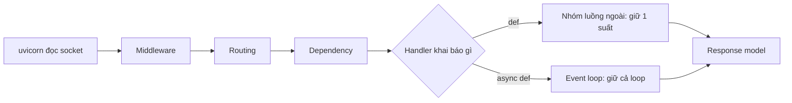

# L07: Một request đi qua FastAPI: def, async def và chỗ nào thật sự nhường lượt

> **Trạng thái:** bản viết lại đủ bảy bước, nằm ngoài `src/`. Chưa nối vào app, chưa đo với người đọc thứ hai.
> **Số liệu:** các con số trong sự cố là giả định của kịch bản, ghi "Giả sử" ở chỗ dùng. Bảng ở Bước 5 là **số đo thật** trên máy này: một tiến trình uvicorn, một worker, Python 3.14.3, fastapi 0.162.0, uvicorn 0.54.0, httpx 0.28.1. Không phải benchmark của một hệ thống thật.

**Tiên quyết:** biết một endpoint HTTP nhận request và trả JSON; biết `time.sleep` là lệnh chặn; biết một tiến trình Python chạy được nhiều việc "cùng lúc" theo một nghĩa nào đó.

## Bước 1. Đoán trước

Giả sử một tiến trình uvicorn, một worker. Ba endpoint cùng chờ 0,2 giây rồi trả lời: A khai báo `def` và gọi `time.sleep`; B khai báo `async def` và gọi `time.sleep`; C khai báo `async def` và `await asyncio.sleep`. Giả sử mỗi endpoint nhận 10 request đồng thời.

Trước khi đọc tiếp, trả lời bốn câu:

1. Endpoint nào xong trước, và mất bao lâu?
2. Endpoint nào chậm nhất, và mất bao lâu?
3. Vì sao `/health`, một endpoint chỉ trả một dict tĩnh, có thể chậm theo khi một endpoint khác bị chặn?
4. Nếu bắn 60 request đồng thời vào A, thời gian tường là bao nhiêu?

Viết đáp án ra giấy. Đáp án nằm ở cuối bước 3.

## Bước 2. Điều bạn đã biết

Bạn đã từng chạy một ứng dụng web kiểu cũ: mỗi request được một luồng hoặc một tiến trình riêng phục vụ, và khi một request ngủ chờ cơ sở dữ liệu thì các request khác vẫn có luồng riêng của chúng. Chậm thì thêm luồng, hoặc thêm tiến trình.

Bạn cũng đã từng viết một script gọi `requests.get` và thấy nó đứng chờ cho tới khi có phản hồi. Đó là một lệnh chặn: luồng đang chạy bị giữ cho tới khi lệnh xong.

Bài này giữ nguyên hai điều đó và thay từng khớp:

- "Mỗi request một luồng" thành **một event loop trên một luồng**, và các request là các tác vụ (task) mà loop chuyển qua lại.
- "Chờ cơ sở dữ liệu" thành **`await` trên I/O bất đồng bộ**, điểm duy nhất mà một tác vụ trả quyền cho loop.
- "Thêm luồng" thành **nhóm luồng ngoài** dành riêng cho các hàm khai báo `def`.

Khác biệt cần nhớ: trên mô hình cũ, một lệnh chặn chỉ giữ luồng của chính nó. Trên event loop, một lệnh chặn giữ luồng duy nhất của cả tiến trình.

## Bước 3. Một ví dụ có số

Giả sử mỗi endpoint chờ 0,2 giây và mỗi endpoint nhận 10 request đồng thời.

Với C (`async def` + `await asyncio.sleep`): cả 10 tác vụ cùng vào loop, mỗi tác vụ `await` 0,2 giây rồi nhường lượt. Chúng chờ chồng lên nhau, nên tổng thời gian khoảng 0,2 giây.

Với B (`async def` + `time.sleep`): request đầu tiên chạy trên loop và giữ loop suốt 0,2 giây. Chín request còn lại đã tới nhưng loop không đọc được gì. Chúng xếp hàng nối tiếp: 10 × 0,2 = 2,0 giây.

Với A (`def` + `time.sleep`): FastAPI đẩy hàm sang nhóm luồng ngoài, nên mỗi request chặn một suất luồng chứ không chặn loop. Giả sử nhóm luồng có ít nhất 10 suất thì cả 10 chạy chồng nhau, tổng khoảng 0,2 giây.

Trường hợp 60 request vào A phụ thuộc số suất. Nếu trần là S thì thời gian xấp xỉ `ceil(60 ÷ S) × 0,2`. Với S = 40 thì khoảng 0,4 giây; với S = 20 thì khoảng 0,6 giây. Đây là chỗ cần đo chứ không nên đoán.

**Đáp án bước 1:** (1) C xong trước, khoảng 0,2 giây; (2) B chậm nhất, khoảng 2,0 giây; (3) vì mọi request của cùng một worker đi qua cùng một loop, và một lệnh chặn trong `async def` giữ loop đó; (4) khoảng 0,4–0,6 giây tuỳ số suất nhóm luồng thực tế.

## Bước 4. Cơ chế, từng bước một



1. **uvicorn nhận request.** Nó đọc từ socket bằng I/O không chặn rồi đưa request vào chuỗi xử lý của ứng dụng. Một tiến trình uvicorn chạy một loop trên một luồng; thêm worker là thêm tiến trình, mỗi tiến trình có loop riêng.
2. **Middleware bọc ngoài mọi route.** Mỗi middleware bao quanh phần còn lại của request, nên nó chạy cho cả `/health`. Một lệnh chặn đặt trong middleware làm chậm mọi endpoint, kể cả endpoint không gọi ra ngoài. Với middleware `async def`, dòng `await call_next(request)` là điểm duy nhất được phép chờ.
3. **Routing khớp path với một hàm xử lý.** Bước này rẻ. Nó cũng là chỗ một request sai định dạng bị chặn sớm: nếu body không khớp mô hình dữ liệu khai báo, FastAPI trả 422 **trước khi handler chạy**. Nghĩa là 422 không đi qua thân hàm của bạn, nên đừng đặt log nghiệp vụ ở đó mà mong thấy nó.
4. **Dependency được giải trước handler.** Mỗi dependency cũng phân nhánh theo từ khoá: dependency `async def` chạy trên loop, dependency `def` được đẩy sang nhóm luồng. Một dependency `def` gọi cơ sở dữ liệu đồng bộ là chỗ chặn hợp lệ — nó chỉ giữ một suất luồng.
5. **Handler `async def` chạy trên loop.** Nó chỉ nhường lượt ở `await` trên một thứ thật sự bất đồng bộ. `await` một hàm đã chặn xong thì không nhường cho ai: quyền đã bị giữ từ trước lúc `await` được gọi.
6. **Handler `def` chạy trong nhóm luồng ngoài và được chờ từ loop.** Tài liệu FastAPI nói rõ: hàm `def` "được chạy trong một nhóm luồng ngoài rồi được await, thay vì được gọi trực tiếp". Vì vậy lệnh chặn trong `def` chỉ chiếm một suất, không chiếm loop. Cái giá là nhóm luồng có trần: khi mọi suất bị giữ bởi request đang chờ, request mới xếp hàng dù loop rảnh.
7. **Response model chạy sau handler.** Dữ liệu trả về được kiểm và chuyển thành JSON theo mô hình đã khai báo. Bước này chạy trên loop, nên nó cũng là một phần chi phí của mỗi request.

**Vì sao lỗi này khó thấy.** CPU thấp, vì tiến trình đang ngủ chờ I/O chứ không tính toán. Log không có exception, vì không có lỗi nào được ném ra. Chỉ độ trễ tăng, và tăng theo bậc: thời gian tường xấp xỉ số request nhân thời gian chặn. Đọc CPU một mình sẽ kết luận sai là hệ thống đang khoẻ.

## Bước 5. Thí nghiệm nhỏ

Cần `fastapi`, `uvicorn`, `httpx`. Trên máy này chúng được cài trong một venv tại `lessons/02-python/l07/.venv`:

```
python -m venv .venv
.venv/Scripts/python.exe -m pip install fastapi uvicorn httpx
```

`app.py` có bốn endpoint: `/health` (`def`, trả dict tĩnh), `/def-sleep` (`def` + `time.sleep(0.2)`), `/async-block` (`async def` + `time.sleep(0.2)`), `/async-await` (`async def` + `await asyncio.sleep(0.2)`).

`bench.py` chạy uvicorn ở **tiến trình riêng** (một worker), rồi từ tiến trình này bắn N request đồng thời bằng `httpx.AsyncClient` và `asyncio.gather`, đo thời gian tường bằng `time.perf_counter`. Client ở tiến trình khác nên phép đo không bị chính client làm nhiễu.

```
python bench.py
```

Trên máy này lệnh `python` trong venv không gọi được trực tiếp từ shell, nên lần chạy thật dùng đường dẫn đầy đủ tới Python 3 cộng `PYTHONPATH` trỏ vào `site-packages` của venv:

```
export PYTHONPATH="D:/research/lessons/02-python/l07/.venv/Lib/site-packages"
"C:/Users/ADMIN/AppData/Roaming/uv/python/cpython-3.14-windows-x86_64-none/python.exe" bench.py
```

Kết quả đã chạy trên máy này:

```
  endpoint          request   thời gian tường   mỗi request  biến thể
  /async-await           10           0.31s         0.03s  async def + await asyncio.sleep
  /def-sleep             10           0.33s         0.03s  def + time.sleep
  /async-block           10           2.08s         0.21s  async def + time.sleep
  /def-sleep             60           1.16s         0.02s  def + time.sleep
  /async-block           60          12.40s         0.21s  async def + time.sleep
```

Chạy lại hai lần nữa trên cùng máy, cùng script, cho cùng hình dạng. Bốn dòng ngắn lệch vài phần trăm: 0,34 / 0,34 / 2,09 / 12,43 giây, rồi 0,40 / 0,39 / 2,13 / 12,42 giây. Dòng `/def-sleep` 60 request thì **không** ổn định: ba lần chạy ra 1,16 / 1,26 / 1,18 giây, còn lần đo trước đó có lúc 0,64 giây. Đọc bảng theo bậc, đừng đọc theo phần lẻ.

- **`await` trên I/O bất đồng bộ là chỗ nhường lượt thật.** 10 request đồng thời vào `/async-await` xong trong 0,31 giây, không phải 10 × 0,2 = 2 giây. Mười lần chờ 0,2 giây chồng lên nhau.
- **`async def` với lệnh chặn tệ hơn `def` với cùng lệnh chặn.** `/async-block` 10 request mất 2,08 giây, đúng bằng 10 × 0,2 cộng chi phí; `/def-sleep` cùng 10 request mất 0,33 giây. Cùng một thân hàm, khác từ khoá, khác khoảng sáu lần.
- **Chi phí của lệnh chặn trên loop tăng tuyến tính và không có trần mềm.** 60 request vào `/async-block` mất 12,40 giây. Không có cơ chế nào ở giữa để chặn bớt; nó chỉ dài ra.
- **Nhóm luồng có trần, và trần đó đọc được trực tiếp.** Trần mặc định là 40 suất, theo `CapacityLimiter` của AnyIO; FastAPI chạy endpoint `def` qua `run_in_threadpool` của Starlette, và hàm đó gọi `anyio.to_thread.run_sync` không truyền limiter riêng, nên dùng đúng trần này. Cách đọc là in `anyio.to_thread.current_default_thread_limiter().total_tokens` — phải gọi bên trong một event loop, ví dụ một hàm `async def` chạy bằng `anyio.run`; gọi ngoài loop thì AnyIO ném `NoEventLoopError`, còn gọi trong một luồng công nhân cũng vậy. Trên máy này lệnh đó in ra 40. Đừng suy trần từ thời gian tường: 60 request vào `/def-sleep` đo được 0,64 đến 1,26 giây trên cùng máy, và chính con số đó đổi giữa các lần chạy — nó chỉ đủ để thấy có trần (60 request mất hơn một giây, không phải 60 × 0,2 = 12 giây như khi không có nhóm luồng), không đủ để tính ra số suất. Phép chia đợt ở bước 3 dự đoán 0,4 giây cho trần 40, thực đo cao hơn hẳn, nên đừng dùng phép chia đó để suy ngược ra số suất.

**Tự thử:** giữ nguyên `app.py`, đổi `time.sleep(0.2)` trong `/async-block` thành `await asyncio.sleep(0.2)` rồi chạy lại. Dự đoán thời gian của 60 request trước khi chạy.

## Bước 6. Bốn câu luyện tập

Trả lời trước khi mở đáp án.

**Câu 1.** Một endpoint `async def` bị chặn 3,8 giây. Vì sao `/health`, endpoint không gọi ra ngoài, cũng chậm theo?

<details>
<summary>Đáp án</summary>

Kết luận: vì cả hai endpoint chạy trên cùng một loop của cùng một worker. Loop là một luồng duy nhất; khi nó đang chạy một lệnh đồng bộ bên trong `async def`, nó không đọc được request mới từ socket, nên mọi request khác phải chờ, kể cả request chỉ trả một dict.

Điều kiện để đúng: handler phải là `async def` và lệnh chặn phải nằm trong thân hàm hoặc trong middleware. Nếu handler là `def`, lệnh chặn chỉ giữ một suất nhóm luồng và các endpoint khác vẫn chạy.

Cách kiểm: bắn đồng thời một request vào endpoint chậm và một request vào `/health`, đo thời gian của `/health`. Sau đó đổi khai báo endpoint chậm sang `def` và đo lại. Trong bảng ở Bước 5, `/async-block` 60 request mất 12,40 giây còn `/def-sleep` 60 request mất 1,16 giây. Con số 1,16 đó là dòng không ổn định — đo lại trên cùng máy được 0,64 đến 1,26 giây — nên đừng dựa vào nó; kết luận của câu này nằm ở chỗ `/health` chậm theo `/async-block`, và điều đó thì lặp lại được.

</details>

**Câu 2.** Vì sao `def` + `time.sleep` không làm đứng cả worker, và cái trần của nó nằm ở đâu?

<details>
<summary>Đáp án</summary>

Kết luận: vì FastAPI đẩy hàm `def` sang nhóm luồng ngoài rồi chờ nó từ loop, nên lệnh chặn chỉ giữ một suất luồng. Loop vẫn đọc được request mới. Trần nằm ở số suất của nhóm luồng: khi mọi suất đang bị giữ bởi request chờ, request mới xếp hàng dù loop rảnh.

Điều kiện để đúng: số request đồng thời phải nhỏ hơn số suất thì mới không thấy trần. Vượt trần thì thời gian tường tăng theo số đợt, không theo số request.

Cách kiểm: đọc trần trực tiếp bằng `anyio.to_thread.current_default_thread_limiter().total_tokens`, gọi trong một event loop (một hàm `async def` chạy bằng `anyio.run`); trên máy này ra 40. Nếu muốn thấy trần tác động thì bắn N lớn hơn trần ở hai mức — ví dụ 60 rồi 120 request vào `/def-sleep` — và so thời gian tường giữa hai mức: chỉ để thấy có bậc, không suy ra số suất từ thời gian. Dòng 60 request đã dao động 0,64 đến 1,26 giây trên cùng máy, nên thời gian tường không dùng được để tính số suất.

</details>

**Câu 3.** Cùng một thân hàm gọi `requests.get`, vì sao `async def` lại tệ hơn `def`?

<details>
<summary>Đáp án</summary>

Kết luận: vì `requests.get` không có điểm nhường lượt. Trong `def`, nó giữ một suất trong nhóm luồng, nên chỉ request đó chờ. Trong `async def`, nó giữ chính loop, nên mọi request của worker đó chờ theo — kể cả health check, và load balancer có thể đánh dấu container không khoẻ.

Điều kiện để đúng: chỉ cần một lời gọi đồng bộ lọt vào chuỗi `async` là đủ. `timeout=5` không cứu được: nó đặt trần cho một lần chặn, không biến lời gọi thành điểm nhường lượt. Nó chỉ đổi "chặn mãi" thành "chặn tối đa 5 giây".

Cách kiểm: so p99 của endpoint ở hai khai báo với cùng tải, và đo `/health` trong lúc đó. Nếu `/health` chậm cùng lúc thì lệnh chặn đang giữ loop. Dùng `py-spy dump --pid <pid>` để thấy luồng đang đứng trong socket hay trong `time.sleep`.

</details>

**Câu 4.** Một request sai định dạng body nhận 422. Nó đã đi qua những chặng nào, và chặng nào chưa chạy?

<details>
<summary>Đáp án</summary>

Kết luận: nó đã qua socket, middleware và routing, và bị chặn ở bước kiểm dữ liệu vào — trước khi handler chạy. Vì vậy thân hàm của bạn không chạy và mọi thứ bạn đặt trong thân handler để ghi log nghiệp vụ sẽ không thấy request đó. Nhưng dependency thì **đã** chạy xong: `solve_dependencies` chạy vòng qua các dependency trước, gọi `request_body_to_args` sau đó, gom mọi lỗi vào cùng một danh sách, và `RequestValidationError` chỉ được raise ở tầng routing sau khi hàm đó trả về. Nghĩa là một `Depends` mở session database vẫn đã mở xong rồi mới có 422, và log đặt trong dependency vẫn thấy request đó. Đó là lý do dependency phải tự đóng tài nguyên trong `finally` hoặc bằng `yield`.

Điều kiện để đúng: 422 sinh ra từ việc kiểm mô hình dữ liệu khai báo trong chữ ký hàm. Nếu bạn tự kiểm trong thân hàm và trả lỗi bằng tay thì mã trạng thái do bạn chọn, và handler đã chạy rồi.

Cách kiểm: gửi một body thiếu trường bắt buộc, rồi xem log. Log trong thân handler không có dòng nào cho request đó; log trong dependency và log trong middleware thì có. Chênh lệch đó là ranh giới thật: dependency chạy xong trước khi 422 được trả về, handler thì không chạy.

</details>

## Bước 7. Câu neo

> Một lệnh chặn trong `async def` giữ event loop của cả worker, nên mọi request khác của worker đó chờ dù CPU rảnh.

## Ghi chú nguồn

<details>
<summary>Ghi chú nguồn, đọc ngày 2026-10-29</summary>

- https://fastapi.tiangolo.com/async/ — hàm khai báo `def` "được chạy trong một nhóm luồng ngoài rồi được await, thay vì được gọi trực tiếp (vì nó sẽ chặn server)"; điều tương tự áp cho dependency khai báo `def`; `await` chỉ dùng được trong `async def` và chỉ nhường lượt khi thứ được chờ là bất đồng bộ.

Đã kiểm trong bài này: số suất mặc định của nhóm luồng là 40 — đọc bằng `anyio.to_thread.current_default_thread_limiter().total_tokens` trong venv của bài (anyio 4.15.1, starlette 1.10.0, fastapi 0.162.0), và `run_in_threadpool` trong `starlette/concurrency.py` gọi `anyio.to_thread.run_sync` không truyền limiter riêng; thời gian tường của 60 request `def` không tái lập được nên không dùng để suy ra số suất. Chưa kiểm trong bài này: chi tiết bên trong `asyncio.gather`; hành vi của response model với dữ liệu lớn; và mọi con số trong sự cố ở phần mở bài, vốn là giả định của kịch bản.

</details>
