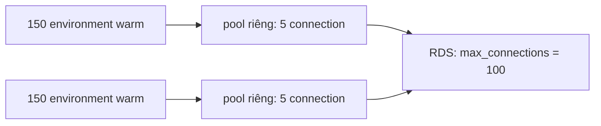

# L08: 150 environment Lambda warm mở bao nhiêu connection tới RDS

> **Trạng thái:** bản đủ bảy bước, nằm ngoài `src/`. Chưa nối vào `Lesson.vue`, chưa qua Goldfish, chưa đo với người đọc thứ hai.
> **Số liệu:** mọi con số trong bài là giả định của kịch bản, được ghi "Giả sử" ở chỗ dùng. Không phải số đo từ hệ thống thật, không phải mặc định của SQLAlchemy, FastAPI hay RDS.

**Tiên quyết:** biết một API chạy trên một máy; biết PostgreSQL có giới hạn số kết nối; đọc được một đoạn `create_engine` của SQLAlchemy ở mức "tạo engine, mượn connection, chạy câu SQL".

## Bước 1. Đoán trước

Giả sử API đọc sản phẩm chạy trên Lambda. Engine SQLAlchemy được tạo ở cấp module với `pool_size=5`. RDS PostgreSQL đặt `max_connections=100`. Một chiến dịch email đẩy tải lên 150 request đồng thời, và Lambda bật khoảng 150 environment.

Trước khi đọc tiếp, trả lời ba câu:

1. Mỗi environment mở tối đa 5 connection. Vậy con số nào là trần của **cả hệ thống**?
2. RDS báo `FATAL: sorry, too many clients already`. CPU của RDS chỉ khoảng 12 phần trăm. Vì sao?
3. Hạ `pool_size` xuống 1 thì lỗi có hết không?

Viết đáp án ra giấy. Đáp án nằm ở cuối bước 3.

## Bước 2. Điều bạn đã biết

Bạn đã từng chạy một API trên một máy. API đó tạo một engine, engine giữ một pool (bể connection), và mọi request dùng chung pool đó. `pool_size=5` nghĩa là nhiều nhất 5 connection cùng lúc cho cả tiến trình. Vượt quá thì request phải chờ, chứ không mở thêm bừa.

Bài này giữ nguyên chuỗi đó và thay đúng một khớp: **một tiến trình** đổi thành **nhiều environment**.

Lambda không chạy code của bạn trong một tiến trình duy nhất. Mỗi lần gọi đồng thời có một execution environment riêng, và mỗi environment nạp module của bạn một lần. Nếu engine được tạo ở cấp module, mỗi environment có engine riêng, pool riêng, trần riêng.

Đó là toàn bộ khác biệt. Mọi thứ còn lại giữ nguyên: connection vẫn được mượn, dùng, trả về pool.

## Bước 3. Một ví dụ có số

Giả sử 150 environment đang chạy, mỗi environment có `pool_size=5` và `max_overflow=0`. Tài liệu SQLAlchemy nói rõ: tổng số connection đồng thời mà **một pool** cho phép là `pool_size + max_overflow`, còn số connection "ngủ" (nằm lại pool) tối đa là `pool_size`.

Vậy một environment mở tối đa 5. Cả hệ thống:

- Trường hợp A: 150 × 5 = **750** connection. Trần là 100. Vượt 650, tức 7,5 lần trần.
- Trường hợp B: hạ xuống `pool_size=1`, được 150 × 1 = **150**. Vẫn vượt 50.
- Trường hợp C: dùng `NullPool`, 150 request đến cùng lúc thì mở **150** connection tại đỉnh. Vẫn vượt 50.

Câu 2: CPU thấp vì phần lớn request không vào được tới câu SQL nào. Cái bị cạn là **slot connection**, không phải năng lực tính toán. Slot connection không nằm trên biểu đồ mặc định của đội trực.

Câu 3: hạ `pool_size` xuống 1 làm số connection giảm 5 lần nhưng vẫn trên trần, nên lỗi chỉ thưa hơn. Muốn hết thì phải hạ số environment, hoặc đặt một khớp gom connection ở giữa.

**Đáp án bước 1:** trần hệ thống là 750 connection, không phải 5; CPU thấp vì request bị chặn trước khi chạy SQL; hạ `pool_size=1` vẫn vượt trần 50 connection.

## Bước 4. Cơ chế, từng bước một



1. **Init.** Engine tạo ngoài handler, nên mỗi environment có một pool riêng. Container warm (container được giữ lại sau lần gọi đầu) giữ pool đó qua nhiều lần gọi. Tài liệu SQLAlchemy nói pool không tạo connection trước: nó chỉ mở khi thật sự cần, nên một environment nhàn rỗi có thể đang giữ 0 connection, và một environment đã chạy thì giữ đúng số nó từng cần.
2. **Mượn và trả.** Handler mượn một connection, chạy câu SQL, rồi trả về pool. Trả về pool **không phải đóng**. Connection nằm lại và vẫn chiếm một slot phía database. Đây là lý do biểu đồ connection không về 0 khi hết tải.
3. **Cộng dồn.** Số connection phía database bằng tổng connection đang mở của mọi environment. Nó tăng theo số environment, không theo số request đang xử lý. Thêm 10 environment là thêm tối đa 50 slot, bất kể các environment đó có bận hay không.
4. **Vì sao lỗi tự hết.** Tải giảm thì Lambda thu hồi container. Container chết thì connection đóng theo. Không ai sửa gì, lỗi biến mất, và người trực dễ kết luận sai là "lỗi mạng tạm thời". Dấu hiệu phân biệt: `DatabaseConnections` đi lên cùng `ConcurrentExecutions`.
5. **NullPool.** `NullPool` bỏ phần giữ connection nhàn rỗi: mượn thì mở, trả thì đóng. Nó không hạ được đỉnh. Đỉnh của NullPool bằng số request đồng thời trong một environment. Với burst, con số đó vẫn là 150 trên toàn hệ thống. Cái giá thêm: mỗi lần mượn phải bắt tay TCP và TLS.
6. **RDS Proxy.** Proxy giữ một bể connection thật phía sau. Theo tài liệu, mặc định proxy dùng lại một connection sau **mỗi transaction** — cơ chế này gọi là multiplexing. Client mở bao nhiêu connection tới proxy cũng được, database chỉ thấy số connection của bể. Proxy xếp hàng hoặc giảm tốc phần chưa phục vụ được, và từ chối (shed load) khi vượt hạn mức. Hai điều kiện đi kèm: (a) `DATABASE_URL` phải trỏ vào endpoint proxy, nếu không thì mọi cấu hình gom connection thành vô nghĩa; (b) khi phiên làm những việc mà proxy không chắc ghép lại được — ví dụ một câu lệnh có text lớn hơn 16 KB — proxy **ghim** (pinning) phiên vào một connection tới hết phiên, và lúc đó không ghép được nữa.
7. **Proxy không nâng trần database.** `max_connections` vẫn là 100. Proxy chỉ làm cho 150 client cùng lúc vẫn lọt qua 100 slot, bằng cách xếp hàng. Nếu nút thắt là truy vấn thiếu index, proxy chỉ làm hàng đợi dài hơn.

**Phép tính phải làm trước khi chọn.** Trần hệ thống = số environment tối đa × (pool_size + max_overflow) + connection của mọi nguồn khác (job batch, môi trường staging dùng chung instance, công cụ phân tích). Giả sử production 20 environment × 1 = 20, staging 5, dev 5, job batch 10: tổng 40, an toàn với trần 100. Nâng reserved concurrency của production lên 120 vì cần tải: tổng thành 140, vượt trần dù không environment nào cấu hình sai. Chỉ một tham số hạ tầng đổi.

**Dạng câu hỏi phỏng vấn bài này trả lời được:** "Vì sao tăng concurrency của Lambda lại làm RDS báo `too many clients` trong khi CPU database vẫn thấp?", "`pool_size=5` nghĩa là gì khi code chạy trên Lambda?", "NullPool có giải quyết bài toán connection trên Lambda không?", "RDS Proxy có làm database chịu tải tốt hơn không?"

## Bước 5. Thí nghiệm nhỏ

Chạy trong thư mục `lessons/02-python/L08-connection-pool/`. Script chỉ dùng thư viện chuẩn của Python 3. Nếu máy không có `python` trong PATH, gọi bằng đường dẫn đầy đủ tới Python 3 trên máy bạn.

```
python pool_sim.py
```

Script mô phỏng **một** environment: 40 request, cách nhau 0,02 giây, mỗi request giữ connection 0,5 giây. Đồng hồ là đồng hồ ảo nên kết quả lặp lại y nguyên. Đây là mô phỏng cơ chế, không phải SQLAlchemy hay RDS thật.

Kết quả đã chạy trên máy này:

```
== Mot environment: 40 request, cach nhau 0.02s, giu connection 0.50s ==
Tran cua pool nay: pool_size 5 + max_overflow 0 = 5 connection

QueuePool (giu connection nha roi):
  request xong:                40
  request phai cho:            35
  so lan thu lai:              1126
  connection mo moi (ca run):  5
  dinh connection phia DB:     5

NullPool (mo moi lan muon, dong khi tra):
  request xong:                40
  request phai cho:            0
  so lan thu lai:              0
  connection mo moi (ca run):  40
  dinh connection phia DB:     25

== Tran toan he thong: 150 environment, max_connections = 100 ==
cau hinh                                             tran    so voi tran
A: pool_size=5, max_overflow=0                        750       vuot 650
B: pool_size=1, max_overflow=0                        150        vuot 50
C: NullPool, burst 150 cung luc                       150        vuot 50
D: reserved 18 env, pool_size=5                        90     khong vuot
```

Ba điều đọc ra từ hai khối đầu:

- Với `pool_size=5`, đỉnh connection phía database đúng bằng 5, và 35 trong 40 request phải chờ. Trần của pool là trần thật của environment này — nhưng nó chỉ là trần của **một** environment.
- Với `NullPool`, không request nào phải chờ, nhưng đỉnh lên 25 và cả 40 connection đều được mở mới. NullPool đổi "chờ" lấy "mở nhiều": bỏ hàng đợi ở phía mình và đẩy burst thẳng xuống database.
- Khối thứ ba là phép nhân: cùng một cấu hình `pool_size=5`, đổi số environment từ 18 lên 150 là đổi từ 90 (an toàn) lên 750 (vượt 7,5 lần).

**Tự thử:** chạy `python pool_sim.py --pool-size 2 --max-overflow 0`. Trần xuống 2, nên đỉnh phía database là 2, 38 trong 40 request phải chờ, và số lần thử lại lên 3545. Đổi cặp tham số mà giữ nguyên tổng thì kết quả không đổi: `--pool-size 2 --max-overflow 3` và `--pool-size 5 --max-overflow 0` đều ra trần 5, 35 request phải chờ, 1126 lần thử lại, đỉnh 5 — vì script chỉ mô hình hoá một trần duy nhất là `pool_size + max_overflow`. Đó cũng là điều cần hiểu về mô hình này: nó không phân biệt connection nằm lại pool với connection mở thêm.

## Bước 6. Bốn câu luyện tập

Trả lời trước khi mở đáp án.

**Câu 1.** Vì sao `pool_size=5` là trần đúng trên một máy chủ nhưng sai trên Lambda?

<details>
<summary>Đáp án</summary>

Kết luận: vì pool thuộc về một tiến trình. Trên máy chủ có một tiến trình phục vụ mọi request, nên một pool là toàn bộ. Trên Lambda, mỗi environment là một tiến trình riêng, nên trần thật là `pool_size` nhân số environment.

Điều kiện để đúng: engine tạo ở cấp module. Nếu engine tạo trong handler thì mỗi lần gọi lại có pool mới, và connection còn tệ hơn vì bị mở/đóng liên tục.

Cách kiểm: vẽ `DatabaseConnections` cạnh `ConcurrentExecutions`. Hai đường đi lên cùng nhau là dấu hiệu của phép nhân; một đường phẳng là dấu hiệu của trần thật.

</details>

**Câu 2.** NullPool bỏ connection nhàn rỗi. Vì sao nó vẫn không cứu được sự cố 150 environment?

<details>
<summary>Đáp án</summary>

Kết luận: vì NullPool chỉ hạ phần **nằm lại**, không hạ phần **đồng thời**. Đỉnh connection bằng số request đang chạy cùng lúc trong một environment, và trên toàn hệ thống vẫn là tổng của 150 environment.

Điều kiện để đúng: burst là burst. Nếu tải đều và mỗi environment chỉ xử lý một request tại một thời điểm, NullPool giữ mỗi environment ở 1 connection, và 150 environment vẫn là 150 — trên trần 100.

Cách kiểm: đọc đỉnh của biểu đồ connection đúng lúc burst, không đọc giá trị trung bình. Trong thí nghiệm trên, NullPool có đáy bằng 0 nhưng đỉnh là 25 cho một environment.

</details>

**Câu 3.** Đặt RDS Proxy rồi, số connection phía database còn tăng theo số environment không?

<details>
<summary>Đáp án</summary>

Kết luận: không theo cùng cách. Database chỉ thấy connection của bể proxy, nên số đó do cấu hình bể quyết định, không do số environment. Nhưng trần `max_connections` của database không đổi, và proxy sẽ từ chối client khi vượt hạn mức của nó.

Điều kiện để đúng: `DATABASE_URL` trỏ vào endpoint proxy. Trỏ thẳng vào instance thì proxy không nằm trên đường đi và mọi thứ như cũ.

Cách kiểm: đếm connection trong `pg_stat_activity` nhóm theo `application_name`. Qua proxy, số phiên từ ứng dụng sẽ ít hơn hẳn số environment, và tên ứng dụng thường là tên proxy.

</details>

**Câu 4.** Với trần 100 connection, chọn cấu hình cho API cần chịu 150 request đồng thời. Nêu phép tính và cái giá.

<details>
<summary>Đáp án</summary>

Kết luận: không cấu hình nào một mình đủ. Phải chặn số environment hoặc gom connection, rồi tính lại.

Cách một: reserved concurrency = 18, `pool_size=5`, `max_overflow=0` → 90 connection, dưới trần 100. Cái giá: request thứ 19 trở đi nhận throttle của Lambda, nên client phải có backoff.

Cách hai: giữ 150 environment, dùng NullPool, đặt RDS Proxy với bể backend nhỏ hơn 100. Cái giá: thêm một hop mạng, thêm phí, và mất khả năng ghép khi phiên bị ghim.

Điều kiện để đúng: phép cộng phải gồm mọi nguồn — job batch, staging, công cụ đọc — không chỉ API.

Cách kiểm: sau khi đặt, khi tải vượt trần thì lỗi chuyển từ `too many clients` của RDS sang throttle của Lambda hoặc độ trễ xếp hàng ở proxy, còn số connection database phẳng.

</details>

## Bước 7. Câu neo

> Số connection tới RDS bằng số environment đang chạy nhân connection mỗi environment, nên `pool_size` là trần của một tiến trình chứ không phải trần của hệ thống.

## Ghi chú nguồn

<details>
<summary>Ghi chú nguồn, đọc ngày 2026-10-29</summary>

- https://docs.sqlalchemy.org/en/20/core/pooling.html — xác nhận: tổng số connection đồng thời một pool cho phép là `pool_size + max_overflow`; số connection ngủ tối đa là `pool_size`; pool không tạo connection trước mà mở khi cần; `poolclass=NullPool` là cách tắt pooling.
- https://docs.aws.amazon.com/AmazonRDS/latest/UserGuide/rds-proxy.html — xác nhận: proxy giữ connection pool và dùng lại; proxy xếp hàng hoặc giảm tốc connection chưa phục vụ được; vượt hạn mức thì proxy từ chối connection (shed load); câu lệnh có text lớn hơn 16 KB làm proxy ghim phiên.
- https://docs.aws.amazon.com/AmazonRDS/latest/UserGuide/rds-proxy.howitworks.html — xác nhận: multiplexing dùng lại connection sau mỗi transaction; pinning giữ phiên trên một connection tới hết phiên; qua proxy thì connection ứng dụng sống sót qua failover, chỉ connection đang trong transaction bị huỷ.

Chưa kiểm trong bài này: `max_connections` mặc định của RDS PostgreSQL (con số 100 là giả định của kịch bản); giá và hạn mức của RDS Proxy; trang concurrency của Lambda; hành vi thu hồi container của Lambda theo thời gian. Toàn bộ số trong bài là số của kịch bản, không phải mặc định của dịch vụ nào.

</details>
