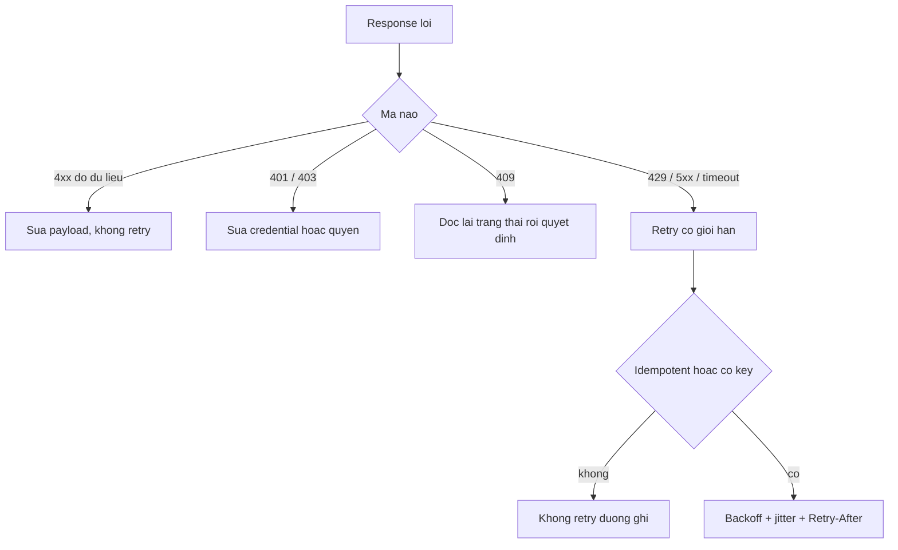

# L09: Lỗi nào phải sửa dữ liệu, lỗi nào đáng retry

> **Trạng thái:** bản đủ bảy bước, nằm ngoài `src/`. Chưa nối vào `Lesson.vue`, chưa qua Goldfish, chưa đo với người đọc thứ hai.
> **Số liệu:** mọi con số trong bài là giả định của kịch bản, được ghi "Giả sử" ở chỗ dùng. Không phải số đo từ hệ thống thật, không phải mặc định của dịch vụ nào.

**Tiên quyết:** biết gọi một API bằng HTTP và đọc mã trạng thái; biết `try`/`except` trong Python; biết một giao dịch ghi dữ liệu là gì.

## Bước 1. Đoán trước

Giả sử dịch vụ đơn hàng gọi API thanh toán của đối tác. Client đang retry tối đa ba lần cho **mọi** mã khác 200, không chờ giữa các lần.

Có ba đợt, mỗi đợt 100 request:

- Đợt 1: đối tác trả 422 vì payload thiếu một trường.
- Đợt 2: đối tác trả 429 kèm header `Retry-After: 2`.
- Đợt 3: request bị timeout, không rõ đối tác đã ghi hay chưa.

Trước khi đọc tiếp, trả lời hai câu:

1. Nếu client tôn trọng `Retry-After` và **không** retry 422, mỗi đợt gửi bao nhiêu request tới đối tác?
2. Đợt nào có thể tạo bản ghi trùng, và vì sao?

Viết đáp án ra giấy. Đáp án nằm ở cuối bước 3.

## Bước 2. Điều bạn đã biết

Bạn đã từng viết một hàm gọi API và bọc nó trong `try`/`except`. Trên máy bạn, đối tác luôn trả 200, nên nhánh lỗi gần như không bao giờ chạy. Khi chạy, bạn thêm một vòng `for` thử lại vài lần — vì ai cũng nói retry làm hệ thống bền hơn.

Bài này giữ nguyên vòng lặp đó và thay đúng một khớp: **điều kiện vào vòng lặp**. Thay "mọi mã khác 200" bằng một quyết định dựa trên việc lần gọi sau có thể khác lần trước hay không.

Câu hỏi quyết định rất cụ thể: nếu tôi gửi lại **y nguyên** request này, kết quả có thể khác không?

- Không thể khác → retry chỉ nhân số request, không đổi kết quả.
- Có thể khác → retry có nghĩa, nhưng phải có giới hạn và phải an toàn.

## Bước 3. Một ví dụ có số

Giả sử mỗi đợt có 100 request, client thử tối đa 4 lần (1 lần đầu + 3 lần lại).

**Đợt 1 — 422.** Tài liệu MDN nói thẳng: client nhận 422 thì nên hiểu rằng gửi lại request **không sửa gì** sẽ nhận đúng lỗi đó. Vậy số request đúng là 100. Nếu retry ba lần thì thành 400 request hoàn toàn vô ích, và tỉ lệ lỗi không đổi một chút nào.

**Đợt 2 — 429.** Đối tác nói "chờ 2 giây". Tôn trọng header nghĩa là chờ 2 giây rồi gửi lại **một** lần. Giả sử lần thứ hai thành công, số request là 100 + 100 = 200. Nếu bỏ qua `Retry-After` và thử ngay, 100 request thành 400 request trong cùng một giây — đúng lúc đối tác đang yêu cầu giảm tải. Đây là cách một "cải tiến độ bền" biến thành hành vi tấn công chính đối tác của mình.

**Đợt 3 — timeout.** Timeout **không** chứng minh server chưa ghi. Nó chỉ nói "tôi không nhận được trả lời trong 5 giây". Server có thể đã trừ tiền và chết ở bước ghi log. Số request là 200 đến 400 tuỳ số lần timeout, và đợt này là đợt duy nhất có nguy cơ tạo hai bản ghi cho cùng một đơn.

**Đáp án bước 1:** 422 là 100 request (không retry); 429 là 200 request nếu tôn trọng `Retry-After`; đợt timeout là đợt có nguy cơ trùng bản ghi, vì timeout không nói được server đã ghi hay chưa.

## Bước 4. Cơ chế, từng bước một



1. **Nhóm sửa đầu vào (4xx do dữ liệu).** Request sai: thiếu trường, sai kiểu, sai định dạng. Lần gọi sau với cùng bytes đi đúng đường cũ và cho đúng kết quả cũ. Việc phải làm là sửa payload hoặc sửa validator, không phải gọi lại. [CHƯA KIỂM: FastAPI trả 422 ở tầng validation trước khi handler chạy — trang tài liệu FastAPI về lỗi validation chưa mở trong phiên này. Điều đã kiểm là MDN nói gửi lại y nguyên sẽ lặp lại đúng lỗi.]
2. **Nhóm sửa quyền (401, 403).** Credential hết hạn hoặc thiếu quyền. Retry không đổi gì; refresh token hoặc sửa policy mới là việc phải làm. Một biến thể đáng nhớ: 403 do clock skew của chữ ký — sửa đồng hồ, không sửa request.
3. **Nhóm xung đột (409).** Tài nguyên đã đổi từ lúc client đọc. Gửi lại y nguyên là ghi đè dựa trên trạng thái cũ. Phải đọc lại, tính lại, rồi gửi bản mới.
4. **Nhóm tạm thời (429, 5xx, timeout, lỗi mạng).** Đây là nhóm duy nhất mà lần gọi sau có thể khác. Retry có nghĩa, với ba điều kiện:
   - **Có trần.** Số lần và tổng thời gian đều có giới hạn. Không trần thì một đối tác sập biến client thành máy bắn request.
   - **Có backoff và jitter.** Chờ tăng dần theo `base × 2^k`, và mỗi client cộng thêm một lượng ngẫu nhiên. Không có jitter, 200 client cùng lỗi sẽ cùng thử lại ở đúng một thời điểm; đó là bão retry (retry storm), tự tạo ra đợt quá tải thứ hai ngay sau đợt đầu.
   - **Tôn trọng `Retry-After`** khi đối tác gửi. Đây là tín hiệu tốt hơn mọi công thức mình tự nghĩ, vì chỉ đối tác biết họ cần bao lâu.
5. **Idempotency là điều kiện, không phải chi tiết.** Thao tác idempotent (gọi lại cho cùng kết quả: `GET`, `PUT` có nội dung đầy đủ) retry được. Thao tác không idempotent (`POST` tạo đơn) chỉ retry được khi mang **idempotency key**: một khoá do phía gọi sinh, giữ nguyên qua các lần thử, để server nhận ra "à, giao dịch này tôi đã làm rồi" và trả lại kết quả cũ thay vì tạo bản ghi thứ hai.
6. **Retry budget.** Đặt một tỉ lệ trần cho lưu lượng retry so với lưu lượng gốc, ví dụ 10 phần trăm. Vượt tỉ lệ đó thì thôi retry và trả lỗi. Không có ngân sách này, một sự cố của đối tác biến thành đòn tự đánh vào mình: mọi tầng đều retry, và tải nhân lên theo số tầng.

**Cái gì phải ghi vào log.** Mã trạng thái **gốc**, số lần thử, và khoá idempotency. Ghi `upstream error` là ghi một câu không phân loại được gì: người trực không biết nên sửa payload hay chờ. Sự cố trong bài gốc kéo dài ba tuần chủ yếu vì log không có mã gốc.

**Dạng câu hỏi phỏng vấn bài này trả lời được:** "Khi nào thì retry, khi nào thì không?", "Vì sao retry mà không có jitter lại làm hệ thống tệ hơn?", "Timeout có nghĩa là request chưa tới server không?", "Làm sao retry một `POST` mà không tạo bản ghi trùng?"

## Bước 5. Thí nghiệm nhỏ

Chạy trong thư mục `lessons/02-python/L09-retry/`. Script chỉ dùng thư viện chuẩn. Nếu máy không có `python` trong PATH, gọi bằng đường dẫn đầy đủ tới Python 3 trên máy bạn.

```
python jitter_sim.py
```

Mô phỏng: 200 client cùng gặp lỗi tại thời điểm 0. Server "chết" tới giây thứ 2, sau đó chỉ nhận 50 request mỗi giây. Mỗi client gửi tối đa 5 lần, backoff `0,5 × 2^k`. Đây là mô phỏng, không gọi mạng. Kết quả cố định vì có `random.Random(seed)`.

Kết quả đã chạy trên máy này:

```
Mo phong: 200 client cung loi tai t=0; server song lai sau 2.0s,
nhan toi da 50 request/giay; backoff 0.5s * 2^k; toi da 5 lan gui moi client.

khong jitter               tong gui:   950 | dinh 100ms khi thu lai:  200 | xong: 100/200
                           dinh 100ms tinh ca lan dau:  200
co jitter (full jitter)    tong gui:   961 | dinh 100ms khi thu lai:   64 | xong: 148/200
                           dinh 100ms tinh ca lan dau:  250
```

Hai con số cần đọc: **đỉnh 200 request trong 100 mili giây** khi không jitter, và **64** khi có jitter. Cùng 200 client, cùng backoff, cùng trần số lần thử — chỉ khác chỗ có rải thời điểm hay không. Đỉnh giảm hơn ba lần.

Điều đáng chú ý thứ hai: số request xong tăng từ 100 lên 148 trên 200. Khi 200 request dồn vào cùng một khoảnh khắc, server chỉ nhận được 50 mỗi giây và phần còn lại bị từ chối; năng lực của server bị lãng phí trong những khoảng không có ai gọi. Jitter rải request ra, nên phần năng lực đó được dùng.

Một chi tiết trung thực: tổng số request gửi gần như bằng nhau (950 và 961). Trong mô hình này, jitter **không** giảm tổng công việc, vì mỗi client vẫn có trần 5 lần gửi và client thành công thì dừng. Cái nó giảm là **độ dồn** — và độ dồn mới là thứ làm server từ chối request. Bài viết của AWS về backoff và jitter đo trên một mô hình khác (tranh chấp ghi đồng thời) và báo cáo giảm hơn một nửa số lần gọi; đừng chép con số đó sang mô hình này.

**Tự thử:** đổi `MAX_ATTEMPTS` thành 8 và chạy lại. Đỉnh không jitter vẫn là 200, và đỉnh có jitter vẫn là **64** — không tăng. Cái đổi là số request xong: từ 100/200 và 148/200 lên **200/200** ở cả hai bên, với tổng gửi 1100 (không jitter) và 1024 (có jitter). Với trần 5 lần, nhiều client hết lượt trước khi server sống lại; nới lên 8 thì ai cũng tới được. Đỉnh không phụ thuộc số lần thử vì nó do lần thử lại **đầu tiên** quyết định: 200 client cùng tính ra cùng một khoảng chờ, nên vẫn dồn vào một cụm y như cũ. Giải thích vì sao.

## Bước 6. Bốn câu luyện tập

Trả lời trước khi mở đáp án.

**Câu 1.** Vì sao 422 không bao giờ đáng retry?

<details>
<summary>Đáp án</summary>

Kết luận: vì kết quả của lần gọi sau giống hệt lần trước khi request không đổi. MDN nói rõ điều này: client nhận 422 nên hiểu rằng gửi lại mà không sửa gì sẽ nhận đúng lỗi đó.

Điều kiện để đúng: request được gửi lại y nguyên. Nếu payload được sinh lại mỗi lần và có thể khác đi thì mới có chuyện lần sau đúng — nhưng đó là sửa dữ liệu, không phải retry.

Cách kiểm: nếu log có cùng một thông báo lỗi trường cho cả bốn lần thử, và tỉ lệ thành công không đổi khi số lần thử tăng, thì retry đang vô ích.

</details>

**Câu 2.** Vì sao backoff mà không có jitter lại tạo ra đợt quá tải thứ hai?

<details>
<summary>Đáp án</summary>

Kết luận: vì mọi client lỗi cùng lúc sẽ tính ra cùng một khoảng chờ, nên chúng thử lại đúng cùng một thời điểm. Backoff làm thưa các đợt, nhưng mỗi đợt vẫn là một cụm dày.

Điều kiện để đúng: các client lỗi gần như đồng thời — đúng tình huống khi một dịch vụ sập hoặc trả 429 hàng loạt.

Cách kiểm: đo số request trong cùng một cửa sổ 100 mili giây. Trong thí nghiệm trên, con số là 200 khi không jitter và 64 khi có jitter, với cùng 200 client.

</details>

**Câu 3.** Request bị timeout. Vì sao retry nó có thể tạo bản ghi thứ hai, và cần gì để retry an toàn?

<details>
<summary>Đáp án</summary>

Kết luận: timeout chỉ nói phía mình không nhận được trả lời. Server có thể đã ghi xong rồi chết trước khi trả lời, nên lần gửi lại có thể là giao dịch thứ hai.

Điều kiện để đúng: thao tác idempotent, hoặc request mang idempotency key giữ nguyên qua các lần thử, và server lưu key kèm kết quả để trả lại kết quả cũ.

Cách kiểm: đếm bản ghi trùng theo khoá nghiệp vụ. Nếu số bản ghi trùng tăng sau một đợt timeout thì thiếu idempotency, không phải thiếu retry.

</details>

**Câu 4.** Đối tác trả 429 kèm `Retry-After: 30`. Client của bạn backoff 1 giây rồi thử lại. Sai ở đâu?

<details>
<summary>Đáp án</summary>

Kết luận: sai ở chỗ bỏ qua tín hiệu của đối tác. `Retry-After` nói thời điểm sớm nhất nên gọi lại; thử sau 1 giây là thử trong lúc họ vẫn đang từ chối, và làm tải của họ nặng thêm.

Điều kiện để đúng: header chỉ có trên một số response (429, 503, và redirect). Không có header thì mới dùng backoff tự tính, và vẫn phải cộng jitter.

Cách kiểm: đo lưu lượng theo giây trong lúc có 429. Nếu lưu lượng tăng sau khi bật retry thì backoff đang sai, bất kể công thức trông đúng.

</details>

## Bước 7. Câu neo

> Chỉ lỗi tạm thời mới đáng gọi lại, và chỉ khi thao tác idempotent; 422 gửi lại y nguyên thì nhận lại đúng 422.

## Ghi chú nguồn

<details>
<summary>Ghi chú nguồn, đọc ngày 2026-10-29</summary>

- https://developer.mozilla.org/en-US/docs/Web/HTTP/Reference/Status/422 — xác nhận: 422 là lỗi phía client, server hiểu nội dung nhưng không xử lý được; client nhận 422 nên hiểu rằng gửi lại request mà không sửa gì sẽ nhận đúng lỗi đó.
- https://developer.mozilla.org/en-US/docs/Web/HTTP/Reference/Headers/Retry-After — xác nhận: `Retry-After` dùng trong 503 (thời gian dịch vụ dự kiến không sẵn sàng) và 429 (thời gian chờ trước khi gửi request mới); giá trị là số giây hoặc một ngày HTTP.
- https://aws.amazon.com/blogs/architecture/exponential-backoff-and-jitter/ — xác nhận: backoff mũ không có jitter vẫn để lại các cụm lời gọi dồn vào cùng thời điểm; thêm jitter làm tốc độ lời gọi gần như đều; bài nêu các biến thể Full Jitter, Equal Jitter, Decorrelated Jitter và nói Full Jitter ít việc nhất trong ba biến thể.

Chưa kiểm trong bài này: cơ chế FastAPI trả 422 ở tầng validation trước khi handler chạy (chưa mở trang tài liệu FastAPI về lỗi validation trong phiên này); ngữ nghĩa chi tiết của 409 và 401/403 trên MDN; hành vi retry mặc định của Lambda và của AWS SDK. Con số 100 request mỗi đợt và 3 lần retry là giả định của kịch bản.

</details>
