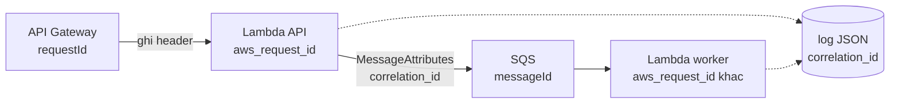

# L10: Nối log của cùng một đơn qua API, Lambda và SQS

> **Trạng thái:** bản đủ bảy bước, nằm ngoài `src/`. Chưa nối vào `Lesson.vue`, chưa qua Goldfish, chưa đo với người đọc thứ hai.
> **Số liệu:** mọi con số trong bài là giả định của kịch bản, được ghi "Giả sử" ở chỗ dùng. Không phải số đo từ hệ thống thật, không phải mặc định của dịch vụ nào.

**Tiên quyết:** biết một request HTTP có header; biết log là gì; biết SQS là hàng đợi message; đọc được một dòng JSON.

## Bước 1. Đoán trước

Giả sử một đơn đi qua API Gateway, một hàm Lambda nhận request, rồi gửi message vào SQS cho một hàm Lambda khác xử lý. Không ai thêm gì vào code, không cấu hình gì thêm.

Trước khi đọc tiếp, trả lời hai câu:

1. `requestId` của API Gateway, `aws_request_id` của Lambda nhận request, `aws_request_id` của Lambda worker, và `messageId` của SQS — có cặp nào trùng nhau không?
2. Muốn nối ba tầng, phải thêm gì, và thêm ở đâu?

Viết đáp án ra giấy. Đáp án nằm ở cuối bước 3.

## Bước 2. Điều bạn đã biết

Bạn đã từng debug một API trên một máy. Server ghi log kiểu `INFO 10:04:12 nhận request /orders`, và mọi dòng của cùng một request nằm liền nhau trong một file. Muốn xem một request đi qua những bước nào, bạn mở file và đọc từ trên xuống.

Bài này giữ nguyên ý đó — "đọc các bước của cùng một request" — và thay hai khớp:

- **Một file** đổi thành **ba nhóm log** ở ba dịch vụ.
- **Một tiến trình** đổi thành **hai hàm Lambda**, mỗi hàm có container riêng, có thể chạy lại.

Thêm một khác biệt nhỏ nhưng quyết định: ba dịch vụ đều **có** id trong log. Chúng chỉ không phải cùng một id.

## Bước 3. Một ví dụ có số

Giả sử ba nhóm log, mỗi nhóm khoảng 200 dòng trong khung giờ sự cố. Một khách báo đơn không tới sau 30 phút.

- Nhóm API Gateway có `requestId`, sinh cho từng request tới nó.
- Nhóm Lambda nhận request có `aws_request_id`, sinh cho từng invocation.
- Nhóm Lambda worker có `messageId`, sinh bởi SQS khi message được gửi.

Ba id thuộc ba phạm vi khác nhau. Không id nào tự đi sang tầng sau: `requestId` không nằm trong payload mà Lambda nhận, `aws_request_id` đổi mỗi lần chạy, `messageId` chỉ tồn tại từ lúc message được gửi.

Không có id chung, việc tìm một đơn là đọc thủ công: 200 dòng nhân ba nhóm, ghép theo thời gian, và cách đó chỉ đúng khi không có hai đơn cùng giây. Giả sử việc đó mất 40 phút.

Nếu mỗi dòng log là JSON có một trường `correlation_id` do biên tạo, cùng một việc là một truy vấn lọc theo trường đó: 7 dòng của đúng đơn, dưới 2 phút.

**Đáp án bước 1:** không cặp nào trùng, và không id nào tự lan sang tầng sau; phải tự tạo một `correlation_id` ở biên, ghi nó vào mọi dòng log, và truyền nó qua `MessageAttributes` khi gửi SQS.

## Bước 4. Cơ chế, từng bước một



1. **Tạo ở biên.** Middleware của API đọc header định danh nếu client gửi, ngược lại sinh một giá trị mới. Giá trị này là `correlation_id` của cả đường đi. Tạo ở biên chứ không tạo ở giữa, vì mọi tầng phía sau phải tham chiếu **cùng một** giá trị; tạo ở giữa thì tầng trước đã ghi log xong và không có id đó.
2. **Ghi log dạng JSON, một dòng một sự kiện.** Mỗi dòng có `event`, `correlation_id`, và các trường của sự kiện. Log dạng chuỗi tự do (`f"đơn {order_id} lỗi"`) không lọc được theo trường; mọi truy vấn phải tìm chuỗi con, và sẽ khớp nhầm dòng của đơn khác có mã nằm trong chuỗi khác.
3. **Truyền qua ranh giới.** Khi gửi SQS, `correlation_id` đi trong `MessageAttributes` — một map tên → giá trị có `DataType` và `StringValue` — chứ không nhét vào body. Body giữ nghiệp vụ; thuộc tính giữ siêu dữ liệu. Worker đọc được thuộc tính mà không phải parse nghiệp vụ, và nghiệp vụ không phải biết gì về việc tracing.
4. **Nhận ở worker và reset.** Worker đọc `correlation_id` từ record, gắn vào context của lần chạy, và **reset sau mỗi invocation**. Container Lambda được tái sử dụng, nên một biến cấp module còn sót giá trị cũ sẽ làm dòng log của đơn sau mang id của đơn trước. Dấu hiệu: id lạ xuất hiện, hoặc một dòng log của đơn mới mang id cũ.
5. **Đọc lại bằng truy vấn.** CloudWatch Logs Insights dùng cú pháp dòng lệnh nối bằng dấu `|`, với các lệnh như `fields`, `filter`, `sort`, `limit`, `stats`. Truy vấn đọc đường đi của một đơn:

```
fields @timestamp, layer, event, correlation_id, order_id, aws_request_id, messageId, error
| filter correlation_id = "corr-a1"
| sort @timestamp asc
| limit 200
```

Đây là **cú pháp truy vấn**, viết theo tài liệu Logs Insights, **chưa chạy trên CloudWatch** trong phiên này. Thí nghiệm ở bước 5 làm đúng việc tương đương bằng Python trên file log cục bộ.

6. **Mức log.** `INFO` cho các mốc nghiệp vụ (nhận đơn, gửi message, hoàn tất), `WARN` cho thứ đáng chú ý nhưng tự hết (retry lần 1, `Retry-After`), `ERROR` cho thứ cần người xem. Không log payload đầy đủ: dung lượng tăng, và dữ liệu khách hàng nằm trong log là một sự cố khác. Log **mã trạng thái gốc** và **id**, không log cả request.

**Ba id hệ thống vẫn giữ.** `correlation_id` không thay ba id kia: `aws_request_id` là thứ phải đưa cho AWS Support khi hỏi về một invocation, `messageId` là thứ phải đưa khi hỏi về một message. Cái `correlation_id` làm được là trả lời "đơn này đi qua những dòng nào", không phải "invocation này chạy trên máy nào".

**Dạng câu hỏi phỏng vấn bài này trả lời được:** "Làm sao trace một request đi qua nhiều dịch vụ?", "`requestId` của API Gateway có dùng làm correlation id được không?", "Vì sao log nên là JSON?", "Truyền metadata qua SQS bằng cách nào?"

## Bước 5. Thí nghiệm nhỏ

Chạy trong thư mục `lessons/02-python/L10-log-correlation/`. Hai script chỉ dùng thư viện chuẩn. Nếu máy không có `python` trong PATH, gọi bằng đường dẫn đầy đủ tới Python 3 trên máy bạn.

```
python emit_logs.py
python trace_order.py
```

Script thứ nhất sinh 12 dòng log JSON cho **hai** đơn đi qua ba tầng, xen kẽ nhau, và ghi ra `logs.jsonl`. Script thứ hai lọc theo `correlation_id` và in dòng thời gian của đúng một đơn. Đây là mô phỏng định dạng log, không gọi AWS.

Kết quả đã chạy trên máy này:

```
da ghi 12 dong vao logs.jsonl
---
Tong so dong log: 12
Loc theo correlation_id = corr-a1 -> 7 dong

Dong thoi gian cua don nay:
  2026-10-29T10:00:00.00Z  api-gateway   request_received
  2026-10-29T10:00:00.05Z  lambda-api    order_accepted       order_id=A-1001 aws_request_id=lam-a-1
  2026-10-29T10:00:00.09Z  lambda-api    message_sent         aws_request_id=lam-a-1 messageId=msg-aaa
  2026-10-29T10:00:01.24Z  lambda-worker message_received     aws_request_id=lam-a-2 messageId=msg-aaa
  2026-10-29T10:00:01.35Z  lambda-worker payment_failed       aws_request_id=lam-a-2 messageId=msg-aaa error=upstream 503
  2026-10-29T10:00:02.40Z  lambda-worker message_redelivered  aws_request_id=lam-a-3 messageId=msg-aaa
  2026-10-29T10:00:02.46Z  lambda-worker order_completed      aws_request_id=lam-a-3 messageId=msg-aaa

Neu chi co mot id he thong thi loc duoc bao nhieu dong:
  requestId       tong  2 dong, o cac tang: api-gateway=2
  aws_request_id  tong 10 dong, o cac tang: lambda-api=4, lambda-worker=6
  messageId       tong  8 dong, o cac tang: lambda-api=2, lambda-worker=6
  order_id        tong  2 dong, o cac tang: lambda-api=2
```

Bốn điều đọc ra:

- Bảy dòng, đúng một đơn, đúng thứ tự thời gian. Không phải đọc 12 dòng rồi tự ghép.
- `requestId` chỉ có ở tầng API Gateway: 2 dòng, cho 2 đơn. Lọc theo nó thì đường đi đứt ngay sau tầng đầu.
- `aws_request_id` có 10 dòng nhưng chia làm ba giá trị khác nhau (`lam-a-1`, `lam-a-2`, `lam-a-3`). Đây chính là chỗ dễ hiểu nhầm: cùng một đơn, ba invocation, ba id. `lam-a-3` là lần xử lý lại sau khi `payment_failed`.
- `messageId` có 8 dòng nhưng chỉ 2 giá trị, mỗi đơn một giá trị. Nó nối được tầng gửi với tầng nhận của **một** message, không nối được về request gốc.

Đơn B (`corr-b2`) nằm xen giữa các dòng của đơn A. Đó là lý do ghép theo thời gian không đáng tin: hai đơn chồng lên nhau trong cùng một giây.

**Tự thử:** chạy `python trace_order.py corr-b2`. Đơn B xong bình thường, không có dòng lỗi. So sánh số dòng với đơn A và giải thích vì sao A nhiều hơn.

## Bước 6. Bốn câu luyện tập

Trả lời trước khi mở đáp án.

**Câu 1.** Vì sao `requestId` của API Gateway không tự trở thành correlation id của cả đường đi?

<details>
<summary>Đáp án</summary>

Kết luận: vì nó thuộc phạm vi một request tới API Gateway. Nó không nằm trong payload mà Lambda nhận, trừ khi code chủ động đọc header và chuyển tiếp.

Điều kiện để đúng: mọi đường vào đều đi qua API Gateway, và code đọc rồi chuyển tiếp ở mọi chỗ. Nếu có thêm job theo lịch hay message từ hệ thống khác thì các đường đó không có `requestId`.

Cách kiểm: đếm số message tới worker mà không có `correlation_id`. Khác 0 nghĩa là có đường vào không qua cổng đó.

</details>

**Câu 2.** Vì sao `correlation_id` phải được tạo ở biên chứ không phải ở Lambda worker?

<details>
<summary>Đáp án</summary>

Kết luận: vì tầng trước đã ghi log trước khi worker chạy. Tạo ở giữa thì các dòng log phía trước không có id đó, và đường đi vẫn đứt ở đúng chỗ cần nối.

Điều kiện để đúng: biên phải là chỗ duy nhất mọi request đi qua — middleware của API, và với job theo lịch thì là chỗ job khởi động.

Cách kiểm: tỉ lệ dòng log có `correlation_id` trên tổng số dòng. Thiếu một chỗ là đường đi đứt ở chỗ đó.

</details>

**Câu 3.** Log dạng chuỗi `don A-1001 loi` có gì không ổn so với log JSON?

<details>
<summary>Đáp án</summary>

Kết luận: không lọc được theo trường. Mọi truy vấn thành tìm chuỗi con, nên sẽ khớp cả dòng của đơn khác có `A-1001` nằm trong một chuỗi khác, và không đếm được theo trường.

Điều kiện để đúng: JSON chỉ có ích khi mọi chỗ ghi log đi qua cùng một cấu hình. Một chỗ ghi chuỗi tự do là một lỗ hổng trong đường nối.

Cách kiểm: chạy một truy vấn `filter` theo trường và so số dòng với khi tìm chuỗi con. Lệch nghĩa là có dòng không phải JSON.

</details>

**Câu 4.** Worker chạy lại cùng một message. Log của lần thứ hai nên khác lần thứ nhất ở đâu?

<details>
<summary>Đáp án</summary>

Kết luận: khác `aws_request_id` (invocation mới) và khác thời điểm, nhưng **giữ nguyên** `correlation_id` và `messageId`. Đó là điều cho phép nhìn ra "cùng một đơn, xử lý hai lần".

Điều kiện để đúng: `correlation_id` phải đi theo message, không phải sinh lại ở worker. Sinh lại thì hai lần xử lý trông như hai đơn khác nhau.

Cách kiểm: lọc theo `messageId`, đếm số `aws_request_id` khác nhau. Lớn hơn 1 nghĩa là message đã được xử lý nhiều lần — thông tin cần để biết handler có idempotent không.

</details>

## Bước 7. Câu neo

> Ba id của ba dịch vụ không tự lan truyền, nên muốn nối một đơn thì phải tự tạo `correlation_id` ở biên và mang nó theo qua log JSON và `MessageAttributes`.

## Ghi chú nguồn

<details>
<summary>Ghi chú nguồn, đọc ngày 2026-10-29</summary>

- https://docs.aws.amazon.com/lambda/latest/dg/python-context.html — xác nhận: context object của handler có thuộc tính `aws_request_id` là "the identifier of the invocation request", cùng `log_group_name`, `log_stream_name`; id này thuộc phạm vi một invocation.
- https://docs.aws.amazon.com/apigateway/latest/developerguide/api-gateway-mapping-template-reference.html — xác nhận: `$context.requestId` là "an ID for the request", và ghi chú rằng client có thể ghi đè request ID này; `$context.extendedRequestId` là ID duy nhất do API Gateway sinh.
- https://docs.aws.amazon.com/AWSSimpleQueueService/latest/APIReference/API_SendMessage.html — xác nhận: `MessageAttributes` là map tên → object có `DataType`, `StringValue`, `BinaryValue`; `MessageId` được trả về trong response của `SendMessage`.
- https://docs.aws.amazon.com/AmazonCloudWatch/latest/logs/CWL_QuerySyntax.html — xác nhận: cú pháp Logs Insights nối nhiều lệnh bằng dấu `|`, có các lệnh `fields`, `filter`, `sort`, `limit`, `stats`, `parse`; comment bằng `#`.

Chưa kiểm trong bài này: câu truy vấn Logs Insights ở bước 4 chưa chạy trên CloudWatch (mới đối chiếu cú pháp với trang tài liệu); định dạng log mặc định của API Gateway và tên các trường trong đó; cách Lambda đọc `MessageAttributes` từ record SQS ở mức tài liệu; giới hạn kích thước và số lượng message attribute. Con số 40 phút, 200 dòng mỗi nhóm và 12 dòng log là giả định của kịch bản.

</details>
