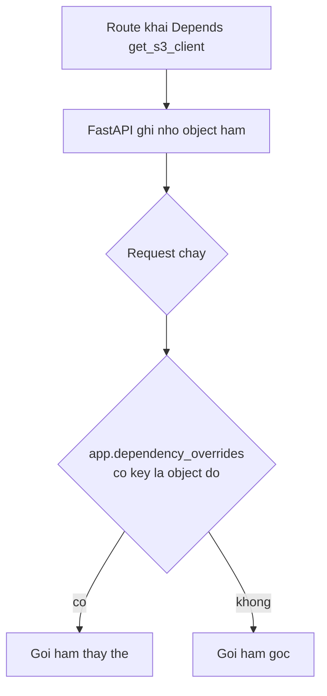

# L11: Test thay client AWS bằng fake ở đúng chỗ

> **Trạng thái:** bản đủ bảy bước, nằm ngoài `src/`. Chưa nối vào `Lesson.vue`, chưa qua Goldfish, chưa đo với người đọc thứ hai.
> **Số liệu:** mọi con số trong bài là giả định của kịch bản, được ghi "Giả sử" ở chỗ dùng. Không phải số đo từ hệ thống thật, không phải mặc định của pytest, FastAPI hay AWS.

**Tiên quyết:** biết viết một route FastAPI; biết `pytest` chạy một hàm `test_*`; biết `MagicMock` dùng để thay một object trong test.

## Bước 1. Đoán trước

Giả sử route khai `Depends(get_s3_client)`, và `get_s3_client` được định nghĩa trong module `app.aws`. Test đặt `app.dependency_overrides[get_s3_client] = fake`.

Có hai cách import trong test:

- Cách A: `from app.aws import get_s3_client`
- Cách B: `from app.api.routes import get_s3_client` (trong khi `routes.py` cũng import hàm đó từ `app.aws`)

Trước khi đọc tiếp, trả lời hai câu:

1. Cách nào làm override có tác dụng, cách nào không?
2. Nếu override không khớp thì route gọi cái gì, và test có đỏ ngay không?

Viết đáp án ra giấy. Đáp án nằm ở cuối bước 3.

## Bước 2. Điều bạn đã biết

Bạn đã từng viết unit test cho một hàm Python. Muốn không gọi mạng, bạn patch tên mà hàm đó dùng: `monkeypatch.setattr("mymodule.requests", fake)`. Cách này hiệu quả vì Python tra tên trong namespace **lúc chạy**, nên đổi giá trị trong namespace là đổi thứ hàm nhìn thấy.

Bài này giữ nguyên ý "thay thứ được gọi" và thay đúng một khớp: **cách tra cứu**.

FastAPI không tra tên. Route khai `Depends(get_s3_client)` một lần, lúc định nghĩa, và giữ **chính object hàm** đó trong danh sách dependency của route. Từ đó về sau, không có tên nào được tra lại.

Hệ quả: muốn thay, phải thay bằng một cơ chế tra theo **object**, không phải theo tên. Đó là `app.dependency_overrides`.

## Bước 3. Một ví dụ có số

Giả sử suite có 60 test cho API đọc và ghi S3, mỗi test gọi S3 thật, và mỗi lần chạy mất 14 phút. Trên máy cá nhân có credential nên mọi test xanh. Trên CI không có credential, cả suite đỏ cùng lúc, trông như hạ tầng sai.

Sau khi override đúng và không còn test nào ra mạng, giả sử suite còn 0,74 giây cho 3 test — đó là con số đo được trên máy này ở bước 5.

Ba câu trả lời:

- **Cách A có tác dụng, cách B cũng có tác dụng** — với điều kiện cả hai trỏ về **cùng một object hàm**. `from app.aws import get_s3_client` ở hai nơi vẫn là một object duy nhất, vì module `app.aws` chỉ nạp một lần và cả hai nơi cùng tham chiếu tới nó.
- **Cách B không có tác dụng** khi `routes.py` đã tạo ra một object khác — ví dụ nó định nghĩa một hàm bọc gọi hàm gốc. Khi đó route giữ hàm bọc, còn test đặt key là hàm gốc, và hai key khác nhau.
- **Nếu override không khớp, route gọi hàm gốc.** Test chỉ đỏ khi hàm gốc thật sự hỏng — tức là khi gọi mạng thất bại. Trên máy có mạng và có credential, test vẫn xanh trong khi đang gọi AWS thật.

**Đáp án bước 1:** cả hai cách đều được nếu cùng một object hàm, cách B hỏng khi có object thứ hai; override không khớp thì route gọi hàm gốc, và test không đỏ ngay — đó mới là chỗ nguy hiểm.

## Bước 4. Cơ chế, từng bước một



1. **Khai báo.** `Depends(get_s3_client)` truyền vào một **hàm**, không phải một chuỗi tên. FastAPI lưu object đó trong danh sách dependency của route. Đây là điểm khác biệt gốc so với `monkeypatch` theo tên.
2. **Tra cứu lúc chạy.** Mỗi request, FastAPI tra `app.dependency_overrides` — một `dict` thường — bằng chính object hàm. Có key khớp thì gọi hàm thay thế; không có thì gọi hàm gốc. Tài liệu FastAPI nói rõ: key là dependency gốc, value là dependency thay thế, và FastAPI gọi hàm thay thế **thay vì** hàm gốc, kể cả các dependency con của nó.
3. **Vì sao key phải là object.** Dict tra theo hash của object. Hai lần import cùng một hàm qua hai đường dẫn trỏ về cùng object thì khớp. Một hàm bọc, một `lambda` viết lại, hay một module bị nạp hai lần dưới hai tên khác nhau thì tạo object khác và không khớp. Đây là lý do câu "patch ở nơi dùng, không phải nơi định nghĩa" đúng với `monkeypatch` nhưng phải phát biểu lại cho `dependency_overrides`: **key phải là đúng object mà route đã giữ**.
4. **Client phải được đưa vào từ ngoài.** Nếu route tự gọi `boto3.client("s3")` bên trong thân hàm, không có object nào để override. Đưa client vào qua `Depends` (hoặc qua tham số hàm với worker) là điều kiện để test điều khiển được nó.
5. **Phải chứng minh fake đã được gọi.** `assert fake.head_object.assert_called_once_with(Bucket="docs", Key="a.txt")` là dòng biến "test xanh" thành "test có ý nghĩa". Không có nó, một override sai vẫn cho suite xanh trên máy có mạng.
6. **Phải dọn sau mỗi test.** `app.dependency_overrides` thuộc về **app**, không thuộc về test. Một override còn sót sẽ ảnh hưởng test chạy sau. Dấu hiệu kinh điển: chạy riêng từng test thì xanh, chạy cả suite thì đỏ theo thứ tự. Dùng fixture `autouse` dọn trước và sau mỗi test.

**Cái fake không chứng minh được.** Fake chứng minh route nối đúng dependency và gọi đúng tham số. Nó **không** chứng minh tên bucket tồn tại, quyền IAM đúng, hay cấu trúc key hợp lệ. Những thứ đó chỉ hiện khi gọi dịch vụ thật hoặc một dịch vụ giả lập đủ chi tiết. Test nhanh và test tích hợp là hai tầng, không thay nhau.

**Dạng câu hỏi phỏng vấn bài này trả lời được:** "Làm sao test một route FastAPI mà không gọi AWS?", "Patch ở đâu thì có tác dụng?", "Vì sao `app.dependency_overrides` lấy hàm làm key?", "Làm sao biết test của bạn thật sự dùng fake?"

## Bước 5. Thí nghiệm nhỏ

Chạy trong thư mục `lessons/02-python/L11-test-fake/`. Thư mục này đã có một venv với `fastapi`, `httpx`, `pytest`. Nếu máy bạn chưa có, tạo lại:

```
python -m venv .venv
.venv\Scripts\python -m pip install fastapi httpx pytest
```

Trên Linux hoặc macOS thì dùng `.venv/bin/python`. Nếu máy không có `python` trong PATH, gọi bằng đường dẫn đầy đủ tới Python 3 trên máy bạn.

```
python -m pytest -v
```

`app.py` là app FastAPI nhỏ: route `/objects/{key}` gọi `client.head_object` qua `Depends(get_s3_client)`. Client "thật" ở đây **không gọi AWS**: nó ném `RuntimeError` ngay khi bị gọi, để test nào lọt ra ngoài fake sẽ đỏ tại chỗ thay vì âm thầm đi ra mạng.

Kết quả đã chạy trên máy này:

```
test_overrides.py::test_dung_cho_thi_fake_duoc_goi PASSED                [ 33%]
test_overrides.py::test_patch_sai_cho_thi_fake_khong_duoc_goi PASSED     [ 66%]
test_overrides.py::test_override_khong_ro_giua_cac_test PASSED           [100%]

============================== warnings summary ===============================
.venv\Lib\site-packages\fastapi\testclient.py:1
  D:\research\lessons\02-python\L11-test-fake\.venv\Lib\site-packages\fastapi\testclient.py:1: StarletteDeprecationWarning: Using `httpx` with `starlette.testclient` is deprecated; install `httpx2` instead.
    from starlette.testclient import TestClient as TestClient  # noqa

-- Docs: https://docs.pytest.org/en/stable/how-to/capture-warnings.html
======================== 3 passed, 1 warning in 0.74s =========================
```

(Cảnh báo kia là của Starlette về `httpx`, không liên quan tới bài.)

Ba test, ba việc khác nhau:

- `test_dung_cho_thi_fake_duoc_goi` — override đúng key. Kiểm ba thứ: mã 200, body đúng, và `fake.head_object.assert_called_once_with(Bucket="docs", Key="a.txt")`. Dòng assert cuối là thứ chứng minh fake thật sự được dùng.
- `test_patch_sai_cho_thi_fake_khong_duoc_goi` — đây là ca patch sai chỗ. Test bọc hàm gốc trong `get_s3_client_wrapper()` rồi dùng **hàm bọc** làm key. Key không khớp object nào mà route giữ, nên FastAPI gọi hàm gốc, hàm gốc ném `RuntimeError`, và `client.get(...)` ném lỗi đó ra. Test khẳng định hai điều: có `RuntimeError`, và `fake.head_object.call_count == 0`. Nghĩa là: override sai **không** làm fake chạy, và cũng không làm request thành công.
- `test_override_khong_ro_giua_cac_test` — chạy sau hai test kia, khẳng định `app.dependency_overrides == {}` và request lại ném `RuntimeError`. Nếu fixture dọn bị bỏ, test này đỏ ngay.

**Điều đáng chú ý:** ca patch sai chỗ là một test **xanh**. Nó xanh vì nó khẳng định đúng điều cần khẳng định: fake không được gọi. Đây là cách biến một cái bẫy thành một test — thay vì tin rằng mình patch đúng, hãy viết một test cho biết patch sai thì trông thế nào.

**Tự thử:** xoá dòng `fake.head_object.assert_called_once_with(...)` ở test đầu và thay `app.dependency_overrides[get_s3_client]` bằng `app.dependency_overrides[get_s3_client_wrapper]`. Test nào đỏ, test nào vẫn xanh, và vì sao?

## Bước 6. Bốn câu luyện tập

Trả lời trước khi mở đáp án.

**Câu 1.** Vì sao patch tên `s3` trong module test không có tác dụng?

<details>
<summary>Đáp án</summary>

Kết luận: vì route không tra tên lúc chạy. Nó giữ object đã lấy từ namespace của module nó import, và patch chỉ đổi giá trị trong namespace được patch.

Điều kiện để đúng: patch đúng namespace mà code **dùng** — tức `app.api.routes.s3`, không phải `app.aws.s3` và càng không phải namespace của test.

Cách kiểm: test vẫn mất vài giây và vẫn cần credential; thời gian chạy không giảm sau khi patch.

</details>

**Câu 2.** Vì sao key của `dependency_overrides` phải là chính function object?

<details>
<summary>Đáp án</summary>

Kết luận: vì đó là `dict` tra theo hash của object, và FastAPI dùng chính object hàm mà route đã khai làm khoá tra cứu.

Điều kiện để đúng: hai bên cùng trỏ về một object. Import cùng một hàm qua hai đường dẫn thì khớp; một hàm bọc hoặc một `lambda` mới thì không.

Cách kiểm: `assert fake.head_object.call_count > 0` sau request. Bằng 0 nghĩa là key không khớp, bất kể mã trạng thái là gì.

</details>

**Câu 3.** Test xanh mà vẫn gọi AWS thật. Thiếu gì?

<details>
<summary>Đáp án</summary>

Kết luận: thiếu assert trên fake, và thiếu một cơ chế chặn mạng. Mã 200 chỉ nói request thành công, không nói ai đã phục vụ nó.

Điều kiện để đúng: muốn biết chắc, phải khẳng định fake đã được gọi đúng tham số. Muốn chắc hơn nữa, chặn socket trong CI để mọi lần ra mạng thành lỗi rõ ràng.

Cách kiểm: chạy suite trên máy không có credential và không có mạng. Nếu vẫn xanh thì test đang dùng fake; nếu đỏ thì nó đang gọi thật.

</details>

**Câu 4.** Vì sao override phải được dọn sau mỗi test, và dấu hiệu nào cho thấy chưa dọn?

<details>
<summary>Đáp án</summary>

Kết luận: vì `app.dependency_overrides` là attribute của **từng instance** `FastAPI` — gán trong `FastAPI.__init__` rồi truyền xuống router qua `dependency_overrides_provider` — chứ không phải trạng thái của tiến trình. Mọi test dùng chung một app object, ví dụ app import ở cấp module, đều thấy override còn sót, nên test sau nhận fake của test trước. Test tự tạo `FastAPI()` mới thì có dict rỗng riêng và không thừa hưởng gì.

Điều kiện để đúng: chỉ cần một test quên dọn là đủ, nên cách chắc chắn là dọn ở fixture `autouse` chạy trước và sau mỗi test, không dựa vào kỷ luật từng test.

Cách kiểm: chạy riêng từng test rồi chạy cả suite. Kết quả khác nhau theo thứ tự là dấu hiệu state rò giữa các test.

</details>

## Bước 7. Câu neo

> `dependency_overrides` tra theo function object, nên fake chỉ có tác dụng khi key là đúng object mà route đã giữ, và chỉ đáng tin khi có assert rằng fake đã được gọi.

## Ghi chú nguồn

<details>
<summary>Ghi chú nguồn, đọc ngày 2026-10-29</summary>

- https://fastapi.tiangolo.com/advanced/testing-dependencies/ — xác nhận: `app.dependency_overrides` là một `dict`; key là dependency gốc (một hàm), value là dependency thay thế; FastAPI gọi hàm thay thế thay vì hàm gốc và không chạy cả các dependency con của hàm gốc; đặt lại bằng cách gán `app.dependency_overrides = {}`.

Chưa kiểm trong bài này: hành vi của `monkeypatch` trong pytest ở mức tài liệu; chi tiết `TestClient` và cảnh báo `httpx` của Starlette; cách `moto` giả lập S3; giới hạn quyền IAM khi gọi S3 thật. Con số 60 test và 14 phút là giả định của kịch bản; con số 0,74 giây là thời gian chạy thật của 3 test trên máy này.

</details>
