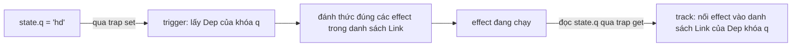

# L12: Reactivity: ref, reactive và cái Proxy ghi sổ ai đọc khóa nào

> **Trạng thái:** bản viết lại đủ bảy bước, nằm ngoài `src/`. Chưa nối vào app, chưa đo với người đọc thứ hai.
> **Số liệu:** mọi con số trong bài là giả định của kịch bản, được ghi "Giả sử" ở chỗ dùng. Không phải số đo từ một hệ thống thật, không phải mặc định của Vue hay JavaScript.

**Tiên quyết:** đã viết một trang HTML có JavaScript gán chữ vào DOM; biết object trong JavaScript là một tập khóa và giá trị; biết hàm là thứ chạy khi được gọi.

## Bước 1. Đoán trước

Giả sử một bảng duyệt chi phí hoàn ứng giữ trạng thái trong một object JavaScript thường. Bốn chỗ trên màn hình tự ghi số vào DOM: tiêu đề, bảng, panel tổng kết ở sidebar, huy hiệu trên thanh menu.

Giả sử hôm nay bạn thêm panel sidebar và huy hiệu menu, sửa hàm duyệt đơn, và gọi hai hàm cập nhật quen thuộc là tiêu đề và bảng.

Trước khi đọc tiếp, trả lời hai câu:

1. Hai vùng màn hình nào sẽ hiện số cũ?
2. Có lỗi nào được ném ra không?

Viết đáp án ra giấy. Đáp án nằm ở cuối bước 3.

## Bước 2. Điều bạn đã biết

Bạn đã từng viết một trang HTML có một ô nhập và một dòng chữ. Khi người dùng gõ, bạn gắn một listener, đọc `input.value`, rồi gán `document.querySelector('#out').textContent = ...`. Trang cập nhật. Không có gì tự động: chính dòng gán đó làm chữ đổi.

Bạn cũng đã từng thấy một bảng tính. Gõ vào ô A1, ô B1 chứa công thức `=A1*2` tự đổi. Không ai viết mã cập nhật B1. Bảng tính biết B1 phụ thuộc A1.

Bài này giữ nguyên chuỗi đó và thay đúng một khớp: thay vì bạn tự gọi hàm cập nhật sau mỗi lần gán, một lớp trung gian ghi lại **ai đọc khóa nào** rồi tự gọi lại đúng những chỗ đã đọc. Lớp đó là `Proxy` của JavaScript, và Vue dựng cơ chế reactivity trên nó.

Ba từ cần phân biệt ngay:

- **state** (trạng thái): dữ liệu thật của màn hình, ví dụ `{ approved: 344 }`.
- **effect** (hiệu ứng): một hàm được chạy lại khi dữ liệu nó đọc thay đổi. Hàm render của component là một effect.
- **track / trigger**: track là lúc đọc, ghi vào sổ; trigger là lúc ghi, tra sổ và đánh thức.

Khác biệt cần nhớ: trên trang HTML thuần, quan hệ "dữ liệu này nuôi dòng chữ kia" chỉ tồn tại trong đầu người viết. Với Proxy, quan hệ đó được ghi lại lúc chạy, nên nó không phụ thuộc vào việc bạn có nhớ hay không.

## Bước 3. Một ví dụ có số

Giả sử bảng có 344 đơn, trong đó 341 đơn đã duyệt, và tổng tiền chờ duyệt là 1.240.000.000 đồng. Lúc 14:02 có ba đơn được duyệt, mỗi đơn 20.000.000 đồng.

Trong code, `state.approved` tăng từ 341 lên 344. `state.pendingTotal` giảm 3 × 20.000.000 = 60.000.000, còn 1.180.000.000.

Hàm duyệt đơn gọi `renderHeader()` và `renderTable()`. Hai hàm `renderSidebar()` và `renderMenu()` được thêm ba tuần trước ở một file khác, và không nằm trong đường xử lý này.

Kết quả: tiêu đề ghi 1.180.000.000, bảng ghi 344 dòng; panel sidebar vẫn ghi 1.240.000.000, huy hiệu menu vẫn ghi 341. Console không in gì. Không exception, không cảnh báo.

Hai chỗ lệch, cùng một nguyên nhân: có hai cạnh phụ thuộc không được cập nhật. Không có cơ chế nào biết rằng hai hàm kia tồn tại, nên không có gì báo chúng bị bỏ sót.

**Đáp án bước 1:** panel sidebar và huy hiệu menu hiện số cũ; không có lỗi nào được ném ra.

## Bước 4. Cơ chế, từng bước một



1. **Bọc object.** `reactive(obj)` trả về một `Proxy` mới với hai bẫy: `get` và `set`. Object gốc không bị sửa. Chỉ những chỗ đọc **qua Proxy** mới được theo dõi; đọc trên object gốc thì không ai biết. Đây là lý do `const { q } = filters` làm đứt dây: nó đọc qua Proxy đúng một lần rồi giữ một bản sao chuỗi.

2. **Track khi đọc.** Mỗi lần một effect đang chạy đọc một khóa, trap `get` lấy effect hiện tại và ghi vào sổ của khóa đó. Cấu trúc là `WeakMap` theo object, bên trong là `Map` theo khóa, bên trong là một `Dep` — với `@vue/reactivity` 3.5.44 cài trong thư mục bài, `Dep` giữ các effect đăng ký trong một danh sách liên kết hai chiều các `Link`, không phải `Set`. Vì vậy sổ ghi ở mức **từng khóa của từng object**, không phải mức component. [INFERENCE: tên và hình dạng `targetMap` lấy từ mã nguồn Vue, không phải từ trang tài liệu; bài này mô tả theo hành vi đã chạy ở bước 5.]

3. **Trigger khi ghi.** Trap `set` so sánh giá trị mới với giá trị cũ bằng `Object.is`. Bằng nhau thì bỏ qua, không đánh thức ai. Khác nhau thì tra sổ của đúng khóa đó và đánh dấu các effect phụ thuộc cần chạy lại. Một khóa không ai đọc thì ghi bao nhiêu lần cũng không có effect nào chạy.

4. **Gộp trong một tick.** Nếu mỗi lần gán đều chạy lại effect ngay, một vòng lặp gán 100 lần sẽ vẽ lại 100 lần. Vue đẩy effect vào một hàng đợi và xoá trùng: nhiều lần đánh dấu trong cùng một tick còn một lần chạy, và lần chạy đó đọc giá trị cuối cùng. Ở bước 5, mục 3 đo đúng việc này: 3 lần gán, scheduler được gọi 3 lần, hàng đợi còn 1 job, effect chạy 1 lần.

5. **ref và reactive khác nhau ở đâu.** `ref(x)` bọc giá trị trong một object có đúng một thuộc tính `.value`, và chính thuộc tính đó là chỗ được track. Nhờ vậy `ref` dùng được cho số, chuỗi, boolean, mảng, object — mọi thứ. `reactive(obj)` chỉ nhận object và trả về Proxy; nó không có `.value`, nên không thể gán lại cả biến. Gán lại cả biến `let state = reactive({...}); state = {...}` là thay Proxy bằng object thường, và mọi chỗ đang giữ Proxy cũ không còn thấy gì. Vì thế: `ref` cho mọi thứ, `reactive` cho object mà bạn chỉ sửa thuộc tính con.

**Vì sao `reactive` bọc sâu.** Khi đọc `state.user`, trap `get` thấy giá trị là object nên trả về một Proxy mới cho chính object đó. Đọc tiếp `state.user.name` lại đi qua Proxy thứ hai. Nhờ vậy sửa một khóa lồng vẫn trigger. Cái giá: mọi object lồng bị bọc khi được đọc, và với dữ liệu lớn chỉ để hiển thị, chi phí này hiện ra thành thời gian mount và bộ nhớ.

**Khi nào dùng `shallowRef`.** `shallowRef(obj)` chỉ theo dõi chính `.value`, không bọc sâu bên trong. Chọn nó khi dữ liệu là một khối lớn bất biến, hoặc là instance của thư viện ngoài mà bạn không muốn Vue can thiệp. Điều kiện đi kèm: mỗi lần đổi phải gán cả `.value` bằng một object mới. Sửa ruột object thì không ai biết — bước 5 mục 6 cho thấy đúng như vậy.

**Câu hỏi phỏng vấn mà bài này trả lời được:** "Vue theo dõi phụ thuộc ở mức nào, và vì sao destructure hoặc gán lại cả biến lại làm mất reactivity?" Trả lời gọn: ở mức từng khóa của từng object; destructure đọc qua Proxy một lần rồi cắt dây, gán lại biến thì thay Proxy bằng object thường.

## Bước 5. Thí nghiệm nhỏ

Máy này không có `bun`, nên thí nghiệm chạy bằng `node` và `npm`. Script dùng gói `@vue/reactivity` — chính là gói lõi Vue dùng cho `ref`, `reactive`, `computed`, `effect`.

```
cd lessons/03-vue/l12
npm install @vue/reactivity
node reactivity-demo.mjs
```

Tương đương với bun: `bun add @vue/reactivity && bun reactivity-demo.mjs`.

Kết quả đã chạy trên máy này:

```
=== 1. effect chạy lại khi ref đổi ===
  effect lần 1: count.value = 0
  gán count.value = 1
  effect lần 2: count.value = 1
  gán count.value = 2
  effect lần 3: count.value = 2
  tổng số lần effect chạy: 3

=== 2. gán lại đúng giá trị cũ thì không chạy lại ===
  gán count.value = 2 lần nữa, effect chạy thêm 0 lần

=== 3. effect có scheduler: gộp nhiều lần đổi trong một tick ===
  gán 3 lần: scheduler được gọi 3 lần, hàng đợi gộp còn 1 job
  sau microtask: effect thật sự chạy 1 lần

=== 4. destructure làm đứt dây, toRefs thì không ===
  [biến rời] effect lần 1: plainQ = ""
  sau filters.q = 'hd': plainQ = "", effect chạy 1 lần
  [toRefs] effect lần 1: q.value = "hd"
  [toRefs] effect lần 2: q.value = "hdd"
  sau filters.q = 'hdd': q.value = "hdd", effect chạy 2 lần

=== 5. reactive bọc sâu object lồng nhau ===
  isReactive(state) = true
  isReactive(state.user) = true
  state có phải object gốc? false
  effect lần 1: state.user.name = An
  effect lần 2: state.user.name = Bình
  sau khi đổi khóa lồng: effect chạy 2 lần

=== 6. shallowRef chỉ theo dõi .value ===
  effect lần 1: big.value.rows.length = 3
  sau push(4): mảng thật dài 4, effect chạy 1 lần
  effect lần 2: big.value.rows.length = 4
  sau khi gán cả .value: effect chạy 2 lần

=== 7. computed lười: không ai đọc thì không tính ===
  vừa tạo computed: số lần tính = 0
  đổi price 2 lần, không đọc: số lần tính = 0
  đọc total.value lần 1 = 600, số lần tính = 1
  đọc total.value lần 2 = 600, số lần tính = 1
  đổi price thêm 1 lần, không đọc: số lần tính = 1
  đọc total.value lần 3 = 800, số lần tính = 2
```

Ba kết quả cần đọc kỹ:

- **Mục 1 và 2:** effect chạy lại đúng khi `.value` đổi, và gán lại giá trị cũ thì không chạy. Đây là `Object.is` ở bước 4.
- **Mục 4:** biến rời `plainQ` đứng yên ở `""` trong khi `filters.q` đã là `'hd'`; `toRefs` thì đi theo. Hai dòng này là toàn bộ lỗi destructure.
- **Mục 7:** `computed` không tính khi không ai đọc. Đổi `price` hai lần mà số lần tính vẫn 0; đọc lần đầu mới tính một lần; đọc lần hai lấy cache.

**Tự thử:** trong mục 4, thay `const { q } = toRefs(filters)` bằng `const q = computed(() => filters.q)`. Effect có chạy lại khi `filters.q` đổi không? Vì sao?

## Bước 6. Bốn câu luyện tập

Trả lời trước khi mở đáp án.

**Câu 1.** Một effect chỉ đọc `state.name`. Sau đó bạn gán `state.count` một trăm lần trong cùng một tick. Effect chạy lại bao nhiêu lần? Nếu effect đọc cả `state.count` thì khác thế nào?

<details>
<summary>Đáp án</summary>

Kết luận: nhánh đầu 0 lần. Nhánh sau 1 lần, vì cả trăm lần gán rơi vào cùng một tick và hàng đợi xoá trùng.

Điều kiện để đúng: effect phải đọc qua Proxy. Nếu effect đọc một biến rời đã destructure thì sổ không có khóa nào và kết quả vẫn là 0 lần, nhưng vì lý do khác — không có gì được track ngay từ đầu. Và effect phải đi qua hàng đợi (render effect, hoặc `watch` với `flush` mặc định): `effect()` thô chạy đồng bộ sau mỗi lần gán, nên cùng phép đo đó ra 100 lần, đúng như mục 1 của script.

Cách kiểm: đặt một bộ đếm trong effect, in ra sau mỗi lần gán. Mục 1 và mục 3 của script là đúng phép đo này.

</details>

**Câu 2.** Vì sao `const { q } = filters` làm mất reactivity, còn `filters.q` thì không?

<details>
<summary>Đáp án</summary>

Kết luận: destructure đọc `filters.q` qua trap `get` đúng một lần, lấy ra một chuỗi, rồi cắt dây. Chuỗi đó không có khóa nào để track, và gán `filters.q` về sau chỉ đổi giá trị bên trong Proxy.

Điều kiện để đúng: `filters` là kết quả của `reactive()`. Nếu `filters` là object thường thì cả hai cách đều không reactive, và lỗi không phải do destructure.

Cách kiểm: in `plainQ` và `filters.q` sau khi gán. Output mục 4 cho ra `plainQ = ""` trong khi `filters.q` đã đổi.

</details>

**Câu 3.** Bạn có một mảng 30.000 dòng chỉ để hiển thị, không bao giờ sửa từng phần tử. Nên dùng `ref`, `reactive` hay `shallowRef`? Nêu cái giá của lựa chọn.

<details>
<summary>Đáp án</summary>

Kết luận: `shallowRef` cho mảng đó, kèm điều kiện mỗi lần cập nhật phải gán cả `.value` bằng mảng mới.

Cái giá: sửa ruột mảng, ví dụ `big.value.push(x)`, không trigger. Đổi lại, Vue không bọc 30.000 object, nên thời gian mount và bộ nhớ thấp hơn. [INFERENCE: mức chênh cụ thể chưa đo trong bài này.]

Điều kiện để đúng: dữ liệu là bất biến ở mức từng phần tử. Nếu một ô trong dòng cần sửa tại chỗ và phải cập nhật ngay, `shallowRef` sẽ làm giao diện đứng yên.

Cách kiểm: mục 6 của script — `push(4)` làm độ dài thật thành 4 mà effect vẫn đứng ở 1 lần; gán cả `.value` mới làm effect chạy lần hai.

</details>

**Câu 4.** Giả sử bạn gán `state = reactive({ q: '' })` lần nữa ở một hàm khác, sau khi đã truyền `state` xuống ba component. Ba component đó thấy gì?

<details>
<summary>Đáp án</summary>

Kết luận: chúng vẫn thấy Proxy cũ. Biến `state` giờ trỏ tới một Proxy mới, còn ba component giữ tham chiếu tới Proxy cũ, nên mọi thay đổi trên object mới không tới được chúng.

Điều kiện để đúng: component nhận `state` như một giá trị, không đọc lại biến module mỗi lần render. Trong thực tế điều này gần như luôn đúng với props.

Cách kiểm: gán lại biến rồi đổi một khóa trên object mới; màn hình đứng yên và console sạch. Đây là lý do `ref` được khuyên cho state cấp cao nhất: gán `state.value = {...}` vẫn đi qua đúng một chỗ được track.

</details>

## Bước 7. Câu neo

> Vue ghi sổ ai đọc khóa nào lúc chạy, nên quên cập nhật một chỗ không còn là chuyện phải nhớ bằng đầu — nhưng đọc qua bản sao thì không có gì được ghi.

## Ghi chú nguồn

<details>
<summary>Ghi chú nguồn, đọc ngày 2026-10-29</summary>

- https://vuejs.org/api/reactivity-core.html — `ref` trả object có một thuộc tính `.value`; đọc và ghi `.value` đều được track; object gán vào ref được bọc sâu bằng `reactive()`; muốn tránh bọc sâu thì dùng `shallowRef()`; `computed` trả về một ref chỉ đọc.
- https://vuejs.org/guide/essentials/watchers.html — effect là hàm chạy lại khi state đổi; tác dụng phụ (gọi mạng, sửa DOM) đặt trong `watch`, không đặt trong computed.
- https://vuejs.org/guide/essentials/list.html — `v-for` nhận alias thứ hai là chỉ số; dùng để đối chiếu phần key ở bài sau.
- Script và output: `lessons/03-vue/l12/reactivity-demo.mjs`, chạy bằng `node` v24.18.1 với `@vue/reactivity@3.5.44`.

Chưa kiểm trong bài này: hình dạng chính xác của `targetMap` trong mã nguồn Vue; mục `key` của trang List Rendering; chi phí bộ nhớ thật của `reactive` bọc sâu. Số liệu ở bước 1 và bước 3 là kịch bản giả định.

</details>
