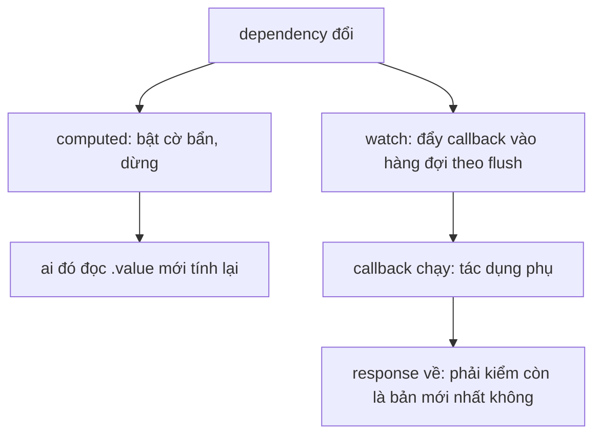

# L13: computed, watch và watchEffect: giá trị suy ra, tác dụng phụ và response cũ

> **Trạng thái:** bản viết lại đủ bảy bước, nằm ngoài `src/`. Chưa nối vào app, chưa đo với người đọc thứ hai.
> **Số liệu:** mọi con số trong bài là giả định của kịch bản, được ghi "Giả sử" ở chỗ dùng. Không phải số đo từ một hệ thống thật, không phải mặc định của Vue hay của mạng.

**Tiên quyết:** đã đọc bài trước về `ref`, `reactive` và cơ chế track/trigger; biết một request HTTP là bất đồng bộ và có thể về sai thứ tự.

## Bước 1. Đoán trước

Giả sử một ô tìm kiếm gọi API mỗi khi từ khóa đổi. Người dùng gõ ba ký tự `a`, `ab`, `abc`, cách nhau 20 ms. Giả sử response của `abc` về sau 60 ms, của `ab` sau 120 ms, của `a` sau 300 ms.

Trước khi đọc tiếp, trả lời hai câu:

1. Response nào về cuối cùng?
2. Giá trị cuối cùng trên màn hình là kết quả của từ khóa nào?

Viết đáp án ra giấy. Đáp án nằm ở cuối bước 3.

## Bước 2. Điều bạn đã biết

Bạn đã từng có một hàm Python tính tổng từ một danh sách, và một chỗ khác gọi hàm đó mỗi khi cần. Bạn cũng đã từng viết một đoạn mã gọi API rồi gán kết quả vào một biến.

Hai việc đó khác nhau ở một điểm quan trọng: hàm tính tổng **trả lời một câu hỏi** ("tổng là bao nhiêu"), còn lời gọi API **làm một việc** ("gửi request này đi"). Bài này đặt hai việc đó vào hai công cụ khác nhau của Vue:

- `computed` — trả lời "giá trị là gì". Hàm phải đồng bộ và thuần: cùng đầu vào cho cùng đầu ra, không gọi mạng, không ghi gì ra ngoài.
- `watch` — trả lời "khi nó đổi thì phải làm gì". Đây là chỗ đặt tác dụng phụ: gọi API, ghi localStorage, đổi state khác.
- `watchEffect` — như `watch` nhưng không liệt kê nguồn; nó tự ghi lại những gì hàm đọc trong lần chạy.

Ba từ cần phân biệt:

- **giá trị suy ra** (derived value): tính được từ state đã có, không cần nguồn ngoài.
- **tác dụng phụ** (side effect): hành động ra ngoài hàm, ví dụ gửi request.
- **race condition** (điều kiện chạy đua): hai việc bất đồng bộ về sai thứ tự nên kết quả cuối là của việc cũ.

Khác biệt cần nhớ: trên một script Python bạn chạy tuần tự, `await` xong mới đi tiếp nên thứ tự do bạn quyết. Trong một trang web, ba request cùng bay và về theo thứ tự mạng quyết, không phải theo thứ tự bạn gửi.

## Bước 3. Một ví dụ có số

Giả sử người dùng gõ `a` ở mốc 0 ms, `ab` ở 20 ms, `abc` ở 40 ms. Giả sử độ trễ mạng của ba request lần lượt là 300 ms, 120 ms, 60 ms.

Request cho `a` về ở 300 ms, cho `ab` ở 140 ms, cho `abc` ở 100 ms. Thứ tự về là `abc`, `ab`, `a`.

Nếu mỗi callback gán thẳng `rows.value = data`, lần ghi cuối là của `a` — từ khóa ngắn nhất, cũ nhất. Màn hình hiện kết quả của `a` trong khi ô tìm kiếm đang ghi `abc`.

Ba response, ba lần ghi, không lỗi nào. Đây là lý do lỗi này khó tìm: mọi thứ "chạy được", chỉ là sai.

**Đáp án bước 1:** response của `a` về cuối cùng; giá trị cuối cùng trên màn hình là kết quả của `a`, không phải `abc`.

## Bước 4. Cơ chế, từng bước một



1. **computed là effect lười có cache.** Lần đọc đầu chạy hàm và ghi lại mọi khóa đã đọc. Khi một khóa phụ thuộc bị ghi, Vue chỉ bật một cờ bẩn rồi dừng; hàm không chạy. Lần đọc kế tiếp mới tính lại và xoá cờ. Nhờ vậy đọc mười lần trong một lần render chỉ tính một lần, và không ai đọc thì không tính lần nào. Bước 5 mục 1 đo đúng việc này: đổi `q` rồi chưa đọc, số lần tính vẫn 0.

2. **watch là effect chủ động.** Nguồn có bốn dạng: một `ref`, một getter `() => a.value + b.value`, một mảng `[a, b]`, hoặc một object `reactive` (khi đó mặc định là deep). Khi nguồn đổi, callback được đẩy vào hàng đợi và chạy kể cả khi không ai đọc kết quả. Callback nhận `(giá trị mới, giá trị cũ)`.

3. **`deep`, `immediate`, `flush` là ba công tắc.** `deep: true` duyệt cả cây con, cần khi nguồn là object và bạn muốn bắt thay đổi ở khóa lồng. `immediate: true` chạy callback ngay một lần lúc đăng ký. `flush` chọn thời điểm: `pre` trước khi component cập nhật DOM, `post` sau khi DOM đã cập nhật, `sync` ngay tại dòng gán. Bước 5 mục 3 in ra thứ tự thật của bốn watcher trên cùng một ref.

4. **watchEffect tự thu thập phụ thuộc.** Không có tham số nguồn: hàm chạy một lần, mọi thứ nó đọc **đồng bộ** trong lần chạy đó được ghi vào sổ, và lần sau chỉ chạy lại khi một trong số đó đổi. Hệ quả: đọc sau `await` thì không được theo dõi, vì lúc đó phạm vi thu thập đã đóng. Bước 5 mục 5 cho thấy đúng giới hạn này.

5. **Dọn dẹp bằng `onCleanup`.** Callback của `watch` và `watchEffect` nhận một hàm `onCleanup`. Hàm này chạy **trước lần chạy kế tiếp** và trước khi watcher bị dừng. Đây là chỗ đúng để xoá timer debounce và huỷ request đang bay.

6. **Vì sao response cũ ghi đè kết quả mới.** Callback là một hàm async: nó `await`, nên trả quyền điều khiển về cho event loop, và phần sau `await` chạy khi response về — không phải theo thứ tự gửi. Không có gì trong `watch` tự chặn việc ghi của một lần chạy đã cũ.

7. **Hai cách chặn, và chúng chặn hai thứ khác nhau.**
   - **Đánh số lần gửi:** mỗi lần chạy tăng một biến đếm, giữ số đó trong closure; khi response về, so số của mình với số mới nhất, lệch thì bỏ. Cách này chặn **việc ghi**, không chặn request — request vẫn bay và vẫn tốn băng thông.
   - **`AbortController`:** mỗi lần chạy tạo một controller, huỷ controller của lần trước, truyền `signal` vào `fetch`. Cách này chặn **cả request**, và promise bị reject với lỗi `AbortError` nên phải bắt.
   - **Debounce** chỉ giảm số lần bắt đầu; nó không thay được hai cách trên. Gõ ba ký tự cách nhau 20 ms với debounce 250 ms thì chỉ một request được gửi — nhưng nếu người dùng gõ chậm hơn 250 ms mỗi ký tự, ba request vẫn bay và vẫn có thể về lệch thứ tự.

**Câu hỏi phỏng vấn mà bài này trả lời được:** "computed và watch khác nhau ở bước nào trong cơ chế, và vì sao debounce một mình không đủ để chặn response cũ ghi đè kết quả mới?" Trả lời gọn: computed chỉ bật cờ bẩn và tính ở lần đọc sau; watch đẩy callback vào hàng đợi để chạy tác dụng phụ; debounce giảm số lần gửi, không quyết định response nào được ghi.

## Bước 5. Thí nghiệm nhỏ

Máy này không có `bun`, nên thí nghiệm chạy bằng `node` và `npm`.

```
cd lessons/03-vue/l13
npm install vue
node computed-watch-race.mjs
```

Tương đương với bun: `bun add vue && bun computed-watch-race.mjs`.

Kết quả đã chạy trên máy này:

```
=== 1. computed lười và có cache ===
  gán q = 'HDD' nhưng chưa đọc: số lần tính = 0
  đọc lần 1 = "hdd", số lần tính = 1
  đọc lần 2 = "hdd", số lần tính = 1

=== 2. bốn dạng nguồn của watch ===
  [nguồn ref] a đổi
  [nguồn getter] tổng = 12
  [nguồn mảng] a = 2, b = 10
  [nguồn getter] tổng = 22
  [nguồn mảng] a = 2, b = 20
  [nguồn reactive] một khóa lồng đổi (deep mặc định)

=== 3. immediate và flush: thứ tự chạy ===
  thứ tự: sync → dòng ngay sau khi gán → pre (mặc định) → immediate → post

=== 4. watchEffect tự thu thập phụ thuộc, onCleanup chạy trước lần kế ===
  watchEffect lần 1: đọc kw = ""
    cleanup của lần 1
  watchEffect lần 2: đọc kw = "ab"
  tổng số lần chạy = 2

=== 5. đọc sau await thì không được theo dõi ===
  lần 1: đọc muộn = 0
  lần 2: đọc muộn = 1
  đổi trigger: tổng số lần chạy = 2 (nếu > 1 thì đọc muộn có được theo dõi)

=== 6. response về lệch thứ tự ===
  [không chặn] thứ tự response về: abc → ab → a
  [không chặn] rows cuối cùng: kết quả cho "a"
  [đánh số] response "ab" mang token 2, token mới nhất là 3: bỏ
  [đánh số] response "a" mang token 1, token mới nhất là 3: bỏ
  [đánh số] rows cuối cùng: kết quả cho "abc"
  [huỷ] request "a" bị huỷ trước khi về
  [huỷ] request "ab" bị huỷ trước khi về
  [huỷ] rows cuối cùng: kết quả cho "abc"
```

Ba kết quả cần đọc kỹ:

- **Mục 6, nhánh không chặn:** response về theo thứ tự `abc → ab → a`, và giá trị cuối là của `a`. Đây đúng là kịch bản ở bước 3.
- **Mục 6, nhánh đánh số:** hai response cũ bị bỏ, giá trị cuối là `abc`. Chú ý request vẫn được gửi — chỉ việc ghi bị chặn.
- **Mục 6, nhánh huỷ:** hai request trước bị `AbortController` huỷ trước khi về, nên không có response nào để ghi.

**Tự thử:** trong mục 6 nhánh không chặn, đổi độ trễ của `a` thành 50 ms và của `abc` thành 300 ms. Giá trị cuối cùng còn sai không? Vì sao?

## Bước 6. Bốn câu luyện tập

Trả lời trước khi mở đáp án.

**Câu 1.** Nếu đặt lời gọi API bên trong `computed`, giá trị mà template nhận được là gì, và ai huỷ request đó khi điều kiện đổi?

<details>
<summary>Đáp án</summary>

Kết luận: template nhận một `Promise`, in ra `[object Promise]`. Không ai huỷ request đó: `computed` giữ kết quả đã tính trong cache, và một `Promise` không có cơ chế huỷ.

Điều kiện để đúng: hàm trong `computed` là async. Nếu hàm đồng bộ và trả về số thì không có vấn đề này — nhưng lúc đó bạn không gọi được mạng.

Cách kiểm: in `typeof computedValue.value` trong template hoặc trong console. Ra `object` thay vì `number` nghĩa là đã bị cache một Promise. Cách sửa: chuyển sang `watch`, dùng `onCleanup` để huỷ.

</details>

**Câu 2.** Vì sao debounce một mình không đủ để chặn một response cũ ghi đè kết quả mới hơn?

<details>
<summary>Đáp án</summary>

Kết luận: debounce quyết định **có gửi hay không**, không quyết định **response nào được ghi**. Hai request đã gửi vẫn có thể về lệch thứ tự.

Điều kiện để đúng: khoảng cách giữa các lần gõ luôn nhỏ hơn ngưỡng debounce, nên chỉ một request tồn tại tại một thời điểm. Người dùng gõ chậm hơn ngưỡng thì điều kiện này mất.

Cách kiểm: đặt độ trễ mạng giảm dần theo từ khóa (như `LATENCY` trong script) và gõ chậm hơn ngưỡng; response cũ vẫn ghi đè. Thêm bộ đếm token là hết.

</details>

**Câu 3.** Cho một tình huống nên dùng `watchEffect` thay vì `watch`, và một tình huống không nên.

<details>
<summary>Đáp án</summary>

Kết luận: nên dùng khi mọi phụ thuộc đều đọc đồng bộ trong lần chạy đầu và bạn không cần giá trị cũ — ví dụ đồng bộ một bản nháp lên localStorage. Không nên dùng khi bạn cần biết giá trị cũ, hoặc khi phụ thuộc chỉ xuất hiện sau `await`.

Điều kiện để đúng: mọi thứ cần theo dõi phải được đọc trước `await` đầu tiên. Mục 5 của script cho thấy đọc sau `await` không được ghi vào sổ.

Cách kiểm: đổi `watchEffect` thành `watch` với getter liệt kê rõ nguồn; nếu hành vi đổi thì phụ thuộc của bạn không nằm hết trong phần đồng bộ.

</details>

**Câu 4.** `flush: 'post'` khác `flush: 'pre'` ở chỗ nào, và khi nào bạn thật sự cần `post`?

<details>
<summary>Đáp án</summary>

Kết luận: `pre` chạy trước khi component cập nhật DOM, `post` chạy sau khi DOM đã cập nhật. Cần `post` khi callback phải đọc kích thước hoặc nội dung đã render, ví dụ đo chiều cao của một phần tử vừa được thêm.

Điều kiện để đúng: bạn đang ở trong một component và có DOM để đọc. Trong script chạy bằng Node không có DOM, nên chỉ quan sát được thứ tự, không đo được kích thước.

Cách kiểm: mục 3 của script — cùng một ref, thứ tự thật là `sync → dòng ngay sau khi gán → pre → immediate → post`. `sync` chạy ngay tại dòng gán, trước cả dòng kế tiếp.

</details>

## Bước 7. Câu neo

> computed trả lời "giá trị là gì" và chỉ tính khi có người đọc; watch trả lời "phải làm gì khi nó đổi" và chạy bất kể ai đọc — nên chỗ chặn response cũ chỉ có thể nằm trong watch, không nằm trong computed.

## Ghi chú nguồn

<details>
<summary>Ghi chú nguồn, đọc ngày 2026-10-29</summary>

- https://vuejs.org/api/reactivity-core.html — `computed` nhận getter và trả về một ref chỉ đọc; `watch` nhận nguồn là ref hoặc getter; `watchEffect` không có tham số nguồn.
- https://vuejs.org/guide/essentials/watchers.html — tác dụng phụ đặt trong `watch`; callback nhận `(new, old)`; có `deep`, `immediate`; có phần dọn dẹp và ví dụ `fetch` bất đồng bộ.
- Script và output: `lessons/03-vue/l13/computed-watch-race.mjs`, chạy bằng `node` v24.18.1 với `vue@3.5.44`, chạy lại hai lần và so khớp output.
- `AbortController` là API của trình duyệt và của Node; thí nghiệm mô phỏng `fetch` bằng `setTimeout` cộng listener `abort` trên `signal`, không gọi mạng thật.

Chưa kiểm trong bài này: mục `flush` và `onCleanup` của trang Watchers (mới đọc phần đầu trang); hành vi chính xác của `onCleanup` khi component bị unmount; chi phí thật của `deep: true` trên object lớn. Mọi con số độ trễ là giả định của kịch bản.

</details>
