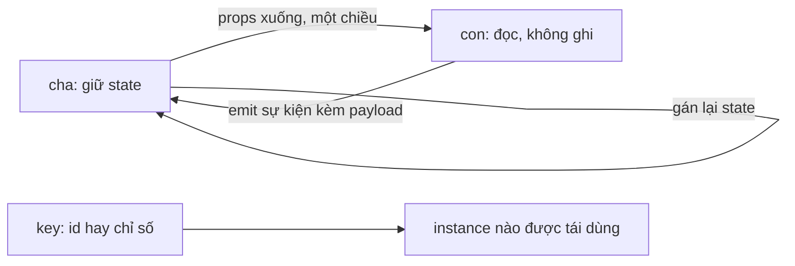

# L14: Component: props xuống, emit lên, v-model và key theo danh tính

> **Trạng thái:** bản viết lại đủ bảy bước, nằm ngoài `src/`. Chưa nối vào app, chưa đo với người đọc thứ hai.
> **Số liệu:** mọi con số trong bài là giả định của kịch bản, được ghi "Giả sử" ở chỗ dùng. Không phải số đo từ một hệ thống thật, không phải mặc định của Vue.

**Tiên quyết:** đã đọc hai bài trước về `ref`/`reactive` và về `computed`/`watch`; biết một component là một hàm render ra DOM; biết vòng lặp `v-for` duyệt một mảng.

## Bước 1. Đoán trước

Giả sử một bảng có 50 dòng, mỗi dòng một ô ghi chú, và mỗi dòng được render bằng một component con. Component cha giữ **một** `note = ref('')` rồi truyền cho mọi dòng. `v-for` dùng `:key="index"`.

Người dùng gõ vào ô của dòng thứ hai, rồi bấm nút sắp xếp theo số tiền.

Trước khi đọc tiếp, trả lời hai câu:

1. Lúc gõ, bao nhiêu ô hiện cùng một chuỗi?
2. Sau khi sắp xếp, chữ đang gõ nằm ở dòng nào?

Viết đáp án ra giấy. Đáp án nằm ở cuối bước 3.

## Bước 2. Điều bạn đã biết

Bạn đã từng viết một hàm Python nhận tham số và trả về kết quả. Hàm đó không tự sửa biến của người gọi; muốn báo ngược lại thì nó `return` một giá trị và người gọi tự quyết định dùng giá trị đó thế nào.

Component trong Vue theo đúng mô hình đó, chỉ khác tên gọi:

- **props** là tham số truyền xuống. Một chiều: cha đưa, con đọc.
- **emit** là giá trị trả ngược. Con không tự sửa dữ liệu của cha; nó phát một sự kiện kèm dữ liệu, cha nghe và tự ghi.
- **v-model** trên component không phải cơ chế thứ ba. Nó là cú pháp rút gọn cho đúng một prop và đúng một listener.
- **key** là danh tính của instance. Khi render danh sách, Vue ghép phần tử mới với instance cũ theo `key`.

Ba từ cần phân biệt:

- **instance** (thực thể): một lần tạo component, có state cục bộ riêng.
- **danh tính** (identity): cái gì làm hai lần render được coi là "cùng một dòng". Với `key` là `id`, danh tính là dòng dữ liệu; với `key` là chỉ số, danh tính là vị trí.
- **bản nháp** (draft): bản sao cục bộ của dữ liệu cha, để người dùng sửa mà chưa gửi đi.

Khác biệt cần nhớ: trên một trang HTML thuần, mỗi ô nhập là một phần tử DOM riêng và giữ chữ của chính nó. Khi Vue tái dùng instance, chữ trong ô nhập thuộc về **instance**, không thuộc về dòng dữ liệu — trừ khi bạn nói rõ danh tính bằng `key`.

## Bước 3. Một ví dụ có số

Giả sử bảng có ba dòng, số tiền lần lượt 100, 900, 400, và mỗi dòng có một ô ghi chú rỗng.

Người dùng gõ `ghi chú cho B` vào ô của dòng B (dòng thứ hai). Sau đó bấm sắp xếp giảm dần theo số tiền, thứ tự mới là B, C, A.

Với `key` là `id`: instance của B đi theo dòng B, nên sau khi sắp xếp chữ vẫn nằm trên B. Ba ô là `B = "ghi chú cho B"`, `C = ""`, `A = ""`.

Với `key` là chỉ số: instance số 0 giờ nhận dữ liệu dòng B nhưng giữ bản nháp của dòng A (rỗng); instance số 1 giờ nhận dòng C nhưng giữ bản nháp `ghi chú cho B`. Ba ô là `B = ""`, `C = "ghi chú cho B"`, `A = ""`.

Cùng một mảng dữ liệu, cùng một component, khác đúng một thuộc tính. Chữ nội bộ về khách hàng nằm trên đơn của người khác, và console không in gì.

**Đáp án bước 1:** cả 50 ô hiện cùng một chuỗi, vì mọi dòng đọc chung một `note`; sau khi sắp xếp, chữ nằm ở vị trí thứ hai chứ không phải dòng thứ hai — tức là có thể nằm trên đơn của người khác.

## Bước 4. Cơ chế, từng bước một



1. **props là dữ liệu một chiều.** Cha truyền giá trị xuống, con đọc. Vue gói props trong một object và, ở bản dev, cảnh báo khi con ghi trực tiếp vào prop. Bản production im lặng — đây là lý do lỗi này sống lâu: nó chạy được cho tới lần cha render lại với dữ liệu mới.

2. **emit là đường ngược.** Con gọi `emit('approve', row.id)`. Vue tra danh sách listener mà cha đã đăng ký cho sự kiện `approve` và gọi chúng với payload. Con không biết cha làm gì với payload; cha là nơi duy nhất quyết định ghi.

3. **v-model là cú pháp, không phải cơ chế.** `v-model="qty"` trên một component mở ra thành `:modelValue="qty"` cộng `@update:modelValue="qty = $event"`. Muốn đổi tên thì dùng `v-model:note`, mở thành `:note` cộng `@update:note`. `defineModel()` trong `script setup` khai báo cả hai phía cùng lúc và trả về một ref: đọc thì đọc prop, ghi thì phát sự kiện. Vẫn là prop cộng listener, chỉ viết gọn hơn.

4. **key quyết định danh tính.** Khi render danh sách, Vue so danh sách mới với danh sách cũ theo `key`. Cùng key thì tái dùng instance cũ và chỉ cập nhật props; key mới thì tạo instance mới. Vì state cục bộ (bản nháp) sống trong instance, `key` quyết định bản nháp đi theo dòng hay đi theo vị trí.

5. **Bản nháp phải đồng bộ có chủ đích.** `ref(props.row.note)` là một ảnh chụp tại lúc mount. Nếu prop đổi từ bên ngoài — ví dụ server trả về bản ghi mới — bản nháp không tự đổi. Phải có một `watch` trên prop để gán lại bản nháp, hoặc dùng `:key="product.id"` ở cha để buộc mount lại instance mới. Hai cách khác nhau về quyền sở hữu: cách thứ nhất giữ instance và đồng bộ tay; cách thứ hai bỏ instance cũ và để cha quyết định.

**Vì sao một ref dùng chung là lỗi cấp state.** Nếu cha giữ một `note` duy nhất và truyền cho mọi dòng, mọi instance đọc cùng một giá trị. Gõ vào bất kỳ ô nào cũng ghi vào cùng một ref, nên mọi ô hiện cùng chữ. Đây không phải lỗi binding — binding đúng; sai là chỗ đặt state: dữ liệu thuộc về từng dòng thì phải sống trong từng instance, hoặc trong từng phần tử của mảng ở cha.

**Câu hỏi phỏng vấn mà bài này trả lời được:** "v-model trên component thực chất là gì, và vì sao dùng chỉ số làm key lại làm state dính sang dòng khác khi sắp xếp?" Trả lời gọn: `v-model` là prop `modelValue` cộng sự kiện `update:modelValue`; `key` là danh tính instance, nên key theo chỉ số làm instance ở lại vị trí trong khi dữ liệu đổi bên trong nó.

## Bước 5. Thí nghiệm nhỏ

Máy này không có `bun`, nên thí nghiệm chạy bằng `node` và `npm`. Script mount thật bằng `@vue/runtime-dom` trên `jsdom`: tạo một DOM giả, gắn app vào đó, gõ vào ô nhập bằng cách phát sự kiện `input`, rồi đọc lại giá trị từng ô sau khi sắp xếp.

```
cd lessons/03-vue/l14
npm install vue jsdom
node key-demo.mjs
```

Tương đương với bun: `bun add vue jsdom && bun key-demo.mjs`.

Kết quả đã chạy trên máy này:

```
=== 1. key theo id ===
  trước khi sắp xếp: A = "" | B = "ghi chú cho B" | C = ""
  sau khi sắp xếp (giảm dần theo amount): B = "ghi chú cho B" | C = "" | A = ""

=== 2. key theo chỉ số (index) ===
  trước khi sắp xếp: A = "" | B = "ghi chú cho B" | C = ""
  sau khi sắp xếp (giảm dần theo amount): B = "" | C = "ghi chú cho B" | A = ""

=== 3. một ref đặt ở cha, dùng chung cho mọi dòng ===
  sau khi gõ vào B: A = "chỉ gõ vào dòng B" | B = "chỉ gõ vào dòng B" | C = "chỉ gõ vào dòng B"
```

Ba kết quả cần đọc kỹ:

- **Mục 1:** chữ ở lại đúng dòng B. Instance đi theo `id`.
- **Mục 2:** chữ nhảy sang dòng C. Instance ở lại vị trí thứ hai, và dữ liệu dòng C vào chỗ đó.
- **Mục 3:** gõ một ô, cả ba ô đổi. Đây là ref dùng chung, không phải lỗi `key`.

Một chi tiết kỹ thuật của script: phải gán `window` và `document` của jsdom vào `globalThis` **trước** khi import `vue`, vì `@vue/runtime-dom` đọc `document` lúc nạp module. Vì vậy script dùng `await import('vue')` sau khi dựng jsdom.

**Tự thử:** đổi `keyMode` ở mục 2 thành `'id'` nhưng giữ nguyên phần còn lại. Output phải giống mục 1 — nếu khác, có chỗ khác đang giữ state ngoài instance.

## Bước 6. Bốn câu luyện tập

Trả lời trước khi mở đáp án.

**Câu 1.** `v-model="qty"` trên một component thực chất mở ra thành gì, và `defineModel()` khác gì so với viết tay?

<details>
<summary>Đáp án</summary>

Kết luận: mở thành `:modelValue="qty"` cộng `@update:modelValue="qty = $event"`. `defineModel()` chỉ khai báo cả hai phía một lần và trả về một ref; ghi vào ref là phát sự kiện, đọc ref là đọc prop.

Điều kiện để đúng: tên model mặc định là `modelValue`. Với `v-model:note`, cặp tương ứng là prop `note` và sự kiện `update:note`.

Cách kiểm: đổi `v-model` thành cặp prop và listener viết tay. Hành vi không đổi — nếu đổi thì có thứ khác đang chạy, không phải `v-model`.

</details>

**Câu 2.** Vì sao gán thẳng vào một prop lại chạy được ở bản production mà không có cảnh báo nào?

<details>
<summary>Đáp án</summary>

Kết luận: prop là object JavaScript bình thường sau khi Vue gói lại; gán vào nó thật sự đổi giá trị. Cảnh báo mutate prop chỉ được bật ở bản dev.

Cái giá: nguồn sự thật thành hai bản. Lần cha render lại với dữ liệu từ server, giá trị con đã ghi bị ghi đè, và không có log nào.

Điều kiện để đúng: gán vào prop có tác dụng với mọi kiểu prop ở bản production — số, chuỗi, object, mảng đều ghi được. Khác biệt nằm ở chỗ khác: với prop là object hoặc mảng, sửa ruột object không bị lần render sau của cha ghi đè ngay, vì cha render lại với đúng tham chiếu đó; với prop là số hay chuỗi, mỗi lần cha render lại là một giá trị mới nên giá trị con đã ghi bị thay.

Cách kiểm: chạy staging bằng bản dev để thấy cảnh báo; hoặc thêm một kiểm tra trong review: mọi `props.x =` đều là lỗi.

</details>

**Câu 3.** Danh sách 30 dòng, mỗi dòng có bản nháp khởi tạo bằng `ref(props.row.note)`, key là chỉ số. Người dùng gõ vào dòng thứ ba rồi sắp xếp. Component có được tạo lại không, và chữ nằm ở đâu?

<details>
<summary>Đáp án</summary>

Kết luận: component không được tạo lại. Vue ghép phần tử mới vào instance số 2 vì key vẫn là 2, nên chữ nằm ở vị trí thứ ba — có thể là đơn của người khác.

Điều kiện để đúng: bản nháp là state cục bộ trong instance. Nếu chữ đọc thẳng từ prop thì không có bản nháp nào để dính, và triệu chứng biến mất (nhưng bạn mất khả năng sửa trước khi gửi).

Cách kiểm: output mục 2 — `C = "ghi chú cho B"`. Đổi sang `key` là `row.id` thì thành `B = "ghi chú cho B"`.

</details>

**Câu 4.** Component `ProductForm` dùng cho cả tạo mới và sửa. Lần mở thứ hai với sản phẩm khác, ô nhập vẫn hiện chữ của sản phẩm trước. Nêu hai cách sửa và cái giá của từng cách.

<details>
<summary>Đáp án</summary>

Kết luận: cách một là `:key="product.id"` ở cha, buộc mount instance mới mỗi khi đổi sản phẩm. Cách hai là giữ instance và `watch` prop để gán lại bản nháp.

Cái giá: `key` làm mất toàn bộ state cục bộ mỗi lần đổi sản phẩm, kể cả thứ bạn muốn giữ như trạng thái mở của một mục. `watch` giữ được state nhưng phải viết đúng điều kiện, và dễ tạo vòng lặp nếu bản nháp lại ghi ngược vào prop.

Điều kiện để đúng: cách `key` cần một id ổn định. Cách `watch` cần prop thật sự đổi giá trị, không phải một object mới cùng nội dung.

Cách kiểm: mở drawer hai lần với hai sản phẩm, in giá trị ô nhập sau mỗi lần mở. Nếu lần hai vẫn là chữ cũ thì bản nháp chưa được đồng bộ.

</details>

## Bước 7. Câu neo

> Con không sở hữu state: nó đọc props xuống và phát sự kiện lên, còn `key` quyết định state cục bộ đi theo dòng dữ liệu hay đi theo chỗ đứng.

## Ghi chú nguồn

<details>
<summary>Ghi chú nguồn, đọc ngày 2026-10-29</summary>

- https://vuejs.org/guide/components/v-model.html — `v-model` trên component là hai chiều; `defineModel()` là macro, compiler mở nó thành prop `modelValue` cộng sự kiện `update:modelValue`; giá trị trả về là một ref đồng bộ với giá trị cha bind.
- https://vuejs.org/guide/essentials/list.html — `v-for` nhận alias thứ hai là chỉ số; dùng để đối chiếu phần key.
- https://vuejs.org/api/reactivity-core.html — `ref` và `watch` dùng trong ví dụ đồng bộ bản nháp với prop.
- Script và output: `lessons/03-vue/l14/key-demo.mjs`, chạy bằng `node` v24.18.1 với `vue@3.5.44` và `jsdom`; mount thật, gõ bằng sự kiện `input`, đọc lại giá trị từ DOM.

Chưa kiểm trong bài này: mục `key` của trang List Rendering (mới đọc phần đầu trang); nội dung cảnh báo mutate prop ở bản dev; hành vi của `defineModel` với modifier và với nhiều model. Ba dòng dữ liệu ở bước 3 và bước 5 là kịch bản giả định, không phải dữ liệu thật.

</details>
