# L16: Vue Router: matcher, guard và việc component được tạo sau cùng

> **Trạng thái:** bản viết lại đủ bảy bước, nằm ngoài `src/`. Chưa nối vào app, chưa đo với người đọc thứ hai.
> **Số liệu:** mọi con số trong bài là giả định của kịch bản, ghi "Giả sử" ở chỗ dùng. Không phải số đo từ hệ thống thật, không phải mặc định của Vue Router. Riêng output ở Bước 5 là output thật của script chạy trên máy này.

**Tiên quyết:** biết một URL gồm đường dẫn và phần sau dấu `?`; biết component có vòng đời tạo và gỡ; biết `setup` chạy khi component được tạo.

## Bước 1. Đoán trước

Giả sử màn hình chi tiết đơn hàng nằm ở đường dẫn `/orders/:id`. Nhân viên đang mở đơn 4821, rồi bấm sang đơn 4822 trong danh sách bên cạnh.

1. Component chi tiết có được tạo lại không?
2. Đoạn code nạp dữ liệu viết trong `setup` có chạy lại không?
3. Nếu dữ liệu vẫn là của 4821, có exception nào được ném ra không?

Viết đáp án ra giấy. Đáp án nằm ở cuối bước 3.

## Bước 2. Điều bạn đã biết

Bạn đã từng làm một trang nhiều màn hình bằng JavaScript thuần: mỗi màn hình là một khối HTML, và bạn ẩn hiện bằng cách đổi `display`. Muốn biết đang ở màn hình nào, bạn giữ một biến `current`. Nhược điểm: không copy được đường dẫn, không back được, và tải lại trang là mất chỗ.

Vue Router thay biến `current` bằng URL. Bốn khớp được thay:

- **Bảng route** thay chuỗi `if/else` chọn màn hình. Mỗi phần tử là một *route record*: một mẫu đường dẫn gắn với một component.
- **Matcher** thay phép so sánh chuỗi. Nó so URL với các mẫu và trả về route record khớp cùng các *params* (phần biến trong đường dẫn, như `:id`).
- **Guard** thay đoạn kiểm tra quyền viết rải rác trong từng màn hình. Guard là hàm chạy trong lúc điều hướng và có quyền cho đi, chặn, hoặc đổi đích.
- **`<RouterView>`** thay chỗ bạn tự chèn HTML. Nó là cái khung, router quyết định component nào được đặt vào đó.

Điểm khác biệt lớn nhất so với trang thuần: điều hướng là một **đường ống bất đồng bộ** có nhiều bước, và component của trang mới chỉ được tạo ở gần cuối đường ống đó.

**Dạng câu hỏi phỏng vấn bài này trả lời được:** "Một lần điều hướng đi qua những bước nào, và component được tạo ở bước nào?" và "Đổi id trên URL thì component có được tạo lại không?"

## Bước 3. Một ví dụ có số

Giả sử màn hình chi tiết có một `setup` gọi API một lần và chốt `route.params.id` vào biến, và một `watch` theo dõi `route.params.id` để nạp lại dữ liệu.

Đi từ 4821 sang 4822: URL đổi, matcher so `/orders/4822` với bảng route và ra **đúng route record cũ** (mẫu `/orders/:id`), chỉ khác giá trị `params.id`. Vì route record không đổi, router dùng lại instance đang có.

Hệ quả, đếm được:

- Số lần `setup` chạy: 1 (chỉ lần đầu).
- Số lần `onMounted` chạy: 1 (chỉ lần đầu).
- Số lần `watch` theo params chạy: 2 (một cho 4821, một cho 4822) — chỉ được 2 vì `watch` trong script có `immediate: true`, nên lần chạy đầu là lần chạy ngay khi đăng ký.

Nếu không có `watch`, con số thứ ba là 1, và màn hình giữ dữ liệu của 4821 trong khi đường dẫn đã là 4822. Không có exception, không có cảnh báo — đây là hành vi bình thường của router, không phải lỗi.

**Đáp án bước 1:** component không được tạo lại; `setup` không chạy lại; không có exception nào.

## Bước 4. Cơ chế, từng bước một

```mermaid
flowchart LR
  A[URL đổi] --> B[Matcher: chọn route record + params]
  B --> C[beforeRouteLeave của component cũ]
  C --> D[beforeEach toàn cục]
  D --> E[beforeRouteUpdate nếu dùng lại instance]
  E --> F[beforeEnter của route đích]
  F --> G[Tải component lười nếu có]
  G --> H[beforeRouteEnter - chưa có this]
  H --> I[beforeResolve toàn cục]
  I --> J[Xác nhận, afterEach]
  J --> K[Tạo component và cập nhật DOM]
```



1. **Matcher chạy trước, và chưa tạo component nào.** Tài liệu Vue Router mô tả bước này là resolve: URL được so với bảng route để ra route record cùng params. Bạn kiểm được bước này mà không cần mount app, bằng `router.resolve('/orders/4822')`.

2. **Guard chạy theo một thứ tự cố định.** Tài liệu có mục "The Full Navigation Resolution Flow" liệt kê 12 bước. Phần cốt lõi: `beforeRouteLeave` của component đang bị rời → `beforeEach` toàn cục → `beforeRouteUpdate` của component được dùng lại → `beforeEnter` của route đích → tải component lười → `beforeRouteEnter` → `beforeResolve` toàn cục → xác nhận → `afterEach` → cập nhật DOM.

3. **Guard bất đồng bộ phải được `await`, và điều hướng ở trạng thái chờ.** Tài liệu ghi: guard có thể resolve bất đồng bộ, và điều hướng được coi là *pending* cho tới khi mọi hook xong. Vì vậy `router.push()` trả về một Promise; không `await` thì code sau đó chạy khi URL còn chưa đổi xong.

4. **Ba kết cục, và chỉ một trong ba là "đi tiếp".** Trả `true` hoặc `undefined` → đi tiếp. Trả `false` → huỷ, URL được đưa về route cũ. Trả một vị trí mới → redirect: điều hướng hiện tại bị bỏ và một lần resolve mới bắt đầu **từ bước một**.

5. **Component được tạo sau cùng, và `beforeRouteEnter` chạy trước khi nó tồn tại.** Tài liệu nói rõ `beforeRouteEnter` **không** có `this`, vì guard chạy trước khi điều hướng được xác nhận và component chưa được tạo. Đây là lý do về mặt cơ chế: bạn không thể đọc state của component trong guard này.

6. **`beforeEnter` không chạy khi chỉ params đổi.** Tài liệu ghi: `beforeEnter` chỉ chạy khi **vào** route, không chạy khi `params`, `query` hay `hash` đổi. Ngược lại, `beforeRouteUpdate` được thiết kế đúng cho trường hợp dùng lại instance — như chuyển giữa `/users/1` và `/users/2`.

**Hệ quả về request đang bay.** Nếu người dùng bấm qua lại nhanh, hai request cùng bay và response về lệch thứ tự. Component không unmount, nên "huỷ khi unmount" không chạy. Phải huỷ theo params: `watch(() => route.params.id, ..., { onCleanup })` và `AbortController`. Chỉ response của lần nạp mới nhất được ghi vào state.

**Về guard và bảo mật.** Guard chạy trên máy người dùng. Nó là trải nghiệm chuyển hướng, không phải kiểm soát truy cập. Quyền thật phải kiểm ở backend theo từng tài nguyên.

## Bước 5. Thí nghiệm nhỏ

Chạy trong thư mục `lessons/03-vue/l16/`. Script mount một app thật trong jsdom, dùng `createMemoryHistory`, đi từ `/orders/4821` sang `/orders/4822`.

```
npm install vue vue-router@4 jsdom
node router-reuse.mjs
```

Tương đương với bun: `bun add vue vue-router@4 jsdom && bun router-reuse.mjs`

Kết quả đã chạy trên máy này:

```
resolve /orders/4821 -> record path=/orders/:id, name=order, params.id=4821
resolve /orders/4822 -> record path=/orders/:id, name=order, params.id=4822

--- điều hướng 1: vào /orders/4821 ---

--- điều hướng 2: /orders/4822 ---

Nhật ký sự kiện, đúng thứ tự đã chạy:
  beforeEach -> /orders/4821
  afterEach -> /
  beforeEnter -> 4821
  beforeResolve -> /orders/4821
  afterEach -> /orders/4821
  setup (instance #1)
  load dữ liệu cho 4821
  onMounted (instance #1)
  === chuyển sang 4822 ===
  beforeEach -> /orders/4822
  beforeRouteUpdate -> 4822
  beforeResolve -> /orders/4822
  afterEach -> /orders/4822
  load dữ liệu cho 4822

Số lần component OrderDetail được tạo: 1
Số lần hook nạp dữ liệu chạy:        2
URL cuối cùng:                       /orders/4822
```

Bốn điều đọc được từ output này:

- **Hai URL khớp cùng một route record.** Dòng `resolve` in ra `path=/orders/:id` cho cả hai, chỉ khác `params.id`. Đây là lý do component được dùng lại.
- **Component được tạo sau `afterEach`, không phải trước.** `setup` và `onMounted` nằm sau dòng `afterEach -> /orders/4821`. Đây là bằng chứng trực tiếp cho "component được tạo sau cùng".
- **`beforeEnter` không chạy ở lần thứ hai.** Chỉ có `beforeRouteUpdate -> 4822`. Nếu bạn đặt logic kiểm quyền trong `beforeEnter` và mong nó chạy lại khi đổi id, bạn đã đặt sai chỗ.
- **`setup` chạy 1 lần, hook nạp dữ liệu chạy 2 lần.** Con số thứ hai chỉ bằng 2 vì script có `watch`; bản ngây thơ không có `watch` sẽ ra 1, và đó chính là lỗi trong sự cố.

Một chi tiết trung thực: dòng `afterEach -> /` nằm giữa nhật ký là của lần điều hướng khởi tạo tới `/` (đường dẫn mặc định của `createMemoryHistory`), chưa xong lúc script gọi `push`. Nó không thuộc lần điều hướng sang 4821.

**Tự thử:** bỏ `watch` khỏi component và chạy lại. Hai con số cuối đổi thành bao nhiêu?

## Bước 6. Bốn câu luyện tập

Trả lời trước khi mở đáp án.

**Câu 1.** Một lần điều hướng đi qua những bước nào theo thứ tự, và component đích được tạo ở bước nào?

<details>
<summary>Đáp án</summary>

Kết luận: matcher resolve URL thành route record trước, rồi guard chạy theo thứ tự leave → `beforeEach` → `beforeRouteUpdate` → `beforeEnter` → `beforeRouteEnter` → `beforeResolve`, xác nhận, `afterEach`, và component chỉ được tạo sau đó, khi DOM cập nhật.

Điều kiện để đúng: route đích không bị guard chặn. Nếu guard trả `false`, chuỗi dừng và không có component nào được tạo. Nếu guard redirect, toàn bộ chuỗi bắt đầu lại từ bước resolve.

Cách kiểm: đặt một dòng log ở đầu `setup` của component đích và một dòng trong `afterEach`. Thứ tự hai dòng trong console trả lời câu này trên máy bạn.

</details>

**Câu 2.** Đổi từ `/orders/4821` sang `/orders/4822` thì component có được tạo lại không, và request cũ đang bay thì sao?

<details>
<summary>Đáp án</summary>

Kết luận: không tạo lại, vì cùng một route record khớp nên instance được dùng lại; `setup` và `onMounted` không chạy lần hai. Request cũ vẫn bay và có thể về sau, ghi đè dữ liệu mới.

Điều kiện để đúng: hai URL khớp cùng route record. Nếu bạn đặt `:key="route.params.id"` trên `<RouterView>`, Vue coi đây là component khác và tạo instance mới — khi đó `setup` chạy lại, đổi lại là mất state cục bộ mỗi lần đổi id.

Cách kiểm: mở tab Network, đổi id. Không có request mới nghĩa là params không được theo dõi; có request nhưng nội dung vẫn cũ nghĩa là response cũ về sau và ghi đè.

</details>

**Câu 3.** Vì sao guard kiểm tra vai trò ở client không phải là authorization, và backend cần gì?

<details>
<summary>Đáp án</summary>

Kết luận: guard chạy trên máy người dùng, sửa được, và không chạy khi ai đó gọi API trực tiếp. Nó chỉ quyết định người dùng có nhìn thấy màn hình hay không.

Điều kiện để đúng: mọi endpoint đều kiểm quyền theo từng tài nguyên ở backend, dựa trên danh tính lấy từ token đã xác thực, không dựa trên tham số client gửi lên.

Cách kiểm: dùng token của người dùng thường gọi thẳng endpoint quản trị bằng `curl`. Nếu trả 200 kèm dữ liệu, lớp bảo vệ duy nhất đang nằm ở phía người dùng.

</details>

**Câu 4.** Nên nạp dữ liệu trong guard hay trong component? Mỗi cách hỏng ở đâu khi mạng chậm?

<details>
<summary>Đáp án</summary>

Kết luận: nạp trong component (theo dõi params) là mặc định đúng, vì điều hướng không bị treo và người dùng thấy trạng thái tải. Nạp trong guard giữ điều hướng ở trạng thái pending suốt thời gian chờ, nên màn hình cũ đứng im, không có phản hồi.

Điều kiện để đúng: component phải theo dõi params và huỷ request cũ, nếu không thì đổi id sẽ không nạp lại. Còn nếu bạn cần chặn hẳn việc vào trang khi thiếu dữ liệu, `beforeResolve` là chỗ tài liệu gợi ý để nạp dữ liệu.

Cách kiểm: làm chậm mạng (devtools throttling), bấm đổi id. Nếu giao diện đứng im không có chỉ báo tải, việc nạp đang nằm trong guard.

</details>

## Bước 7. Câu neo

> Matcher chọn route record trước, guard quyết định sau, và component chỉ được tạo khi mọi guard đã đồng ý — nên đổi params không tạo instance mới, và dữ liệu phải đi theo params chứ không theo vòng đời component.

## Ghi chú nguồn

<details>
<summary>Ghi chú nguồn, đọc ngày 2026-10-29</summary>

- https://router.vuejs.org/guide/advanced/navigation-guards.html — xác nhận thứ tự 12 bước của "Full Navigation Resolution Flow"; ba kết cục `true`/`false`/vị trí mới; guard bất đồng bộ và trạng thái pending; `beforeRouteEnter` không có `this`; `beforeEnter` không chạy khi chỉ params/query/hash đổi.
- https://router.vuejs.org/guide/essentials/dynamic-matching.html — xác nhận nhiều URL cùng mẫu khớp cùng một route record, instance được dùng lại, và một số hook vòng đời không được gọi; cách theo dõi `route.params` bằng `watch` hoặc `beforeRouteUpdate`.
- Output ở Bước 5: chạy `node router-reuse.mjs` trong `lessons/03-vue/l16/`, dán nguyên văn.

Chưa kiểm trong bài này: hành vi của `:key` trên `<RouterView>` (là suy luận từ cơ chế key của Vue, không đọc trang tài liệu tương ứng trong phiên này) [INFERENCE]; thời điểm chính xác Vue flush DOM so với `afterEach`; chi tiết `createMemoryHistory`. Số liệu trong sự cố là kịch bản.

</details>
