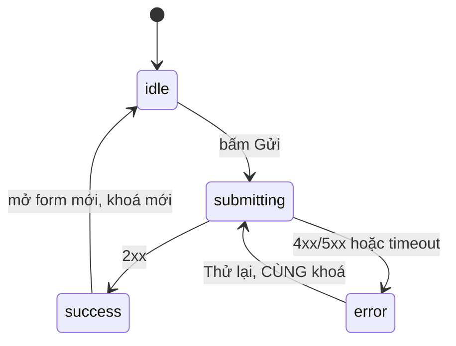

# L17: Form submit: bốn trạng thái, khóa double submit và Idempotency-Key

> **Trạng thái:** bản viết lại đủ bảy bước, nằm ngoài `src/`. Chưa nối vào app, chưa đo với người đọc thứ hai.
> **Số liệu:** mọi con số trong bài là giả định của kịch bản, ghi "Giả sử" ở chỗ dùng. Không phải số đo từ hệ thống thật, không phải mặc định của trình duyệt hay của Vue. Riêng output ở Bước 5 là output thật của script chạy trên máy này.

**Tiên quyết:** biết một form HTML và sự kiện submit; biết `fetch`/`POST` trả về mã trạng thái HTTP; biết `ref` và `reactive`.

## Bước 1. Đoán trước

Giả sử màn hình nhập đơn hàng có một nút Gửi. Nhân viên bấm ba lần thật nhanh trong cùng một phần giây. Mỗi lần bấm gọi cùng một hàm `submit()`, và hàm đó gửi `POST /api/orders`.

1. Có mấy request tới server?
2. Nếu server không có cơ chế chống trùng, có mấy đơn được tạo?

Viết đáp án ra giấy. Đáp án nằm ở cuối bước 3.

## Bước 2. Điều bạn đã biết

Bạn đã từng làm một form HTML: một `input`, một nút `type="submit"`, và một đoạn `onclick` gọi `fetch('/api/orders', { method: 'POST' })`. Trang đó chạy đúng khi mạng tốt và người dùng bấm một lần.

Vue thay hai khớp:

- Thay `onclick` bằng `@submit.prevent="submit"`. Sự kiện vẫn là sự kiện của trình duyệt, chỉ khác là bạn không phải tự tìm phần tử.
- Thay biến DOM bằng `ref`. `status` là một `ref` giữ trạng thái của form.

Bài này thêm ba khớp mà form HTML thuần cũng cần, nhưng thường bị bỏ qua:

1. **Bốn trạng thái** thay cho một biến `loading` đúng/sai.
2. **Một khóa trong bộ nhớ** chặn cú bấm thứ hai, vì `disabled` không chặn kịp.
3. **Một `Idempotency-Key`** gửi lên server, để lần gửi lại không tạo bản ghi thứ hai.

**Dạng câu hỏi phỏng vấn bài này trả lời được:** "Vì sao vô hiệu hóa nút gửi không phải là idempotency?" và "Request tạo đơn timeout, bạn có kết luận được server chưa ghi gì không?"

## Bước 3. Một ví dụ có số

Giả sử nút Gửi bị vô hiệu hóa bằng `:disabled="status === 'submitting'"`, và `status` chỉ đổi sau khi Vue render lại. Giữa lúc bấm và lúc nút thật sự bị khóa, trình duyệt vẫn nhận cú bấm thứ hai và thứ ba.

Giả sử ba cú bấm lọt vào trong khoảng đó. Không có khóa trong bộ nhớ, ba request được gửi. Server không có bảng idempotency, ba đơn được tạo. Tỉ lệ nhân lên: một lần bấm thừa là một đơn phải xóa thủ công.

Giả sử thêm một biến `inFlight` kiểm ở dòng đầu hàm `submit()`. Cú bấm thứ hai và thứ ba gặp `inFlight === true` và quay về ngay. Số request: 1. Số đơn: 1.

Nhưng khóa trong bộ nhớ chỉ sống trong một tab. Giả sử request đó timeout sau 10 giây, và nhân viên bấm Thử lại. Nếu code sinh khóa mới ở mỗi lần bấm, server thấy một `Idempotency-Key` khác và tạo đơn thứ hai — dù server đã ghi đơn thứ nhất trước khi timeout. Số đơn: 2, cho một lần nhập.

**Đáp án bước 1:** ba request; ba đơn nếu server không chống trùng.

## Bước 4. Cơ chế, từng bước một



1. **Bốn trạng thái, không phải hai.** `idle` (chưa gửi), `submitting` (đang gửi), `success` (xong), `error` (lỗi). Mỗi trạng thái quyết định ba thứ: nút có bấm được không, thông báo hiện gì, và có cho gửi tiếp không. Chỉ `submitting` mới khóa. Một biến `loading` đúng/sai gộp `success` và `error` làm một, nên không phân biệt được "xong" với "hỏng" — và đó là chỗ người dùng bấm lại vô ích.

2. **`disabled` không phải khóa.** Nó chỉ có hiệu lực sau khi giao diện render lại, và chỉ chặn một đường bấm trên một tab. Khóa thật là một biến thường (không cần `ref`), kiểm ở dòng đầu hàm gửi, trước mọi thứ khác. Nó không phụ thuộc vào việc nút đã kịp disable hay chưa.

3. **Khóa định danh ý định, không định danh request.** Bản nháp IETF mô tả `Idempotency-Key` là giá trị duy nhất do client sinh, server dùng để nhận ra các lần thử lại của cùng một request. Ràng buộc quan trọng: khóa **không được** dùng lại với payload khác. Vì vậy khóa phải sinh khi **mở form** (khi bắt đầu một ý định), giữ nguyên qua các lần thử lại, và chỉ đổi khi ý định đổi — tức khi người dùng sửa dữ liệu hoặc mở form mới.

4. **Server lưu khóa kèm kết quả.** Bản nháp chia ba trường hợp. Lần đầu: xử lý bình thường và trả kết quả. Trùng khóa và request gốc **đã xong**: trả lại kết quả đã lưu, không tạo bản ghi mới. Trùng khóa và request gốc **đang chạy**: trả `409 Conflict`. Ngoài ra, dùng lại khóa với payload khác thì trả `422`.

5. **Vì vậy timeout không cho phép kết luận gì.** Timeout nghĩa là client không nhận được phản hồi, không phải server chưa ghi. Lần thử lại phải mang **đúng khóa cũ**; khi đó server trả lại kết quả đã lưu và tổng số bản ghi vẫn là một. Sinh khóa mới lúc thử lại là biến một lần nhập thành hai đơn, và không có lỗi nào hiện ra.

6. **Bỏ response cũ.** Người dùng bấm Lưu hai lần, lần thứ hai thất bại nhưng về trước. Nếu code ghi mọi response vào state, giao diện hiện lỗi trong khi server đã ghi thành công. Cần một bộ đếm phiên: mỗi lần gửi tăng bộ đếm, response chỉ được ghi nếu bộ đếm của nó vẫn là mới nhất.

**409 khác phát lại kết quả cũ ở chỗ nào.** `409` nói "khoản này đang được xử lý, chờ đi" — client nên thử lại sau, không sửa gì. `200` kèm kết quả cũ nói "việc này đã xong rồi, đây là kết quả" — client hiển thị luôn. Nhầm hai cái này thì hoặc bạn báo lỗi cho một đơn đã tạo thành công, hoặc bạn tạo thêm một đơn.

**Validation ở client là trải nghiệm, không phải kiểm soát.** Server phải validate lại và kiểm quyền theo tài nguyên, vì một request tự tạo bằng `curl` không đi qua form của bạn.

## Bước 5. Thí nghiệm nhỏ

Chạy trong thư mục `lessons/03-vue/l17/`. Script không cần cài gói nào; nó mô phỏng client và server bằng JavaScript thuần, có bảng idempotency.

```
node idempotency.mjs
```

Tương đương với bun: `bun idempotency.mjs`

Kết quả đã chạy trên máy này:

```
=== Tình huống 1: bấm Gửi ba lần ===
  Số bản ghi đơn hàng trên server: 1
  Mã đơn: ORD-0001
  lần 1 -> 201, lần 2 -> bị chặn (inFlight), lần 3 -> bị chặn (inFlight)

[client] TimeoutError: timeout sau 10s

=== Tình huống 2: timeout rồi Thử lại, giữ nguyên khoá ===
  Số bản ghi đơn hàng trên server: 1
  Mã đơn: ORD-0001
  server đã ghi 1 bản ghi trước khi client biết; lần thử lại trả HTTP 200 cho đơn ORD-0001

[client] TimeoutError: timeout sau 10s

=== Tình huống 3: timeout rồi Thử lại với khoá mới ===
  Số bản ghi đơn hàng trên server: 2
  Mã đơn: ORD-0001, ORD-0002
  lần thử lại trả HTTP 201 và tạo thêm một bản ghi

=== Tình huống 4: request thứ hai tới khi request đầu chưa xong ===
  Số bản ghi đơn hàng trên server: 0
  Mã đơn: 
  server trả HTTP 409 — "A request is outstanding for this Idempotency-Key"
```

Đọc bốn tình huống:

- **Tình huống 1 — 1 bản ghi.** Cú bấm thứ hai và thứ ba bị `inFlight` chặn trước khi chạm tới mạng. Nếu bỏ biến đó, cả ba request cùng bay và server tạo ba bản ghi (bạn kiểm được bằng cách xóa dòng `if (inFlight) return`).
- **Tình huống 2 — 1 bản ghi.** Server đã ghi trước khi client timeout; lần thử lại mang đúng khóa cũ nên server trả `200` kèm đơn `ORD-0001`, không tạo thêm.
- **Tình huống 3 — 2 bản ghi.** Cùng một lần nhập, nhưng khóa mới nên server coi là ý định mới và tạo `ORD-0002`. Đây chính là sự cố "hai đơn giống hệt nhau" trong bài.
- **Tình huống 4 — 0 bản ghi.** Khóa đang được xử lý, request thứ hai nhận `409` và phải chờ, không được coi là thành công cũng không được sinh khóa mới.

Phần được mô phỏng: độ trễ mạng, timeout, và việc server commit trước khi client biết. Không có HTTP thật, không có Vue. Cơ chế bảng idempotency và ba nhánh trả về thì đúng như bản nháp IETF mô tả.

**Tự thử:** đổi `retryWithSameKey` thành `retryWithNewKey` trong tình huống 2. Số bản ghi thành mấy?

## Bước 6. Bốn câu luyện tập

Trả lời trước khi mở đáp án.

**Câu 1.** Vì sao vô hiệu hóa nút gửi không phải là idempotency, và thiếu lớp nào ở phía server?

<details>
<summary>Đáp án</summary>

Kết luận: `disabled` chỉ chặn một đường bấm trên một tab, và chỉ sau khi giao diện render lại. Nó không chặn tải lại trang, tab khác, retry tự động của trình duyệt, hay một request gửi lại bằng devtools. Thiếu lớp server: một bảng lưu `Idempotency-Key` kèm kết quả.

Điều kiện để đúng: server phải nhận khóa từ client và tra bảng trước khi tạo bản ghi. Nếu server bỏ qua header, mọi lớp phía client đều vô nghĩa.

Cách kiểm: gửi cùng một request hai lần bằng `curl` với cùng header `Idempotency-Key`. Số bản ghi tăng 1 là đúng; tăng 2 là server chưa có bảng.

</details>

**Câu 2.** Request tạo đơn timeout sau 10 giây. Bạn có được kết luận server chưa ghi gì không, và lần thử lại phải làm gì?

<details>
<summary>Đáp án</summary>

Kết luận: không kết luận được gì. Timeout chỉ nói client không nhận được phản hồi; server có thể đã commit. Lần thử lại phải mang **đúng khóa cũ**, và server trả lại kết quả đã lưu.

Điều kiện để đúng: khóa được sinh lúc mở form và không bị sinh lại trong nhánh xử lý lỗi. Nếu code sinh khóa trong `catch`, mọi lần thử lại đều là ý định mới.

Cách kiểm: đếm số bản ghi sau hai lần gửi cùng khóa. Một bản ghi và mã đơn giống nhau ở cả hai lần là đúng.

</details>

**Câu 3.** Hai response về lệch thứ tự sau khi người dùng bấm Lưu hai lần, lần thứ hai thất bại. Giao diện nên hiển thị gì, và cái gì quyết định?

<details>
<summary>Đáp án</summary>

Kết luận: chỉ response của lần gửi mới nhất được ghi vào state. Bộ đếm phiên quyết định: mỗi lần gửi tăng bộ đếm, response có bộ đếm cũ bị bỏ qua.

Điều kiện để đúng: bộ đếm tăng ở đầu hàm gửi, trước `await`. Nếu tăng sau `await`, hai request có thể cùng đọc một giá trị.

Cách kiểm: làm chậm một trong hai request, bấm hai lần, xem giao diện. Nếu giao diện hiện lỗi trong khi server đã ghi, response cũ đang ghi đè.

</details>

**Câu 4.** Validation ở client đã chặn số lượng âm và SKU sai. Còn thiếu gì để một request tạo bằng `curl` không tạo được đơn sai?

<details>
<summary>Đáp án</summary>

Kết luận: thiếu validation ở server và thiếu kiểm quyền theo tài nguyên. Mã client bị bỏ qua hoàn toàn khi gọi API trực tiếp.

Điều kiện để đúng: server validate lại mọi ràng buộc (số lượng dương, SKU tồn tại, quyền của người dùng trên tài nguyên đó) và không tin bất kỳ trường nào client gửi lên để quyết định quyền.

Cách kiểm: gửi `curl` với `qty: -5` và với token của người dùng thường. Phải nhận `4xx`, không phải `201`.

</details>

## Bước 7. Câu neo

> Một lần bấm Gửi là một ý định có bốn trạng thái và một định danh — khóa giữ nguyên khi thử lại cùng dữ liệu, đổi khi dữ liệu đổi — nên server trả lại kết quả cũ thay vì tạo bản ghi thứ hai.

## Ghi chú nguồn

<details>
<summary>Ghi chú nguồn, đọc ngày 2026-10-29</summary>

- https://datatracker.ietf.org/doc/draft-ietf-httpapi-idempotency-key-header/ — xác nhận `Idempotency-Key` là giá trị duy nhất do client sinh để server nhận ra lần thử lại; khóa không được dùng lại với payload khác; lần đầu xử lý bình thường, trùng khóa đã xong thì trả kết quả nhất quán, trùng khóa đang chạy thì trả `409`; payload khác với cùng khóa thì trả `422`.
- Output ở Bước 5: chạy `node idempotency.mjs` trong `lessons/03-vue/l17/`, dán nguyên văn.

Chưa kiểm trong bài này: chính sách hết hạn khóa (bản nháp chỉ nói resource SHOULD công bố, không nêu con số cụ thể); thời gian render lại của Vue so với một cú bấm liên tiếp [INFERENCE: `disabled` có hiệu lực sau khi patch xong DOM]; hành vi retry tự động của từng trình duyệt với `POST`. Số liệu trong sự cố là kịch bản.

</details>
