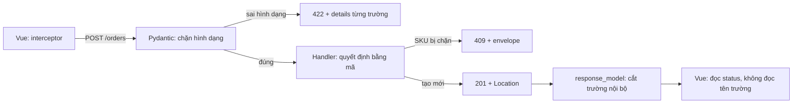

# L18: Hợp đồng API giữa Vue và FastAPI

> **Trạng thái:** bản viết lại đủ bảy bước, nằm ngoài `src/`. Chưa nối vào app, chưa đo với người đọc thứ hai.
> **Số liệu:** mọi con số trong bài là giả định của kịch bản, được ghi "Giả sử" ở chỗ dùng. Không phải số đo từ hệ thống thật, không phải mặc định của FastAPI hay Vue. Output ở Bước 5 là output thật của script trong thư mục này.

**Tiên quyết:** đã gọi một API bằng `fetch` hoặc `axios` từ Vue; biết response có `status` và `body`; biết JSON là gì.

## Bước 1. Đoán trước

Giả sử bản pilot có 100 nhân viên nội bộ. Trong một buổi chiều, 37 người bấm nút Đặt hàng với SKU nằm trong danh sách chặn. Server trả `200` kèm body `{"ok": false, "error": "sku đang bị chặn"}`. Dashboard lỗi tính tỉ lệ lỗi bằng số response có mã `>= 400` chia cho tổng số response.

Trước khi đọc tiếp, trả lời hai câu:

1. Bao nhiêu người trong 37 người đó thấy toast xanh báo thành công?
2. Tỉ lệ lỗi trên dashboard nhích lên bao nhiêu điểm phần trăm?

Viết đáp án ra giấy. Đáp án nằm ở cuối bước 3.

## Bước 2. Điều bạn đã biết

Bạn đã gọi API từ Vue nhiều lần. Đoạn code quen thuộc trông như thế này:

```js
const res = await fetch("/orders", { method: "POST", body: JSON.stringify(payload) })
if (res.ok) {
  toast.success("Đã đặt hàng")
} else {
  toast.error("Có lỗi")
}
```

Hai thứ bạn đã dùng: `res.ok` (đúng khi mã nằm trong 200–299) và `res.json()` (body). Bài này không thêm cú pháp mới. Nó chỉ nói rõ ba chỗ mà một response phải đi qua, và chỗ nào quyết định điều gì.

**Chỗ thứ nhất — máy đọc.** Status code, và tên các trường trong body. Đây là phần thư viện HTTP, cache, gateway, log, alert đọc được. Chúng không hiểu nghiệp vụ đặt hàng; chúng chỉ so số và so tên trường.

**Chỗ thứ hai — người đọc.** Trường `message` trong body. Con người đọc câu này để biết phải làm gì tiếp.

**Chỗ thứ ba — nơi sinh ra cả hai.** Model Pydantic khai báo hình dạng body, và type hint khai báo kiểu trả về. FastAPI sinh cả mã lẫn body từ hai khai báo đó.

Khác biệt cần nhớ so với cách bạn vẫn làm: trước đây body là nơi chứa kết quả, còn mã là chi tiết trang trí. Bài này đảo lại. Mã là kết quả. Body là chi tiết.

## Bước 3. Một ví dụ có số

Giả sử pilot có 100 nhân viên, và một buổi chiều 37 người bấm Đặt hàng với SKU bị chặn. Giả sử p99 của route là 180 ms, nên 37 request đó xong trong khoảng một giây.

Server trả `200` cho cả 37. Phía Vue thấy `res.ok === true`, chạy nhánh thành công, hiện toast xanh. Dashboard tính tỉ lệ lỗi bằng `count(status >= 400) / count(*)`. Tử số là 0, mẫu số là 37. Tỉ lệ lỗi là 0%. Không một điểm nào nhích.

Cùng lúc đó, số đơn thật trong cơ sở dữ liệu tăng 0. Tỉ lệ thành công theo đúng nghĩa nghiệp vụ là 0/37.

Giả sử đội sửa lại cho route trả `409` khi SKU bị chặn. Cùng 37 request đó, tử số thành 37, tỉ lệ lỗi thành 100%, và alert kêu ngay trong phút đầu. Không có dòng code nghiệp vụ nào đổi. Chỉ có mã đổi.

Giả sử sáng hôm sau phía Vue gửi thêm một header tuỳ biến `X-Tenant-Id`, và backend chưa khai header đó trong `Access-Control-Allow-Headers`. Trình duyệt chặn request ngay ở preflight, trước khi request tới FastAPI. Số dòng log của FastAPI cho buổi sáng đó là 0, nên không có gì để tra.

**Đáp án bước 1:** 37 người thấy toast xanh; tỉ lệ lỗi nhích 0 điểm phần trăm.

## Bước 4. Cơ chế, từng bước một



1. **Pydantic chặn ở biên vào, trước handler.** Model khai báo `sku: str` và `qty: int` kèm ràng buộc. Thiếu trường hoặc sai kiểu thì FastAPI dừng trước khi handler chạy, và trả `422` kèm danh sách lỗi từng trường. Điểm quan trọng: handler và cơ sở dữ liệu không bao giờ thấy dữ liệu bẩn. Bạn không phải viết `if not body.qty: return ...` ở mọi route.
2. **Handler quyết định kết quả bằng mã, không bằng body.** Tạo mới trả `201` kèm header `Location`. SKU bị chặn trả `409`. Thiếu quyền trả `403`. Trong code, khác biệt nằm ở `raise` so với `return`: ném lỗi thì request dừng ngay tại đó, còn `return {"ok": false}` thì request vẫn đi tiếp bình thường và mã vẫn là `200`.
3. **Một exception handler chung sinh ra hình dạng body.** Mọi lỗi đi qua cùng một chỗ, nên body lỗi luôn có cùng ba trường `code`, `message`, `correlation_id`. `code` là thứ máy so được, `message` là thứ người đọc, `correlation_id` là sợi dây tra ngược vào log.
4. **`response_model` lọc chiều ra.** Handler trả một dict có thêm trường nội bộ cũng không sao: FastAPI cắt mọi trường không khai báo trong model. Tài liệu FastAPI nói rõ điểm này, và nói thêm rằng nếu dữ liệu trả về không khớp model thì đó là lỗi của code phía server, nên FastAPI trả lỗi server thay vì trả dữ liệu sai hình dạng.
5. **Cùng những model đó sinh ra `openapi.json`.** Không có bước viết tài liệu riêng. Client Vue sinh kiểu từ file này, nên đổi tên một trường làm pipeline phía client đỏ ngay lúc build, thay vì hiện `undefined` trên màn hình người dùng.

**Vì sao đổi tên một trường trong body mà không đổi mã lại làm vỡ client cũ.** Đây là chỗ dễ hiểu sai nhất, và script ở bước sau cho thấy nó bằng số. Client cũ gửi `{"sku": "abc-1", "quantity": 2}`. Model mới khai báo `qty`. Pydantic mặc định bỏ qua trường lạ, nên `quantity` biến mất không một lời cảnh báo, và `qty` thiếu nên request nhận `422` với `field: body.qty`. Không có `500`, không có exception ở đâu cả. Mã vẫn là `422` như mọi lần dữ liệu sai hình dạng — nghĩa là mã không hề đổi, chỉ có hình dạng body đổi. Đó chính là định nghĩa của một thay đổi hợp đồng.

**Ba mã, ba hành vi giao diện khác nhau.** Gộp chúng thành một mã `400` là mất thông tin, vì mỗi mã dẫn tới một việc khác nhau:

| Mã | Nghĩa | Giao diện làm gì |
|---|---|---|
| `422` | Đúng cú pháp JSON, sai ràng buộc từng trường | Chiếu `details` vào đúng ô nhập, người dùng sửa tại chỗ |
| `409` | Đúng hình dạng, xung đột trạng thái nghiệp vụ | Không sửa ô nhập được; phải tải lại trạng thái mới nhất |
| `201` | Đã tạo tài nguyên | Chuyển sang trang chi tiết bằng `Location`, không đoán id từ body |

## Bước 5. Thí nghiệm nhỏ

Script `contract_check.py` dựng một app FastAPI nhỏ và gọi nó bằng `TestClient`. Không cần server thật: `TestClient` gọi thẳng app trong cùng tiến trình, nên mã và body in ra đúng như một client HTTP nhìn thấy. Đây là FastAPI thật, Pydantic thật — chỉ có mạng là không có.

Cài và chạy trong thư mục `lessons/04-noi-hai-mang/l18/`:

```
python -m venv .venv
uv pip install --python .venv/Scripts/python.exe fastapi httpx
.venv/Scripts/python.exe contract_check.py
```

Kết quả đã chạy trên máy này:

```
=== 1. Tạo mới hợp lệ ===
POST /orders  gửi: {"sku": "abc-1", "qty": 2}
<- 201
Location: /orders/ord-1001
body: {"id": "ord-1001", "sku": "abc-1", "qty": 2}

=== 2. SKU bị chặn ===
POST /orders  gửi: {"sku": "banned-sku", "qty": 1}
<- 409
body: {"code": "sku_blocked", "message": "SKU banned-sku đang bị chặn", "correlation_id": "corr-0001"}

=== 3. Dữ liệu sai hình dạng ===
POST /orders  gửi: {"sku": "abc-1", "qty": 0}
<- 422
body: {"code": "invalid_body", "message": "Body không đúng hình dạng; xem details.", "correlation_id": "corr-0002", "details": [{"field": "body.qty", "msg": "Input should be greater than or equal to 1"}]}

=== 4. Client cũ gửi tên trường cũ ===
POST /orders  gửi: {"sku": "abc-1", "quantity": 2}
<- 422
body: {"code": "invalid_body", "message": "Body không đúng hình dạng; xem details.", "correlation_id": "corr-0003", "details": [{"field": "body.qty", "msg": "Field required"}]}

=== Bảng mã, in từ chính các response ở trên ===
201  1. Tạo mới hợp lệ
409  2. SKU bị chặn
422  3. Dữ liệu sai hình dạng
422  4. Client cũ gửi tên trường cũ

=== Dùng Location của đơn vừa tạo ===
GET /orders/ord-1001 -> 200
body: {"id": "ord-1001", "sku": "abc-1", "qty": 2}
```

Đọc bốn khối trên theo thứ tự, vì mỗi khối trả lời một câu.

**Khối 1.** Handler trả về một dict có bốn trường, trong đó có `internal_note`. Body nhận được chỉ có ba. `response_model=OrderOut` đã cắt trường thứ tư. Header `Location` cho biết địa chỉ của tài nguyên vừa tạo, nên client không phải đọc `id` từ body rồi tự ghép URL. Khối cuối chứng minh `Location` dùng được: gọi `GET` vào đúng đường dẫn đó trả `200`.

**Khối 2.** Mã là `409`, không phải `200`. Body có `code: "sku_blocked"` cho máy so và `message` cho người đọc. `correlation_id` là `corr-0001` vì đây là lỗi đầu tiên trong lượt chạy.

**Khối 3.** `qty: 0` vi phạm `ge=1`. Handler không chạy lần nào. `details` chỉ đúng `body.qty`, nên giao diện biết chiếu thông báo vào ô số lượng. Đây là toàn bộ giá trị của `422` so với `400`: nó nói được sai ở đâu.

**Khối 4.** Đây là câu trả lời cho câu hỏi của bài. Client cũ gửi `quantity`, model mới cần `qty`. Mã là `422`, giống khối 3, nhưng `msg` là `Field required` chứ không phải một ràng buộc bị vi phạm. `quantity` không xuất hiện trong `details` ở đâu cả — Pydantic bỏ qua trường lạ, nên trường cũ biến mất im lặng. Không có mã mới nào báo "hợp đồng đã đổi". Nếu client không đọc `details`, người dùng chỉ thấy "Có lỗi".

**Tự thử:** giữ nguyên mọi thứ, đổi `qty` thành `1000`. Mã trả về là gì, và `msg` nói gì? (Gợi ý: đọc `le=999` trong model.)

## Bước 6. Bốn câu luyện tập

Trả lời trước khi mở đáp án.

**Câu 1.** Vì sao một route chỉ trả `200` kèm `{"ok": false}` làm dashboard lỗi mù, trong khi người dùng vẫn thấy thông báo?

<details>
<summary>Đáp án</summary>

Kết luận: dashboard tính lỗi từ status code, còn thông báo cho người dùng đọc từ body. Hai kênh này do hai đoạn code khác nhau đọc, nên chúng có thể nói hai điều trái nhau mà không bên nào biết.

Khi mã là `200`, mọi tầng trung gian — thư viện HTTP, cache, gateway, access log, alert — đều xếp response vào nhóm thành công. Chúng không đọc `ok`. Chỉ đoạn code giao diện do bạn viết mới đọc `ok`, và nó đọc được thì hiện thông báo đúng.

Điều kiện để đúng: dashboard và alert phải tính từ status code, không từ một trường trong body.

Cách kiểm: đếm response có mã `>= 400` trong access log của một route mà nghiệp vụ chắc chắn có từ chối. Nếu con số là 0, kết quả đang nằm trong body.

</details>

**Câu 2.** Cùng một route `POST /orders`, ba tình huống: body thiếu `qty`, SKU bị chặn, tạo mới thành công. Mã nào cho tình huống nào, và vì sao không dùng `400` cho cả ba?

<details>
<summary>Đáp án</summary>

Kết luận: `422` cho body thiếu `qty`, `409` cho SKU bị chặn, `201` cho tạo mới thành công. Ba mã này dẫn tới ba hành vi giao diện khác nhau, nên gộp lại là mất thông tin mà không được gì.

`422` nghĩa là sửa được tại chỗ: giao diện chiếu `details` vào đúng ô nhập. `409` nghĩa là dữ liệu đúng hình dạng nhưng trạng thái đã đổi: sửa ô nhập vô ích, phải tải lại trạng thái mới. `201` nghĩa là có tài nguyên mới, kèm `Location` để đi tới đó. `400` dành cho gói tin hỏng ở mức giao thức, là lỗi tích hợp mà người dùng không làm gì được.

Điều kiện để đúng: `422` phải đến từ tầng kiểm dữ liệu trước handler, không phải từ một `if` viết tay trong handler.

Cách kiểm: gửi ba request và đọc mã. Nếu request thiếu trường nhận `500`, tầng kiểm đang chạy sau chỗ nó phải chạy.

</details>

**Câu 3.** Backend đổi tên trường `qty` thành `quantity` trong body, giữ nguyên mọi mã. Vì sao client cũ vỡ, và vỡ ở đâu?

<details>
<summary>Đáp án</summary>

Kết luận: client cũ vỡ ở bước kiểm dữ liệu vào, và nó vỡ bằng `422` chứ không bằng một lỗi rõ ràng nào về việc đổi tên. Mã không đổi, nhưng hình dạng body đổi, và hình dạng body cũng là một phần của hợp đồng.

Client cũ gửi `quantity`. Model mới cần `qty`. Pydantic mặc định bỏ qua trường lạ, nên `quantity` biến mất không cảnh báo và `qty` thiếu, sinh ra `422` với `Field required`. Không có `500`, không có exception ở server.

Điều kiện để đúng: model không đặt `extra="forbid"`. Nếu đặt, trường lạ bị từ chối thẳng và thông báo chỉ đúng tên `quantity`, dễ tra hơn.

Cách kiểm: gọi route bằng đúng payload của client cũ trong một test, rồi so mã và `details` với bản deploy trước. Test đỏ trước khi deploy là đủ.

</details>

**Câu 4.** Vì sao phải có `response_model` khi handler đã trả đúng dữ liệu?

<details>
<summary>Đáp án</summary>

Kết luận: `response_model` là màng lọc khai báo, không phải kiểm tra thừa. Nó quyết định trường nào được ra ngoài, nên trường nội bộ không thể lọt chỉ vì người viết handler quên.

Trong script ở bước 5, handler trả dict có `internal_note`. Body nhận được không có trường đó. Nếu bỏ `response_model`, `internal_note` đi nguyên vẹn ra ngoài, và lần sau đổi tên nó lại thành một thay đổi hợp đồng ngoài ý muốn.

Điều kiện để đúng: model đầu ra phải khai báo riêng, không dùng lại model đầu vào. Dùng chung một model là cách phổ biến nhất để trường chỉ nên có ở đầu vào lọt ra đầu ra.

Cách kiểm: thêm một trường vào dict trả về mà không khai trong model, rồi đọc body. Không thấy trường đó là màng lọc đang chạy.

</details>

## Bước 7. Câu neo

> Mã trạng thái là kết quả cho máy, body là chi tiết cho người, và cả hai chỉ khớp nhau khi cùng sinh ra từ một model — nên đổi một trường trong body cũng là đổi hợp đồng, kể cả khi mã không đổi.

## Ghi chú nguồn

<details>
<summary>Ghi chú nguồn, đọc ngày 2026-10-29</summary>

- https://fastapi.tiangolo.com/tutorial/response-model/ — xác nhận: kiểu trả về dùng để validate, sinh JSON Schema, và **lọc** dữ liệu ra ngoài; nếu dữ liệu trả về không khớp model thì FastAPI trả lỗi server thay vì trả dữ liệu sai hình dạng; `response_model` ưu tiên hơn type hint.
- https://fastapi.tiangolo.com/tutorial/response-status-code/ — xác nhận: `status_code` là tham số của decorator, mặc định là `200`, `201` là "Created", và `fastapi.status` chỉ là tên gọi dễ đọc của cùng con số.
- https://fastapi.tiangolo.com/tutorial/handling-errors/ — xác nhận: `HTTPException` được `raise` chứ không `return`, body mặc định là `{"detail": ...}`; khi dữ liệu không hợp lệ FastAPI ném `RequestValidationError` và có handler mặc định; có thể ghi đè handler đó bằng `@app.exception_handler(RequestValidationError)`.
- https://developer.mozilla.org/en-US/docs/Web/HTTP/Reference/Headers/Set-Cookie — xác nhận định nghĩa thuộc tính cookie dùng ở bài sau (`HttpOnly`, `SameSite`, `Secure`, `Path`), đọc luôn trong phiên này để khỏi mở lại.

Chưa kiểm trong bài này: mã `422` không được nêu tên trong trang status code của FastAPI mà chỉ xuất hiện trong trang xử lý lỗi (dưới dạng handler mặc định của `RequestValidationError`); hành vi bỏ qua trường lạ của Pydantic là quan sát từ chính output ở bước 5, không đọc trang cấu hình `model_config`; chi tiết preflight CORS không mở trong phiên này nên phần preflight ở bước 3 là mô hình suy ra từ sự cố, không phải trích dẫn.

</details>
