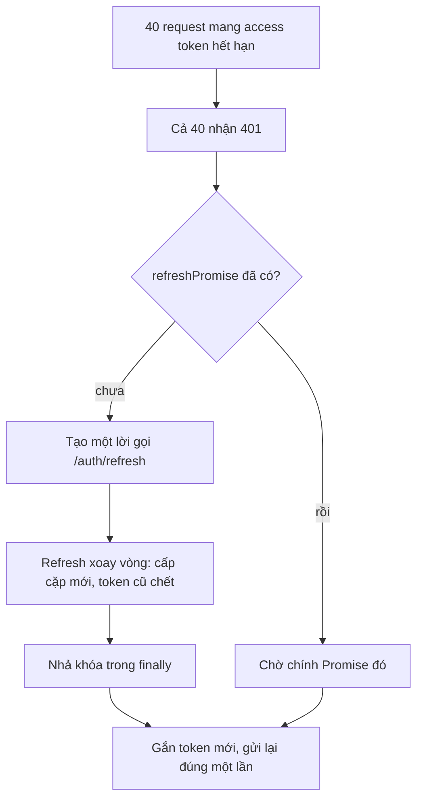

# L19: Auth xuyên hai phía: token, nơi lưu, interceptor, và ai quyết định quyền

> **Trạng thái:** bản viết lại đủ bảy bước, nằm ngoài `src/`. Chưa nối vào app, chưa đo với người đọc thứ hai.
> **Số liệu:** mọi con số trong bài là giả định của kịch bản, được ghi "Giả sử" ở chỗ dùng. Không phải số đo từ hệ thống thật, không phải mặc định của Vue hay của bất kỳ thư viện JWT nào. Riêng các con số ở Bước 5 là output thật của script trong thư mục này, chạy trên một mô phỏng.

**Tiên quyết:** đã từng gắn header `Authorization: Bearer ...` vào một request; biết `localStorage` là gì; biết 401 nghĩa là chưa được xác thực.

## Bước 1. Đoán trước

Giả sử 40 request nghiệp vụ đang bay cùng lúc, tất cả mang một access token đã hết hạn. Mỗi request nhận `401`. Interceptor được viết theo phản xạ: thấy `401` thì gọi `/auth/refresh`. Endpoint refresh xoay vòng token — mỗi lần cấp cặp mới thì refresh token cũ chết ngay.

Trước khi đọc tiếp, trả lời hai câu:

1. Có bao nhiêu lời gọi tới `/auth/refresh`?
2. Trong 40 request đó, bao nhiêu request cuối cùng thành công?

Viết đáp án ra giấy. Đáp án nằm ở cuối bước 3.

## Bước 2. Điều bạn đã biết

Bạn đã làm phần dễ nhất của việc này: đăng nhập xong, lưu token vào `localStorage`, và một interceptor gắn header cho mọi request.

```js
localStorage.setItem("access_token", res.data.access_token)
http.interceptors.request.use((config) => {
  config.headers.Authorization = "Bearer " + localStorage.getItem("access_token")
  return config
})
```

Ba khớp trong đoạn code đó sẽ bị thay, từng cái một.

**Khớp thứ nhất — một token thành hai.** Access token sống ngắn, đi kèm mọi request. Refresh token sống dài, chỉ dùng để đổi lấy access token mới. Tách ra vì hai thứ có hai mức rủi ro khác nhau: access token bay qua mạng ở mọi request nên dễ lộ nhất, và vì nó sống ngắn nên lộ cũng chỉ hại trong khoảng đó.

**Khớp thứ hai — `localStorage` thành RAM cộng cookie.** `localStorage` đọc được bằng bất kỳ đoạn JavaScript nào chạy trong origin đó. Một lỗi XSS ở một thư viện bên thứ ba là đủ để đọc ra cả hai token. Bài này đổi: access token giữ trong một biến RAM, refresh token nằm trong cookie `HttpOnly` — loại cookie mà JavaScript không đọc được, theo định nghĩa.

**Khớp thứ ba — mỗi request tự lo, thành một lần chung.** Đây là khớp gây ra sự cố, và là phần lớn của bài này.

Khác biệt cần nhớ: trước đây `401` là chuyện của từng request. Từ bài này, `401` là chuyện của cả phiên, nên phải có đúng một chỗ xử lý nó.

## Bước 3. Một ví dụ có số

Giả sử 9h00 thứ Hai, khoảng 1.000 người dùng mở ứng dụng trong vài phút đầu giờ làm. Access token sống 15 phút. Vì mọi người đăng nhập gần như cùng lúc, tới 9h15 gần một nghìn request đồng thời nhận `401`.

Cách làm ngây thơ sinh ra một lời gọi refresh cho mỗi request: 1.000 lời gọi. Lời đầu tiên xoay vòng refresh token thành công. 999 lời còn lại mang đúng cái refresh token vừa chết, nên chúng nhận `401` — và mỗi `401` đó lại kích hoạt một vòng thử lại. Giả sử log của API ghi 1.024 lời gọi tới `/auth/refresh` trong một giây, pool 20 connection bị chiếm hết, p99 của endpoint refresh lên 6,4 giây.

Con số đáng chú ý: **một** lời gọi thành công, **1.023** lời gọi thất bại, và không có lỗi `5xx` nào nên alert không kêu.

Bây giờ thu nhỏ xuống cho vừa một script: 40 request thay vì 1.000. Cùng cơ chế, nên tỉ lệ giữ nguyên. Không có single-flight: 40 lời gọi refresh, 1 thành công, 39 thất bại, và chỉ 1 request cuối cùng có dữ liệu. Có single-flight: 1 lời gọi refresh, cả 40 request thành công.

**Đáp án bước 1:** 40 lời gọi tới `/auth/refresh`; 1 request thành công trong 40.

## Bước 4. Cơ chế, từng bước một



1. **Đăng nhập cấp hai thứ khác nhau.** Access token trả trong body, Vue giữ trong RAM. Refresh token gắn bằng `Set-Cookie` với `HttpOnly`, `Secure`, `SameSite=Strict` và `Path=/auth/refresh`. Bốn thuộc tính đó làm bốn việc: `HttpOnly` chặn JavaScript đọc, `Secure` chặn gửi qua HTTP thường, `SameSite=Strict` chặn trình duyệt gửi cookie khi request phát sinh từ site khác, và `Path` thu hẹp cookie chỉ đi tới đúng một đường dẫn. MDN ghi rõ: `HttpOnly` chặn đọc qua `document.cookie` nhưng cookie vẫn được gửi kèm request do JavaScript khởi tạo — chặn đọc, không chặn dùng.
2. **Mỗi request nghiệp vụ tự mang danh tính.** Interceptor đọc access token từ RAM và gắn `Authorization: Bearer`. Không đọc từ `localStorage`, nên một lỗi XSS không rút được token ra khỏi tab. Cái giá phải trả ngay là một round trip mỗi lần khởi động, trước khi hiện dữ liệu.
3. **Gặp `401` thì gộp, không nhân bản.** Đây là toàn bộ cơ chế single-flight, và nó chỉ là một biến:

   ```js
   function sharedRefresh() {
     if (!refreshPromise) {
       refreshPromise = doRefresh().finally(() => { refreshPromise = null })
     }
     return refreshPromise
   }
   ```

   Request đầu tiên thấy `refreshPromise` rỗng nên tạo Promise và lưu lại. 39 request còn lại thấy nó đã có nên chờ chính Promise đó. Chúng không gọi server lần nào.
4. **Nhả khóa trong `finally`, không phải sau `await`.** Nếu gán `refreshPromise = null` ở dòng sau `await` trên nhánh thành công, thì một lần refresh thất bại sẽ để khóa nằm mãi: mọi request `401` sau đó treo tới khi người dùng F5. `finally` chạy ở cả hai nhánh.
5. **Replay đúng một lần.** Có token mới thì gắn header và gửi lại request, kèm một cờ đánh dấu đã thử. Gặp `401` lần nữa thì bỏ cuộc, không xoay thêm vòng. Và `401` đến từ chính `/auth/refresh` không bao giờ được đưa vào nhánh chờ: nếu đưa vào, một refresh token đã bị xoay vòng sẽ sinh ra vòng lặp vô hạn. `401` từ endpoint refresh nghĩa là phiên đã chết — việc phải làm là đăng xuất, không phải thử lại.
6. **Backend vẫn là nơi quyết định quyền.** Token hợp lệ chỉ chứng minh danh tính; nó không chứng minh request này được phép. Mỗi request, FastAPI kiểm chữ ký, kiểm hạn, kiểm loại token, rồi lọc truy vấn theo danh tính lấy từ token.

**Vì sao `localStorage` là chỗ đắt.** Tài liệu OWASP về quản lý phiên nói thẳng: không lưu token xác thực, session id, JWT hay refresh token trong `localStorage` hoặc `sessionStorage`, vì bất kỳ JavaScript nào chạy trong origin đều đọc được, nên một lỗ XSS là lộ toàn bộ token. Cùng tài liệu ghi `HttpOnly` là biện pháp bắt buộc để chống đánh cắp session id qua XSS.

**Cái giá của từng chỗ lưu, nói thẳng.**

| Chỗ lưu | XSS đọc được? | Sống qua F5? | Cái giá phải trả |
|---|---|---|---|
| `localStorage` | Có | Có | Một lỗ XSS là mất cả phiên dài hạn |
| Biến RAM | Không đọc trực tiếp, nhưng mã XSS gọi được API | Không | Mỗi lần tải trang phải refresh im lặng, thêm một round trip |
| Cookie `HttpOnly` | Không | Có | Kéo theo cấu hình `SameSite`, `Secure`, `Path`, và phải chống CSRF |

## Bước 5. Thí nghiệm nhỏ

Script `refresh_sim.mjs` chạy bằng Node, không cần thư viện nào. **Đây là mô phỏng**, không phải server thật và không có token thật: nó dựng một đối tượng đóng vai server, giữ tập access token còn hạn và tập refresh token còn sống, rồi cho 40 request chạy đồng thời qua đó. Cái được mô phỏng đúng là hai cơ chế: endpoint trả `401` khi access token hết hạn, và endpoint refresh xoay vòng làm refresh token cũ chết.

```
node refresh_sim.mjs
```

Kết quả đã chạy trên máy này:

```
40 request nghiệp vụ cùng nhận 401 vì access token "at-0" đã hết hạn.
Server refresh xoay vòng: cấp cặp mới thì refresh token cũ chết.

=== Chế độ A: không single-flight, replay tối đa 1 lần ===
Lời gọi /auth/refresh                           40
  trong đó thành công                            1
  trong đó bị từ chối (token đã bị xoay vòng)   39
Lời gọi API nghiệp vụ                           80
Request được gửi lại sau khi refresh             1
Request thành công                               1
Request thất bại                                39

=== Chế độ B: single-flight, replay tối đa 1 lần ===
Lời gọi /auth/refresh                            1
  trong đó thành công                            1
  trong đó bị từ chối (token đã bị xoay vòng)    0
Lời gọi API nghiệp vụ                           80
Request được gửi lại sau khi refresh            40
Request thành công                              40
Request thất bại                                 0

=== Chế độ C: không single-flight, KHÔNG chặn replay (trần an toàn 3 vòng) ===
Lời gọi /auth/refresh                          117
  trong đó thành công                            3
  trong đó bị từ chối (token đã bị xoay vòng)  114
Lời gọi API nghiệp vụ                          157
Request được gửi lại sau khi refresh             3
Request thành công                               3
Request thất bại                                37

=== Kiểm chặn lặp trên chính endpoint refresh ===
Hai lời gọi /auth/refresh đồng thời bằng cùng refresh token "rt-0"
  mã trả về: 200, 401
  lời gọi refresh phát sinh thêm sau cái 401     0
```

Đọc bốn khối đó theo thứ tự.

**Chế độ A.** 40 lời gọi refresh cho 40 request, và chỉ 1 lời thành công. Con số 39 bị từ chối không phải vì server hỏng: lời gọi đầu đã xoay vòng, nên 39 lời còn lại cầm một refresh token đã chết. 80 lời gọi API nghiệp vụ là 40 lần gửi đầu cộng 40 lần thử lại: đúng một request cầm được access token mới nên lần thử lại của nó thành công, còn 39 request kia vẫn cầm access token cũ nên nhận `401` lần nữa rồi dừng vì đã hết hạn mức replay một lần. Kết quả cuối: 1 request có dữ liệu.

**Chế độ B.** Cùng 40 request, cùng 80 lời gọi API, nhưng chỉ 1 lời gọi refresh. Cả 40 request chờ đúng một Promise rồi gửi lại, nên 40 request thành công. Số lời gọi refresh giảm 40 lần; số request thành công tăng từ 1 lên 40.

**Chế độ C.** Đây là chế độ không có cờ chặn replay. Để script dừng được, nó tự đặt trần an toàn 3 vòng. Trong 3 vòng đó đã có 117 lời gọi refresh — tức là đã gần gấp ba chế độ A, và trần 3 vòng chỉ là giới hạn của script chứ không phải giới hạn của code thật. Sự cố 1.024 lời gọi trong bài là chế độ này chạy không có trần, ở quy mô 1.000 người dùng.

**Khối cuối.** Hai lời gọi `/auth/refresh` đồng thời bằng cùng refresh token: một cái `200`, một cái `401`. Số lời gọi refresh phát sinh thêm sau cái `401` là 0. Đây là bằng chứng cho bước 5 của cơ chế: `401` từ chính endpoint refresh không được đưa vào nhánh chờ, nên nó không tự gọi lại mình.

**Tự thử:** đổi `maxRounds` ở chế độ B từ `1` thành `3`. Số lời gọi refresh có tăng không? (Ghi chú: single-flight và trần replay là hai cơ chế khác nhau, chặn hai kiểu hỏng khác nhau.)

## Bước 6. Bốn câu luyện tập

Trả lời trước khi mở đáp án.

**Câu 1.** Bốn mươi request cùng nhận `401`, interceptor dùng một Promise refresh chung. Refresh chạy mấy lần, và vì sao 39 request kia không tự gọi?

<details>
<summary>Đáp án</summary>

Kết luận: refresh chạy đúng một lần, vì 39 request kia chờ chính Promise mà request đầu tiên đã tạo và lưu vào một biến dùng chung, thay vì tự mở lời gọi riêng.

Cơ chế nằm ở `if (!refreshPromise)`: chỉ request nào thấy biến rỗng mới tạo lời gọi. Vì JavaScript chạy một luồng, không có hai request nào cùng lọt qua phép kiểm đó trước khi biến được gán.

Điều kiện để đúng: biến `refreshPromise` phải ở phạm vi dùng chung cho mọi request, không phải biến cục bộ trong hàm xử lý lỗi của từng request.

Cách kiểm: đếm số lời gọi `/auth/refresh` trên mỗi lần hết hạn token. Con số đúng xấp xỉ 1; lớn hơn 1 rõ rệt nghĩa là single-flight không chạy.

</details>

**Câu 2.** Vì sao `401` đến từ chính endpoint `/auth/refresh` không được đưa vào nhánh chờ và gửi lại?

<details>
<summary>Đáp án</summary>

Kết luận: vì `401` ở đó nghĩa là refresh token đã chết, nên mọi lần thử lại đều thất bại theo cùng một cách. Đưa nó vào nhánh chờ biến một lần lỗi thành một vòng lặp.

Nếu refresh cũng được refresh, mỗi `401` sinh một lời gọi mới, lời gọi mới lại `401`, và vòng đó chỉ dừng khi có ai đó chặn. Chế độ C trong script cho thấy hình dạng của vòng đó: 117 lời gọi chỉ trong 3 vòng.

Điều kiện để đúng: phải phân biệt được `401` của request nghiệp vụ với `401` của chính endpoint refresh, thường bằng cách so URL.

Cách kiểm: gửi một lời gọi refresh bằng refresh token đã chết, rồi đếm số lời gọi phát sinh thêm. Con số đúng là 0.

</details>

**Câu 3.** Vì sao đặt access token trong `localStorage` là chỗ đắt, trong khi để trong RAM thì phải refresh mỗi lần tải trang?

<details>
<summary>Đáp án</summary>

Kết luận: `localStorage` đọc được bằng mọi JavaScript chạy trong origin, nên một lỗ XSS là mất cả phiên dài hạn; RAM không đọc được nhưng mất khi tải lại trang, nên phải trả một round trip mỗi lần khởi động.

Với access token sống ngắn, mất nó chỉ hại trong khoảng thời gian còn lại; với refresh token sống dài, mất nó hại cho tới khi bị thu hồi. Vì vậy refresh token phải nằm trong cookie `HttpOnly`, không nằm ở chỗ nào JavaScript đọc được.

Điều kiện để đúng: không có lỗ XSS nào chạy được trong origin. Nếu có, mã XSS vẫn gọi được API bằng token trong RAM — nó không đọc được token nhưng dùng được phiên.

Cách kiểm: chạy thử `document.cookie` trong console sau khi đăng nhập. Không thấy refresh token là `HttpOnly` đang có tác dụng.

</details>

**Câu 4.** Một request mang access token hợp lệ vẫn nhận `403`. Vì sao đây không phải lỗi cấu hình?

<details>
<summary>Đáp án</summary>

Kết luận: token hợp lệ chỉ chứng minh danh tính, không chứng minh quyền trên bản ghi cụ thể. Quyền do backend quyết định ở từng request, dựa trên danh tính lấy từ token và dữ liệu của bản ghi.

Nếu backend chỉ kiểm token rồi trả dữ liệu, thì người dùng A đổi id trong URL là đọc được dữ liệu của B. Vì vậy câu truy vấn phải lọc theo danh tính, và `403` là kết quả đúng khi bộ lọc không khớp.

Điều kiện để đúng: mọi truy vấn đọc dữ liệu riêng đều đi qua bộ lọc theo danh tính, không chỉ những route được đánh dấu là cần quyền.

Cách kiểm: đăng nhập bằng tài khoản A, gọi một endpoint bằng id của B. Nhận `403` hoặc `404` là đúng; nhận dữ liệu của B là sai.

</details>

## Bước 7. Câu neo

> Refresh là việc dùng chung chứ không phải việc của từng request, nên mọi `401` phải chờ đúng một Promise, replay đúng một lần, và quyền vẫn do backend quyết định ở từng request.

## Ghi chú nguồn

<details>
<summary>Ghi chú nguồn, đọc ngày 2026-10-29</summary>

- https://developer.mozilla.org/en-US/docs/Web/HTTP/Reference/Headers/Set-Cookie — xác nhận: `HttpOnly` cấm JavaScript truy cập cookie qua `document.cookie` nhưng cookie **vẫn được gửi** kèm request do `fetch()` hoặc `XMLHttpRequest` khởi tạo; `SameSite=Strict` chỉ gửi cookie cho request cùng site; `SameSite=Lax` cho phép điều hướng top-level bằng phương thức an toàn; `Secure` chỉ gửi qua `https:`; `Path` giới hạn đường dẫn được gửi cookie.
- https://cheatsheetseries.owasp.org/cheatsheets/Session_Management_Cheat_Sheet.html — xác nhận: `HttpOnly` là biện pháp bắt buộc để chống đánh cắp session id qua XSS; `SameSite` chỉ nên là lớp bổ sung cho CSRF chứ không thay CSRF token; cảnh báo không lưu token xác thực, JWT hay refresh token trong `localStorage`/`sessionStorage` vì mọi JavaScript trong origin đều đọc được; `Path` và `Domain` nên thu hẹp tối đa.
- https://fastapi.tiangolo.com/tutorial/handling-errors/ — xác nhận cách một lỗi được ném và trả về theo mã, dùng cho phần backend kiểm quyền ở bước 6 của cơ chế.

Chưa kiểm trong bài này: hành vi xoay vòng refresh token và phát hiện dùng lại token là quy ước của kịch bản, không đọc đặc tả OAuth nào trong phiên này; con số 1.024 lời gọi, p99 6,4 giây và pool 20 connection là giả định của sự cố, không phải số đo; toàn bộ script ở bước 5 là mô phỏng bằng JavaScript thuần, không gọi server thật và không dùng token thật; phần "backend lọc truy vấn theo danh tính" là mô hình suy ra, không đọc mã nguồn FastAPI nào.

</details>
