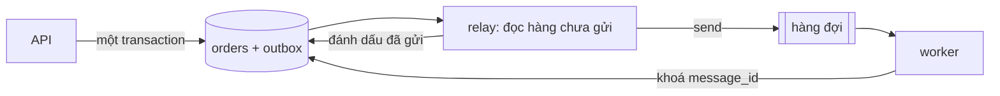

# L21: Outbox: vì sao ghi cơ sở dữ liệu và gửi message lệch nhau, và chỗ nào vá được

> **Trạng thái:** bản viết lại đủ bảy bước, nằm ngoài `src/`. Chưa nối vào app, chưa đo với người đọc thứ hai.
> **Số liệu:** mọi con số trong bài là giả định của kịch bản, được ghi "Giả sử" ở chỗ dùng. Không phải số đo từ hệ thống thật, không phải mặc định của AWS hay PostgreSQL.

**Tiên quyết:** biết một transaction cơ sở dữ liệu commit hoặc rollback trọn vẹn; biết hàng đợi message giao message cho worker; biết khoá chính chặn được hai hàng trùng.

## Bước 1. Đoán trước

Giả sử một worker nhận message, tải tệp 5 MB, quét nội dung, gửi hoá đơn, rồi xoá message. Visibility timeout đặt 30 giây. Thời gian xử lý p99 là 45 giây.

1. Một message được nhận ở giây 0. Đến giây thứ 45 nó mới xử lý xong. Trong khoảng giữa, chuyện gì xảy ra với message đó?
2. Giả sử API ghi hoá đơn vào PostgreSQL, commit xong, rồi gọi `send_message`. Lời gọi đó lỗi. Outbox có cứu được trường hợp này không? Còn trường hợp gửi xong mà commit lỗi thì sao?

Viết ra giấy. Đáp án ở cuối bước 3.

## Bước 2. Điều bạn đã biết

Bạn đã từng viết hai dòng liền nhau như thế này:

```python
db.execute("INSERT INTO invoices ...")
queue.send({"invoice_id": ...})
```

Hai dòng, một hàm, trông như một việc. Trên máy bạn, chúng luôn chạy cùng nhau: test xanh, không có hoá đơn nào thiếu, không có message nào thừa.

Bài này chỉ ra rằng chúng là hai việc, ở hai hệ thống, không có transaction chung. Giữa hai dòng đó có một khoảng thời gian, và trong khoảng đó tiến trình có thể chết, mạng có thể đứt, hàng đợi có thể từ chối.

Có đúng hai cách lệch, và chúng ngược chiều nhau:

- Ghi cơ sở dữ liệu thành công, gửi message thất bại: hàng có, message không có. Việc nặng không bao giờ chạy, và không ai biết.
- Gửi message thành công, ghi cơ sở dữ liệu thất bại: message có, hàng không có. Worker nhận một message trỏ tới thứ không tồn tại.

## Bước 3. Một ví dụ có số

Giả sử đợt cao điểm có 10.000 tệp trong hai mươi phút. Visibility timeout 30 giây, p99 xử lý 45 giây. Giả sử 15% số message vượt 30 giây, tức 1.500 message bị giao lại cho worker khác.

Trong 1.500 lần giao lại đó, giả sử 340 lần worker đầu đã kịp gửi hoá đơn trước khi bị giao lại. Đó là 340 khách nhận hai hoá đơn cho một lần upload — đúng con số kế toán mang tới.

Còn phần mất: giả sử mỗi ngày có 200 lần ghi hoá đơn mà lời gọi gửi message thất bại. Nếu không ai thử lại, đó là 200 việc không bao giờ chạy, và không có hàng nào đánh dấu là đã bỏ.

**Đáp án bước 1:** message hiện lại trong hàng đợi ở giây thứ 30 và worker khác nhận nó, vì ẩn chỉ là hợp đồng thuê có hạn chứ không phải khoá. Còn outbox: nó cứu được trường hợp ghi thành công mà gửi lỗi — message trở thành hệ quả của một hàng đã commit, nên gửi lại được. Nó không cứu được việc giao trùng, và chính bước relay của outbox lại sinh thêm một nguồn trùng nữa. Còn vế "gửi xong mà commit lỗi": đó là chiều không xảy ra khi send chỉ chạy sau commit, nên outbox không cần vá chiều này.

## Bước 4. Cơ chế, từng bước một



1. **Ghi nguyên tử.** Một transaction ghi cả hàng nghiệp vụ lẫn hàng outbox, rồi commit, rồi trả 202 kèm mã việc. Commit hỏng thì không có gì được ghi, và cũng không có message nào để mồ côi.

   Đây là chỗ vá cách lệch thứ nhất. Trước đây, ghi xong mà gửi hỏng là mất; giờ hàng outbox đã nằm trong cùng lần commit đó, nên nó là bằng chứng còn lại rằng việc gửi còn nợ.

2. **Relay đẩy lên hàng đợi.** Một tiến trình đọc các hàng outbox chưa gửi, gửi lên hàng đợi, rồi đánh dấu đã gửi. Trên PostgreSQL, đọc bằng `FOR UPDATE SKIP LOCKED` để nhiều relay chạy song song mà không tranh cùng một hàng: tài liệu PostgreSQL nói `SKIP LOCKED` bỏ qua những hàng không khoá được ngay, và dùng được để tránh tranh khoá khi nhiều consumer cùng đọc một bảng kiểu hàng đợi.

   Bước đánh dấu là một transaction riêng, và đây là mấu chốt. Gửi xong mà chết trước khi đánh dấu thì lần sau relay gửi lại. Đó là nguồn trùng thứ hai, và outbox không xoá được nó — chỉ consumer idempotent mới làm nó vô hại.

3. **Worker tự chặn trùng.** Worker chèn `message_id` vào bảng đã xử lý trong cùng transaction với việc nghiệp vụ. Khoá chính làm trọng tài: hai worker chạy song song thì đúng một bên commit, bên kia nhận lỗi trùng khoá và chỉ xác nhận message.

4. **Tách lỗi tạm thời khỏi lỗi vĩnh viễn.** Lỗi hạ tầng thì gia hạn visibility để message quay lại sau. Message hỏng định dạng thì chép sang hàng đợi lỗi rồi mới xoá bản gốc — xoá không tự chuyển message đi đâu cả.

5. **Hàng đợi lỗi có người đọc.** Redrive policy với số lần nhận tối đa đưa message độc sang hàng đợi lỗi, và cảnh báo khi độ sâu của nó khác 0.

**Vì sao chỉ một chiều được vá.** Tài liệu về transactional outbox phát biểu kết quả đúng bằng một câu: message được bảo đảm gửi khi và chỉ khi transaction commit. "Khi và chỉ khi" là cả hai chiều ở mức transaction: không commit thì không có message, commit thì chắc chắn có đường để message ra đời.

Nhưng "có đường" không phải "đúng một lần". Cũng trang đó nói rõ: relay có thể publish một message nhiều hơn một lần, ví dụ chết sau khi publish và trước khi ghi nhận đã publish, nên consumer phải idempotent. Đó chính là cách lệch còn lại: một message không tương ứng với một lần commit mới nào. Hình dạng của nó đổi từ "gửi trước rồi commit hỏng" sang "gửi hai lần cho một lần commit", nhưng bản chất thì giữ nguyên.

## Bước 5. Thí nghiệm nhỏ

Chạy trong thư mục `lessons/04-noi-hai-mang/l21/`. Script chỉ dùng thư viện chuẩn.

```
python outbox_sim.py
```

Kết quả đã chạy trên máy này:

```
== Kịch bản 1: commit xong, gửi message thì lỗi ==
  gửi thất bại: hàng đợi không phản hồi
  hàng đã commit : 1
  message đã gửi : 0
  số mất         : 1   (hàng có, message không có)
  số trùng       : 0   (message thừa cho cùng một hàng)
  số ma          : 0   (message không có hàng nào)

== Kịch bản 2: gửi message xong, commit thì lỗi ==
  commit thất bại, đã rollback
  hàng đã commit : 0
  message đã gửi : 1
  số mất         : 0   (hàng có, message không có)
  số trùng       : 0   (message thừa cho cùng một hàng)
  số ma          : 1   (message không có hàng nào)

== Kịch bản 3: outbox, relay gửi xong rồi chết trước khi đánh dấu ==
  sau commit: 1 hàng, 1 hàng outbox, 0 đã đánh dấu
  relay lần 1: thấy 1 hàng chưa gửi
    gửi message cho order-3
    tiến trình chết trước khi kịp đánh dấu sent = 1
  relay lần 2: thấy 1 hàng chưa gửi
    gửi message cho order-3
    đánh dấu sent = 1
  hàng đã commit : 1
  message đã gửi : 2
  số mất         : 0   (hàng có, message không có)
  số trùng       : 1   (message thừa cho cùng một hàng)
  số ma          : 0   (message không có hàng nào)

  bỏ qua message trùng order-3:invoice
  hoá đơn thực tế sau khi consumer idempotent: 1 trong khi đã gửi 2 message

== Tổng hợp ==
kịch bản                            gửi   mất  trùng   ma
1. commit ok, gửi lỗi                 0     1      0    0
2. gửi ok, commit lỗi                 1     0      0    1
3. outbox, relay chết giữa chừng      2     0      1    0
```

Ba dòng cuối là toàn bộ bài học, và chúng do script đếm trên dữ liệu thật của từng kịch bản, không phải số dán tay.

- Kịch bản 1: hàng có, message không. Đây là chiều **mất**, và là chiều outbox vá.
- Kịch bản 2: message có, hàng không. Đây là chiều **ma**. Ở dạng ngây thơ nó xảy ra vì gửi trước rồi commit; outbox loại bỏ đúng thứ tự đó.
- Kịch bản 3: một hàng, hai message. Không mất, không ma, nhưng **trùng**. Outbox không cứu được dòng này — nó chỉ chuyển chiều lệch từ mất sang trùng, và trùng là chiều mà chỉ consumer idempotent mới dập được.

Dòng cuối cùng của output là bằng chứng cho câu đó: hai message đã gửi, nhưng bảng `processed` có khoá chính trên `message_id`, nên lần thứ hai nhận `IntegrityError` và bị bỏ qua. Hoá đơn thực tế là 1.

Ba điều cần nói rõ về phạm vi mô phỏng. Cơ sở dữ liệu là **SQLite trong bộ nhớ**, không phải PostgreSQL: một tiến trình, một kết nối, không có hai phiên tranh nhau, nên `SKIP LOCKED` không có gì để làm và script không dùng nó. Hàng đợi là **một list**, không phải SQS: không có visibility timeout, không có receipt handle, và "chết" chỉ là một dòng `break`. Cái giữ lại được là thứ tự hai bước và chỗ một bước thành công còn bước kia thất bại.

**Tự thử:** bỏ `break` ở lần relay thứ nhất. Số message gửi vẫn là 2, nhưng đó là một relay chạy hai lượt trên cùng hàng, không phải một relay chết rồi khởi động lại.

## Bước 6. Bốn câu luyện tập

Trả lời trước khi mở đáp án.

**Câu 1.** Vì sao không thể đặt `queue.send` vào trong cùng transaction với `INSERT`?

<details>
<summary>Đáp án</summary>

Kết luận: vì transaction của cơ sở dữ liệu không bao trùm hàng đợi. Hàng đợi không tham gia commit đó, nên nó không rollback theo, và cũng không giữ message lại chờ commit.

Tài liệu về outbox nói rõ lý do người ta không dùng transaction phân tán: cơ sở dữ liệu hoặc broker có thể không hỗ trợ, và kể cả khi hỗ trợ thì ghép chặt hai hệ thống là điều thường không mong muốn.

Điều kiện để đúng: cơ sở dữ liệu và hàng đợi là hai hệ thống riêng. Nếu message nằm trong cùng cơ sở dữ liệu, ví dụ một bảng làm hàng đợi, thì một transaction là đủ.

Cách kiểm: gửi message trong transaction rồi rollback, sau đó đọc hàng đợi. Message vẫn ở đó.

</details>

**Câu 2.** Outbox vá chiều nào, và vì sao nó không vá được chiều còn lại?

<details>
<summary>Đáp án</summary>

Kết luận: outbox vá chiều mất — hàng đã commit mà không có message — bằng cách ghi message như một hàng trong cùng transaction, rồi để relay gửi lại cho tới khi được. Nó không vá chiều trùng, vì bước "đánh dấu đã gửi" là một transaction riêng nằm sau khi message đã ra khỏi tay.

Relay gửi xong rồi chết trước khi đánh dấu là chuyện bình thường, không phải sự cố hiếm. Lần chạy sau nó thấy hàng vẫn chưa gửi và gửi lại. Đó là at-least-once, và outbox không có cách nào biến nó thành exactly-once.

Điều kiện để đúng: bước đánh dấu nằm ngoài transaction đã gửi. Nếu gửi và đánh dấu nằm trong cùng một transaction nguyên tử với hàng đợi thì mới hết trùng — điều kiện đó không tồn tại khi hàng đợi là hệ thống riêng.

Cách kiểm: dừng relay ngay sau lời gọi gửi, khởi động lại, đếm message trong hàng đợi. Con số lớn hơn số hàng outbox.

</details>

**Câu 3.** Worker nhận cùng một message hai lần. Cần gì để khách chỉ nhận một hoá đơn?

<details>
<summary>Đáp án</summary>

Kết luận: cần một khoá chống trùng được ghi trong cùng transaction với việc nghiệp vụ. Chèn `message_id` vào bảng đã xử lý; khoá chính làm trọng tài, nên lần thứ hai nhận lỗi trùng khoá và chỉ xác nhận message mà không làm lại việc.

Chỗ đặt khoá quan trọng hơn bản thân khoá. Nếu chèn khoá ở transaction riêng, có khoảng thời gian giữa "đã ghi khoá" và "đã gửi hoá đơn", và chết trong khoảng đó là mất việc. Cùng transaction thì hai thứ cùng sống hoặc cùng chết.

Điều kiện để đúng: `message_id` ổn định qua các lần giao. Nếu mỗi lần giao sinh một ID mới thì khoá không bắt được gì.

Cách kiểm: chạy cùng message hai lần rồi đếm hoá đơn. Phải là một, và lần thứ hai phải có một dòng lỗi trùng khoá trong log.

</details>

**Câu 4.** Vì sao vẫn phải giữ visibility timeout dài, dù đã có outbox và consumer idempotent?

<details>
<summary>Đáp án</summary>

Kết luận: vì outbox giải bài toán mất message ở phía ghi, không giải bài toán giao trùng ở phía đọc. Visibility timeout ngắn hơn thời gian xử lý thì message hiện lại giữa lúc worker còn đang chạy, và mọi lần giao trùng đều phải trả giá bằng công việc chạy hai lần.

Idempotent làm lần chạy thừa vô hại về kết quả, nhưng không làm nó miễn phí: nó vẫn tốn CPU, vẫn gọi dịch vụ ngoài, vẫn chiếm một worker. Ở 10.000 message và 15% bị giao lại, đó là 1.500 lần chạy thừa.

Điều kiện để đúng: thời gian xử lý thật lớn hơn visibility timeout. Nếu xử lý luôn xong trong 2 giây thì 30 giây là dư.

Cách kiểm: so p99 thời gian xử lý với visibility timeout. Nếu p99 lớn hơn, log sẽ có hai dòng cho cùng một `message_id`, cách nhau đúng bằng visibility timeout.

</details>

## Bước 7. Câu neo

> Hai hệ thống không có transaction chung thì không có thứ tự nào là an toàn; outbox biến việc gửi thành hệ quả của commit, nên cái còn lại phải chặn là giao trùng.

## Ghi chú nguồn

<details>
<summary>Ghi chú nguồn, đọc ngày 2026-10-29</summary>

- SQS giao ít nhất một lần, và ứng dụng phải idempotent: https://docs.aws.amazon.com/AWSSimpleQueueService/latest/SQSDeveloperGuide/standard-queues-at-least-once-delivery.html — xác nhận "you might get that message copy again" và "Design your applications to be idempotent".
- Transactional outbox, "sent if and only if the transaction commits", và relay có thể publish hơn một lần: https://microservices.io/patterns/data/transactional-outbox.html — cũng là nguồn cho câu "consumer must be idempotent, perhaps by tracking the IDs of the messages that it has already processed".
- `FOR UPDATE SKIP LOCKED` bỏ qua hàng không khoá được ngay, dùng được cho bảng kiểu hàng đợi có nhiều consumer: https://www.postgresql.org/docs/current/sql-select.html

Chưa kiểm trong bài này: visibility timeout mặc định của SQS; hành vi redrive policy; chi phí thật của một relay chạy liên tục. Con số 10.000 tệp, 30 giây, 45 giây, 15%, 340 và 200 đều là giả định của kịch bản. Script ở bước 5 dùng SQLite trong bộ nhớ và một list làm hàng đợi — mô phỏng thứ tự hai bước, không phải PostgreSQL và không phải SQS.

</details>
