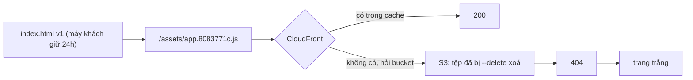
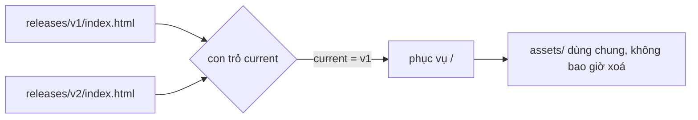

# L22: Deploy: vì sao index.html cũ trỏ vào tệp JS đã xoá, và rollback đúng phải là gì

> **Trạng thái:** bản viết lại đủ bảy bước, nằm ngoài `src/`. Chưa nối vào app, chưa đo với người đọc thứ hai.
> **Số liệu:** mọi con số trong bài là giả định của kịch bản, được ghi "Giả sử" ở chỗ dùng. Không phải số đo từ hệ thống thật, không phải mặc định của S3 hay CloudFront.

**Tiên quyết:** biết một trang web tải về gồm HTML trước, rồi HTML trỏ tới tệp JS và CSS; biết trình duyệt có bộ nhớ đệm; biết S3 là nơi chứa tệp và CloudFront là lớp đứng trước nó.

## Bước 1. Đoán trước

Giả sử 22 giờ đội bạn deploy bản 2.0. Bản build gồm một `index.html` và vài tệp JS, CSS có hash trong tên. Cả thư mục được đẩy lên một bucket S3, CloudFront đứng trước, và bucket đặt đúng một chính sách cache 24 giờ cho mọi tệp.

Giả sử 22 giờ 04, pipeline chạy `aws s3 sync dist/ s3://... --delete`. Tệp JS của bản 1.9 bị xoá khỏi bucket ngay lúc đó.

Một người dùng đã mở trang lúc 21 giờ, để tab đó, rồi 22 giờ 10 mở lại. Trả lời hai câu:

1. Trình duyệt của người đó lấy `index.html` từ đâu?
2. Vì sao máy của đội bạn mở cửa sổ ẩn danh vẫn thấy trang lên bình thường?

Viết đáp án ra giấy. Đáp án ở cuối bước 3.

## Bước 2. Điều bạn đã biết

Bạn đã từng build một app Vue. Trong thư mục `dist/` có một `index.html`, và cạnh nó là `assets/index-8f3a1b.js`. Bạn cũng biết trình duyệt giữ tệp trong bộ nhớ đệm: mở lại trang thì nó không tải lại mọi thứ.

Bài này giữ nguyên chuỗi đó và thay từng khớp bằng một dịch vụ AWS:

- Thư mục `dist/` trên máy bạn → bucket S3.
- Web server trên máy bạn → CloudFront.
- `cp -r dist/ /var/www/` → `aws s3 sync dist/ s3://bucket/`.

Khác biệt cần nhớ nằm ở chỗ thứ ba: `s3 sync` không phải `cp`. Nó so sánh hai bên và có cờ `--delete`, nghĩa là tệp ở đích mà không có ở nguồn sẽ bị xoá. Trên một máy chủ bạn hiếm khi gõ lệnh xoá mọi tệp không còn trong bản build; trong pipeline thì cờ đó có mặt ở gần như mọi ví dụ trên mạng.

Khác biệt thứ hai: trên máy bạn, tệp cũ nằm đó cho tới khi bạn xoá. Trên CloudFront, mỗi tệp còn có một bản sao trong bộ nhớ đệm ở điểm biên, và bản sao đó sống theo một con số khác.

## Bước 3. Một ví dụ có số

Giả sử bản 1.9 có hai tệp: `assets/app.8083771c.js` và `assets/style.cc564ca3.css`. Hash trong tên lấy từ nội dung tệp, nên nội dung đổi thì tên đổi.

Giả sử chính sách cache đang là `public, max-age=86400` cho mọi tệp — 86.400 giây, tức 24 giờ.

Người dùng mở trang lúc 21 giờ. Trình duyệt tải `index.html`, thấy header nói "giữ 24 giờ", nên giữ. Trong `index.html` đó có hai đường dẫn: `app.8083771c.js` và `style.cc564ca3.css`.

22 giờ 04, `--delete` xoá hai tệp đó khỏi bucket. Chúng không còn tồn tại.

22 giờ 10, người dùng mở lại tab. Trình duyệt còn bản `index.html` trong hạn 24 giờ, nên nó không hỏi CloudFront. Nó đọc hai đường dẫn trong bản đã lưu và xin hai tệp kia. CloudFront không có, quay về bucket, bucket không có: trả 404. Trang trắng.

Máy của đội bạn thì khác: cửa sổ ẩn danh không có bộ nhớ đệm, nên nó tải `index.html` mới, và bản mới trỏ tới tệp của bản 2.0 — những tệp đang có trên bucket. Trang lên.

Giả sử sáng hôm sau khoảng 8% người dùng vào trang báo lỗi. Con số đó không phải tỉ lệ người dùng hỏng; nó là tỉ lệ người dùng còn giữ `index.html` cũ trong máy tại thời điểm họ mở lại.

**Đáp án bước 1:** (1) từ bộ nhớ đệm của chính trình duyệt, vì `index.html` bị gắn `max-age=86400` như mọi tệp khác; (2) vì cửa sổ ẩn danh không có bản lưu nào, nên nó tải `index.html` mới và đi theo đường dẫn của bản mới.

## Bước 4. Cơ chế, từng bước một



1. **Tên có hash là một lời hứa.** Nội dung tệp đi vào hash, hash đi vào tên. Nếu nội dung không đổi thì tên không đổi, và một tên đã phát hành sẽ không bao giờ mang nội dung khác. Vì vậy tệp loại này cache được một năm mà không sợ cũ: bản mới có tên mới, không ghi đè tên cũ.

2. **`index.html` là tấm bản đồ, và nó không có hash.** Nó là tệp duy nhất có tên cố định mà nội dung đổi mỗi lần deploy. Chính cái tên cố định khiến nó không thể cache lâu: nếu cache, trình duyệt giữ một tấm bản đồ cũ trỏ tới những tên tệp thuộc về bản cũ.

3. **`no-cache` không có nghĩa là không lưu.** Nó nghĩa là trước khi dùng bản đã lưu, trình duyệt phải hỏi lại. Câu hỏi mang theo `If-None-Match` với ETag của bản đang giữ. Chưa đổi thì máy chủ trả 304 và trình duyệt dùng bản cũ, không tải lại byte nào. Vừa deploy thì trả 200 với nội dung mới. Cái giá của `no-cache` là một vòng hỏi đáp, không phải một lần tải lại toàn bộ.

4. **Giá trị cache hiệu lực là giá trị đi kèm object lúc ghi.** Header `Cache-Control` của một object S3 là system metadata, sửa được, nhưng chỉ sửa được bằng cách ghi lại object hoặc copy object đó. Nghĩa là một lần đẩy tay bằng console, hoặc một luật cache mặc định của CloudFront, có thể ghi đè thứ pipeline của bạn vừa đặt. Với CloudFront còn một bẫy nữa: nếu **Minimum TTL** của cache behavior lớn hơn 0 thì CloudFront dùng Minimum TTL kể cả khi origin gửi `no-cache`, `no-store` hay `private`. Đặt Minimum TTL bằng 0 là điều kiện để `no-cache` có tác dụng ở tầng biên.

5. **Thứ tự đẩy quyết định ai thấy gì.** Asset trước, `index.html` sau cùng. Nếu đẩy index trước, có một khoảng thời gian trong đó index mới trỏ tới tệp chưa lên — cùng một lỗi 404, chỉ khác nguồn gốc.

6. **`--delete` phá lời hứa ở bước 1.** Sau khi xoá, tên `app.8083771c.js` vẫn được nhắc tới trong những bản `index.html` đang nằm trong máy người dùng, nhưng tên đó không còn trỏ tới gì. Tệp có hash chỉ bất biến khi nó còn tồn tại.

7. **Rollback cần hai thứ có sẵn trước khi deploy.** Một: tệp của bản cũ vẫn còn trên bucket, nếu không thì trỏ về cũng ra 404. Hai: bản build cũ được lưu nguyên như một artifact, kèm một con trỏ nói bản nào đang phục vụ. Có hai thứ đó thì rollback là ghi lại con trỏ, mất vài giây. Không có thì rollback là revert commit rồi build lại, và bản dựng lại không phải bản đã chạy: registry đã có phiên bản thư viện mới, hash ra khác, và bạn vừa đưa lên một artifact chưa từng chạy ở đâu.



Sơ đồ thứ hai là toàn bộ phần rollback: hai bản index nằm sẵn, một con trỏ chọn bản đang phục vụ, và thư mục asset là kho chung chỉ ghi thêm. Đổi con trỏ là xong; không bước nào phải build.

**Về bucket private.** Một bucket để public cho CloudFront đọc là cách nhanh nhất, và cũng là cách bỏ qua mọi luật đặt ở biên: ai biết tên miền bucket thì gọi thẳng, không đi qua CloudFront. Cách đúng là bucket private, bật Block Public Access, và cho CloudFront ký yêu cầu tới S3 bằng OAC. Khi đó mọi request đều đi qua CloudFront, nên luật chặn và giới hạn tốc độ đặt ở đó mới thật sự có tác dụng.

## Bước 5. Thí nghiệm nhỏ

Chạy trong thư mục `lessons/04-noi-hai-mang/l22/`. Script chỉ dùng thư viện chuẩn của Python. Nó không gọi AWS: "bucket" là một thư mục trên đĩa, và 404 là tệp không tồn tại. Đây là mô phỏng cơ chế, không phải một lần deploy thật.

```
python deploy_sim.py
```

Kết quả đã chạy trên máy này:

```
Mô phỏng deploy tĩnh. Không gọi AWS: bucket là thư mục trên đĩa.
Giả sử: build v1 và v2 mỗi bản gồm index.html + 2 tệp có hash trong tên.

=== Bản build ===
  v1  assets/app.5b636b61.js
  v1  assets/style.da21991e.css
  v2  assets/app.84329dc9.js
  v2  assets/style.0705158f.css

=== A. Một chính sách cache 24h cho mọi tệp, deploy có --delete ===
  index.html của v1 đã tải về máy khách       có
  Cache-Control của index.html và assets: public, max-age=86400
  Máy khách giữ index đó 24 giờ và không hỏi lại.

  22:04 deploy v2, sync --delete:
  assets còn lại: ['app.84329dc9.js', 'style.0705158f.css']

  Máy khách mở lại trang bằng index đã lưu:
  index trong máy khách vẫn là bản v1
  GET /assets/app.5b636b61.js                 404
  GET /assets/style.da21991e.css              404
  => màn hình trắng: index đang dùng trỏ tới tệp không còn

=== B. Hai chính sách cache, deploy không xoá tệp cũ ===
  Cache-Control index.html: no-cache
  Cache-Control assets:     public, max-age=31536000, immutable

  Deploy v2: đẩy assets trước, rồi mới đẩy index.html.
  assets còn lại: ['app.5b636b61.js', 'app.84329dc9.js', 'style.0705158f.css', 'style.da21991e.css']
  GET /index.html sau deploy                  200
  Máy khách mới: index vừa tải
  GET /assets/app.84329dc9.js                 200
  GET /assets/style.0705158f.css              200
  => trang lên: mọi tệp index trỏ tới đều còn
  Máy khách còn cầm index v1 (tab mở từ trước)
  GET /assets/app.5b636b61.js                 200
  GET /assets/style.da21991e.css              200
  => trang lên: mọi tệp index trỏ tới đều còn

=== C. Rollback: đổi con trỏ về release cũ ===
  con trỏ current trước rollback              v2

  Bản v2 có lỗi. Rollback bằng một lần ghi con trỏ:
  con trỏ current sau rollback                v1
  số bước build lại                           0
  số tệp phải chép                            0 (assets của v1 vẫn nằm trên bucket)
  Máy khách tải index sau rollback
  GET /assets/app.5b636b61.js                 200
  GET /assets/style.da21991e.css              200
  => trang lên: mọi tệp index trỏ tới đều còn
  Máy khách còn cầm index v1 từ trước
  GET /assets/app.5b636b61.js                 200
  GET /assets/style.da21991e.css              200
  => trang lên: mọi tệp index trỏ tới đều còn

  So sánh: revert commit rồi build lại, không giữ artifact.
  Giả sử giữa hai lần build, thư viện ui lên 1.4.0 -> 1.5.0.
  index v1 gốc trỏ tới : ['assets/app.5b636b61.js', 'assets/style.da21991e.css']
  index build lại      : ['assets/app.77eddac0.js', 'assets/style.1b273f3b.css']
  hai đường dẫn trùng nhau: False
  (bản v2 đang phục vụ trước rollback: 200, dài 140 byte)
```

Ba khối A, B, C là ba câu trả lời cho ba tình huống.

Khối A là sự cố: index cũ xin hai tệp, cả hai trả 404. Không có lỗi nào ở tầng mạng, không có 500, chỉ có hai tệp không còn tồn tại.

Khối B là cách làm đúng, và nó in hai lần "trang lên": một lần cho máy khách mới, một lần cho máy khách còn cầm index v1. Dòng thứ hai là dòng quan trọng nhất trong cả bài — nó là thứ mà `--delete` phá mất. Chú ý `assets còn lại` có bốn tệp, gấp đôi một bản build: hai tệp của v1 và hai tệp của v2 nằm cạnh nhau vì tên khác nhau.

Khối C là rollback: `current` đổi từ `v2` về `v1`, số bước build lại bằng 0, số tệp phải chép bằng 0. Và phần so sánh cuối cho thấy vì sao rollback bằng cách build lại là chuyện khác: cùng một mã nguồn, chỉ cần thư viện `ui` lên một bản nhỏ, hash đổi và index mới trỏ tới hai tên tệp khác hẳn. Bạn vừa phát hành một artifact chưa ai chạy thử.

**Tự thử:** đổi `SOURCES["v2"]` để `app.js` giữ nguyên nội dung như v1, rồi chạy lại. Tên tệp `app.*.js` của hai bản có giống nhau không, và khối B còn mấy tệp trong `assets`? Trả lời được câu đó là bạn đã nắm được vì sao hash phải tính từ nội dung.

## Bước 6. Bốn câu luyện tập

Trả lời trước khi mở đáp án.

**Câu 1.** Vì sao `index.html` phải `no-cache` còn `app.5b636b61.js` thì cache được một năm?

<details>
<summary>Đáp án</summary>

Kết luận: hai tệp khác nhau ở chỗ tên có gắn với nội dung hay không. Tên có hash thì nội dung đổi là tên đổi, nên một tên đã phát hành không bao giờ cần đổi nội dung; cache một năm là an toàn. `index.html` giữ nguyên tên qua mọi lần deploy trong khi nội dung đổi, nên nếu cache thì trình duyệt dùng bản đồ cũ.

Điều kiện để đúng: hash phải tính từ nội dung tệp, và bản cũ không được xoá. Nếu xoá tệp cũ thì tên vẫn bất biến nhưng đích đến không còn.

Cách kiểm: mở DevTools, xem cột Size của `index.html` — có `304` hoặc "revalidated" nghĩa là `no-cache` đang chạy; thấy "from disk cache" mà không có vòng hỏi nào nghĩa là nó đang bị cache thật.

</details>

**Câu 2.** Pipeline của bạn đã đặt `Cache-Control: no-cache` cho `index.html`, nhưng sau deploy người dùng vẫn thấy bản cũ. Kể hai chỗ có thể ghi đè header đó.

<details>
<summary>Đáp án</summary>

Kết luận: header là metadata đi kèm object tại thời điểm ghi, nên nó chỉ đúng cho lần ghi đó; và ở tầng biên, Minimum TTL của cache behavior có thể đè lên nó.

Chỗ thứ nhất: một lần đẩy tay bằng console hoặc một script khác ghi lại object mà không kèm header. Chỗ thứ hai: cache behavior của CloudFront đặt Minimum TTL lớn hơn 0, khi đó CloudFront dùng Minimum TTL kể cả khi origin gửi `no-cache`. Còn một chỗ thứ ba đáng nhớ: một service worker hoặc một lớp cache phía trước có thể giữ bản riêng.

Điều kiện để đúng: bạn đang nhìn đúng đường đi của request. Nếu người dùng đi qua một proxy của công ty thì proxy đó cũng có luật riêng.

Cách kiểm: `curl -I https://tên-miền/index.html` xem header trả về, rồi so với header trên object trong bucket. Lệch nhau nghĩa là có một tầng ở giữa đang ghi đè.

</details>

**Câu 3.** Vì sao rollback bằng "revert commit rồi cho pipeline chạy lại" không tương đương với "trỏ con trỏ về artifact cũ"?

<details>
<summary>Đáp án</summary>

Kết luận: revert rồi build lại tạo ra một artifact mới, không phải artifact đã chạy tuần trước. Build phụ thuộc vào registry và phiên bản thư viện tại thời điểm chạy, nên cùng một commit có thể ra byte khác, hash khác, và hành vi khác.

Trỏ con trỏ thì đưa lên đúng bộ byte đã phục vụ khách hàng, không có biến nào mới. Cái giá là bạn phải giữ artifact của các bản cũ, và phải giữ cả tệp asset của chúng trên bucket.

Điều kiện để đúng: bạn có lưu artifact theo từng bản và có một con trỏ chọn bản đang phục vụ. Không có hai thứ đó thì "rollback" chỉ là một lần deploy khác.

Cách kiểm: so hash của tệp JS sau rollback với hash đã ghi trong bản ghi deploy của tuần trước. Khác nhau nghĩa là bạn đã build lại, không phải rollback.

</details>

**Câu 4.** Deploy đúng thứ tự, cache đúng chính sách, vẫn còn đường nào khiến người dùng thấy trắng trang ngay sau deploy?

<details>
<summary>Đáp án</summary>

Kết luận: còn. Thứ tự đúng chỉ bảo vệ được trường hợp index và asset cùng một bản. Nếu có bước dọn xoá asset cũ, hoặc nếu CDN còn giữ một `index.html` cũ ở điểm biên trong khi bucket đã là bản mới, thì index cũ vẫn gặp 404.

Ba đường còn lại đáng nhớ: một là invalidate không chạy hoặc chạy sai đường dẫn, nên điểm biên vẫn trả index cũ; hai là một bước dọn định kỳ xoá asset theo tuổi; ba là bản build mới tham chiếu một asset chưa kịp lên vì pipeline đẩy song song thay vì tuần tự.

Điều kiện để đúng: người dùng đang dùng một `index.html` có tuổi lớn hơn thời điểm asset của nó bị xoá.

Cách kiểm: theo dõi tỉ lệ 404 trên đường dẫn `/assets/`. Con số này tăng ngay sau deploy là dấu hiệu sớm nhất, và nó xuất hiện trước khi người dùng báo.

</details>

## Bước 7. Câu neo

> Tệp có hash không bao giờ đổi nội dung nên cache lâu là đúng; `index.html` không có hash nên phải hỏi lại mỗi lần, và chỉ khi tệp của bản cũ còn trên bucket thì rollback mới là một thao tác đổi con trỏ thay vì một lần build lại.

## Ghi chú nguồn

<details>
<summary>Ghi chú nguồn, đọc ngày 2026-10-29</summary>

- https://docs.aws.amazon.com/AmazonS3/latest/userguide/UsingMetadata.html — xác nhận `Cache-Control` là system metadata do người dùng điều khiển, và muốn sửa thì phải copy object hoặc ghi lại object; header không sửa tại chỗ được.
- https://docs.aws.amazon.com/AmazonCloudFront/latest/DeveloperGuide/Expiration.html — xác nhận `Cache-Control: max-age` quyết định thời gian CloudFront giữ object; khi không dùng cache policy thì TTL mặc định là 24 giờ; nếu Minimum TTL lớn hơn 0 thì CloudFront dùng Minimum TTL kể cả khi origin gửi `no-cache`, `no-store` hoặc `private`; trình duyệt cache theo `max-age` của header.
- https://docs.aws.amazon.com/AmazonCloudFront/latest/DeveloperGuide/Expiration.html#ExpirationDownloadDist — bảng đối chiếu header của origin với Minimum/Default/Maximum TTL, dùng cho lập luận "giá trị hiệu lực không chỉ do pipeline quyết định".

Chưa kiểm trong bài này: hành vi chính xác của cờ `--delete` trong `aws s3 sync` (bài chỉ dùng nó như tên của thao tác xoá tệp không còn trong bản build); cú pháp OAC và Block Public Access; hành vi `immutable` của từng trình duyệt. Số liệu trong bài là kịch bản, không phải số đo.

</details>
