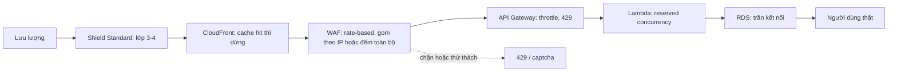

# L23: DDoS: bất đối xứng tài nguyên và tầng chặn sớm nhất

> **Trạng thái:** bản viết lại đủ bảy bước, nằm ngoài `src/`. Chưa nối vào app, chưa đo với người đọc thứ hai.
> **Số liệu:** mọi con số trong bài là giả định của kịch bản, được ghi "Giả sử" ở chỗ dùng. Không phải số đo từ hệ thống thật, không phải mặc định của AWS.

**Tiên quyết:** biết một request HTTP đi qua cổng vào rồi tới hàm xử lý rồi tới cơ sở dữ liệu; biết rate limit là gì; biết Lambda có concurrency và cơ sở dữ liệu có trần kết nối.

## Bước 1. Đoán trước

Giả sử ba giờ sáng thứ Bảy, endpoint tra cứu sản phẩm công khai của bạn đang phục vụ 90 request mỗi giây thì trong bốn phút leo lên 14.000 request mỗi giây.

Dashboard vẫn xanh: hàm trả 200, p99 mỗi hàm dưới 120 ms, không dịch vụ nào báo lỗi. Nhưng tỉ lệ người dùng thật hoàn tất được một lần tìm kiếm rơi từ 99% xuống 4%.

Giả sử log cổng vào cho thấy 96% request đến từ khoảng 40.000 địa chỉ IP, mỗi địa chỉ gửi đúng một request mỗi ba giây. Luật rate limit đang đặt 1.000 request trong 5 phút cho mỗi IP.

Trả lời hai câu trước khi đọc tiếp:

1. Tài nguyên nào đã cạn, khi mọi hàm vẫn trả 200 và p99 vẫn đẹp?
2. Vì sao luật rate limit theo IP không chặn được gì?

Đáp án ở cuối bước 3.

## Bước 2. Điều bạn đã biết

Bạn đã từng đặt `limit_req` trong nginx: 10 request mỗi giây cho mỗi IP, vượt thì trả 429. Bạn cũng biết vì sao phải đặt nó — để một khách hàng viết vòng lặp không kéo sập dịch vụ.

Bài này giữ nguyên khớp đó và thay từng phần bằng một tầng AWS:

- nginx trên máy bạn → AWS WAF đứng trước CloudFront và API Gateway.
- Bộ đếm trong bộ nhớ của nginx → bộ đếm của rate-based rule, chạy ở biên.
- `worker_connections` của nginx → bảng trạng thái kết nối của thiết bị cân bằng tải, và trần concurrency của Lambda.

Khác biệt cần nhớ: `limit_req` của bạn đặt cho lưu lượng hợp lệ tăng vọt. Ở đây lưu lượng được sinh ra để làm bạn tốn tài nguyên, và người sinh ra nó không cần nhận được gì.

## Bước 3. Một ví dụ có số

Giả sử mỗi request mang một chuỗi truy vấn ngẫu nhiên, nên không bản ghi cache nào dùng lại được. Tầng biên không hấp thụ được gì; mọi request đi tới origin.

Giả sử 40.000 IP, mỗi IP một request mỗi ba giây. Tổng là 40.000 ÷ 3 ≈ 13.333 request mỗi giây. Mỗi IP chỉ có 20 request trong một phút, tức 100 request trong 5 phút — bằng 10% của ngưỡng 1.000. Không bộ đếm nào chạm ngưỡng, nên số 429 gần bằng không.

Giờ tính trần của từng tầng bằng số giả định:

- **Biên:** giả sử CloudFront nhận 10 Gbps, mỗi request 12 KB. 10 Gbps là 1,25 GB mỗi giây; chia cho 12 KB ra khoảng 101.700 request mỗi giây. Tầng này còn rất xa.
- **Cổng vào:** giả sử hạn mức ổn định của tài khoản là 10.000 request mỗi giây.
- **Lambda:** giả sử trần concurrency của tài khoản là 1.000 và p99 một lần gọi là 0,12 giây. Số request đồng thời chịu được là 1.000 ÷ 0,12 ≈ 8.333 mỗi giây.
- **Cơ sở dữ liệu:** giả sử trần 200 kết nối và một truy vấn mất 0,05 giây. Số truy vấn đồng thời là 200 ÷ 0,05 = 4.000 mỗi giây.

Trần thật của hệ thống là con số nhỏ nhất: 4.000 request mỗi giây, ở tầng cơ sở dữ liệu. Lưu lượng trong sự cố là 14.000, gấp 3,5 lần trần đó.

Và đây là chỗ giải thích vì sao p99 của từng hàm vẫn đẹp: mỗi hàm vẫn kịp trả lời trong 120 ms. Cái cạn là tài nguyên **dùng chung phía sau** — hàng đợi và bể kết nối. Request thật xếp sau 10.000 request rác trong cùng một hàng, nên tỉ lệ hoàn tất nghiệp vụ sụp trong khi mã trạng thái vẫn 200.

**Đáp án bước 1:** (1) số kết nối tới cơ sở dữ liệu và hàng đợi phía sau nó, không phải CPU của từng hàm; (2) vì ngưỡng gắn với từng IP, và mỗi IP chỉ gửi 100 request trong 5 phút, bằng một phần mười ngưỡng.

## Bước 4. Cơ chế, từng bước một

**Bất đối xứng là đơn vị đo.** Kẻ tấn công trả gần như không đáng kể cho một request. Bạn trả băng thông, một dòng trong bảng trạng thái kết nối, thời gian CPU, một chỗ trong hàng đợi, một kết nối cơ sở dữ liệu, và tiền. Mọi câu hỏi phòng thủ quy về: **request này bắt tôi trả bao nhiêu, và kẻ gửi trả bao nhiêu?**

1. **Ba lớp tài nguyên, ba dấu hiệu khác nhau.** Lớp khối lượng làm cạn đường truyền: bit mỗi giây dựng đứng, request mỗi giây gần phẳng. Lớp giao thức làm cạn bảng trạng thái: số kết nối nửa mở tăng, gói mỗi giây tăng, ví dụ SYN flood. Lớp ứng dụng làm cạn CPU, hàng đợi và kết nối cơ sở dữ liệu bằng những request HTTP hoàn toàn hợp lệ. Đọc ba đường cong này so với đường nền theo giờ là bước đầu tiên, và nó quyết định bạn gọi ai.

2. **Tầng biên hấp thụ lớp khối lượng.** AWS Shield Standard bật sẵn cho mọi tài khoản, không tính thêm phí, và xử lý các dạng tấn công mạng và giao thức phổ biến; CloudFront, Route 53 và Global Accelerator được hưởng mức bảo vệ đầy đủ hơn. CloudFront trả nội dung đã cache ngay tại điểm biên nên request đó không tới origin. Nhưng điều kiện để tầng này có ích là **cache key ổn định**: một chuỗi truy vấn ngẫu nhiên biến mọi request thành cache miss, và biên chỉ còn là đường ống. Đây đúng là thứ đã xảy ra trong sự cố.

3. **WAF đếm theo một đối tượng gom, và mặc định đối tượng đó là IP.** Rate-based rule gom request theo tiêu chí bạn chọn, đếm trong một cửa sổ, và áp hành động khi vượt ngưỡng. Mặc định gom theo địa chỉ IP nguồn. Cửa sổ nhận các giá trị 60, 120, 300, 600 giây, mặc định 300. Ngưỡng thấp nhất là 10. Đây là lý do một botnet chia nhỏ dưới ngưỡng đi qua mà không bộ đếm nào thấy: **mỗi đối tượng gom có bộ đếm riêng, và không có bộ đếm tổng.**

4. **Muốn thấy tổng thì đổi kiểu gom.** Chọn kiểu "đếm toàn bộ" (count all) kèm một scope-down statement để mọi request khớp điều kiện rơi vào **một** bộ đếm. Khi đó bạn thấy con số tổng, và cũng mất luôn khả năng tách theo nguồn: ngưỡng chặn tất cả hoặc không chặn ai. WAF không bảo đảm chặn đúng bằng ngưỡng; nó áp gần ngưỡng. Hành động có thể là chặn hoặc thử thách.

5. **Đặt trần ở tầng trong để sập toàn phần thành từ chối có kiểm soát.** API Gateway throttle bằng token bucket và trả 429 khi vượt. Lambda có reserved concurrency: chạm trần thì request bị throttle thay vì đè xuống cơ sở dữ liệu. Trần không làm hệ thống nhanh hơn; nó chỉ đổi loại sự cố. Và trần phải đặt theo **tầng thấp nhất**, không theo tầng to nhất — trong ví dụ trên, đặt concurrency 8.000 vẫn vô nghĩa vì cơ sở dữ liệu chỉ chịu 4.000.

6. **Chọn tầng chặn sớm nhất mà vẫn tách được người thật.** Chặn càng sớm càng ít tài nguyên bị chạm, nhưng càng sớm càng ít thông tin. Ở biên bạn có IP, ASN, dấu vân tay TLS, đường dẫn, header. Ở tầng ứng dụng bạn có ngữ cảnh người dùng, khóa API, lịch sử hành vi. Câu hỏi không phải "chặn ở đâu rẻ nhất" mà "chặn ở đâu tôi còn phân biệt được hai phía".



Sơ đồ này là toàn bộ câu trả lời cho câu hỏi "chặn ở đâu": mỗi mũi tên là một lần tài nguyên bị chạm, và mỗi khớp là một chỗ có thể dừng lưu lượng.

7. **Cái giá của chặn sớm là chặn nhầm.** Đây là phần dễ bỏ qua nhất. Ba dạng:
   - **NAT dùng chung.** Một văn phòng, một trường học, một nhà mạng di động đưa hàng trăm người ra internet qua một địa chỉ IP. Rate limit theo IP thấy một IP gửi 150 request mỗi giây và chặn cả tòa nhà. Đây là dạng phổ biến nhất và cũng khó nhìn thấy nhất, vì phía bạn chỉ thấy một IP.
   - **Ngưỡng thấp tự từ chối khách hàng thật.** Mỗi lần hạ ngưỡng là một lần bạn quyết định rằng một nhóm người dùng thật sẽ bị chặn trong đỉnh lưu lượng hợp lệ.
   - **Chi phí của chính lớp phòng thủ.** Mọi lớp phán quyết tính tiền theo request hoặc theo GB log, cộng thêm độ trễ, và tạo ra một hệ thống phải có người chỉnh ngưỡng. Ghi log mọi request bị chặn trong lúc bị tấn công biến chính hệ thống log thành chỗ sập và thành một dòng chi phí mới — nên lấy mẫu.

8. **Dấu hiệu sớm không phải 5xx.** Trong sự cố, mọi hàm trả 200. Thứ sụp là tỉ lệ hoàn tất nghiệp vụ, p99 theo route, và số kết nối cơ sở dữ liệu đứng sát trần. Chờ 5xx là chờ tới lúc đã muộn.

## Bước 5. Thí nghiệm nhỏ

Chạy trong thư mục `lessons/05-phong-thu/l23/`. Script chỉ dùng thư viện chuẩn của Python. Nó không gọi AWS và không có lưu lượng thật: đây là **mô phỏng** trần theo tầng và một bộ đếm cửa sổ cố định. Mọi tham số được in ra trước kết quả, và không tham số nào được chỉnh sau khi thấy kết quả.

```
python ddos_budget.py
```

Nếu máy không có `python` trong PATH, gọi bằng đường dẫn đầy đủ tới Python 3 trên máy bạn.

Kết quả đã chạy trên máy này:

```
MÔ PHỎNG bằng thư viện chuẩn. Không gọi AWS, không có lưu lượng thật.

=== Tham số giả định (mọi con số dưới đây là giả định của kịch bản) ===
  Edge        : 10 Gbps, mỗi request 12 KB
  Gateway     : 10,000 request/giây (hạn mức ổn định)
  Lambda      : trần 1,000 concurrency, p99 0.12 s, 10 request/giây mỗi đơn vị
  DB          : 200 kết nối, một truy vấn 50 ms
  Người thật  : 300 người sau một NAT chung, mỗi người 0.5 request/giây
  Tấn công    : 40,000 IP, mỗi IP 1 request mỗi 3 giây
  Quy tắc     : 1,000 request mỗi IP mỗi cửa sổ 60 giây

=== Trần request mỗi giây của từng tầng ===
  Edge (băng thông)            101,725   (bit/giây chia cho byte mỗi request)
  Gateway (hạn mức)             10,000   (hạn mức ổn định của tài khoản)
  Lambda (concurrency/p99)       8,333   (trần concurrency chia p99)
  Lambda (lượt gọi)             10,000   (10 request/giây mỗi đơn vị)
  DB (kết nối/truy vấn)          4,000   (trần kết nối chia thời gian một truy vấn)
  => trần thật của hệ thống: 4,000 request/giây, ở tầng DB (kết nối/truy vấn)
  => tầng nào vượt trần thật trước thì tầng đó quyết định, không phải tầng to nhất

=== Đếm theo IP, cửa sổ cố định ===
  Ngưỡng 1,000 request mỗi IP mỗi 60 giây; 300 người thật dùng chung một IP NAT.

  Kết quả:
  cửa sổ    thật gửi  thật qua  thật bị chặn  tấn công gửi  tấn công lọt  tấn công bị chặn
  0            9,000     1,000         8,000       800,000       800,000                 0
  1            9,000     1,000         8,000       800,000       800,000                 0
  2            9,000     1,000         8,000       800,000       800,000                 0
  Tổng người thật bị chặn : 24,000 / 27,000 (88.9%)
  Tổng tấn công lọt       : 2,400,000 / 2,400,000 (100.0%)
  Người thật bị chặn lần đầu ở giây thứ 6

=== Nâng ngưỡng để cứu NAT ===
  Ngưỡng 10,000 request mỗi IP mỗi 60 giây.

  Kết quả:
  cửa sổ    thật gửi  thật qua  thật bị chặn  tấn công gửi  tấn công lọt  tấn công bị chặn
  0            9,000     9,000             0       800,000       800,000                 0
  1            9,000     9,000             0       800,000       800,000                 0
  2            9,000     9,000             0       800,000       800,000                 0
  Tổng người thật bị chặn : 0 / 27,000 (0.0%)
  Tổng tấn công lọt       : 2,400,000 / 2,400,000 (100.0%)

=== Đổi kiểu gom: đếm toàn bộ request khớp một phạm vi ===
  Ngưỡng 5,000 request mỗi 60 giây, không chia theo IP.

  Kết quả:
  cửa sổ    thật gửi  thật qua  thật bị chặn  tấn công gửi  tấn công lọt  tấn công bị chặn
  0            9,000       150         8,850       800,000         4,850           795,150
  1            9,000       150         8,850       800,000         4,850           795,150
  2            9,000       150         8,850       800,000         4,850           795,150
  Tổng người thật bị chặn : 26,550 / 27,000 (98.3%)
  Tổng tấn công lọt       : 14,550 / 2,400,000 (0.6%)
  Người thật bị chặn lần đầu ở giây thứ 1

=== Biên cửa sổ cố định ===
  Ngưỡng 1,000 request mỗi cửa sổ 60 giây, một IP.
  Gửi 1,000 request ở giây 59 của cửa sổ 1: qua.
  Gửi 1,000 request ở giây 60 (cửa sổ 2): qua.
  => trong 2 giây, một IP đẩy được 2,000 request, gấp đôi ngưỡng.
  Bộ đếm bị xoá theo mốc thời gian, không theo tốc độ.

=== Đọc kết quả ===
  Chặn theo IP: người thật mất 88.9% request, tấn công lọt 100.0% request.
  Cái mất nằm ở phía người thật, cái được nằm ở phía kẻ tấn công.
  Chặn sớm chỉ rẻ khi tầng chặn còn phân biệt được hai phía.
```

Đọc ba khối kết quả theo thứ tự.

**Trần theo tầng.** Năm dòng đầu cho năm con số, và con số quyết định là 4.000 ở tầng cơ sở dữ liệu. Dòng "Lambda (lượt gọi) 10.000" là con số dễ đọc sai nhất: nó là trần trên lý thuyết của Lambda, không phải trần của hệ thống. Nếu chỉ nhìn 10.000 bạn sẽ đặt ngưỡng cảnh báo sai chỗ.

**Chặn theo IP.** Người thật bị chặn 88,9% request, tấn công lọt 100%. Không một request tấn công nào bị chặn, vì mỗi IP chỉ gửi 20 request trong cửa sổ 60 giây, bằng 2% ngưỡng. Người thật bị chặn từ giây thứ 6, vì 300 người dùng chung một IP NAT đẩy 150 request mỗi giây, nên chạm 1.000 request sau 6 giây đầu cửa sổ. Phần còn lại của cửa sổ, cả tòa nhà bị chặn.

**Nâng ngưỡng lên 10.000.** Người thật qua hết — và tấn công cũng qua hết, vẫn 100%. Đây là cái bẫy: nới ngưỡng để cứu NAT là bỏ luôn tác dụng của quy tắc. Không có ngưỡng nào vừa cho 150 request/giây của một IP NAT đi qua, vừa chặn 20 request/phút của 40.000 IP.

**Đổi sang đếm toàn bộ.** Tấn công lọt còn 0,6% — nhưng người thật bị chặn 98,3%, và bị chặn từ giây đầu tiên. Bộ đếm tổng thấy cuộc tấn công và chặn luôn cả người thật, vì nó không có thông tin để tách hai phía. Đây chính là cái giá của việc chặn sớm: đúng chỗ, nhưng mù.

**Biên cửa sổ.** Bộ đếm bị xoá theo mốc thời gian chứ không theo tốc độ, nên một IP gửi 1.000 request ở cuối cửa sổ này và 1.000 request ở đầu cửa sổ sau đi qua cả hai, tức gấp đôi ngưỡng trong hai giây. Đây là nhược điểm cố hữu của cửa sổ cố định, và là lý do các hệ thống thật dùng cửa sổ trượt hoặc token bucket.

**Tự thử:** giữ nguyên mọi tham số, đổi `REAL_USER_RPS` từ 0,5 xuống 0,1 rồi chạy lại. Lưu lượng người thật giảm 5 lần, nhưng tỉ lệ request người thật bị chặn giảm được bao nhiêu, và người thật bị chặn lần đầu ở giây thứ mấy? Vì sao ngưỡng 1.000 request mỗi cửa sổ vẫn chặn gần một nửa lưu lượng người thật, và con số đó nói gì về việc chọn ngưỡng theo lưu lượng trung bình của từng người?

## Bước 6. Bốn câu luyện tập

Trả lời trước khi mở đáp án.

**Câu 1.** Trong sự cố, mọi hàm trả 200 và p99 dưới 120 ms, nhưng tỉ lệ hoàn tất tìm kiếm còn 4%. Tài nguyên nào đã cạn, và vì sao mã trạng thái không phản ánh điều đó?

<details>
<summary>Đáp án</summary>

Kết luận: cạn tài nguyên dùng chung phía sau hàm — hàng đợi và số kết nối cơ sở dữ liệu. Mỗi hàm vẫn kịp trả lời vì phần chậm nằm ở chỗ xếp hàng chờ kết nối, không nằm trong thời gian tính toán của hàm.

Mã trạng thái chỉ nói request đã được xử lý xong, không nói nó đã trả về thứ người dùng cần trong thời gian chấp nhận được. Một request chờ 40 giây rồi trả 200 vẫn là 200.

Điều kiện để đúng: tài nguyên bị chia sẻ giữa request thật và request rác. Nếu mỗi request có tài nguyên riêng thì không có chuyện này.

Cách kiểm: vẽ đồng thời ba đường — số kết nối cơ sở dữ liệu, độ sâu hàng đợi, và tỉ lệ hoàn tất nghiệp vụ. Nếu hai đường đầu dựng đứng đúng lúc đường thứ ba sụp, thì kết luận đúng.

</details>

**Câu 2.** Vì sao một luật rate limit 1.000 request mỗi 5 phút cho mỗi IP chặn được 0 request trong sự cố?

<details>
<summary>Đáp án</summary>

Kết luận: vì ngưỡng gắn với từng đối tượng gom, còn kẻ tấn công chia lưu lượng cho hàng chục nghìn đối tượng. Mỗi IP gửi 100 request trong 5 phút, bằng 10% ngưỡng, nên không bộ đếm nào chạm trần dù tổng vượt xa năng lực hệ thống.

Đây là giới hạn của mọi ngưỡng theo nguồn: nó bảo vệ khỏi một nguồn quá hung hăng, không bảo vệ khỏi nhiều nguồn cùng vừa phải.

Điều kiện để đúng: lưu lượng được chia đủ nhỏ và đủ đều. Nếu kẻ tấn công dồn vào vài IP thì luật này chặn được.

Cách kiểm: vẽ phân bố số request theo IP. Đường cong phẳng trên hàng chục nghìn IP là dấu hiệu botnet; một vài IP nhô cao là dấu hiệu một nguồn đơn lẻ.

</details>

**Câu 3.** Bạn có hai lựa chọn: rate limit theo IP ở biên, hoặc đếm tổng ở biên. Nêu cái giá của từng cách bằng một câu, rồi nói cách nào hợp với hệ thống có nhiều người dùng sau NAT.

<details>
<summary>Đáp án</summary>

Kết luận: đếm theo IP rẻ về ngữ cảnh nhưng chặn nhầm cả một nhóm người dùng chung một địa chỉ; đếm tổng thấy được cuộc tấn công nhưng chặn cả người thật vì không có thông tin để tách.

Với hệ thống có nhiều người dùng sau NAT, cách theo IP chặn nhầm thường xuyên và không thể sửa bằng cách nới ngưỡng, vì nới đủ để NAT đi qua là bỏ luôn tác dụng. Cách đếm tổng cũng chặn người thật, nhưng chặn có kiểm soát và biết trước.

Điều kiện để đúng: bạn phải biết tỉ lệ người dùng đi qua NAT. Nếu gần như toàn bộ khách hàng là doanh nghiệp sau một IP, kết luận đổi hẳn.

Cách kiểm: nhìn phân bố số request theo IP cùng số người dùng ước tính mỗi IP. Một IP có 150 request/giây và 300 người dùng là NAT, không phải bot.

</details>

**Câu 4.** Vì sao đặt reserved concurrency của Lambda lên 8.000 không làm hệ thống chịu được 8.000 request mỗi giây?

<details>
<summary>Đáp án</summary>

Kết luận: vì trần thật là tầng thấp nhất trong chuỗi, không phải tầng bạn vừa nâng. Nếu cơ sở dữ liệu chỉ chịu 4.000 truy vấn đồng thời, thì 8.000 hàm đồng thời chỉ làm hàng đợi chờ kết nối dài gấp đôi và p99 tăng.

Nâng trần ở một tầng chỉ dời điểm sập xuống tầng dưới, nơi trần cứng hơn và không co giãn. Trong lúc bị tấn công, mỗi đơn vị mở rộng còn là tiền trả cho lưu lượng rác.

Điều kiện để đúng: các tầng dùng chung một tài nguyên hữu hạn ở cuối chuỗi. Nếu mỗi hàm có tài nguyên dữ liệu riêng thì kết luận khác.

Cách kiểm: sau khi nâng trần, xem số kết nối cơ sở dữ liệu có đứng sát trần không và p99 có tăng không. Nếu cả hai đều đúng thì trần thật chưa đổi.

</details>

## Bước 7. Câu neo

> Vì mỗi request rác bắt hệ thống trả tài nguyên dùng chung mà kẻ gửi không trả gì, nên chặn phải đặt ở tầng sớm nhất còn phân biệt được người thật — và khi tầng đó chỉ còn nhìn thấy địa chỉ IP, cái giá của việc chặn sớm chính là những người dùng thật dùng chung một địa chỉ.

## Ghi chú nguồn

<details>
<summary>Ghi chú nguồn, đọc ngày 2026-10-29</summary>

- https://docs.aws.amazon.com/waf/latest/developerguide/waf-rule-statement-type-rate-based.html — xác nhận rate-based rule gom request theo tiêu chí, đếm trong cửa sổ đánh giá, nhận scope-down statement, và không lồng được vào statement khác.
- https://docs.aws.amazon.com/waf/latest/developerguide/waf-rule-statement-type-rate-based-aggregation-options.html — xác nhận mặc định gom theo địa chỉ IP nguồn, có các lựa chọn ASN, forwarded IP, custom keys, và kiểu "count all" yêu cầu scope-down.
- https://docs.aws.amazon.com/waf/latest/developerguide/waf-rule-statement-type-rate-based-high-level-settings.html — xác nhận cửa sổ nhận 60, 120, 300, 600 giây với mặc định 300; ngưỡng thấp nhất là 10; WAF áp gần ngưỡng chứ không bảo đảm chính xác.
- https://docs.aws.amazon.com/waf/latest/developerguide/ddos-standard-summary.html — xác nhận Shield Standard bật sẵn cho mọi khách hàng, không tính thêm phí, xử lý tấn công lớp mạng và giao thức phổ biến, và CloudFront/Route 53/Global Accelerator được hưởng mức bảo vệ đầy đủ.

Chưa kiểm trong bài này: hạn mức throttle cụ thể của API Gateway và trần concurrency mặc định của tài khoản Lambda; giá của WAF, Shield Advanced và NAT gateway; hành vi chính xác của cửa sổ trượt so với cửa sổ cố định trong WAF. Mọi con số trong bài là giả định của kịch bản, và script là mô phỏng chứ không phải lưu lượng thật.

</details>
