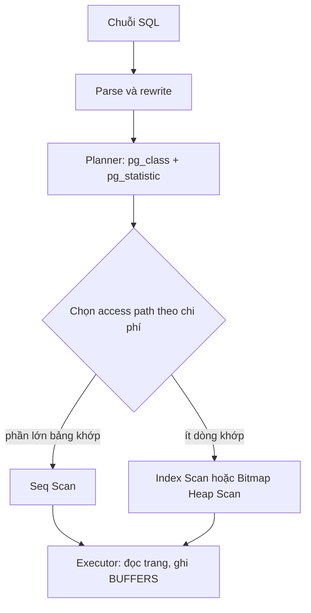

# L24: PostgreSQL thực chiến: planner, index, transaction và cái giá của ORM

> **Trạng thái:** bản viết lại đủ bảy bước, nằm ngoài `src/`. Chưa nối vào app, chưa đo với người đọc thứ hai.
> **Số liệu:** mọi con số kịch bản trong bài là giả định, ghi "Giả sử" ngay chỗ dùng. Số đo trong Bước 5 là output thật của script trên PostgreSQL 18.6 (PGlite), không phải số đo từ hệ thống production nào và không phải benchmark.

**Tiên quyết:** biết `SELECT`, `WHERE`, `ORDER BY`, `LIMIT`; biết index là một cấu trúc tra cứu riêng của bảng; biết transaction là một nhóm lệnh cùng thành công hoặc cùng huỷ.

## Bước 1. Đoán trước

Giả sử bảng `orders` có 50.000 dòng, trong đó 200 dòng mang `status = 'cancelled'`. Truy vấn lấy 20 dòng cancelled mới nhất, sắp theo `created_at` giảm dần.

Trước khi đọc tiếp, trả lời ba câu:

1. Chưa có index nào, câu đó phải đọc bao nhiêu trang của bảng?
2. Có composite index `(status, created_at DESC)`, còn bao nhiêu trang?
3. Giả sử một lệnh `UPDATE` đổi 29.400 dòng từ `pending` sang `done`, rồi hỏi lại "bảng còn bao nhiêu pending" mà chưa chạy `ANALYZE`. Planner sẽ ước lượng bao nhiêu dòng?

Viết đáp án ra giấy. Đáp án nằm ở cuối bước 3.

## Bước 2. Điều bạn đã biết

Bạn đã từng thêm một index và thấy câu truy vấn nhanh lên. Bạn cũng đã từng thêm index mà không thấy gì thay đổi. Hai lần đó bạn làm cùng một thao tác, nên khác biệt không nằm ở index.

Bài này giữ nguyên những gì bạn biết về index và thay từng khớp bằng thứ nằm dưới nó:

- Câu SQL bạn viết không được chạy trực tiếp. Nó bị biến thành một **kế hoạch** (plan): cây các bước, mỗi bước là một nút.
- Kế hoạch do **planner** (bộ tối ưu truy vấn) chọn, dựa trên **thống kê** (statistics) mà `ANALYZE` thu thập.
- Mỗi dòng trong bảng có thể tồn tại nhiều **phiên bản** (row version); **snapshot** quyết định transaction của bạn nhìn thấy phiên bản nào.

Khác biệt cần nhớ so với trực giác "index làm mọi thứ nhanh": planner không chọn index vì index tốt. Nó chọn đường rẻ nhất theo **chi phí ước lượng**, và chi phí đó tính từ số dòng mà nó *đoán*.

## Bước 3. Một ví dụ có số

Giả sử trên production bảng `orders` có 4,2 triệu dòng, endpoint danh sách đơn lọc theo `status` đang ở p99 1,8 giây. Đội thêm B-tree trên `status`, deploy, và p99 không đổi một mili giây. Giả sử đúng tuần đó hệ thống import 600 nghìn đơn cũ và một job báo cáo giữ transaction mở 40 phút.

Ba sự kiện đó không liên quan tới nhau bằng cảm giác, nhưng liên quan bằng cơ chế: bulk load đổi phân bố giá trị, `ANALYZE` không chạy, nên `pg_statistic` vẫn mô tả bảng của tuần trước. Planner nhân selectivity cũ với số dòng mới và ra một ước lượng sai. Với ước lượng sai, chi phí của Seq Scan và của Index Scan bị tính sai theo, và planner chọn theo con số sai đó.

Con số cụ thể của bài này nhỏ hơn, để chạy được trên một máy: 50.000 dòng, 200 dòng cancelled, 29.880 dòng pending.

- Chưa có index: câu lấy 20 dòng cancelled phải đọc tuần tự cả bảng. Trong lần chạy thật ở Bước 5, `Buffers: shared hit=368` — 368 trang.
- Có composite index: `Buffers: shared hit=20 read=2` — 22 trang.
- Sau `UPDATE` đổi 29.400 dòng, planner ước lượng khoảng **47.400** dòng pending trong khi bảng chỉ còn **480**. Sai khoảng 100 lần.
- Sau `ANALYZE`, cùng câu đó, ước lượng về khoảng **470–520** — sát 480 nhưng không bằng.

**Đáp án bước 1:** khoảng 368 trang; khoảng 22 trang; khoảng 47.400 dòng, tức sai cỡ 100 lần so với 480 dòng thật.

## Bước 4. Cơ chế, từng bước một



1. **Parse và rewrite.** Chuỗi SQL thành cây cú pháp, rồi rule hệ thống (view, row-level security) viết lại thành cây truy vấn chuẩn hoá. Trạm này rẻ và hiếm khi là thủ phạm.

2. **Planner ước lượng.** Với mỗi bảng, planner lấy số trang và số dòng từ `pg_class`, lấy **selectivity** (tỉ lệ dòng thoả một điều kiện) từ `pg_statistic`, nhân ra số dòng dự kiến ở từng nút. Tài liệu PostgreSQL mô tả đúng phép tính này cho một Seq Scan: chi phí bằng số trang đọc nhân `seq_page_cost` cộng số dòng nhân `cpu_tuple_cost`, với mặc định 1.0 và 0.01.

3. **Chọn access path.** Có ba đường chính, và tài liệu mô tả rõ khi nào đường nào rẻ:
   - **Seq Scan** đọc tuần tự mọi trang.
   - **Index Scan** đọc index rồi ghé bảng cho từng dòng, theo thứ tự index.
   - **Bitmap Heap Scan** gom vị trí dòng từ index, sắp theo thứ tự trang, rồi đọc bảng một lượt — đổi đọc ngẫu nhiên lấy đọc tuần tự.

4. **Đọc cây, tìm nút lệch.** Mỗi dòng của `EXPLAIN` có hai cụm số: `cost=... rows=N width=W` là ước lượng, `actual time=... rows=M loops=L` là số đo. Nút nào có `rows` cách `actual rows` nhiều lần là nút đang bị thống kê sai. Trong lần chạy thật ở Bước 5, nút `Index Scan` trên `status = 'pending'` in `rows≈47.400` và `actual rows=50`: đó là chỗ cần sửa, và sửa bằng `ANALYZE` chứ không bằng index.

   Một điều quan trọng mà lần chạy này cho thấy: **ước lượng sai không phải lúc nào cũng đổi kế hoạch**. Ở đây planner vẫn chọn Index Scan dù tưởng có 47 nghìn dòng, vì `LIMIT 50` làm chi phí dừng sớm rất thấp. Cái nó làm sai là chi phí, và chi phí mới là thứ quyết định. Còn khi ước lượng sai theo chiều ngược lại — tưởng nhiều dòng khớp trong khi thật ra ít — thì Seq Scan thắng và index đúng cột nằm im. Đó là hình dạng của sự cố ở Bước 3, dựng bằng kịch bản.

5. **`BUFFERS` trả lời câu "chờ gì".** `shared hit` là trang đã có trong bộ nhớ đệm; `read` là trang phải đọc từ nguồn ngoài. Cùng một câu, Seq Scan cho 368 trang, Index Scan cho 22 trang. Không có `BUFFERS`, bạn chỉ biết câu chậm; có nó, bạn biết chậm vì đọc bao nhiêu trang.

6. **Composite index: thứ tự cột là một phần định nghĩa.** Tài liệu PostgreSQL phát biểu luật: index nhiều cột hiệu quả nhất khi có ràng buộc trên các cột **trái nhất**; chính xác hơn, ràng buộc bằng trên các cột đầu, cộng ràng buộc bất đẳng thức trên cột đầu tiên không có ràng buộc bằng, sẽ luôn được dùng để giới hạn phần index phải quét. Ràng buộc trên các cột bên phải vẫn được kiểm **trong index** nên vẫn tiết kiệm lượt ghé bảng, nhưng không nhất thiết thu hẹp phần index phải đọc.

   Vì vậy với truy vấn `status = ? AND created_at BETWEEN ? AND ?`, thứ tự đúng là `(status, created_at)`: điều kiện bằng đứng trước, điều kiện khoảng đứng sau. Đảo lại thành `(created_at, status)` thì index vẫn dùng được, nhưng phần index phải đọc rộng hơn. Lần chạy thật cho thấy đúng như vậy: với `(created_at, status)` planner dùng Bitmap Heap Scan, `Buffers: shared hit=38 read=30`, 1,431 ms; với `(status, created_at)` là Index Scan, `Buffers: shared hit=29 read=2`, 0,173 ms. Cùng dữ liệu, cùng câu SQL.

7. **Truy vấn composite index không phục vụ.** Hai hình dạng rõ ràng:
   - **Thiếu cột đầu.** `ORDER BY created_at DESC LIMIT 20` mà không lọc `status`: index `(status, created_at)` không cho được thứ tự đó. Lần chạy thật: Seq Scan rồi Sort, `Buffers: shared hit=584`, 46,764 ms.
   - **Toàn bộ cột đều bị bọc trong hàm hoặc so khớp mờ.** Ví dụ `WHERE lower(status) = 'pending'` hoặc `status LIKE '%pend%'` — B-tree trên `status` không dùng được cho biểu thức đó.

   Có một ngoại lệ đáng biết, và bài này gặp nó khi chạy: PostgreSQL 18 có **skip scan**. Tài liệu mô tả nó sinh một ràng buộc bằng động cho mỗi giá trị có thể của cột thiếu ràng buộc, rồi nhảy qua các nhóm không liên quan. Trong lần chạy thật, câu chỉ lọc `created_at` (thiếu `status`) vẫn dùng được index `(status, created_at)` với `Index Searches: 5`. Nghĩa là luật "phải có cột trái nhất" đã có đường vòng, nhưng đường vòng đó chỉ rẻ khi cột thiếu ràng buộc có **rất ít giá trị phân biệt** — tài liệu nói rõ nếu có nhiều giá trị thì planner thường vẫn chọn Seq Scan.

8. **MVCC: mỗi transaction thấy một snapshot.** Mỗi lần `UPDATE` không sửa dòng cũ; nó ghi một **phiên bản mới** và đánh dấu phiên bản cũ là đã bị xoá bởi transaction đó. Mỗi phiên bản mang `xmin` (transaction tạo ra nó) và `xmax` (transaction xoá nó). Transaction đọc theo một **snapshot**: một mốc các transaction đã commit tại thời điểm nó bắt đầu. Phiên bản hiện ra khi `xmin` đã commit trước snapshot và `xmax` chưa commit hoặc rỗng.

   Lần chạy thật: snapshot `761:761:` lấy trước khi `INSERT`. Dòng `id=1` có `xmin=755` — hiện ra. Dòng vừa `INSERT` có `xmin=761` — không hiện ra. Sau `UPDATE`, dòng `id=1` mang `xmin=762` — phiên bản mới cũng không hiện ra trong snapshot cũ. Đó là toàn bộ cơ chế, đo được bằng `pg_visible_in_snapshot`.

9. **Write conflict.** Hai transaction cùng đọc một dòng rồi cùng ghi: transaction thứ hai gặp phiên bản đã bị transaction thứ nhất sửa. Ở mức `READ COMMITTED` nó chờ rồi ghi tiếp trên phiên bản mới; ở mức `REPEATABLE READ` hoặc `SERIALIZABLE` nó nhận lỗi serialization và phải chạy lại cả transaction. Điểm mấu chốt: **isolation cao hơn không xoá race condition, nó đổi loại lỗi bạn phải xử lý** — từ "âm thầm ghi đè" sang "lỗi bắt buộc retry". [CHƯA KIỂM: lần chạy này chỉ có một kết nối nên không dựng được hai transaction đồng thời; xem ghi chú ở Bước 5.]

## Bước 5. Thí nghiệm nhỏ

Chạy trong thư mục `lessons/06-dao-sau/l24/`. Script dùng PGlite — PostgreSQL biên dịch sang WASM, nên planner, MVCC và `BUFFERS` đều là của PostgreSQL, không phải mô phỏng bằng thư viện khác. Đây là mô phỏng **cơ chế trên dữ liệu giả**, không phải benchmark.

```
npm install @electric-sql/pglite
node explain_demo.mjs
```

Kết quả đã chạy trên máy này:

```
========== 0. Phiên bản PostgreSQL đang chạy ==========
PostgreSQL 18.6 (PGlite 0.5.13) on wasm32-unknown-emscripten, compiled by emcc (Emscripten gcc/clang-like replacement + linker emulating GNU ld) 6.0.5 (1db513782be24469589d7cb8a1f1834e9a33f271), 32-bit
Số kết nối đang mở (pg_stat_activity): 1

========== 1. Bảng orders, 50.000 dòng giả ==========
[{"status":"cancelled","n":200},{"status":"done","n":19920},{"status":"pending","n":29880}]
Kích thước heap sau khi nạp: 3014656 byte

========== 2. Trước khi có index: lọc 200 dòng cancelled trong 50.000 ==========

--- Q_cancel — chưa có index nào ---
Limit  (cost=998.40..998.45 rows=20 width=17) (actual time=6.209..6.274 rows=20.00 loops=1)
  Buffers: shared hit=368
  ->  Sort  (cost=998.40..998.91 rows=203 width=17) (actual time=6.200..6.218 rows=20.00 loops=1)
        Sort Key: created_at DESC
        Sort Method: top-N heapsort  Memory: 19kB
        Buffers: shared hit=368
        ->  Seq Scan on orders  (cost=0.00..993.00 rows=203 width=17) (actual time=0.115..5.721 rows=200.00 loops=1)
              Filter: (status = 'cancelled'::text)
              Rows Removed by Filter: 49800
              Buffers: shared hit=368
Planning:
  Buffers: shared hit=22
Planning Time: 0.302 ms
Execution Time: 6.411 ms
>> nút trên cùng: Limit
>> ước lượng 20 dòng, thực tế 20 dòng, 6.274 ms

========== 3. Thêm composite index (status, created_at DESC) rồi ANALYZE ==========

--- Q_cancel — sau composite index ---
Limit  (cost=0.29..57.08 rows=20 width=17) (actual time=0.218..0.319 rows=20.00 loops=1)
  Buffers: shared hit=20 read=2
  ->  Index Scan using idx_orders_status_created on orders  (cost=0.29..590.93 rows=208 width=17) (actual time=0.215..0.260 rows=20.00 loops=1)
        Index Cond: (status = 'cancelled'::text)
        Index Searches: 1
        Buffers: shared hit=20 read=2
Planning:
  Buffers: shared hit=16 read=1
Planning Time: 0.340 ms
Execution Time: 0.452 ms
>> nút trên cùng: Limit
>> ước lượng 20 dòng, thực tế 20 dòng, 0.319 ms

========== 4. Bulk load đổi phân bố, KHÔNG chạy ANALYZE ==========
[{"status":"cancelled","n":200},{"status":"done","n":49320},{"status":"pending","n":480}]

--- Q_pending — thống kê vẫn là bản của bước 3 ---
Limit  (cost=0.42..4.54 rows=50 width=18) (actual time=0.072..0.677 rows=50.00 loops=1)
  Buffers: shared hit=42 read=11 dirtied=10
  ->  Index Scan using idx_orders_status_created on orders  (cost=0.42..3911.64 rows=47469 width=18) (actual time=0.069..0.615 rows=50.00 loops=1)
        Index Cond: (status = 'pending'::text)
        Index Searches: 1
        Buffers: shared hit=42 read=11 dirtied=10
Planning Time: 0.278 ms
Execution Time: 0.749 ms
>> nút trên cùng: Limit
>> ước lượng 50 dòng, thực tế 50 dòng, 0.677 ms
[{"indexrelname":"idx_orders_status_created","idx_scan":1},{"indexrelname":"orders_pkey","idx_scan":0}]

========== 5. Chạy ANALYZE, đúng câu SQL đó chạy lại ==========

--- Q_pending — sau ANALYZE ---
Limit  (cost=0.41..74.20 rows=50 width=17) (actual time=0.023..0.154 rows=50.00 loops=1)
  Buffers: shared hit=40
  ->  Index Scan using idx_orders_status_created on orders  (cost=0.41..723.51 rows=490 width=17) (actual time=0.020..0.109 rows=50.00 loops=1)
        Index Cond: (status = 'pending'::text)
        Index Searches: 1
        Buffers: shared hit=40
Planning:
  Buffers: shared hit=28
Planning Time: 0.372 ms
Execution Time: 0.555 ms
>> nút trên cùng: Limit
>> ước lượng 50 dòng, thực tế 50 dòng, 0.154 ms
[{"indexrelname":"idx_orders_status_created","idx_scan":1},{"indexrelname":"orders_pkey","idx_scan":0}]

========== 6. Thứ tự cột: điều kiện bằng trước, điều kiện khoảng sau ==========
Số dòng khớp: 29

--- Q_order với index (created_at, status) — khoảng đứng trước ---
Bitmap Heap Scan on orders  (cost=202.42..302.55 rows=30 width=9) (actual time=1.335..1.385 rows=29.00 loops=1)
  Recheck Cond: ((created_at >= '2026-01-20 00:00:00'::timestamp without time zone) AND (created_at < '2026-01-25 00:00:00'::timestamp without time zone) AND (status = 'cancelled'::text))
  Heap Blocks: exact=29
  Buffers: shared hit=38 read=30
  ->  Bitmap Index Scan on idx_orders_created_status  (cost=0.00..202.41 rows=30 width=0) (actual time=1.299..1.300 rows=29.00 loops=1)
        Index Cond: ((created_at >= '2026-01-20 00:00:00'::timestamp without time zone) AND (created_at < '2026-01-25 00:00:00'::timestamp without time zone) AND (status = 'cancelled'::text))
        Index Searches: 1
        Buffers: shared hit=9 read=30
Planning:
  Buffers: shared hit=35 read=1
Planning Time: 0.361 ms
Execution Time: 1.431 ms
>> nút trên cùng: Bitmap Heap Scan on orders
>> ước lượng 30 dòng, thực tế 29 dòng, 1.385 ms

--- Q_order với index (status, created_at) — điều kiện bằng đứng trước ---
Index Scan using idx_orders_status_created on orders  (cost=0.29..69.49 rows=31 width=9) (actual time=0.055..0.114 rows=29.00 loops=1)
  Index Cond: ((status = 'cancelled'::text) AND (created_at >= '2026-01-20 00:00:00'::timestamp without time zone) AND (created_at < '2026-01-25 00:00:00'::timestamp without time zone))
  Index Searches: 1
  Buffers: shared hit=29 read=2
Planning:
  Buffers: shared hit=33 read=1
Planning Time: 0.611 ms
Execution Time: 0.173 ms
>> nút trên cùng: Index Scan using idx_orders_status_created on orders
>> ước lượng 31 dòng, thực tế 29 dòng, 0.114 ms

========== 7. Truy vấn composite index (status, created_at) KHÔNG phục vụ ==========

--- Q_range — thiếu cột đầu status ---
Index Scan using idx_orders_status_created on orders  (cost=0.29..241.88 rows=120 width=9) (actual time=0.142..0.393 rows=120.00 loops=1)
  Index Cond: ((created_at >= '2026-01-20 00:00:00'::timestamp without time zone) AND (created_at < '2026-01-20 02:00:00'::timestamp without time zone))
  Index Searches: 5
  Buffers: shared hit=11 read=6
Planning Time: 0.274 ms
Execution Time: 0.522 ms
>> nút trên cùng: Index Scan using idx_orders_status_created on orders
>> ước lượng 120 dòng, thực tế 120 dòng, 0.393 ms

--- Q_sort — sắp xếp theo created_at, không lọc status ---
Limit  (cost=2414.48..2414.53 rows=20 width=12) (actual time=46.452..46.469 rows=20.00 loops=1)
  Buffers: shared hit=584
  ->  Sort  (cost=2414.48..2539.48 rows=50000 width=12) (actual time=46.448..46.455 rows=20.00 loops=1)
        Sort Key: created_at DESC
        Sort Method: top-N heapsort  Memory: 18kB
        Buffers: shared hit=584
        ->  Seq Scan on orders  (cost=0.00..1084.00 rows=50000 width=12) (actual time=0.034..23.589 rows=50000.00 loops=1)
              Buffers: shared hit=584
Planning Time: 0.255 ms
Execution Time: 46.764 ms
>> nút trên cùng: Limit
>> ước lượng 20 dòng, thực tế 20 dòng, 46.469 ms

--- Q_range — sau khi thêm index riêng trên created_at ---
Index Scan using idx_orders_status_created on orders  (cost=0.29..245.15 rows=123 width=9) (actual time=0.047..0.131 rows=120.00 loops=1)
  Index Cond: ((created_at >= '2026-01-20 00:00:00'::timestamp without time zone) AND (created_at < '2026-01-20 02:00:00'::timestamp without time zone))
  Index Searches: 5
  Buffers: shared hit=15
Planning:
  Buffers: shared hit=30 read=1
Planning Time: 0.375 ms
Execution Time: 0.193 ms
>> nút trên cùng: Index Scan using idx_orders_status_created on orders
>> ước lượng 123 dòng, thực tế 120 dòng, 0.131 ms

========== 8. MVCC: snapshot quyết định transaction thấy phiên bản dòng nào ==========
Snapshot S0 lấy trước khi INSERT: 761:761:
id=1 xmin=755 xmax=0 — nhìn thấy trong S0: true
id=50001 xmin=761 xmax=0 — nhìn thấy trong S0: false
Sau UPDATE: id=1 xmin=762 xmax=0 — phiên bản mới nhìn thấy trong S0: false
Số bản ghi còn hiện ra khi đọc bảng: 50001

========== 9. Phiên bản cũ vẫn chiếm chỗ cho tới khi VACUUM ==========
Sau khi nạp:            3014656 byte
Sau UPDATE 29.400 dòng: 4784128 byte
Sau VACUUM FULL:        3014656 byte
Số kết nối trong pg_stat_activity: 1 — không dựng được hai transaction đồng thời.
```

Khối trên là **một** lần chạy. `ANALYZE` lấy mẫu ngẫu nhiên, nên số dòng **ước lượng** đổi giữa các lần: chạy lại bốn lần trên máy này, ước lượng pending trước `ANALYZE` ra 47.215–47.744, sau `ANALYZE` ra 472–523, ước lượng cancelled ở bước 3 ra 200–212, và ước lượng cancelled ở bước 2 (trước khi có index) ra 170–210. `cost` và `actual time` cũng đổi theo. Thứ không đổi: `Buffers` (368 trang và 22 trang), số dòng thật (480 và 200), và bậc sai — trước `ANALYZE` sai cỡ 100 lần, sau `ANALYZE` còn sai vài phần trăm. Đọc bảng theo bậc, đừng đọc theo chữ số cuối.

Ba chỗ phải đọc đúng, nếu không sẽ học sai:

- **`idx_scan` không ổn định giữa các lần chạy.** Trên PGlite, cùng script này cho ra 0 ở lần chạy này và 1 ở lần chạy khác — đã thấy cả hai giá trị — nên không dùng nó làm bằng chứng. Trên PostgreSQL thật, `idx_scan` là bằng chứng index có được dùng; ở đây bằng chứng là chính kế hoạch in ra.
- **Ước lượng khoảng 47.400 so với 480 dòng thật.** Đó là thống kê cũ, và `ANALYZE` đưa về khoảng 470–520. Nút lệch nằm ở dòng `Index Scan ... rows=47...`, không nằm ở nút `Limit` phía trên.
- **`Index Searches: 5` ở bước 7.** Đây là skip scan của PostgreSQL 18, không phải index đơn trên `created_at` được chọn. Script có tạo index đó nhưng planner vẫn đi index composite.

Giới hạn của lần chạy: PGlite chỉ có **một kết nối** (`pg_stat_activity` in ra 1), nên phần write conflict giữa hai transaction đồng thời không dựng được ở đây. Bài trình bày cơ chế đó bằng tài liệu và bằng luật hiện/không hiện của snapshot, không bằng hai session thật.

**Tự thử:** đổi `LIMIT 20` thành `LIMIT 5000` trong `QCANCEL` và chạy lại. Kế hoạch có còn là Index Scan không, và `Buffers` tăng lên bao nhiêu?

## Bước 6. Bốn câu luyện tập

Trả lời trước khi mở đáp án.

**Câu 1.** Thêm index đúng cột mà p99 không đổi. Bạn đọc gì trước, và tìm dấu hiệu nào?

<details>
<summary>Đáp án</summary>

Kết luận: đọc `EXPLAIN (ANALYZE, BUFFERS)` của đúng câu chậm, tìm nút có `rows` ước lượng lệch nhiều lần so với `actual rows`. Nút lệch là thống kê sai, và sửa bằng `ANALYZE` trước khi nghĩ tới index thứ hai.

Điều kiện để đúng: index đang tồn tại và đúng cột, đúng kiểu. Nếu index sai cột hoặc cột bị bọc trong hàm thì nguyên nhân nằm ở định nghĩa index, không ở thống kê.

Cách kiểm: chạy `ANALYZE` rồi chạy lại đúng câu đó. Nếu ước lượng về sát thực tế và kế hoạch đổi đường, thủ phạm là thống kê. Nếu kế hoạch không đổi và `Buffers` vẫn lớn, thủ phạm nằm ở hình dạng truy vấn hoặc ở index.

</details>

**Câu 2.** Với truy vấn `WHERE status = ? AND created_at >= ? AND created_at < ?`, vì sao `(status, created_at)` rẻ hơn `(created_at, status)`?

<details>
<summary>Đáp án</summary>

Kết luận: index nhiều cột chỉ dùng được điều kiện bằng trên các cột trái nhất để giới hạn phần index phải quét; điều kiện bất đẳng thức dùng được ở cột đầu tiên không có ràng buộc bằng. Đặt `status` trước thì `created_at` trở thành cột khoảng ngay sau cột bằng, nên cả hai điều kiện cùng thu hẹp lát cắt index. Đặt `created_at` trước thì điều kiện khoảng đứng đầu và `status` chỉ còn được kiểm trong index.

Điều kiện để đúng: cả hai điều kiện đều là hằng số so sánh trên cột của index, không bọc trong hàm, và cột `status` có đủ ít giá trị phân biệt để phần index bị quét nhỏ.

Cách kiểm: so `Index Cond` và `Buffers` của hai kế hoạch. Cả hai đều in đủ ba điều kiện trong `Index Cond` — ràng buộc trên cột bên phải vẫn được kiểm trong index. Khác biệt thật là ở bản `(created_at, status)` ràng buộc đó chỉ được kiểm trong index chứ không thu hẹp phần index phải quét, nên phải đọc ra qua số trang trong `Buffers`: bản bitmap đọc 68 trang (`shared hit=38 read=30`), bản index scan đọc 31 trang (`shared hit=29 read=2`).

</details>

**Câu 3.** Truy vấn nào composite index `(status, created_at)` không phục vụ, và vì sao?

<details>
<summary>Đáp án</summary>

Kết luận: ba hình dạng điển hình — chỉ sắp xếp theo `created_at` mà không lọc `status`; lọc bằng biểu thức bọc cột như `lower(status)` hoặc so khớp mờ `status LIKE '%pend%'`; và lọc theo một cột không có trong index.

Điều kiện để đúng: cột dẫn đầu của index không xuất hiện dưới dạng điều kiện bằng hoặc khoảng dùng được, và không có skip scan rẻ hơn Seq Scan. Skip scan chỉ rẻ khi cột thiếu ràng buộc có rất ít giá trị phân biệt.

Cách kiểm: đọc kế hoạch. Nếu thấy `Seq Scan` cộng `Sort` dù index tồn tại, hoặc `Index Cond` không nhắc tới cột bạn tưởng, thì index đang không phục vụ truy vấn đó. Trong lần chạy của bài, `ORDER BY created_at DESC LIMIT 20` cho Seq Scan cộng Sort với 584 trang.

</details>

**Câu 4.** Hai transaction cùng đọc một dòng rồi cùng ghi. Điều gì quyết định transaction thứ hai thấy gì, và isolation cao hơn sửa được gì?

<details>
<summary>Đáp án</summary>

Kết luận: snapshot của mỗi transaction quyết định nó thấy phiên bản dòng nào. `UPDATE` không sửa dòng cũ mà ghi phiên bản mới với `xmin` mới, và đánh dấu phiên bản cũ bằng `xmax`. Isolation cao hơn không xoá race condition; nó đổi lỗi âm thầm ghi đè thành lỗi serialization bắt buộc retry.

Điều kiện để đúng: transaction thứ hai đọc sau khi transaction thứ nhất đã commit, và mức isolation đủ để nó giữ một snapshot cố định thay vì lấy snapshot mới cho từng câu lệnh.

Cách kiểm: in `xmin` và `xmax` của dòng trước và sau `UPDATE`; dùng `pg_visible_in_snapshot` với snapshot lấy trước đó. Phiên bản mới phải trả `false`. Với hai session thật, lỗi cần thấy là `could not serialize access due to concurrent update` ở mức `REPEATABLE READ`.

</details>

## Bước 7. Câu neo

> Câu SQL không chậm; kế hoạch mới chậm, và kế hoạch được chọn từ thống kê, nên mọi cuộc điều tra bắt đầu ở `EXPLAIN (ANALYZE, BUFFERS)`.

## Ghi chú nguồn

<details>
<summary>Ghi chú nguồn, đọc ngày 2026-10-29</summary>

- https://www.postgresql.org/docs/18/using-explain.html — mở trong phiên. Xác nhận: kế hoạch là cây nút; bốn số trong ngoặc là cost khởi động, cost tổng, số dòng ước lượng, độ rộng trung bình; Seq Scan tính bằng số trang nhân `seq_page_cost` cộng số dòng nhân `cpu_tuple_cost`; Bitmap Heap Scan gom vị trí dòng rồi sắp theo thứ tự trang; `rows` là số dòng **phát ra** chứ không phải số dòng quét.
- https://www.postgresql.org/docs/18/indexes-multicolumn.html — mở trong phiên. Xác nhận: luật "equality constraints on leading columns, plus any inequality constraints on the first column that does not have an equality constraint"; ràng buộc trên cột bên phải được kiểm trong index nhưng không nhất thiết thu hẹp phần index phải quét; và mô tả skip scan của B-tree cùng điều kiện nó có lợi (cột thiếu ràng buộc có rất ít giá trị phân biệt).
- Script `explain_demo.mjs` và toàn bộ output ở Bước 5: chạy thật trong phiên này trên PGlite 0.5.13, PostgreSQL 18.6 wasm32. `SELECT version()` in ra phiên bản đó ở đầu output.

Chưa kiểm trong bài này: hành vi `idx_scan` trên PostgreSQL thật (trên PGlite giá trị này không ổn định giữa các lần chạy); lỗi serialization giữa hai session thật; trang tài liệu về MVCC và isolation của PostgreSQL 18; `max_connections` và các tham số chi phí mặc định khác ngoài hai hằng số đã nêu.

</details>
