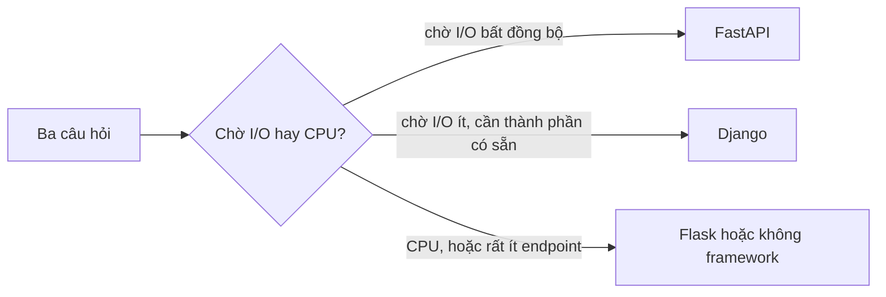

# L25: Chọn FastAPI, Django hay Flask theo ba trục: I/O, schema và thành phần có sẵn

> **Trạng thái:** bản viết lại đủ bảy bước, nằm ngoài `src/`. Chưa nối vào app, chưa đo với người đọc thứ hai.
> **Số liệu:** số request, độ trễ và mọi phần trăm trong bài là giả định của kịch bản, ghi "Giả sử" ngay chỗ dùng. Không phải benchmark, không phải mặc định của framework nào.

**Tiên quyết:** biết `def` và `async def` khác nhau ở chỗ hàm async phải có `await` mới nhường quyền; biết mỗi kết nối database là một tài nguyên có trần; biết một API cần hợp đồng để client biết gửi gì.

## Bước 1. Đoán trước

Giả sử một endpoint tra cứu đơn hàng mất 220 ms, trong đó 200 ms là chờ database. Endpoint đang viết bằng `def` và được đổi sang `async def`, nhưng driver database vẫn là bản đồng bộ. Một worker, một event loop.

Trước khi đọc tiếp, trả lời ba câu:

1. Với 1 request một lúc, endpoint nhanh hơn hay chậm hơn?
2. Với 40 request đồng thời, p99 xấp xỉ bao nhiêu?
3. Lúc đó có bao nhiêu kết nối database đang mở?

Viết đáp án ra giấy. Đáp án nằm ở cuối bước 3.

## Bước 2. Điều bạn đã biết

Bạn đã biết ba điều, và cả ba đều dùng được ngay cho quyết định chọn framework:

- `def` trong FastAPI bị đẩy sang **threadpool** (bể luồng), nên một lời gọi chặn chỉ chiếm một luồng. `async def` chạy thẳng trên **event loop** (vòng lặp sự kiện), nên một lời gọi chặn khoá cả vòng lặp.
- `Depends` giải đồ thị phụ thuộc theo từng request và dọn dẹp sau `yield`.
- Kết nối database có trần, và trần đó không tự nới theo lưu lượng.

Bài này giữ nguyên ba điều đó và thay câu hỏi. Câu hỏi không còn là "framework nào nhanh hơn" mà là ba câu bạn phải trả lời trước khi viết dòng code đầu tiên:

1. Phần lớn thời gian của request là **chờ I/O** hay **chờ CPU**?
2. **Schema** lấy từ đâu làm nguồn sự thật?
3. Thành phần nào bạn muốn **có sẵn** thay vì tự viết?

Khác biệt cần nhớ: cú pháp route của ba framework gần như giống nhau. Ba câu trên mới là thứ khác nhau, và chúng quyết định bạn sẽ phải tự viết bao nhiêu.

## Bước 3. Một ví dụ có số

Giả sử endpoint tra cứu đơn hàng chạy 220 ms, trong đó 200 ms là chờ database. Đội đổi `def` sang `async def` để tăng số request xử lý đồng thời, giữ nguyên driver đồng bộ, chạy một worker.

Trên máy dev, một request một lúc: bỏ được chi phí chuyển sang threadpool, nên nhanh hơn khoảng 10 ms. Không ai thấy vấn đề.

Trên production với 40 request đồng thời, p99 lên 6,4 giây. Con số này không đến từ database: mỗi lần `async def` gọi driver đồng bộ, event loop đứng yên đúng bằng thời gian chờ database. Bốn mươi request không chồng lên nhau, chúng xếp hàng sau nhau. Nếu mỗi request chiếm 200 ms thì 40 request tuần tự là khoảng 8 giây; p99 đo được 6,4 giây vì một phần request tới muộn hơn và hàng đợi ngắn hơn. Cùng bậc độ lớn, cùng nguyên nhân.

Số kết nối database lúc đó là **1**. Dashboard database hoàn toàn bình thường, và đó chính là tín hiệu đánh lừa: tầng dữ liệu nhàn, nên không ai nghĩ tới nó.

**Đáp án bước 1:** nhanh hơn khoảng 10 ms; p99 xấp xỉ 8 giây (đo được 6,4 giây); 1 kết nối.

## Bước 4. Cơ chế, từng bước một



1. **Trục 1 — request chờ gì.** WSGI là callable đồng bộ: một request chiếm một luồng từ đầu tới khi response xong. ASGI là coroutine với `receive` và `send`: chờ I/O không chiếm luồng. FastAPI chạy `async def` trên event loop và đẩy `def` sang threadpool. Django và Flask mặc định đi đường đồng bộ.

   Cái giá: async chỉ thắng khi phần lớn thời gian là chờ I/O **bất đồng bộ**. Với việc nặng CPU, event loop chỉ có một luồng và mọi phép tính đều chiếm nó, nên async không giúp gì mà còn làm code phức tạp hơn. Lúc đó lựa chọn đúng là nhiều worker process hoặc đẩy việc sang hàng đợi.

2. **Trục 2 — schema lấy từ đâu.** Ba nguồn sự thật khác nhau, và chọn nguồn nào là chọn cái gì được phép là "đúng":
   - **Type hint.** FastAPI dựng hợp đồng từ khai báo kiểu Python cộng Pydantic. Tài liệu FastAPI nói rõ: nó dựa trên **OpenAPI** cho việc mô tả API, kèm **JSON Schema** cho model dữ liệu, và tài liệu tương tác được sinh ra từ chính các khai báo đó. Dữ liệu được validate trước khi vào thân hàm.
   - **Model của database.** Django lấy model làm gốc; migration sinh từ chênh lệch giữa model và lịch sử migration. Tài liệu Django mô tả `makemigrations` là bước đóng gói thay đổi model thành file migration, `migrate` là bước áp chúng vào database, và coi migration như "hệ thống quản lý phiên bản cho schema database".
   - **Bạn tự chọn.** Flask không quyết định. Bạn có thể dùng dataclass, Pydantic, marshmallow, hoặc không validate gì.

   Cái giá: nguồn sự thật càng gần database thì hợp đồng API càng dễ lệch khỏi cái client cần; nguồn sự thật càng gần type hint thì bạn càng phải tự nối nó xuống database.

3. **Trục 3 — thành phần nào có sẵn.** Django đi kèm ORM, migration, admin, auth và phân quyền trong một lần cài. FastAPI đi kèm routing, validate và OpenAPI; ORM, migration, admin, auth vẫn là việc của bạn. Flask gần như chỉ có routing và một app context.

   Cái giá: mỗi thành phần có sẵn là một quan điểm. Bẻ quan điểm đó thường đắt hơn viết từ đầu, vì bạn phải hiểu cả framework lẫn chỗ mình bẻ. Ngược lại, tự ghép mọi thứ thì bộ khung tự chế luôn thiếu người bảo trì.

4. **Cái giá vận hành, tính bằng người.** Giả sử đội bạn có 3 người và một quý. Chọn Django: tuần đầu có admin cho vận hành dùng được, nhưng ba người phải đọc cùng một mô hình. Chọn FastAPI: code nhỏ, hợp đồng rõ, nhưng ba người phải tự dựng auth và migration — khoảng hai tuần công, và không ai kiểm tra chéo được vì không có chuẩn chung. Chọn Flask: tự do, nhưng mọi ranh giới do bạn đặt và người mới phải đọc toàn bộ code để hiểu.

5. **Bảng chọn, không có ô nào thắng tuyệt đối.**

   | Framework | Mô hình I/O | Nguồn schema | Có sẵn |
   |---|---|---|---|
   | Django | WSGI đồng bộ, async ở mức vỏ | Model và serializer | ORM, migration, admin, auth |
   | Flask | WSGI đồng bộ | Bạn chọn | Gần như chỉ routing |
   | FastAPI | ASGI, `async def` trên event loop | Type hint và Pydantic | Routing, validate, OpenAPI |

6. **Cách kiểm lựa chọn sau khi đã chọn.** Ba phép đo, không phải cảm nhận:
   - Tăng dần số request đồng thời và vẽ p99. Đường p99 tăng gần tuyến tính trong khi CPU thấp nghĩa là chỗ chờ đang bị chặn — thường là event loop hoặc pool.
   - Đo **event loop lag**. Lag tăng cùng lúc với lưu lượng nghĩa là có lời gọi chặn nằm trong `async def`.
   - Diff OpenAPI giữa hai bản deploy. Một trường đổi kiểu mà client không biết là lỗi hợp đồng, không phải lỗi code.

## Bước 5. Thí nghiệm nhỏ

Chạy trong thư mục `lessons/06-dao-sau/l25/`. Script có hai phần: một bảng quyết định chỉ dùng thư viện chuẩn, và một đoạn dùng `fastapi` để in OpenAPI sinh từ type hint. Đây là **bảng quyết định và một ví dụ sinh schema**, không phải benchmark: không có số đo hiệu năng nào trong output.

```
uv venv --python <đường dẫn python3> .venv
uv pip install --python .venv/Scripts/python.exe fastapi
./.venv/Scripts/python.exe framework_axes.py
```

Output dưới đây chạy với fastapi 0.162.0 và Python 3.14; tạo venv đúng ba lệnh trên cho kết quả y hệt.

```
========== A. Bảng quyết định theo ba trục ==========
Số request mỗi giây chỉ là giả định của kịch bản.

--- Đầu vào mẫu: API tra cứu cho mobile ---
  Trục 1 — request chờ gì:            io-mang
  Trục 2 — schema lấy từ đâu:         type-hint
  Trục 3 — thành phần muốn có sẵn:    không có
  Giả sử có 120 request mỗi giây.
  => Chọn: FastAPI
  Cái giá: Routing, validate và OpenAPI có sẵn; đổi lại bạn tự dựng ORM, migration, admin và auth, và tự chọn driver bất đồng bộ đúng.

--- Đầu vào mẫu: Bảng điều khiển nội bộ cho vận hành ---
  Trục 1 — request chờ gì:            io-db
  Trục 2 — schema lấy từ đâu:         db-model
  Trục 3 — thành phần muốn có sẵn:    admin, orm, migration, auth
  Giả sử có 15 request mỗi giây.
  => Chọn: Django
  Cái giá: ORM, migration, admin, auth có sẵn; đổi lại mọi thứ đi kèm một quan điểm, và bẻ quan điểm đó thường đắt hơn viết từ đầu.

--- Đầu vào mẫu: Service nhỏ nén ảnh, hai endpoint ---
  Trục 1 — request chờ gì:            cpu
  Trục 2 — schema lấy từ đâu:         tu-chon
  Trục 3 — thành phần muốn có sẵn:    không có
  Giả sử có 5 request mỗi giây.
  => Chọn: Flask
  Cái giá: Tự do tối đa, ghép thư viện theo ý; đổi lại bộ khung tự chế luôn thiếu người bảo trì và bạn tự chịu mọi ranh giới.

========== B. OpenAPI sinh từ type hint ==========
fastapi 0.162.0
Đường dẫn có trong hợp đồng: ['/orders/{order_id}']
Tham số của route, sinh từ chữ ký hàm:
  order_id   in=path   required=True schema={"type": "integer", "title": "Order Id"}
  tenant     in=query  required=True schema={"type": "string", "description": "M\u00e3 tenant, b\u1eaft bu\u1ed9c theo h\u1ee3p \u0111\u1ed3ng", "title": "Tenant"}
  chi_tiet   in=query  required=False schema={"type": "boolean", "default": false, "title": "Chi Tiet"}
Schema của response, sinh từ model Pydantic:
{
  "properties": {
    "id": {
      "type": "integer",
      "title": "Id"
    },
    "code": {
      "type": "string",
      "title": "Code"
    },
    "status": {
      "type": "string",
      "title": "Status"
    },
    "total": {
      "type": "number",
      "title": "Total"
    }
  },
  "type": "object",
  "required": [
    "id",
    "code",
    "status",
    "total"
  ],
  "title": "OrderOut"
}
Kiểu trả về khai báo trong type hint: OrderOut
Số dòng tài liệu phải viết tay: 0 (mọi thứ trên đây sinh từ khai báo type).
```

Ba chỗ đáng đọc kỹ trong output:

- **`Đường dẫn có trong hợp đồng`** là thứ client đọc được. Nó bằng đúng chuỗi trong `@app.get`, không có bước viết tay nào chen vào.
- **`tenant` là `required=True`** chỉ vì nó có `= Query(...)` không kèm giá trị mặc định. Đổi thành `tenant: str = "default"` là nó thành `required=False`. Hợp đồng đổi theo chữ ký hàm, không theo tài liệu.
- **`chi_tiet` có `"default": false`** vì kiểu là `bool` với giá trị mặc định `False`. Đây là kiểu suy luận mà bạn phải kiểm: nếu client gửi `?chi_tiet=maybe`, FastAPI trả lỗi validate trước khi thân hàm chạy.

Giới hạn của thí nghiệm: bảng quyết định là **luật do bài này đặt ra**, không phải khuyến nghị chính thức của dự án nào. Ba nhãn `io-mang`, `db-model`, `cpu` là đầu vào của bài, không phải thuật ngữ của framework. Phần B chỉ chứng minh một điều: OpenAPI sinh từ type hint. Nó không nói gì về tốc độ của ba framework.

**Tự thử:** đổi `chi_tiet: bool = False` thành `chi_tiet: bool = Query()` rồi chạy lại. `required` của tham số đó thành gì, và vì sao?

## Bước 6. Bốn câu luyện tập

Trả lời trước khi mở đáp án.

**Câu 1.** Vì sao cùng một lời gọi database, `def` không làm sập cả server còn `async def` thì có?

<details>
<summary>Đáp án</summary>

Kết luận: `def` bị đẩy sang threadpool nên một lời gọi chặn chỉ chiếm một luồng, các request khác vẫn được phục vụ. `async def` chạy trên event loop nên lời gọi chặn khoá luôn mọi request đang chờ.

Điều kiện để đúng: driver database chưa có bản bất đồng bộ và trong thân hàm không có `await` nào. Nếu driver đã là bản async thì `await` nhường quyền và kết luận đổi.

Cách kiểm: tăng số request đồng thời và đo p99 cùng CPU. p99 tăng gần tuyến tính trong khi CPU thấp và số kết nối database gần như không đổi là dấu hiệu vòng lặp bị chặn.

</details>

**Câu 2.** Schema lấy từ type hint khác schema lấy từ model ở chỗ nào, và mỗi cách có cái giá gì?

<details>
<summary>Đáp án</summary>

Kết luận: type hint đặt hợp đồng HTTP ở tầng giao diện, nên nó mô tả đúng cái client gửi và nhận, và sinh OpenAPI trực tiếp. Model đặt hợp đồng ở tầng lưu trữ, nên schema database là gốc và API là hình chiếu của nó.

Điều kiện để đúng: với FastAPI, hợp đồng chỉ đúng khi mọi route khai báo `response_model` hoặc kiểu trả về; thiếu khai báo thì OpenAPI mô tả sai. Với Django, hợp đồng chỉ đúng khi serializer được giữ đồng bộ với model.

Cách kiểm: diff OpenAPI giữa hai bản deploy, và so với schema database thật. Lệch ở đâu là chỗ nguồn sự thật chưa được nối.

</details>

**Câu 3.** Service dành 90% thời gian chờ một dịch vụ ngoài. Ba trục trả lời thế nào?

<details>
<summary>Đáp án</summary>

Kết luận: trục 1 chỉ về FastAPI, vì chờ I/O bất đồng bộ là hình dạng mà ASGI có lợi. Trục 2 và 3 vẫn phải trả lời: nếu không ai cần admin và hợp đồng API cần máy đọc được, FastAPI rẻ hơn; nếu đội vận hành cần giao diện quản trị ngay thì câu trả lời đổi.

Điều kiện để đúng: client của dịch vụ ngoài có bản async, và bạn đặt giới hạn concurrency để không dội hàng loạt request sang dịch vụ đó. Thiếu một trong hai thì async không giúp được.

Cách kiểm: p99 gần như phẳng khi tăng concurrency. Nếu p99 vẫn tăng tuyến tính thì trong đường đi còn một lời gọi chặn.

</details>

**Câu 4.** Workload là nén ảnh. Chọn gì, và vì sao không phải async?

<details>
<summary>Đáp án</summary>

Kết luận: nén ảnh là CPU-bound nên async không giúp gì — event loop chỉ có một luồng và mọi phép tính đều chiếm nó. Lựa chọn đúng là đẩy việc sang worker riêng hoặc hàng đợi, còn tầng HTTP chỉ nhận việc và trả về ngay. Framework nào cũng được, miễn là không chặn vòng lặp.

Điều kiện để đúng: thời gian xử lý tỉ lệ với lượng dữ liệu chứ không với số request đồng thời. Nếu phần lớn thời gian thật ra là chờ upload hoặc chờ lưu file thì kết luận quay lại trục 1.

Cách kiểm: CPU chạm trần cùng lúc p99 tăng, và tăng số worker process thì tổng thông lượng tăng theo. Nếu tăng worker không giúp, nút thắt không phải CPU của tiến trình.

</details>

## Bước 7. Câu neo

> Ba framework không khác nhau ở cú pháp route mà ở ba câu: chờ I/O theo mô hình nào, schema lấy từ đâu, và ai sở hữu những thành phần bạn không muốn tự viết.

## Ghi chú nguồn

<details>
<summary>Ghi chú nguồn, đọc ngày 2026-10-29</summary>

- https://fastapi.tiangolo.com/features/ — mở trong phiên. Xác nhận: FastAPI dựa trên OpenAPI cho việc mô tả API và JSON Schema cho model dữ liệu, tài liệu tương tác (Swagger UI, ReDoc) sinh từ đó; toàn bộ dựa trên khai báo kiểu chuẩn của Python qua Pydantic; có hệ thống dependency injection theo đồ thị.
- https://docs.djangoproject.com/en/5.2/topics/migrations/ — mở trong phiên. Xác nhận: `makemigrations` đóng gói thay đổi model thành file migration, `migrate` áp chúng vào database, migration được mô tả như hệ thống quản lý phiên bản cho schema; migration chạy trong một transaction trên database hỗ trợ DDL transaction.
- Script `framework_axes.py` và output ở Bước 5: chạy thật trong phiên này với fastapi 0.162.0. Bảng quyết định dùng thư viện chuẩn; phần OpenAPI dùng `app.openapi()` của FastAPI.

Chưa kiểm trong bài này: tài liệu Flask (chưa mở trang nào của Flask trong phiên, nên mọi câu về Flask ở mức hiểu biết chung); hành vi threadpool mặc định của FastAPI ở mức số đo; tài liệu Starlette về ASGI; bất kỳ benchmark nào giữa ba framework. Số request, độ trễ và p99 trong bài là kịch bản giả định.

</details>
