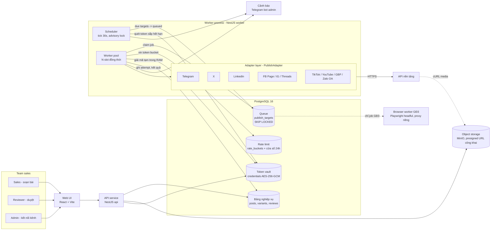
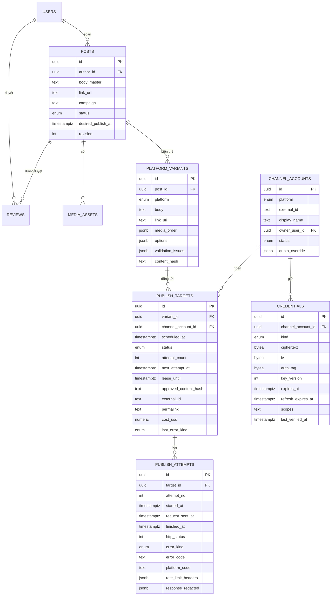
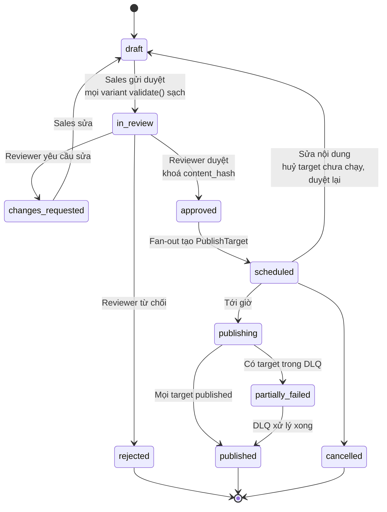

# Kiến trúc — tool đăng tin đa nền tảng tự host cho team sales

**Ngày:** 2026-10-13 · **Trạng thái:** tài liệu quyết định (giai đoạn thiết kế, chưa code) · **Đầu vào:** `RESEARCH.md` (cùng thư mục). Mọi con số về trần, giá, thời gian duyệt dưới đây lấy từ `RESEARCH.md`; con số nào là phép tính suy ra đều ghi rõ công thức. Nhận định nằm ngoài RESEARCH.md được đánh dấu `[INFERENCE]`.

---

## 1. Bài toán, định nghĩa lại cho đúng

### 1.1 Câu hỏi chưa có lời đáp

Yêu cầu gốc: *"50–70 bài/ngày lên nhiều nền tảng."* Câu này có hai cách đọc, và chúng dẫn tới hai hệ thống khác hẳn nhau:

| | Kịch bản A — **tổng** | Kịch bản B — **mỗi kênh** |
|---|---|---|
| Nghĩa | 50–70 lượt đăng/ngày cộng dồn qua mọi kênh | 50–70 lượt đăng/ngày **trên từng kênh** (tương đương: 50–70 bài gốc, mỗi bài bắn ra toàn bộ kênh) |
| Khối lượng thật | 50–70 lượt đăng/ngày | N kênh × 50–70. Với 8 kênh có API dùng được → **400–560 lượt đăng/ngày** |

**Đơn vị đo dùng trong toàn tài liệu:** 1 "bài" = 1 lần nội dung xuất hiện trên 1 tài khoản của 1 nền tảng = 1 `PublishTarget` (định nghĩa ở mục 4.3). Một bài gốc (`Post`) đăng lên 3 kênh tính là 3 bài.

### 1.2 Kịch bản B: 70 bài/ngày trên MỖI kênh

| Kênh | Trần (RESEARCH.md) | 70/ngày có vào không? | Lý do |
|---|---|---|---|
| Facebook Page | BUC `4800 × engaged users` calls/24h (100 engaged ⇒ 480.000 calls) | ✅ về kỹ thuật | Page mới (0 engaged) có thể bị throttle; Meta không công bố sàn |
| Instagram | **100/24h** bài thường · **50/24h** carousel | ⚠️ | 70 bài thường qua được; 70 carousel **vượt trần 50** |
| Threads | **250/24h** | ✅ | Text ≤500 ký tự, ≤5 link/bài |
| LinkedIn cá nhân | ~**150**/member/ngày (nguồn thứ cấp) | ✅ về kỹ thuật | 70 bài/ngày trên feed một người là spam `[INFERENCE]` |
| LinkedIn company | Dev tier **100/member/24h**, **500/app/24h** | ❌ về thời gian | Vetting **3–6 tháng**, có thể bị từ chối |
| X | **100 req/15 phút/member** ≈ 960/ngày | ✅ kỹ thuật · ❌ chi phí | 70 bài có link × $0.200 × 30 ngày = **≈$420/tháng** cho riêng X |
| TikTok | Chưa audit: DIRECT_POST công khai trả 403; MEDIA_UPLOAD **≤5 pending shares/24h** | ❌ | 70 > 5. Sau audit vẫn còn cap ẩn `spam_risk_too_many_posts` |
| Telegram | **30 msg/s** tổng · **1 msg/s/chat** · **20 msg/phút/group** | ✅ | Không có trở ngại |
| Zalo OA | **1 broadcast/ngày/người nhận** · **4 broadcast free/tháng** · **30 tin truyền thông/tháng/OA** | ❌ | 70/ngày so với trần 30/**tháng** |
| YouTube | **100 upload/ngày** | ✅ kỹ thuật | 70 video/ngày vượt xa năng lực sản xuất của một team sales `[INFERENCE]` |
| Google Business Profile | Không công bố | ⚠️ | Không chứng minh được là qua |
| Facebook Group | API **xoá 22/04/2024** | ❌ | Chỉ còn browser automation: account mới 10–15 group/ngày, account trưởng thành 35–50 group/ngày → cần **3–5 account** + proxy + chấp nhận ban |

Ngoài các bức tường theo từng nền tảng, B còn vấp hai bức tường chung:

- **Khâu duyệt nội dung.** 8 kênh × 50–70 = 400–560 biến thể phải duyệt mỗi ngày. Giả sử 1 phút/biến thể thì mất 400–560 phút = **6,7–9,3 giờ duyệt/ngày** `[INFERENCE — phép tính dựa trên giả định 1 phút]`. Đó là việc toàn thời gian của một người, chỉ để bấm duyệt.
- **Chi phí X.** Bài sales hầu như luôn có link → $0.200/bài. Ở 50–70 bài/ngày, riêng X tốn **$300–$420/tháng** (50 × 0.2 × 30 và 70 × 0.2 × 30). Mức này gấp đôi đến gấp ba Ayrshare ($149/tháng).

### 1.3 Kịch bản A: 70 bài/ngày tổng cộng

Chia mẫu cho 70 bài (lấy cận trên). Phần trăm sử dụng = số bài phân bổ / trần của kênh.

**GĐ1 (chỉ các kênh không cần duyệt app, xem mục 2):**

| Kênh | Bài/ngày | Trần | % trần | Chi phí/tháng |
|---|---|---|---|---|
| Telegram (nhiều kênh/group) | 30 | 20 msg/phút/group | ≈0% | Free |
| LinkedIn cá nhân (chia cho nhiều sales) | 25 | ~150/member | ≤17% nếu dồn hết vào 1 người | Free |
| X | 15 | ≈960/member | ≈2% | 15 × $0.200 × 30 = **$90** (có link) |
| **Tổng** | **70** | | | **≈$90** |

**GĐ2 (sau khi Meta duyệt):**

| Kênh | Bài/ngày | Trần | % trần |
|---|---|---|---|
| Facebook Page | 25 | BUC 4800 × engaged | rất thấp |
| Instagram | 10 | 100 (carousel 50) | 10% (20% nếu toàn carousel) |
| Threads | 10 | 250 | 4% |
| LinkedIn cá nhân | 10 | ~150/member | ≤7% |
| Telegram | 10 | 20/phút/group | ≈0% |
| X | 5 | ≈960/member | ≈1% · 5 × $0.200 × 30 = **$30/tháng** |
| **Tổng** | **70** | | |

Không kênh nào dùng quá 20% trần. Phần còn dư rất nhiều, nên có thể dồn thêm vào một kênh khi có chiến dịch.

### 1.4 Kết luận dứt khoát

> **Kịch bản A (tổng 50–70 bài/ngày) khả thi.** Với Telegram, LinkedIn cá nhân và X thì chạy được ngay ở GĐ1, chi phí khoảng $90/tháng. Sau khi Meta duyệt (GĐ2) thì chạy thoải mái, mọi kênh dưới 20% trần.
>
> **Kịch bản B (50–70 bài trên MỖI kênh) không khả thi.** Có 4 chỗ chặn cứng: Zalo OA (30 tin/tháng), TikTok trước audit (5/ngày), Facebook Group (không còn API) và Instagram carousel (50/ngày). Thêm vào đó là 2 chỗ chặn mềm: X tốn $300–420/tháng, và khâu duyệt cần 6–9 giờ người mỗi ngày. Nếu bỏ hết các kênh bị chặn thì vẫn đạt được "B thu hẹp", nhưng như vậy là đã bỏ đúng những kênh sales VN cần nhất (FB Group, Zalo).
>
> **Tài liệu này thiết kế cho A.** Đơn vị đếm là `PublishTarget`, và trần từng kênh nằm trong cấu hình rate limiter (mục 4.4). Hệ thống chịu tới khoảng 600 target/ngày mà không phải đổi kiến trúc. Vì vậy nếu sau này Justin muốn "B thu hẹp" thì chỉ cần sửa cấu hình, không phải viết lại.

---

## 2. Ma trận khả thi

Chi phí tính ở mức đẩy 50–70 bài/ngày **vào riêng kênh đó** (trường hợp xấu nhất). Thời gian duyệt lấy từ RESEARCH.md.

| Nền tảng | Trần/ngày | Chi phí ở 50–70 bài/ngày | Độ khó duyệt | Kết luận | GĐ |
|---|---|---|---|---|---|
| Telegram | 30 msg/s tổng; 20 msg/phút/group; 1 msg/s/chat | Free | **Không duyệt**: bot chỉ cần là admin kênh và có `can_post_messages` | **Dùng được ngay** | 1 |
| X (API v2 PPU) | 100 req/15 phút/member ≈ 960; app 10.000/24h | Bài thường $22.5–$31.5/tháng · **có link $300–$420/tháng** · +$0.005 media metadata. Tặng $20 credit + match tới $50 | **Không duyệt**, chỉ OAuth 2.0 | **Dùng được ngay** (có trần ngân sách) | 1 |
| LinkedIn cá nhân (Share on LinkedIn) | ~150/member, 100k/app (nguồn thứ cấp) | Free | **Nhẹ**: email doanh nghiệp + privacy policy, không cần screencast | **Dùng được ngay** | 1 |
| TikTok — MEDIA_UPLOAD (nháp) | ≤5 pending shares/24h; 6 req/phút/token | Free | Không cần audit; user phải mở app để hoàn tất | **Dùng được ngay**, chỉ làm kênh nháp, volume thấp | 1 |
| Facebook Page | BUC `4800 × engaged users`/24h | Free | **Nặng**: App Review `pages_manage_posts` + Business Verification + PPA nếu Page thuộc diện | **Chờ duyệt** | 2 |
| Instagram Business | **100/24h**, carousel **50/24h** | Free | **Nặng**: App Review, IG phải nối với FB Page | **Chờ duyệt** (đi cùng hồ sơ Meta) | 2 |
| Threads | **250/24h** | Free | **Trung bình**: App Review cho Threads use case (app id/secret riêng) | **Chờ duyệt** | 2 |
| YouTube | **100 upload/ngày** | Free | **Trung bình**: Google Cloud project phải verified, nếu chưa thì video bị private | **Chờ duyệt** | 2 |
| Google Business Profile | Không công bố | Free | Business phải verified | **Chờ duyệt** | 2 |
| TikTok — DIRECT_POST công khai | 6 req/phút/token + cap ẩn | Free | **Nặng**: audit "vài tuần – vài tháng", có thể bị từ chối | **Chờ duyệt** | 2 |
| Zalo OA | 1 broadcast/ngày/người; 4 free/tháng; 30 tin truyền thông/tháng | Gói Tăng trưởng **2.500.000đ/năm** (gói rẻ nhất có Broadcast) + **55đ/tin** tư vấn sau 8 tin free/48h | OA doanh nghiệp phải xác thực | **Chờ duyệt**, chỉ dùng làm kênh chăm sóc, không làm kênh volume | 2 |
| LinkedIn company page | Dev 100/member/24h, 500/app/24h; Standard không giới hạn | Không có giá công khai | **Rất nặng**: vetting 4–8 tuần nếu hồ sơ mạnh, thường 3–6 tháng, có thể bị từ chối | **Tùy chọn** | 3 |
| Facebook Group (Playwright) | Quan sát từ cộng đồng: account mới 2–3 post/giờ, 10–15 group/ngày; account trưởng thành 35–50 group/ngày | 3–5 account + proxy residential + CAPTCHA (2Captcha ~EUR 1.40/1000, CapSolver ~$1.20/1000) | Không có cổng duyệt, nhưng **vi phạm Meta ToS §3**; checkpoint không tự gỡ được | **Rủi ro cao, tùy chọn** | 3 |
| Zalo cá nhân | Không có API | — | Thư viện unofficial tự cảnh báo có thể bị khoá tài khoản | **Không dùng** | — |

### Các giai đoạn triển khai

**GĐ1 — chạy được trong 1–2 tuần, không chờ ai duyệt.**
Kênh: Telegram, X, LinkedIn cá nhân, TikTok MEDIA_UPLOAD (nháp).
Nền tảng hệ thống: API, workflow duyệt, scheduler, rate limiter, token vault, retry/DLQ.
**Ngay ngày 1, song song:** nộp mọi hồ sơ duyệt của GĐ2 (mục 5). Hồ sơ Meta cần screencast quay luồng đăng thật, nên adapter Facebook Page phải viết xong ở chế độ Development mode để có cái mà quay.

**GĐ2 — mở dần theo từng hồ sơ được duyệt.**
Thứ tự ưu tiên: Facebook Page → Instagram → Threads (cùng hệ Meta, đi chung một hồ sơ Business Verification) → YouTube → Google Business Profile → TikTok DIRECT_POST → Zalo OA.
Mỗi kênh là một adapter mới. Workflow, scheduler, rate limiter và vault giữ nguyên.

**GĐ3 — rủi ro cao, chỉ làm khi Justin chốt (mục 6).**
- Facebook Group: chạy trên một worker Playwright **tách riêng** (máy riêng, account riêng, proxy riêng).
- LinkedIn company page: theo quy trình vetting nhiều tháng.
Cả hai không chặn GĐ1 hay GĐ2.

---

## 3. Quyết định stack — có bảo vệ

### 3.1 Hiện trạng máy

Máy hiện có **Node v24.18.1 + npm 11.16.0**. **Không có Python trên PATH** (`python`/`py`/`python3` đều báo not found), cũng không có docker/redis/psql. Repo `D:/research` đang chứa tooling Node ESM.
Sự thật này **được tính** nhưng **không quyết định**: cài Python mất một buổi. Lập luận chính phải đứng vững được kể cả khi máy đã có Python.

### 3.2 So sánh

Ký hiệu: ✅ tốt · ⚠️ được nhưng có giá phải trả · ❌ yếu.

| Tiêu chí | (a) Tự viết TypeScript/Node | (b) Tự viết Python/FastAPI | (c1) Self-host Postiz (AGPL) | (c2) Mixpost Pro (MIT + $299) | (d) Mua Ayrshare |
|---|---|---|---|---|---|
| SDK chính thức Meta/LinkedIn/X | ⚠️ Cả ba đều là REST + OAuth 2.0. SDK chính thức (Meta Business SDK, client LinkedIn, SDK X) có cho cả Node lẫn Python nhưng thiên về Marketing/Ads `[INFERENCE]`; thực tế gọi `fetch` thẳng. **Tiêu chí này không phân định a và b** | ⚠️ Như (a) | ✅ Provider đã viết sẵn cho 30+ kênh | ⚠️ Pro có 11 nền tảng | ✅ 13 mạng, không phải đụng SDK |
| Hệ sinh thái queue/scheduler | ✅ BullMQ, pg-boss, Graphile Worker; thiết kế này chỉ cần PostgreSQL `SKIP LOCKED` (mục 4) | ✅ Celery, RQ, Dramatiq, procrastinate | ✅ Có sẵn | ✅ Laravel queue | ✅ Không phải lo |
| Playwright (GĐ3) | ✅ Node là bản gốc. Hệ stealth (playwright-extra, puppeteer-extra) nằm ở Node | ⚠️ Có bản Python chính thức. Camoufox thuận Python hơn `[INFERENCE]` | ❌ Không có luồng browser automation | ❌ | ❌ |
| Độ quen của Justin | ✅ React/TS ở frontend. NestJS (DI, module, decorator) rất gần **Spring Boot + Angular**. Dùng một ngôn ngữ cho cả UI và backend, chia sẻ type | ✅ **Quen nhất ở backend** (FastAPI, Django/DRF). Nhưng UI duyệt vẫn phải viết React/TS → hai ngôn ngữ | ⚠️ Monorepo TS lạ, phải đọc hiểu codebase của người khác | ❌ **PHP/Laravel + frontend Vue** `[INFERENCE: Mixpost dùng Inertia/Vue]` → Vue là một trong hai lỗ hổng | ✅ Chỉ gọi API |
| Máy hiện tại | ✅ Chạy được ngay | ⚠️ Phải cài Python trước | ⚠️ Cần Docker | ⚠️ Cần PHP + Docker | ✅ |
| Chi phí | ✅ Chỉ tốn VPS + phí X PPU | ✅ Như (a) | ✅ Self-host ~$5/tháng infra (cloud $29–39) | ✅ $299 trả một lần | ⚠️ **$149/tháng** (1 profile) · $299/tháng (10 profile). Một team nhiều Page/account nhiều khả năng cần gói 10 profile `[INFERENCE]` |
| Ai lo app review | ❌ Tự lo | ❌ Tự lo | ❌ **Vẫn tự lo**: self-host nghĩa là dùng app credentials của mình | ❌ Tự lo | ✅ **Ayrshare lo toàn bộ**, kể cả token refresh |
| Workflow duyệt cho sales | ✅ Thiết kế đúng nhu cầu | ✅ | ⚠️ Phải sửa trong codebase lạ; bản fork có sửa đổi phải theo AGPL | ⚠️ Sửa Laravel/Vue | ❌ Chỉ là API, vẫn phải tự viết UI + workflow |
| Zalo OA / FB Group / kênh VN | ✅ Viết adapter riêng | ✅ | ⚠️ Phải tự thêm provider | ⚠️ | ❌ Không có Zalo, không có FB Group |
| Thời gian tới ngày chạy (GĐ1) | **1–2 tuần** | 1–2 tuần + cài môi trường | 1–2 ngày để deploy, nhưng kênh Meta vẫn phải chờ app review như (a) | Vài ngày + học PHP/Vue | **1–3 ngày** cho kênh được hỗ trợ, nhưng UI duyệt vẫn mất 1 tuần |
| Sở hữu & rủi ro dài hạn | ✅ Sở hữu toàn bộ | ✅ | ⚠️ Phải theo kịp upstream | ⚠️ | ❌ Vendor lock-in, dữ liệu nằm ở bên thứ ba |

**Cách đọc bảng:**
- (a) và (b) gần như hoà ở SDK và queue.
- (b) thắng ở độ quen backend.
- (a) thắng ở ba điểm: **một ngôn ngữ cho cả UI duyệt lẫn backend** (UI duyệt là bắt buộc), **Playwright gốc** cho GĐ3, và **tham khảo được provider của Postiz cùng ngôn ngữ** (đọc để hiểu, không copy, để tránh dính AGPL).
- (c) và (d) không gỡ được nút thắt thật. (c) vẫn phải tự làm app review. (d) gỡ được app review nhưng không có Zalo/FB Group và vẫn phải tự viết workflow duyệt.

### 3.3 Stack cụ thể của (a)

| Lớp | Chọn | Lý do |
|---|---|---|
| Runtime | Node 24 + TypeScript (ESM) | Khớp với máy và repo hiện có |
| Backend | NestJS, chạy 2 entrypoint: `api` và `worker` từ cùng một codebase | Mô hình module/DI quen thuộc với người đã làm Spring Boot/Angular |
| DB + queue | PostgreSQL 16; bảng `publish_targets` dùng luôn làm queue (`FOR UPDATE SKIP LOCKED`); **không dùng Redis** | Ở mức vài trăm job/ngày, một Postgres là đủ. Trạng thái job và trạng thái nghiệp vụ nằm cùng một dòng, nên không có lỗi dual-write giữa DB và queue |
| ORM / migration | Drizzle | Viết gần với SQL, typed, chạy được raw SQL cho `SKIP LOCKED` |
| Validation | zod, dùng chung giữa UI và API | Một nguồn schema |
| UI | React + Vite + TS | Justin đã quen; **không dùng Vue** |
| Object storage | MinIO (S3-compatible) trong Docker Compose, có domain HTTPS công khai cho presigned URL | Instagram bắt media nằm trên public server. **Không dùng AWS** (lỗ hổng của Justin) |
| Browser (GĐ3) | Playwright `launchPersistentContext`, chạy headful + Xvfb trên worker riêng | Theo RESEARCH.md §9 |
| Triển khai | VPS + Docker Compose | Docker nằm trong vùng quen; tránh AWS |

### 3.4 Chốt

**Chọn (a) TypeScript/Node.** Lý do:
- Sản phẩm thực chất là **UI duyệt cho team sales + một worker gọi REST**. Viết cả hai bằng TypeScript thì có một ngôn ngữ, một bộ schema dùng chung, một toolchain.
- GĐ3 (Playwright) chạy trên runtime gốc của nó.
- Có thể đọc provider của Postiz cùng ngôn ngữ để tham khảo.
- NestJS chuyển được thẳng kinh nghiệm Spring Boot/Angular của Justin.
- Lợi thế "quen FastAPI hơn" của (b) không bù được việc phải duy trì hai ngôn ngữ, vì UI React/TS là bắt buộc.
- Node v24 có sẵn trên máy là điểm cộng phụ, không phải lý do chính.

Nút thắt thật là app review, và cả (a), (b), (c) đều phải tự lo phần này. Vì vậy chọn stack theo tiêu chí bảo trì 6 tháng, không theo tiêu chí ai lo hồ sơ.

**Khi nào nên đổi ý:** nếu Meta App Review bị từ chối 2 lần, hoặc kéo dài quá 8 tuần trong khi Facebook Page là trục chính, thì viết một `AyrshareAdapter` (gói $149 hoặc $299/tháng) cắm vào cùng interface `PublishAdapter` cho riêng các kênh Meta, phần còn lại giữ nguyên. Nếu người bảo trì dài hạn chỉ biết Python thì chuyển sang (b) **trước** khi bắt đầu code.

---

## 4. Kiến trúc hệ thống

### 4.1 Sơ đồ thành phần



**Ranh giới module (NestJS):**

| Module | Trách nhiệm | Không được làm |
|---|---|---|
| `content` | Post, PlatformVariant, media, gọi `validate()` của adapter | Gọi API nền tảng |
| `review` | State machine duyệt, ghi `reviews`, chặn sửa sau duyệt | Tạo job trực tiếp; chỉ phát sự kiện `approved` |
| `scheduling` | Fan-out Post đã duyệt → PublishTarget; scheduler tick; khung giờ (Zalo 6h00–19h59) | Giữ token |
| `publishing` | Worker pool, claim job, retry/DLQ, ghi PublishAttempt | Biết chi tiết từng nền tảng |
| `adapters/*` | Mỗi nền tảng một thư mục, implement `PublishAdapter` | Đụng vào DB (adapter là hàm thuần + HTTP) |
| `ratelimit` | Token bucket + sliding window, cấu hình trần | Gọi mạng |
| `vault` | Mã hoá/giải mã, refresh, health check, cảnh báo | Trả plaintext ra API |
| `accounts` | Kết nối OAuth, danh sách channel account | |

**Tại sao adapter không được đụng DB:** khi đó adapter test được bằng fixture HTTP, và việc thay một adapter (ví dụ bằng `AyrshareAdapter`) không kéo theo thay đổi ở tầng lưu trữ.

### 4.2 Adapter pattern — `PublishAdapter`

Mỗi nền tảng một implementation. Worker chỉ biết interface này.

```ts
type Platform =
  | 'telegram' | 'x' | 'linkedin_member' | 'linkedin_org'
  | 'facebook_page' | 'instagram' | 'threads'
  | 'tiktok' | 'youtube' | 'gbp' | 'zalo_oa'
  | 'facebook_group_browser';            // GĐ3, chạy ở browser worker

interface Capabilities {
  maxTextLength: number | null;          // threads: 500, telegram: 4096
  maxLinks: number | null;               // threads: 5
  imageMimeTypes: string[];              // instagram: ['image/jpeg']
  maxImages: number;                     // instagram carousel: 10, threads: 20, tiktok photo: 35
  video: { allowed: boolean; maxSeconds?: number; maxBytes?: number }; // threads ≤ 300s, telegram ≤ 50MB
  requiresPublicMediaUrl: boolean;       // instagram, threads: true
  asyncPublish: boolean;                 // instagram container, tiktok, youtube: true
  publishWindow?: { from: string; to: string; tz: 'Asia/Ho_Chi_Minh' }; // zalo_oa broadcast 06:00–19:59
  costUsd?: (v: VariantContent) => number; // x: 0.015 | 0.200 nếu có link, +0.005 nếu có media
}

interface VariantContent {
  text: string;
  link?: string;
  media: MediaRef[];                     // thứ tự đã chốt
  options: Record<string, unknown>;      // riêng từng nền tảng: privacy_level, media_type, chat_id...
}

interface MediaRef {
  assetId: string;
  publicUrl: string;                     // presigned, sống ≥ 1h
  mime: string; bytes: number; sha256: string;
  width?: number; height?: number; durationSec?: number;
}

interface PublishInput {
  targetId: string;                      // idempotency key nội bộ
  account: { id: string; externalId: string; platform: Platform };
  credential: DecryptedCredential;       // chỉ sống trong RAM của worker
  content: VariantContent;
}

type PublishResult =
  | { status: 'published'; externalId: string; permalink?: string; publishedAt: Date; costUsd?: number }
  | { status: 'pending'; checkpoint: Record<string, string>; pollAfterSec: number }; // ig container id, tiktok publish_id

type ErrorKind = 'retryable' | 'rate_limited' | 'fatal' | 'needs_human' | 'ambiguous';

class PublishError extends Error {
  kind: ErrorKind;
  code: string;                          // mã chuẩn hoá: 'AUTH_INVALID', 'LINK_LIMIT', ...
  platformCode?: string | number;        // mã gốc: 190, 'THREADS_API__LINK_LIMIT_EXCEEDED', ...
  retryAfterSec?: number;                // từ header / body của nền tảng
  requestSent: boolean;                  // false = chắc chắn chưa tới nền tảng
  raw: unknown;                          // đã lọc token
}

interface PublishAdapter {
  readonly platform: Platform;
  readonly capabilities: Capabilities;

  /** Hàm thuần, chạy lúc soạn và trước khi duyệt. Rỗng = hợp lệ. */
  validate(content: VariantContent): ValidationIssue[];

  /** Đăng. Ném PublishError, không bao giờ trả lỗi qua giá trị. */
  publish(input: PublishInput): Promise<PublishResult>;

  /** Cho nền tảng async: IG container status_code, TikTok publish status, YouTube processing. */
  poll?(input: PublishInput, checkpoint: Record<string, string>): Promise<PublishResult>;

  /** Quota phía server nếu nền tảng cho xem: IG content_publishing_limit, Threads threads_publishing_limit. */
  remoteQuota?(input: Omit<PublishInput, 'content'>): Promise<{ used: number; limit: number }>;

  /** Refresh token OAuth. Không có với Telegram bot token và Page token. */
  refresh?(cred: DecryptedCredential): Promise<RefreshedCredential>;

  /** Kiểm tra token còn sống bằng một call rẻ, chạy hằng ngày. */
  healthCheck(cred: DecryptedCredential, account: PublishInput['account']): Promise<'ok' | 'revoked'>;
}
```

Một số ràng buộc từ RESEARCH.md mà `validate()` phải chặn **trước khi duyệt**, không đợi đến lúc đăng:

| Adapter | Kiểm tra |
|---|---|
| Threads | text ≤500 ký tự; ≤5 link; video ≤5 phút; carousel 2–20 item |
| Instagram | ảnh chỉ JPEG (bước upload tự chuyển sang JPEG, tạo asset dẫn xuất); carousel ≤10 item |
| Telegram | text ≤4096; ảnh ≤10MB; video/doc ≤50MB |
| TikTok | chạy pre-flight `creator_info/query`; dùng FILE_UPLOAD chunked thay vì `PULL_FROM_URL` để khỏi phải verify domain |
| X | ước tính chi phí theo `costUsd`, hiển thị ngay khi soạn |
| Zalo OA | còn quota broadcast tháng; giờ hẹn nằm trong 6h00–19h59 |

### 4.3 Mô hình dữ liệu



| Bảng | Vai trò | Cột chính / ràng buộc |
|---|---|---|
| `users` | Người dùng nội bộ | `role ∈ {sales, reviewer, admin}` |
| `posts` | **Nội dung gốc**, đơn vị mà người duyệt duyệt | `status` (mục 4.7), `revision` tăng mỗi lần sửa |
| `media_assets` | File trên MinIO | `storage_key`, `mime`, `bytes`, `sha256`, `derived_from_id` (ví dụ bản JPEG sinh ra cho IG) |
| `platform_variants` | **Biến thể riêng từng kênh**: cắt text, đổi hashtag, chọn ảnh | `UNIQUE(post_id, platform)`, `content_hash` = hash(body, link, media, options) |
| `publish_targets` | **Job đăng**: 1 variant × 1 channel account. **Đồng thời là queue** | `UNIQUE(variant_id, channel_account_id)` (chống đăng trùng); index `(status, next_attempt_at)`; `approved_content_hash` phải bằng `content_hash` của variant thì mới được claim |
| `publish_attempts` | **Log từng lần thử**, chỉ append | `request_sent_at` (NULL = chưa gửi được request); response đã lọc token |
| `reviews` | Quyết định duyệt | `decision ∈ {approve, request_changes, reject}`, `content_hash_at_review`, `comment` |
| `channel_accounts` | Page/IG/bot/OA đã kết nối | `status ∈ {active, needs_reauth, paused, disabled}` |
| `credentials` | Token vault (mục 4.5) | `kind ∈ {page_token, oauth_user, bot_token, oauth_app, browser_profile_ref}` |
| `rate_buckets` | Token bucket (mục 4.4) | `key`, `capacity`, `refill_per_sec`, `tokens`, `updated_at` |
| `audit_log` | Ai làm gì, lúc nào | Bắt buộc với connect/disconnect kênh và approve |

**Trạng thái `publish_targets`:**

`pending_approval → scheduled → queued → publishing → (awaiting_remote →) published`

Các nhánh phụ:
- `publishing → retry_wait → queued`
- `publishing → failed` (DLQ, lỗi `fatal`)
- `publishing → needs_human` (DLQ, cần người xử lý)
- `* → cancelled`

### 4.4 Rate limiter theo từng nền tảng

Hai lớp, cùng nằm trong PostgreSQL.

1. **Token bucket**, chống burst theo giây/phút. Mỗi bucket là một dòng trong `rate_buckets`. Lấy token bằng một transaction `SELECT … FOR UPDATE`: tính số token nạp lại theo thời gian trôi qua, còn token thì trừ 1, hết thì trả về `waitSec`.
2. **Sliding window 24h** (cửa sổ 30 ngày với Zalo), chống vượt trần ngày. Đếm thẳng trên `publish_targets`: số target `published` hoặc đang `publishing/awaiting_remote` có `published_at > now() - interval '24 hours'` theo `channel_account_id`. Không cần bảng đếm riêng, nên không lệch số.

Nếu bị giới hạn, job **không bị tính là một lần thử**. Target quay về `queued` với `next_attempt_at = now() + waitSec`.

**Hệ số an toàn mặc định 0,8** (chạy ở 80% trần công bố), chỉnh được trong `channel_accounts.quota_override`:

| Nền tảng | Token bucket | Sliding window | Trần công bố → mặc định ×0,8 | Nguồn sự thật phía server |
|---|---|---|---|---|
| Telegram | Toàn bot: 30/s · mỗi chat: 1/s · mỗi group: 20/phút | — | — | `retry_after` trong lỗi 429 |
| X | Mỗi member: 100 req/15 phút | App: 10.000/24h | 10.000 → 8.000 | Header reset của X; thêm **trần ngân sách $/ngày** |
| LinkedIn cá nhân | — | Mỗi member/24h | ~150 → 120 | 429 |
| LinkedIn company (GĐ3) | — | 100/member/24h · 500/app/24h (Dev tier) | 100 → 80 · 500 → 400 | 429 |
| Facebook Page | — | Theo BUC | Không có trần cứng, phụ thuộc engaged users | Header BUC usage của Meta (`X-Business-Use-Case-Usage` `[INFERENCE: tên header]`): ≥80% thì dừng account đó tới khi phục hồi |
| Instagram | — | 100/24h (carousel 50/24h) | 100 → 80 · 50 → 40 | `GET /{ig-user-id}/content_publishing_limit` trước mỗi lần đăng |
| Threads | — | 250/24h | 250 → 200 | `GET /{threads-user-id}/threads_publishing_limit` |
| TikTok | Mỗi user token: 6 req/phút | MEDIA_UPLOAD: 5 pending/24h | 5 → 4 | `spam_risk_too_many_posts` → khoá account 24h |
| YouTube | — | 100 upload/ngày | 100 → 80 | Lỗi quota |
| Zalo OA | — | Broadcast: 1/ngày/người nhận; 4 free/tháng; 30 tin truyền thông/tháng/OA | Giữ nguyên (đã quá thấp) | Lỗi API; khung 6h00–19h59 do scheduler kiểm |
| GBP | Mặc định 1 req/giây `[INFERENCE: trần không công bố, đặt mức thận trọng]` | — | — | 429 |
| FB Group (GĐ3) | — | Account mới: 2–3/giờ, 10–15 group/ngày · trưởng thành: 35–50 group/ngày | Đặt cận dưới: 2/giờ, 10/ngày, 35/ngày | Checkpoint → `needs_human` |

**Giãn lịch:** mặc định mỗi channel account cách nhau tối thiểu một khoảng (cấu hình, mục 6), để 25 bài/ngày trên một Page không dồn vào cùng một phút. Đây là quyết định sản phẩm, không phải ràng buộc của API.

### 4.5 Token vault

| Khía cạnh | Thiết kế |
|---|---|
| Mã hoá at-rest | AES-256-GCM (`node:crypto`). KEK 32 byte đọc từ Docker secret hoặc file ngoài DB, **không bao giờ** nằm trong DB hay repo. Mỗi bản ghi có `iv` riêng, `auth_tag`, `key_version`. AAD = `credential.id ‖ channel_account_id` để không bê ciphertext từ dòng này sang dòng khác được |
| Xoay khoá | Thêm KEK mới, tăng `key_version`, chạy job re-encrypt theo lô; trong lúc chuyển thì đọc được cả hai version |
| Phạm vi plaintext | Chỉ worker giải mã, ngay trước khi gọi adapter, và xoá tham chiếu sau call. API không có endpoint trả token. Log và `publish_attempts.response_redacted` lọc mọi field `access_token`, `refresh_token`, `Authorization` |
| Refresh scheduler | Mỗi giờ quét `expires_at < now() + 20% vòng đời` (vòng đời tính từ `expires_in` lúc cấp). Mỗi credential lấy `pg_try_advisory_lock` để hai worker không refresh cùng lúc (refresh token xoay vòng sẽ hỏng nếu bị dùng hai lần) |
| Cảnh báo sắp hết hạn | `refresh_expires_at` (refresh token cũng có hạn, khi đó người phải đăng nhập lại): báo trước 7 ngày và 1 ngày qua Telegram bot admin + banner trên UI. Refresh thất bại: `channel_accounts.status = needs_reauth`, các target liên quan chuyển `needs_human`, báo ngay |
| **Page token không hết hạn** | Lấy Page token từ user token long-lived, nên `expires_at = NULL` và scheduler refresh bỏ qua. Theo RESEARCH.md token này **chết khi đổi password / revoke / gỡ app**, nên mỗi ngày chạy `healthCheck()` (một call đọc rẻ vào `/{page-id}`). Lỗi auth (Meta OAuthException code 190 `[INFERENCE: mã lỗi chuẩn của Meta]`) → `needs_reauth` + cảnh báo. Lần đăng tiếp theo không phải là lúc phát hiện token chết |
| Telegram bot token | `kind = bot_token`, không hết hạn. `healthCheck` gọi `getMe` và kiểm tra bot còn là admin có `can_post_messages` |
| Browser profile (GĐ3) | Không nằm trong DB. Thư mục profile mã hoá trên volume của browser worker; DB chỉ lưu `browser_profile_ref`. Mỗi account một folder (dùng chung folder sẽ dính Chrome lock) |

### 4.6 Retry + DLQ

**Phân loại lỗi** (adapter quy về `ErrorKind`, worker quyết định xử lý):

| Kind | Ví dụ (RESEARCH.md + chuẩn HTTP) | Xử lý | Tính là 1 lần thử? |
|---|---|---|---|
| `retryable` | 5xx, timeout **trước khi** gửi request, lỗi mạng, Meta `is_transient: true`; IG container `IN_PROGRESS` quá hạn poll | Exponential backoff | Có |
| `rate_limited` | 429 (X, LinkedIn, Telegram `retry_after`), BUC ≥ ngưỡng, IG/Threads hết quota 24h, TikTok `spam_risk_too_many_posts` | Chờ `retryAfterSec` hoặc tới khi cửa sổ mở lại | **Không** (giới hạn tổng thời gian chờ, xem dưới) |
| `fatal` | Vi phạm định dạng lọt qua `validate()`: Threads `THREADS_API__LINK_LIMIT_EXCEEDED`, IG ảnh không phải JPEG, nội dung bị nền tảng từ chối | `failed` → DLQ. Phải **sửa variant** (quay lại duyệt) | — |
| `needs_human` | Token chết (Meta code 190, 401 sau khi refresh hỏng); TikTok 403 `unaudited_client_can_only_post_to_private_accounts`; bot Telegram không còn là admin; vượt trần ngân sách X; checkpoint FB (GĐ3) | `needs_human` → DLQ + cảnh báo. Account bị `paused` để không đốt các target khác | — |
| `ambiguous` | Timeout/mất kết nối **sau khi** đã gửi request (`request_sent_at` có giá trị, không có response); lease hết hạn khi đang `publishing` | **Không tự retry**: đăng trùng tệ hơn đăng thiếu. Chuyển `needs_human` kèm link kiểm tra trên nền tảng; người bấm "Đã lên" (nhập permalink) hoặc "Đăng lại" | — |

**Backoff:** `delay = min(60s × 4^(n−1), 2h) × jitter(0,8–1,2)`, tức khoảng 1 phút → 4 phút → 16 phút → 64 phút. Hết **5 lần thử** thì chuyển `failed`.
`rate_limited` không tính vào 5 lần thử, nhưng nếu `now() > scheduled_at + stale_window` (mặc định 6 giờ) thì chuyển `needs_human` thay vì đăng muộn. Bài khuyến mãi đăng trễ một ngày có thể sai thông tin.

**Lease:** worker claim job bằng `UPDATE … SET status='publishing', lease_until=now()+5min … WHERE id IN (SELECT … FOR UPDATE SKIP LOCKED LIMIT k)`. Scheduler thu hồi lease hết hạn:
- `request_sent_at IS NULL` → trả về `queued`
- ngược lại → `ambiguous`

**DLQ không phải một queue riêng.** DLQ là tập target có `status ∈ {failed, needs_human}`, hiển thị trên UI kèm toàn bộ `publish_attempts`. Thao tác: **Sửa & gửi duyệt lại** · **Đăng lại** · **Đánh dấu đã lên** · **Huỷ**. Mỗi thao tác ghi `audit_log`.

**Async publish** (IG container, TikTok, YouTube): `publish()` trả `pending` → target chuyển `awaiting_remote` với `next_attempt_at = now() + pollAfterSec`, worker gọi `poll()`. Mỗi lần poll ghi một attempt nhưng không tính vào 5 lần thử. Poll quá 24h thì chuyển `needs_human`.

### 4.7 Quy trình duyệt nội dung



Quy tắc:

1. **Duyệt theo `Post`, nhưng khoá theo hash.** Reviewer xem mọi variant cạnh nhau, kèm bản xem trước từng kênh và chi phí X ước tính. Khi bấm duyệt, hệ thống lưu `content_hash` của từng variant vào `reviews.content_hash_at_review` và `publish_targets.approved_content_hash`.
2. **Sửa sau khi duyệt thì phải duyệt lại.** Mọi thay đổi variant làm hash lệch, worker từ chối claim, Post quay về `draft`, các target chưa chạy chuyển `cancelled`. Target đã `published` giữ nguyên.
3. **Bốn mắt:** người soạn không tự duyệt bài của mình (cấu hình được, xem mục 6).
4. **Một nguồn lịch duy nhất.** Mọi hẹn giờ do scheduler của hệ thống giữ, **không dùng** `scheduled_publish_time` của Facebook Page (dù FB hỗ trợ 10 phút → 30 ngày). Lý do: huỷ, sửa và rate limit áp dụng đồng nhất cho mọi kênh, và hệ thống không có bài "nằm sẵn" trên nền tảng mà mình không kiểm soát.
5. **Validate trước khi duyệt.** `in_review` chỉ mở khi `validate()` của mọi variant trả rỗng, nên reviewer không mất công duyệt một bài chắc chắn sẽ `fatal`.
6. **Thông báo:** bài vào `in_review` thì báo reviewer, bài vào `changes_requested` hoặc DLQ thì báo người soạn, qua Telegram bot nội bộ (kênh GĐ1 sẵn có).

---

## 5. Ước tính khối lượng & thứ tự làm

S ≈ ≤1 ngày công · M ≈ 2–4 ngày công · L ≈ ≥1 tuần công hoặc phụ thuộc thời gian chờ bên ngoài.

| # | Hạng mục | Độ phức tạp | Phụ thuộc | Ghi chú |
|---|---|---|---|---|
| 0 | **Nộp hồ sơ duyệt** (song song, ngày 1): Meta Business Verification · LinkedIn developer app (Share on LinkedIn) · Google Cloud project verification · TikTok audit · xác thực Zalo OA + mua gói Tăng trưởng (nếu chốt Zalo) · LinkedIn company vetting (nếu chốt GĐ3) | **L (thời gian chờ)** · S công sức | Domain, privacy policy, email doanh nghiệp | Đường găng thật của dự án. TikTok: vài tuần đến vài tháng. LinkedIn company: 3–6 tháng |
| 1 | Khung repo: NestJS `api` + `worker`, Drizzle, Docker Compose (Postgres, MinIO), CI | S | — | |
| 2 | Schema + migration (mục 4.3) | S | 1 | |
| 3 | Token vault: AES-GCM, KEK, redact log | M | 2 | |
| 4 | Kết nối kênh: OAuth flow chung + màn hình admin | M | 3 | Telegram dùng bot token, không cần OAuth |
| 5 | `PublishAdapter` + **Telegram adapter** | S | 2 | Adapter đơn giản nhất, dùng để chạy thông toàn luồng |
| 6 | Queue `SKIP LOCKED` + scheduler tick + lease + advisory lock | M | 2 | |
| 7 | Rate limiter (token bucket + sliding window + cấu hình mục 4.4) | M | 6 | |
| 8 | Retry/DLQ + `publish_attempts` + cảnh báo Telegram | M | 5, 6 | |
| 9 | Soạn bài + variant + media upload (MinIO, chuyển JPEG) + `validate()` | M | 2, 5 | |
| 10 | Workflow duyệt + UI React (soạn, duyệt, lịch, DLQ) | **L** | 9 | Phần code lớn nhất của GĐ1 |
| 11 | **X adapter** (OAuth 2.0, media upload, trần ngân sách) | M | 4, 7 | |
| 12 | **LinkedIn member adapter** | M | 4, 0 (duyệt nhẹ) | Pin version API theo header. Marketing v202510 sunset **2026-10-15** → build thẳng trên version hiện hành, không động tới v202510 |
| 13 | TikTok MEDIA_UPLOAD (nháp, chunked upload, `creator_info/query`) | M | 4, 7 | ≤5 pending/24h |
| — | **Hết GĐ1 (1–2 tuần, với #10 làm UI tối thiểu)** | | | |
| 14 | **Facebook Page adapter** + chạy ở Development mode để quay screencast nộp App Review | M | 4, 0 | Phải xong sớm, vì hồ sơ Meta cần video luồng thật |
| 15 | Instagram adapter (container → publish, poll `status_code`, public URL, kiểm quota) | M | 14, duyệt Meta | |
| 16 | Threads adapter (500 ký tự, ≤5 link) | S | 14, duyệt Threads | |
| 17 | Health check hằng ngày cho Page token + refresh scheduler | S | 3, 14 | |
| 18 | YouTube adapter (resumable upload) | M | Google Cloud verified | |
| 19 | GBP adapter | S | Business verified | |
| 20 | TikTok DIRECT_POST công khai | S | 13, TikTok audit | Chủ yếu là đổi `privacy_level` + xử lý lỗi |
| 21 | Zalo OA adapter (broadcast + khung giờ + quota tháng) | M | OA xác thực + gói | |
| — | **GĐ2: mở theo từng hồ sơ được duyệt** | | | |
| 22 | Browser worker Playwright cho FB Group: profile/account, proxy residential, Xvfb, checkpoint → `needs_human` | **L** | Justin chốt chấp nhận rủi ro ToS | Máy và account tách riêng |
| 23 | LinkedIn org adapter | S | Vetting xong | Code ít, chờ lâu |
| — | **GĐ3: tùy chọn** | | | |

### Phần đau nhất

**Phần đau nhất là app review và các loại xác minh, không phải code.**

- Tổng code GĐ1 + GĐ2 là loại việc S/M quen thuộc: REST, OAuth, Postgres, một UI CRUD có workflow. Một người làm được trong vài tuần.
- Đường găng nằm ở người khác: Meta (App Review + Business Verification + PPA), TikTok audit (vài tuần – vài tháng, **có thể bị từ chối**), LinkedIn company vetting (**3–6 tháng, có thể bị từ chối**), Google Cloud verification. Không dòng code nào rút ngắn được những khoảng chờ này.
- Facebook Page (trục chính của sales VN) và Instagram nằm sau đúng cánh cửa đó.
- Facebook Group (nơi sales VN đăng nhiều nhất) **không có cửa hợp pháp nào**.

Vì vậy việc số 0 trong bảng là nộp hồ sơ ngay ngày đầu, và thiết kế dồn mọi thứ không phụ thuộc duyệt vào GĐ1.

---

## 6. Rủi ro & quyết định cần Justin chốt

### 6.1 Quyết định mở

| # | Câu hỏi | Lựa chọn | Khuyến nghị |
|---|---|---|---|
| 1 | "50–70 bài/ngày" là tổng hay mỗi kênh? | A tổng · B mỗi kênh | **A.** B không khả thi (mục 1.4). Đơn vị đếm: `PublishTarget` |
| 2 | Có bắt buộc Facebook Group không? | Không · Có, chấp nhận vi phạm ToS + 3–5 account + ban | **Không** ở GĐ1–2. Nếu có thì làm GĐ3, máy/account/proxy tách riêng, không bao giờ dùng account cá nhân của sales |
| 3 | Ngân sách X mỗi tháng? | Bỏ X · Chỉ bài không link (≤$31.5) · Cho bài có link với trần | **Trần $90/tháng** (≈15 bài có link/ngày); vượt trần thì `needs_human` |
| 4 | Kênh Meta trước khi có App Review? | Chờ · Thử Development mode cho Page nội bộ · Cầu tạm `AyrshareAdapter` $149–299/tháng | **Thử Development mode ngày 1** (đăng 1 bài lên Page của công ty bằng tài khoản có role trên app `[INFERENCE: quyền dev mode áp dụng cho người có role]`). Thất bại mà sales cần Facebook ngay thì dùng Ayrshare làm cầu, tối đa tới khi hồ sơ Meta có kết quả |
| 5 | Tài khoản LinkedIn: của ai? | Mỗi sales tự kết nối feed cá nhân · Chỉ một account | **Mỗi sales tự kết nối**, có đồng ý bằng văn bản. Trần ~150 tính theo member, nên chia người là chia tải |
| 6 | Có xin LinkedIn company page không? | Không · Nộp vetting ngay | **Nộp ngay nếu cần**: chi phí nộp thấp, thời gian chờ dài (3–6 tháng) |
| 7 | Zalo OA? | Bỏ · Gói Tăng trưởng 2.500.000đ/năm cho broadcast | **Có, nhưng chỉ làm kênh chăm sóc** (≤30 tin truyền thông/tháng), không tính vào chỉ tiêu 50–70 |
| 8 | TikTok/YouTube: team có sản xuất video không? | Không · Có | **Nếu không có video thì bỏ cả hai**, khỏi mất công nộp audit. Nếu có thì TikTok bắt đầu bằng MEDIA_UPLOAD nháp |
| 9 | Quy tắc bốn mắt | Bắt buộc mọi kênh · Miễn cho kênh Telegram nội bộ | **Bắt buộc với mọi kênh công khai**; miễn cho kênh Telegram nội bộ |
| 10 | Đăng muộn có chấp nhận không? (`stale_window`) | 1h · 6h · Không giới hạn | **6h**, quá hạn thì `needs_human` |
| 11 | Khoảng cách tối thiểu giữa 2 bài trên cùng một account | 0 · 15 phút · 30 phút | **15 phút** (25 bài/Page/ngày chiếm 6 giờ: 24 khoảng × 15 phút) |
| 12 | Hosting | VPS + Docker Compose · AWS | **VPS + Docker Compose** (tránh lỗ hổng AWS). MinIO có domain HTTPS công khai cho media IG/Threads |
| 13 | Ngôn ngữ backend | TypeScript (a) · Python (b) | **TypeScript** (mục 3.4), trừ khi người bảo trì dài hạn chỉ biết Python |
| 14 | Lưu `publish_attempts` bao lâu? | 30 ngày · 180 ngày · Mãi mãi | **180 ngày**, sau đó gom thành thống kê |

### 6.2 Rủi ro đã biết

| Rủi ro | Tác động | Giảm thiểu |
|---|---|---|
| Meta từ chối hoặc kéo dài App Review | Mất trục chính FB Page + IG | Đi đường dev mode / cầu Ayrshare (quyết định 4); nộp ngày 1 |
| Page mới (0 engaged users) bị throttle BUC | FB Page đăng chậm | Theo dõi header BUC, giãn lịch, ưu tiên Page đã có tương tác |
| LinkedIn Marketing v202510 sunset 2026-10-15 | Tích hợp viết theo version cũ sẽ gãy | Pin version hiện hành ngay từ đầu; version nằm trong cấu hình |
| TikTok audit bị từ chối | Chỉ đăng được nháp | Chấp nhận MEDIA_UPLOAD lâu dài, hoặc bỏ TikTok |
| Chi phí X phình vì bài có link ($0.200, gấp 13× bài thường) | Hoá đơn tăng | Trần ngân sách cứng trong rate limiter |
| Threads ≤5 link, IG chỉ JPEG | Bài lỗi `fatal` | `validate()` chặn trước khi duyệt; tự chuyển JPEG |
| Token chết âm thầm (Page token khi đổi password) | Mất bài đã hẹn | Health check hằng ngày + cảnh báo |
| Đăng trùng do timeout sau khi gửi | Spam, mất uy tín | Kind `ambiguous` không tự retry; `UNIQUE(variant_id, channel_account_id)` |
| GĐ3 FB Group: checkpoint, ban, ToS §3 | Mất account, rủi ro pháp lý | Cô lập hoàn toàn; không bao giờ là phụ thuộc của GĐ1–2 |
| Đổi trần/giá không báo trước (ví dụ YouTube đã đổi từ ~6 lên 100 upload/ngày trong 2026) | Cấu hình lệch thực tế | Trần nằm trong cấu hình; ưu tiên endpoint quota phía server (IG, Threads) |
